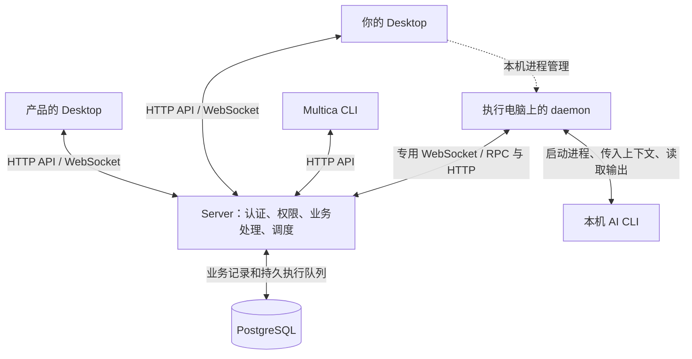

# 跨账号任务流转与共享 AI 协作：讨论记录

## 记录范围与阅读方式

- 日期：2026-10-10；最新续谈为 2026-10-17，见 §57–§61。
- Trellis 任务：`10-10-cross-workspace-collaboration`。
- 记录来源：本次会话中的需求分析、`grill-me` 逐项讨论和源码核查。
- 当前状态：本轮需求变更处于 `planning`；2026-10-13/14 已有基础实现和验证，新触发/多目标方案尚未实现。旧章节的状态只描述当时情形。
- 当前需求以 [PRD](prd.md) 为准。本文保留讨论演进、被替代的选择、架构依据和不确定项。
- 这是整理后的讨论记录：用户关键发言以引文保留，助手回复为摘要；不是包含所有工具输出和过程消息的逐字转录。
- 用户最初要求先讨论、不创建任务；最终明确要求新建 Trellis 任务并保存为 Markdown。因此此次只建立规划记录，没有开始产品实现。

## 一、原始需求

用户希望在已有个人账号的基础上，让不同岗位在自己的工作台接续处理单子：产品创建并派给开发，开发在待办中收到，可以评论、继续处理，再交给其他人或与 AI 协作。

最初描述中的关键选项：

> 再转给产品
>
> 继续和 Aiden 协同
>
> 派给其他人

用户要求分析可行性和基于当前架构的实现难度，并使用 `grill-me` 探讨需求。

### 术语纠正

用户随后问：

> Aiden是什么

助手说明：曾把原文中的 Aiden 当作某个 AI 智能体的名字，但并未确认其含义，也没有在代码核查中确认一个名为 Aiden 的内置概念。用户没有进一步确认这个专名；后续统一讨论 AI 智能体，不以 Aiden 作为产品实体、预置账号或实现依赖。

用户另问过桌面端 `demo`、CLI 与 Server 的交互。助手当时按可能指 daemon 理解，同时解释了 Desktop 与 daemon 两者；该用词未被单独确认。本文使用代码中已明确的 Desktop、daemon、Multica CLI 和底层 AI CLI。

## 二、关键问答与决策演进

### 1. 本轮先讨论，不创建任务

用户选择：

> 先分析并用 grill-me 探讨，暂不创建任务

助手保持只读源码分析，未把讨论直接转成实现。直至本轮最后用户主动要求创建 Trellis 任务。

### 2. 不强制共用工作空间

用户明确：

> 是否共用一个工作空间，不强制。大概率是每个人有每个人的工作空间 。这种情况怎么办呢？

讨论由同空间成员互派转为支持跨空间协作。保留个人工作空间，并通过账号级工作台和单据授权访问共享任务，是提出的方案方向。

需要区分：用户确认了不同工作空间；所有人连接同一套 Server 是当前分析前提，不等于用户确认了跨多个独立 Server 的互通范围。

### 3. 如何在自己的工作台看到其他空间派来的任务

用户追问：

> 比如说，不用一个工作空间，但是呢，我能看到派给我的任务，这是怎么实现的？

助手提出：工作空间记录任务归属，单据权限决定谁可以参与，个人工作台按账号汇总待办。产品创建的任务可以保留在空间 A，向你的账号共享后出现在你的工作台中；你看到同一张任务，评论与历史写回同一份记录。

这是拟新增的数据访问路径。现有系统主要依赖工作空间成员身份，不能仅添加一个前端列表就视为跨空间共享已经完成。

### 4. 明确 Desktop、CLI、daemon、Server 的分工

用户问：

> 从技术架构上去实现的话，这个桌面端 demo、CLI 以及后端的 server，这个数据是怎么交互的？

源码核查确认：Desktop 和 Multica CLI 都能直接访问 Server；daemon 负责领取 AI 执行并调用本机工具；业务任务、评论、权限、通知和执行记录以 Server 数据库为依据。人类派单无需经过接收人的 daemon。

详细交互见本文第四节。

### 5. 过程可见性从两个选项中收敛到共享过程

早期比较：

- A：默认只共享公开评论和提交结果，内部讨论留在处理人的空间。
- B：本单专属讨论和系统已记录的 AI 执行过程向参与者共享。

用户询问选择 B 的复杂度，后续共同控制 AI 的讨论在 B 的基础上继续。当前需求采用 B；A 保留在记录中作为早期比较，不是最终默认。

助手建议将共享范围限定为本单专属协作会话，而不是把个人账号全部历史聊天或整个工作空间自动公开。准确会话模型仍需技术设计。

### 6. 产品权限曾选择只评论，随后被明确替换

用户最初回答：

> 产品看到过程之后，只能评论和跟进

随后明确修改：

> 产品看到过程之后  修改为  也能直接指挥、停止正在执行的 AI

最终规则是允许获授权协作者直接指挥和停止本单 AI。早期“产品评论不能触发执行”的限制已经被替代，不应写入最终需求。

共同控制本单与调用任意私有智能体、访问整台电脑是不同的授权范围。既有私有智能体调用门禁和任务凭据范围仍需在技术设计中正确衔接。

### 7. 转交对象不限于产品，两种交接目的都需要

用户纠正：

> 这个地方转交的不一定是产品，就是转给另外一个人，转给另外一个账号，比如是测试，或者是另外的开发
>
> 可能会有需要补充信息，或者是我处理完了需要提交给他，这两种情况都有。

最终采用通用账号转交。转交可以是请接收人补充信息，也可以是把阶段结果交给对方继续处理。把任务交给测试或另一位开发不自动等于整单完成。

“当前处理人”“协作者”“处理环节”需要分开表达，不能把产品、开发、测试直接变成三种互不兼容的登录账号类型。

### 8. 忙碌时的新指令采用排队策略

用户在上述回复中选择：

> A：新指令排队，当前一轮结束后执行；需要中止时直接点“停止”。

最终不要求首版对所有 AI CLI 实现运行中实时插话。新指令进入相应 AI 会话的队列，当前一轮结束后处理；停止为独立操作。

### 9. 停止当前执行，同时挂起后续队列

用户选择：

> 停止当前执行，同时挂起后续指令，等待有人明确恢复

据此确定：排队指令保留；挂起期间新增指令继续等待；明确恢复之前不自动执行。刷新界面、重新登录或网络重连都不被视为恢复指令。

助手提出的技术要求：先阻止后续领取，再停止当前执行，避免停止期间队列抢跑；界面区分正在停止与执行端确认停止。状态及回执方案还需形成设计。

### 10. 恢复从下一条开始，不自动重做被停止的指令

用户选择：

> 从下一条排队指令开始

被停止的指令保留停止记录。恢复解除后续队列的挂起，从下一条开始；如需继续被打断的工作，应由后续显式操作表达，而不是自动复活进程或重试原指令。

### 11. 转交后原协作者保留控制权限

助手询问：开发交给测试后，是保留本单 AI 控制权，还是只保留查看和评论。

用户回答：

> 保留

因此，产品、开发、测试等已经获授权的协作者不因普通转交自动失去本单的指挥、停止和恢复权限。转交改变当前处理责任，不等于退出协作。谁能显式撤权或移除协作者尚未讨论完毕。

### 12. 转交不改变运行和队列状态

用户选择：

> 保持执行和队列的原有状态

最终规则：运行中的继续运行，挂起的仍挂起。转交不自动停止、恢复或重新启动 AI。它与前面的保留协作权限规则共同说明，负责人流转与执行生命周期应独立维护。

### 13. 授权创建 Trellis 任务并保存讨论

用户最终要求：

> 新建个trellis任务，然后请将这个讨论保留到 Markdown中

本次据此创建规划任务及本记录，不将保存文档理解为启动产品实现。

## 三、最终流程示例

### 跨账号转交

产品在空间 A 创建需求，交给使用空间 B 的开发。开发通过个人工作台处理，信息不足时交给某个账号补充，再继续开发。阶段结果交给测试，测试发现问题后可以交给另一位开发修复。

各次转交保留同一业务任务的身份、评论和交接历史；已有协作者保留权限。任务不应在每次转交时被复制为彼此竞争的多个业务事实来源。

### 指令、停止、恢复与转交

| 时刻 | 当前执行 | 后续指令 | 处理责任与协作权限 |
| --- | --- | --- | --- |
| 开发处理任务 | 指令 1 运行 | 2、3 排队 | 开发负责，产品和开发可协作 |
| 转交给测试 | 1 继续 | 2、3 保持排队 | 测试负责，产品和开发保留权限 |
| 某位协作者点击停止 | 1 收到停止请求，等待执行端确认 | 2、3 挂起 | 不因停止改变业务负责人 |
| 挂起时新增指令 4 | 不启动新执行 | 2、3、4 等待 | 有权限参与者仍可讨论 |
| 挂起时再次转交 | 保持停止状态 | 保持挂起 | 新处理人接手，旧协作者保留权限 |
| 明确恢复 | 从 2 开始 | 随后 3、4 | 1 不自动重试；控制操作留痕 |

上表描述目标行为，不是对现有版本完成情况的声明。多智能体或多个并发会话的精确停止范围仍需设计。

## 四、当前架构及拟新增交互

### 当前架构主干

- Desktop 的任务页面通过共享 API 客户端访问 Server。界面数据由 TanStack Query 缓存；工作台布局、筛选等客户端状态由 Zustand 管理。
- Desktop 管理本机 daemon 时，经 Electron IPC 到主进程，再通过 Multica CLI、本机控制接口等机制管理守护进程。
- Multica CLI 的业务命令直接访问 Server；`multica daemon start` 等命令管理守护进程。Multica CLI 与 daemon 启动的底层 AI CLI 是两个概念。
- Server 保存业务任务、评论、通知、权限及执行记录，PostgreSQL 是事实来源。工作空间通常通过数据库记录中的 `workspace_id` 区分。
- 本机代码目录和工具进程位于执行电脑；任务上下文、执行消息和结果会回传 Server，不能把本地执行理解为所有内容只存在本机。

### 当前 AI 执行链路

1. Server 将 AI 执行写入 PostgreSQL 的 `agent_task_queue`。
2. Server 通过 daemon 专用 WebSocket 发出 `task_available` 唤醒提示。
3. daemon 在能力协商支持时通过 `tasks.claim` WebSocket RPC 领取；必要时回退 HTTP。不能把当前协议描述为 WebSocket 永远只通知、HTTP 永远负责领取。
4. Server 返回上下文、智能体配置和绑定 task、agent、workspace 的任务凭据。
5. daemon 准备工作目录，调用对应 provider 的本机 AI CLI，读取流式输出。
6. daemon 当前通过 HTTP 上传执行消息和完成、失败结果；Server 入库并向有权接收事件的客户端推送。
7. AI 执行中调用 Multica CLI 时，可使用任务凭据直接向 Server 评论或更新任务，而不是所有操作都经 daemon 转发。

持久任务队列与终态回传已有可靠性机制，但不能据此保证每条中间流式消息绝不丢失。共享过程指系统实际记录的过程；完整审计级消息交付保证未在本轮确认。

### 跨空间派单的方案方向

以下是拟新增能力，不是已经存在的接口或最终表结构：

1. 产品提交带接收账号的转交请求，Server 验证其操作权限。
2. Server 协调更新当前处理人、单据授权和交接记录；通知由持久业务状态驱动。
3. 接收人的账号级工作台查询获授权且需要自己处理的任务，覆盖不同来源空间。
4. 单据详情、评论、附件、执行记录和实时订阅使用一致的授权依据。
5. 待办可在重新登录后通过查询恢复，不能只依赖一次 WebSocket 通知。

一种讨论过的实现路径是保留原任务的空间归属并增加按单授权。是否复用现有任务扩展授权、怎样建模参与关系和路由，应在 `design.md` 中决策；此处不宣称需要新增独立服务。

### 在个人空间执行并共享过程的方案方向

现有任务、智能体、运行时和任务 token 都存在工作空间边界。空间 A 的任务不能简单绕过校验直接调用空间 B 的私有智能体。

讨论提出可在空间 B 使用关联的内部任务或会话承载执行，由 Server 传递已授权的需求上下文，并将本单允许共享的过程、结果关联回空间 A 的业务任务。协作事实保持一份，执行可以有多次记录。

该关联机制仍是候选设计。共同控制需要落实资源拥有者授权、控制者身份和执行凭据归属；不得把“看得到共享任务”直接等同于可以使用原处理人的完整凭据、全部运行时或其他私有资源。

### 停止与队列挂起的方案方向

用户选择的语义要求持久队列门禁：先阻止后续任务领取，再处理当前执行停止；收到执行端回执后展示真实停止结果。明确恢复后开放后续领取，跳过已停止指令。

现有停止接口可以复用，但本轮尚未验证或实现满足全部上述语义的会话级持久挂起机制。并发领取、在途停止、终态竞争、重复请求和过期恢复指令都需要设计及验证。

## 五、源码核查依据

源码核查基于当时 `codex/projects-p1` 工作副本，HEAD 为 `cfa0254eb`，工作区同时存在其他任务的未提交改动。下列行号是核查时定位；后续以符号和实际源码为准。本轮没有启动服务或运行真实 AI，也没有通过测试证明拟新增能力已实现。

| 结论 | 代码入口 |
| --- | --- |
| 用户与空间成员关系已经分离，一个用户可加入多个空间 | [member.sql](../../../server/pkg/db/queries/member.sql#L10)、[workspace.sql](../../../server/pkg/db/queries/workspace.sql#L1) |
| 用户名密码登录已存在，设备身份与人员账号是不同模型 | [auth_password.go](../../../server/internal/handler/auth_password.go#L128)、[auth_device.go](../../../server/internal/handler/auth_device.go#L25) |
| 无邮箱账号可以通过共享邀请链接加入空间；邮件邀请不能直接视为用户名邀请 | [share_link.go](../../../server/internal/handler/share_link.go#L264)、[invitation.go](../../../server/internal/handler/invitation.go#L72) |
| 现有任务加载按任务与空间共同限定 | [handler.go：loadIssueForUser](../../../server/internal/handler/handler.go#L1102) |
| 指派成员要求属于任务空间；指派智能体还需要调用权限 | [issue.go：validateAssigneePair](../../../server/internal/handler/issue.go#L4133) |
| 我的任务已有按当前用户关系筛选的页面，但仍置于空间上下文 | [my-issues-page.tsx](../../../packages/views/my-issues/components/my-issues-page.tsx#L15)、[my-issues-view-store.ts](../../../packages/core/issues/stores/my-issues-view-store.ts) |
| 指派、评论、订阅和变更历史已有基础 | [notification_listeners.go](../../../server/cmd/server/notification_listeners.go#L688)、[subscriber_listeners.go](../../../server/cmd/server/subscriber_listeners.go#L81)、[activity_listeners.go](../../../server/cmd/server/activity_listeners.go#L114) |
| 收件箱已有跨空间未读摘要，但完整列表按空间读取 | [inbox/queries.ts](../../../packages/core/inbox/queries.ts#L5)、[inbox.sql](../../../server/pkg/db/queries/inbox.sql#L1) |
| 评论提及智能体可创建独立执行，保留人类负责人；目标仍被限定在本单空间 | [task.go：EnqueueTaskForMention](../../../server/internal/service/task.go#L1351)、[comment.go](../../../server/internal/handler/comment.go#L3164) |
| 当前普通转派或修改任务为取消状态不隐式停止正在进行的 AI 执行 | [issue.go](../../../server/internal/handler/issue.go#L4097)、[issue_reassign_no_cancel_test.go](../../../server/internal/handler/issue_reassign_no_cancel_test.go)、[issue_cancel_status_no_cancel_test.go](../../../server/internal/handler/issue_cancel_status_no_cancel_test.go) |
| Desktop 直接使用带登录和空间信息的共享 API 客户端 | [client.ts](../../../packages/core/api/client.ts#L1061)、[core-provider.tsx](../../../packages/core/platform/core-provider.tsx#L73) |
| Desktop 登录后同步本机 daemon 身份及 Server 目标，再自动启动 | [daemon-login-sync.ts](../../../apps/desktop/src/renderer/src/platform/daemon-login-sync.ts#L21) |
| 客户端实时连接当前仍依赖活动空间，已有用户范围广播基础 | [provider.tsx](../../../packages/core/realtime/provider.tsx#L79)、[realtime/hub.go](../../../server/internal/realtime/hub.go#L383) |
| 执行记录实时订阅对空间及私人会话创建者有访问门禁 | [scope_authorizer.go](../../../server/cmd/server/scope_authorizer.go#L47) |
| Multica CLI 业务命令直接调用 Server API | [cmd_issue.go](../../../server/cmd/multica/cmd_issue.go#L1463)、[cli/client.go](../../../server/internal/cli/client.go#L46) |
| daemon 领取任务采用 WebSocket RPC 优先和 HTTP 回退 | [wsrpc.go](../../../server/internal/daemon/wsrpc.go#L308)、[daemon_rpc.go](../../../server/internal/handler/daemon_rpc.go#L48) |
| AI 执行有持久队列和 task 范围凭据 | [agent.sql](../../../server/pkg/db/queries/agent.sql#L337)、[handler/daemon.go](../../../server/internal/handler/daemon.go#L1881) |
| AI provider 的统一接口提供执行、消息和结果，不代表已有通用运行中追加指令接口 | [agent.go：Backend、Session](../../../server/pkg/agent/agent.go#L17) |
| 执行消息和终态通过 daemon HTTP 客户端回传 | [daemon/client.go](../../../server/internal/daemon/client.go#L502) |
| 已有停止 API 和执行端状态观察、中止机制 | [handler/daemon.go：CancelTask](../../../server/internal/handler/daemon.go#L4991)、[daemon.go：watchTaskCancellation](../../../server/internal/daemon/daemon.go#L5040) |
| 重新运行仍需调用权限，不能仅凭任务可见性调用私有智能体 | [task_lifecycle.go](../../../server/internal/handler/task_lifecycle.go#L209) |

补充阅读：[项目架构](../../../apps/docs/content/docs/developers/architecture.zh.mdx)、[守护进程与运行时](../../../apps/docs/content/docs/daemon-runtimes.zh.mdx)、[根项目规则](../../../CLAUDE.md)。

## 六、难度判断及估算的适用范围

- 同一空间内的成员互派、评论、通知已有主要能力，基础流转难度较低。
- 各人独立空间、按单共享、账号级待办、个人运行环境关联执行，整体属于中高复杂度。
- 讨论中曾用“比 A 多约 20%～40%”粗估 B 的共享过程展示增量。该数字没有实施拆分依据，而且不包含后来扩大为跨账号共同控制及停止、挂起、恢复的完整需求；不能当作当前总工作量或排期承诺。
- 用户选择排队而非实时插话，减少了统一适配各 AI CLI 实时输入能力的范围；保留原执行状态的转交规则也与现有机制更接近。
- 主要投入预计在 Server 的授权、跨空间关联、持久队列控制与一致性；共享前端及 CLI 接入同一套服务规则；daemon 的领取、执行、回传链路可以复用，但不能预先承诺无需修改。

## 七、后续继续时的边界

下一次继续应先读取 [PRD 的开放问题](prd.md#继续规划时需要解决的问题)，再展开技术设计。不要重新询问已确认的选择，也不要恢复已经被用户替换的只评论权限或自动重试策略。

尚未确定的 API、表结构、队列粒度、资源控制授权、生命周期、客户端覆盖及正式排期，应进入后续设计和计划，不能由本记录中的示意图自动推导为已批准方案。

本次保存结果为 `prd.md` 与 `discussion.md`，并在 `implement.jsonl`、`check.jsonl` 中登记本次调研和已有权限、跨层规范。`design.md`、`implement.md` 及最终上下文清单将在继续规划时完善。任务保持 `planning`。

## 八、2026-10-12 继续规划

用户要求新建分支继续讨论。已从 `main` 的 `327a53948` 创建并切换到 `codex/cross-workspace-collaboration`，关联现有任务，保持 `planning`。

### 1. 新增协作者由发起人和当前处理人管理

本轮问题限定为：谁可以通过邀请或转交，让新账号成为本单协作者。选项为发起人和当前处理人、所有已有协作者、仅发起人。

用户确认：

> 发起人和当前处理人

已落实为 [PRD](prd.md) 的 R12、AC13 和 AC14。新增协作者权限随当前处理责任变化；发起人继续拥有这项权限。原处理人若不是发起人，不因保留本单 AI 控制权限而继续拥有新增协作者权限。

本次选择没有决定移除协作者、向已有协作者转交的操作权限，也没有授予对个人 AI 运行资源的使用权限。F01 的新增协作者授权角色已明确，资源授权与撤权政策仍需继续讨论；原需求审计保留为 2026-10-10 的历史快照。

### 2. 个人 AI 运行环境按单授权

本轮问题是：开发提供个人 AI 运行环境，产品、测试的指令也将在该环境执行时，采用按单一次授权，还是为每位新增协作者逐人授权。两种方案的授权范围均限定为本单协作会话。

用户确认：

> A：按单授权

已落实为 [PRD](prd.md) 的 R13、AC15 和 AC16。环境拥有者确认一次本单授权，覆盖当前及以后按 R12 合法加入的协作者；后续新增协作者无需逐人再次确认，授权不扩展到其他任务、私人会话或整个工作空间。

该选择确认了本单运行资源的授权来源和协作者覆盖方式，没有决定协作者移除、授权撤销、执行凭据与费用归属，以及切换运行环境的规则。F01 的剩余权限政策和 O03 的其余事项继续保留为开放问题。

### 3. 仅发起人可以移除已有协作者

本轮问题是：谁可以主动移除已有协作者，撤销其本单参与权限。选项为仅发起人，或发起人和当前处理人。

用户确认：

> 仅发起人

已落实为 [PRD](prd.md) 的 R14、AC17 和 AC18。移除权限仅属于发起人；当前处理人若不是发起人，可以按 R12 新增协作者，但不能移除已有协作者。被移除者不再拥有原协作身份及由此授予的权限，此前的按单资源授权不能代替有效协作身份。

本次选择没有决定被移除者此前提交的排队指令或运行中指令如何处置，也没有决定个人主动退出、移除当前处理人时的责任交接，以及运行环境拥有者撤销资源授权的规则。这些事项继续保留在开放问题中。

### 4. 被移除者的未执行指令自动取消

本轮问题限定为：被移除者此前提交、尚未执行的排队指令如何处理。选项为自动取消并保留记录及原因，或等待仍有权限的协作者确认接管后执行。

用户确认：

> 自动取消

已落实为 [PRD](prd.md) 的 R15、AC19 和 AC20。被移除者在本单的未执行指令自动取消，挂起队列中的指令也适用；保留指令记录、提交人及取消原因。其他有权限的协作者需要执行相同内容时，应提交新指令，不能通过恢复队列或接管操作复活原取消条目。

取消范围按指令提交者和本单确定，不因此取消其他协作者的指令。已经开始执行的指令如何处置仍待确认；本次选择也没有决定主动退出或撤回运行资源授权时是否采用相同规则。

### 5. 被移除者的运行中指令请求停止并挂起会话队列

本轮问题是：被移除者提交的指令已经运行时，是请求停止并挂起该会话队列，还是允许当前指令完成。两种选项均沿用 R15，取消其尚未执行的指令。

用户确认：

> 请求停止并挂起该会话队列

已落实为 [PRD](prd.md) 的 R16、AC21 和 AC22。移除后请求停止该指令，挂起其所在会话的后续队列；其他协作者的指令保留并等待仍有权限的人明确恢复。被移除者自己的未执行指令仍自动取消，恢复不重做已停止或已取消的指令。

停止请求受理不等于执行端已确认结束，界面和验收须保留这一差别。无关会话不因本项规则停止或挂起。本次尚未决定停止未确认时能否提前登记恢复意图，也未决定主动退出或撤回运行资源授权时的处置方式。

### 6. 停止未确认时暂不接受恢复

本轮问题是：执行端断线、尚未确认旧执行已结束时，恢复请求应被暂时拒绝，还是提前登记恢复意愿并在结束确认后自动继续。

用户确认：

> 暂不接受恢复

已落实为 [PRD](prd.md) 的 R17、AC23 和 AC24。停止未确认时拒绝恢复并提示等待原因，不保存稍后自动恢复的意愿。旧执行确认结束后，会话仍保持挂起，须由仍有权限的协作者重新明确恢复；此前被拒绝的请求不能通过重放自动生效。

结束确认的可信依据、停止与自然完成的竞态以及断线恢复机制仍需进入技术设计。本次没有改变已确认的指令顺序、取消规则或恢复后跳过已停止指令的规则。

### 7. 提供补充完成并交回动作

本轮问题是：开发把任务交给产品补充信息后，提供明确的"补充完成并交回"动作，还是继续由当前处理人持有任务并手动选择接收人再次转交。

用户确认：

> 提供“补充完成并交回”动作

已落实为 [PRD](prd.md) 的 R18、AC25 和 AC26。该动作把任务交回提出本次补充请求的账号，当前处理责任及待办随之转回；目标是本次补充请求人，不固定为整单发起人。普通评论不自动触发交回。

补充信息交回不代表整单完成，也不改变 AI 执行或队列状态。通用转交的操作权限、阶段状态及整单完成权限仍需继续明确。

### 8. 整单仅由发起人完成

本轮问题是：测试验证通过后，谁可以把整张共享任务标记为完成。选项为仅发起人，或发起人和当前处理人。

用户确认：

> 仅发起人

已落实为 [PRD](prd.md) 的 R19、AC27 和 AC28。整单完成权限属于发起人，不随普通转交转移；非发起人的当前处理人或其他协作者不能直接完成整单。阶段结果、补充完成、测试通过及 AI 执行结束均不能替代发起人的明确完成操作。

本次选择只确认整单完成的权限。最终结果如何提交给发起人、验收待办如何归属、取消及重开权限，以及完成后的 AI 执行和队列如何处置仍需继续明确。

### 9. 提交验收时将处理责任和待办转给发起人

本轮问题是：当前处理人准备好最终结果后，提交验收并转交给发起人，还是保留当前处理人并为发起人增加独立验收待办。

用户确认：

> 提交验收并转交

已落实为 [PRD](prd.md) 的 R20、AC29 和 AC30。当前处理人执行明确的"提交验收并转交"动作后，处理责任和待办一起转给整单发起人，由发起人验收并按 R19 确认完成。

提交验收不代表整单已经完成；原处理人继续保留协作权限，AI 执行和队列维持转交时的状态。验收不通过时仍可使用 R03 的通用账号转交能力继续处理，具体阶段状态、取消及重开权限与完成后的执行处置尚需明确。

### 10. 首版限定同一套 Server 部署

本轮问题是：首版是否限定所有协作者连接同一套 Multica Server，还是需要不同独立 Server 部署之间也能互相派单和协作。

用户确认：

> 同一套 Server

已落实为 [PRD](prd.md) 的 R21，并补充 AC01 的部署范围。账号和工作空间仍可各自独立，首版不包含不同独立 Server 之间的身份互信、派单、协作数据同步和执行控制。

此前讨论和需求审计中仅作为分析前提的同一 Server 条件，至此成为已确认交付边界。客户端首版覆盖范围和版本顺序仍待明确。

### 11. 首版覆盖 Web 和 Desktop

本轮问题是：首版由 Web 和 Desktop 提供完整协作功能、CLI/daemon 配套适配而 Mobile 后续支持，还是将 Mobile 一并纳入首版。

用户确认：

> Web + Desktop

已落实为 [PRD](prd.md) 的 R22、AC31 和 AC32。Web 与 Desktop 首版覆盖完整协作流程，CLI/daemon 为相关执行与控制提供配套适配，Mobile 新协作功能后续交付。服务端权限和队列规则应覆盖所有调用入口，不能由旧客户端或旧接口绕过。

O07 的部署范围和客户端覆盖范围均已收敛，分别由 R21、R22 承接，已从 PRD 开放问题表移除。具体客户端、CLI 与 daemon 的兼容验证方案仍需在技术设计和实施计划中落实。

### 12. 每张任务同时仅一个共享 AI 会话

本轮问题是：同一张任务首版采用单个共享会话、所有协作者共用一条队列，还是支持多个共享会话各自排队并行执行。

用户确认：

> 同时仅一个共享会话

已落实为 [PRD](prd.md) 的 R23、AC33 和 AC34，并更新会话术语。首版每张任务同时仅一个共享 AI 会话，所有协作者的指令统一排队；停止、挂起及恢复针对该会话，不影响其他任务，也不能通过另一客户端另开并行会话绕过挂起。

O04 的首版会话范围已由 R23 承接，从开放问题表移除。运行环境更换和会话历史的具体管理仍在相关开放问题及后续设计范围内。本次没有确定普通评论、回复或提及 AI 是否触发执行；该问题原已列入需求审计 F06，现补充为 O08 以便继续收敛。

### 13. 显式选择发给 AI 才进入指令队列

本轮问题是：默认发送普通评论、显式选择"发给 AI"才触发执行，还是回复或提及 `@AI` 即自动进入指令队列。

用户确认：

> 显式选择“发给 AI”

已落实为 [PRD](prd.md) 的 R24、AC35 和 AC36，并更新 R06 的指令入口说明。默认评论、回复 AI 或在评论中提及 `@AI` 本身均不触发执行；用户须明确选择"发给 AI"。发送前区分操作意图，发送后遵守统一排队及挂起规则。

O08 的产品交互选择已收敛并从开放问题表移除，需求审计 F06 的核心触发规则由 R24 承接。各客户端和服务端入口如何执行同一规则，以及已排队指令的持久化与状态约束，仍需在技术设计中落实。

### 14. 运行环境拥有者撤回本单授权立即生效

本轮问题是：环境拥有者撤回本单授权时，立即阻止新执行、请求停止当前执行并挂起保留队列，还是等待当前一轮结束后再撤回。

用户确认：

> 立即生效

已落实为 [PRD](prd.md) 的 R25、AC37 和 AC38。撤回后立即阻止该授权下的新执行，请求停止本单当前执行，队列挂起并保留；须确认旧执行已结束、重新取得有效授权，再由有权限的协作者明确恢复。重新授权本身不触发自动恢复。

本次撤回的是本单运行资源授权，协作者身份不因此被移除；保留队列也不同于 R15 对被移除者未执行指令的自动取消。运行环境如何更换以及执行凭据与费用归属仍需明确。

### 15. 允许按条件手动更换运行环境

本轮问题是：首版允许发起人或当前处理人在旧执行确认结束、队列已挂起、新环境拥有者授权后手动切换并明确恢复，还是固定使用原环境。

用户确认：

> 允许手动更换

已落实为 [PRD](prd.md) 的 R26、AC39 和 AC40。切换由发起人或当前处理人发起，必须满足旧执行结束确认、队列挂起和新环境拥有者的本单授权；切换本身不解除挂起，恢复仍需明确操作。

普通转交不自动更换环境，切换保留本单协作历史及原有指令状态，不重做已停止或已取消的指令。本次没有确定新环境如何获得代码、文件和未提交修改，也没有决定执行凭据与费用归属，仍在 O03 中继续收敛。

### 16. 通过 Git 或附件准备新环境

本轮问题是：切换运行环境时，通过 Git 中已提交的代码或明确交付的附件准备新环境，还是由系统自动迁移原工作目录及未提交修改。

用户确认：

> 通过 Git／附件准备

已落实为 [PRD](prd.md) 的 R27、AC41 和 AC42。首版使用 Git 或附件交接代码与工作文件，不自动搬运原环境的工作目录、未提交修改或未明确交付的本地文件，也不新增自动迁移、同步和冲突恢复流程。

新环境的文件准备与会话恢复仍是不同动作，继续遵守 R26 的权限、停止确认、挂起及明确恢复条件。O03 的代码文件准备方式已收敛，执行凭据和费用归属尚需核查现有机制后明确。

本轮随后完成[执行身份、凭据与用量的源码核查](research/runtime-identity-and-usage.md)：现有调用链保留真实指令发起人，Multica 任务令牌绑定执行和工作空间，供应商配置与平台认证分别处理。源码中的成本上报不等于协作者之间已经分摊费用。O03 已收窄为供应商账号、额度和计费方式的产品选择；该核查不是用户对新计费能力的授权。

### 17. 沿用所选运行环境的 AI 服务账号

本轮问题是：首版 AI 调用沿用所选运行环境已配置的供应商账号和额度，还是要求每位协作者使用自己的供应商账号。

用户确认：

> 沿用所选运行环境的账号

已落实为 [PRD](prd.md) 的 R28、AC43 和 AC44。AI 调用使用所选环境已配置的登录或 API 凭据及对应额度，实际指令提交者仍单独记录；普通转交或其他协作者发指令不会自动切换供应商账号。平台任务令牌与真实调用人权限边界继续保留。

O03 的资源授权、撤回、更换、文件准备及供应商账号选择均已收敛，由 R13、R25–R28 承接，从开放问题表移除。[源码核查记录](research/runtime-identity-and-usage.md)已同步这次产品选择。供应商账户的实际外部付款方仍取决于其账户和组织设置，不将指令提交者或资源拥有者字段直接解释为个人账单。

### 18. 精确查找接收账号

本轮问题是：跨空间邀请或派单时，输入完整用户名、邮箱或账号 ID 精确查找并确认接收人，还是开放同一 Server 的账号目录与模糊搜索。

用户确认：

> 精确查找

已落实为 [PRD](prd.md) 的 R29、AC45 和 AC46。首版通过完整账号标识精确定位同一 Server 中的接收人，本功能不提供全站目录或姓名模糊搜索；查找结果仅用于确认目标，不自动授权或转交，实际变更仍需符合 R12 等相应操作权限。

O01 的账号发现方式已明确，主动退出与当前处理人被移除时的交接仍待讨论。

### 19. 允许非发起人主动退出

本轮提出的 A 方案为：非发起人可以主动退出，当前处理人须先转交责任，发起人不能退出；退出后的指令沿用已确认的移除规则处理。另一方案是不提供主动退出，统一由发起人移除。

用户确认：

> 允许

已按 A 方案落实为 [PRD](prd.md) 的 R30、AC47 和 AC48，并同步 R07、R14。退出撤销本单协作权限，取消本人未执行指令；如本人指令正在运行，则请求停止并挂起会话。发起人也不能通过移除自己绕过退出限制。

O01 仍需明确发起人移除当前处理人时的责任交接。运行环境拥有者退出或被移除时，其资源授权是否同步撤回也尚未确定，保留在 O06；本次不将普通协作身份退出直接解释为资源授权撤回。

### 20. 运行环境拥有者离开时自动撤回授权

本轮问题是：运行环境拥有者退出或被移除时，自动撤回其本单资源授权，还是继续提供资源直到本人另行撤回。

用户确认：

> 自动撤回

已落实为 [PRD](prd.md) 的 R31、AC49 和 AC50，并补充 R30 的资源授权关联规则。资源拥有者离开后按 R25 立即撤回本单授权，阻止新执行，请求停止使用该环境的本单当前执行，并挂起队列；即使当前指令由其他协作者提交，也适用这一资源撤权规则。

离开者自己的未执行指令仍按 R15 取消，其他协作者的指令保留并等待有效资源授权及明确恢复。重新加入本单不自动恢复原授权。来源空间或账号删除，以及协作历史和附件的保留政策仍待明确。

### 21. 移除当前处理人后自动交回发起人

本轮问题是：发起人移除当前处理人时，任务自动交回发起人，还是必须在移除时指定另一位接收人。

用户确认：

> 自动交回发起人

已落实为 [PRD](prd.md) 的 R32、AC51 和 AC52。移除当前处理人的同时，将处理责任和待办交回发起人，发起人需要时可再转交他人；移除和回交作为同一业务操作，不留下责任悬空的结果。

移除普通协作者不因此改动当前处理人，重复或过期请求也不能覆盖后续交接。O01 的参与者增删、查找、主动退出及移除当前处理人的责任交接已收敛，从开放问题表移除。

### 22. 普通转交仅由发起人和当前处理人发起

本轮问题限定为：接收人已经是本单协作者时，谁可以发起普通转交。A 为仅发起人和当前处理人，B 为任何已有协作者。

用户确认：

> 选A

已落实为 [PRD](prd.md) 的 R33、AC53 和 AC54，并在 R03 中关联操作权限。普通转交仅由发起人和当前处理人发起；原处理人若不再担任当前处理人且不是发起人，继续保留讨论和 AI 控制权限，但不再拥有转交权限。新账号加入仍需满足 R12。

O02 的普通转交权限已收敛；阶段状态、整单取消及重开、完成后的执行处置和持续跟踪入口仍需明确。

### 23. 整单取消与重开也仅限发起人

本轮问题是：整单取消，以及重开已完成或已取消的任务，是否也只允许发起人操作。A 为仅发起人，B 为发起人和当前处理人。

用户确认：

> A

已落实为 [PRD](prd.md) 的 R34、AC55 和 AC56，并同步 R19。整单完成、取消和重开的权限均集中在发起人，不因处理责任转交而转移，也不能从 AI 控制权或资源拥有者身份推导出这些业务权限。

本次只确认整单状态操作的权限；任务完成或取消时，当前 AI 执行及剩余队列如何收尾，仍需在 O02 中明确。

### 24. 整单结束时同时结束本单 AI 工作

本轮问题是：任务完成或取消时，同时请求停止当前执行、取消剩余指令并保留历史，还是仅改变业务状态而保留 AI 和队列的原状态。A 方案要求重开任务后才能发送新指令。

用户确认：

> A  同时结束本单 AI 工作

已落实为 [PRD](prd.md) 的 R35、AC57 和 AC58，并同步 R19。完成或取消时请求停止当前执行，取消所有剩余未执行指令，历史保留；已结束任务不接受新指令或恢复。重开不自动复活旧指令，旧执行未确认结束时仍遵守 R17。

本轮另据 R02、R07 补充持续访问验收 AC59，以覆盖需求审计 F05：原处理人转出并归档通知后，仍能从个人工作台找到有权限的本单，但不再计入其当前待办。这是已有协作保留规则的必要访问结果，未决定新的页面布局。

[状态与访问核查](research/status-and-access-contracts.md)确认现有系统支持工作空间自定义状态，关闭和重开规则须按类别判断。O02 剩余为既有状态目录与交接动作的技术映射。来源空间非协作者的查看、评论权限原已在审计 F01 中提出，尚未确认，现补充为 O09。

### 25. 来源空间普通成员保留查看和普通评论

本轮问题是：来源工作空间中未加入本单的普通成员，保留查看及普通评论能力，还是必须加入本单后才能访问。A 方案保留基础访问，但不自动授予 AI 控制或管理权限。

用户确认：

> A：保留查看和普通评论

已落实为 [PRD](prd.md) 的 R36、AC60 和 AC61，并更新 AC05 的访问依据。来源空间成员身份与本单协作身份分别判断：退出或被移出协作并不撤销仍有效的空间成员权限，因此可以继续基础查看和评论，但失去原协作身份带来的 AI 控制及管理权限。

O09 已收敛并从开放问题表移除，[状态与访问核查](research/status-and-access-contracts.md)也已同步。该选择不把协作访客变成整个来源空间的成员，也不将来源空间普通成员自动加入本单协作。

### 26. 含共享任务记录的来源空间禁止直接删除

本轮问题是：来源工作空间存在共享任务记录时，首版阻止直接删除，还是允许删除空间并新增共享任务的独立归档、归属和权限处理。

用户确认：

> A

已落实为 [PRD](prd.md) 的 R37、AC62 和 AC63。只要仍有本功能的共享任务记录，就不允许直接删除来源空间，包括任务均已完成或取消的情况；不能先清理评论、附件或权限后才返回拒绝。首版不新增独立归档或迁移流程。

O06 的来源空间删除政策已收敛。账号不可用时的处理及历史保留仍需结合既有账号禁用、恢复机制核查，不将本次选择扩大为新增账号删除能力。

本轮随后核查[既有账号管理机制](research/status-and-access-contracts.md)：平台提供禁用、恢复和密码恢复，禁用保留账号记录、撤销旧凭据并写入审计。结合既定历史保留规则补充 AC64，不因协作者离开或账号禁用删除本单历史。O06 收窄为发起人被禁用时是否允许平台管理员进行有审计的业务代管。

### 27. 发起人被禁用时允许平台管理员有限代管

本轮问题是：发起人账号被禁用时，允许有相应平台权限的管理员以自身身份代为完成、取消或重开并记录原因，还是必须先恢复原账号再由发起人操作。

用户确认：

> A  允许有限代管

已落实为 [PRD](prd.md) 的 R38、AC65 和 AC66，并明确 R19、R34 的这一例外。代管仅在发起人被禁用时生效，限完成、取消和重开三类业务操作，记录原因与真实管理员，保留原发起人身份，不扩大普通协作者权限，也不绕过资源授权或队列控制规则。

O06 的产品选择已收敛并从开放问题表移除，[账号与状态核查](research/status-and-access-contracts.md)同步更新。后续保持 planning，研究 O02 的状态映射与 O05 的并发协议，形成 design.md 和 implement.md 后再进行完整规划评审。

### 28. 首版只支持新建协作任务

技术核查发现旧附件可能通过公开或已签发链接访问，旧执行也没有完整的共享队列结束证明。主会话据此询问首版仅新建协作任务，还是一并支持存量转换；推荐前者。

用户确认：

> 按推荐来

已落实为 [PRD](prd.md) 的 R39、AC67 和 AC68。首版通过明确的新建入口原子建立协作状态和受控附件范围；存量普通任务转换、公开附件迁移及旧执行接续迁移留到后续。O10 已收敛。

### 29. 技术设计与实施阶段成稿

用户进一步要求：

> 继续

主会话继续规划，形成 [design.md](design.md)、[implement.md](implement.md)，并把三路研究整合为可自动加载的 [design-contracts.md](research/design-contracts.md)。完整研究与原始讨论保留供按需核查，不全部注入超过大小预算的上下文。

设计采用唯一来源 issue、复用全局用户 assignee、独立协作执行关联、单 session FIFO、持久未结 run、supervisor 启动账本和撤权后仅收尾的窄凭据。状态映射使用来源目录；工作台使用 `/account` 和 Desktop 持久账号 tab。实施分 P0–P8，68 条 AC 均分配主验证阶段。三位原研究代理分别独立审阅授权、队列和客户端；审阅不涉及产品实现。

O11 已提出但尚未收到选项回答：creator 和 handler 都被禁用时，推荐允许管理员仅在本次 reopen 内指定已有有效协作者接手；不赋予一般转交/邀请/资源权，零有效候选则拒绝。备选为拒绝该场景的重开，等待有效授权人或独立账号恢复流程。用户本次“继续”用于继续形成规划材料，不推定为该选项回答，也不当作尚未呈现的最终规划摘要获批。

### 30. 独立审阅与技术问题收敛

三路有界静态审阅完成，原发现及复核结论保留：

- [授权审阅](research/design-review-authority.md)：A01–A05 在设计层关闭。补齐创建幂等范围/私有草稿一次绑定、业务凭据逐请求查权、人类写入白名单、认证/安装身份兼容矩阵及 grant 资源关系。
- [执行审阅](research/design-review-queue.md)：Q01–Q05 在设计层关闭。补齐无许可占位结算、跨进程 nonce burn/seal、正式 admission、维护 gate/Resume 的同事务共享锁与 epoch，以及 outcome/proof 乱序归并。
- [客户端审阅](research/design-review-client.md)：C01–C06 在设计层关闭。补齐 Web bearer 附件通道、双端新建入口、跨阶段 AC67 证据、列表键/权限重验、旧新版本 wire 分离、状态选项摘要和 Desktop 空间列表失败门禁。

具体执行边界集中在 [execution-contract.md](research/execution-contract.md)，自动上下文登记它与权限规范；主设计和实施计划自动加载，索引/超长原报告按需读。原 39 项 R 和 68 项 AC 的文本行保持不变；PRD 仅合并重复说明、更新方案/证据及开放问题。

O02 状态映射、O05 并发和终结协议已形成可实施设计并经静态复核，从 PRD 开放问题移除；相应并发/原生证明仍属于实施验收。本轮没有产品代码、迁移、服务或真实 AI 执行。O11 仍待用户选择，尚未进入最终规划摘要审批，更未授权 `task.py start`。

本轮文档验证通过：任务范围 `git diff --check`、`task.py validate`（implement/check 各 2 条真实上下文）、JSON/相对链接、R01–R39 与 AC01–AC68 完整性及每项 AC 单一主验证归属。原 107 行需求/验收文本的 SHA-256 保持 `7f91c26264448c51b90f82df03f524c594cc870eda14d80e9f44e4228c4da795`。实际调用 Codex 上下文生成器，implement/check 均为 125591 bytes，三个主文档及结尾完整加载，无截断；每个加载文件均小于 32768 bytes。以上仅为规划文档验证，不代表产品测试通过。

### 31. 允许双禁用场景重开并指定已有协作者接手

用户在本轮明确确认：

> 发起人和当前处理人都被禁用时，管理员重开任务，能否指定已有的有效协作者接手 ，请允许

O11 已收敛为 [PRD](prd.md) 的 R40、AC69 和 AC70。仅在 R38 管理域且发起人、当前处理人均被禁用时，管理员重开必须指定本单已有且有效的协作者；无人可接手则拒绝。重开、责任/待办转移、审计和通知意图原子提交，保留真实管理员、原发起人和前后处理人。目标在提交前退出、被移除或被禁用，或原账号状态/责任变化，须锁内重验并拒绝过期操作，不能只重开不接手。

管理员不因此获得一般转交、邀请、资源或本单全文读取权限；新接手人仅获得现有当前处理人权限。其他动作和非双禁用场景不得夹带接手人；已有有效处理人时普通代管重开保留责任。重开保持队列挂起，不复活账号、旧指令或 grant，不绕过旧执行结束确认。

本轮同步 design D04/D05/D09/D10、执行协议 E02、实施计划 P0/P7 和研究索引；原 R01–R39、AC01–AC68 保留，新增两项 AC 的主验证归属均为 P7。早期审阅和讨论中的 O11 未决表述保留为历史，不再代表当前决策。本次确认的是 O11 的产品规则，尚未启动产品实现。

Codex 原生独立审阅 `o11_plan_review` 对本轮增量进行了只读静态复核，未发现阻塞性矛盾；核对了双禁用/已有参与者、最小候选披露、原子重开与责任/审计/outbox、账号/参与关系竞争、过期与幂等请求以及不复活指令/grant。该复核不代表产品测试通过。

文档验证：任务范围 `git diff --check`、`task.py validate`、JSON/JSONL 与相对链接检查通过。R01–R40、AC01–AC70 连续且无重复；70 条 AC 均有唯一主验证阶段。原 107 行需求/验收文本逐行保留，SHA-256 仍为 `7f91c26264448c51b90f82df03f524c594cc870eda14d80e9f44e4228c4da795`。Codex implement/check 实际上下文完整加载、单文件及总量均在既有限额内，最终字节数见 task.json。仅执行文档检查，未运行产品 lint/typecheck/单元或端到端测试。

### 32. 最终规划摘要（等待实现批准）

- **目标与范围：** 同一 Server 内，独立账号/工作空间围绕同一业务任务派单、补充、阶段交接、验收并共享 AI 过程；Web/Desktop 完整支持，CLI/daemon 配套。个人工作台保留当前待办和参与入口，转出或归档通知不抹掉有权访问的历史。
- **协作与权限：** 仅新建协作任务；唯一来源单据、对象级权限及受控附件。发起人/当前处理人负责邀请和转交，发起人负责移除及整单生命周期；R38 有限代管与本轮 R40 双禁用重开接手是专用例外，原发起人及真实审计身份保留。来源普通成员保留查看和普通评论。
- **AI 规则：** 显式“发给 AI”进入每单唯一顺序队列；停止后挂起，旧执行确认结束并明确恢复才执行下一条，被停止或取消的指令不重做。转交不自动改变运行状态。环境按单授权、撤回立即生效，手动换环境通过 Git/附件准备并沿用所选环境供应商账号。
- **不纳入首版：** 跨 Server、Mobile 新协作界面、存量普通任务转换及公开附件迁移、运行中插话、自动搬运工作目录和来源空间删除后的独立归档；有协作记录的来源空间暂不允许删除。
- **验收与实施：** 40 项需求、70 条验收标准；按 P1 数据权限、P2 人类流转、P3 内容实时、P4 运行监督、P5 队列、P6 双端工作台、P7 有限代管、P8 集成发布实施。核心证明是跨空间隔离、双端接续、唯一 FIFO 与真实停止确认、撤权/账号变化下的并发一致性、原子接手与审计以及普通任务回归。
- **风险与产物：** 原生进程结束证明、跨空间事务和旧入口兼容仍须实施验证；无法证明旧进程结束时保持暂停，已有协作数据只能回退兼容版本。PRD、design、implement 和研究上下文已齐备，静态审阅与文档验证通过。无未决产品问题，产品实现和产品测试尚未开始。

此摘要随本轮回复呈现；后续用户明确批准按该摘要实现后，再进入执行阶段。本次 O11 确认不回填为尚未呈现摘要的批准。

### 33. grill-me 需求复核启动：标题与正文的修改权

用户要求：

> 请调用grill me  分析澄清一下需求

本轮在现有任务内进入追问式需求复核，保留已确认 R01–R40、AC01–AC70 和 O11 决定，不启动产品实现。前一轮“无未决产品问题”仅反映当时的问题清单，不能把未列明的产品行为都当成用户已接受；§32 的最终摘要待本轮访谈完成后更新。

**G01，待用户选择：协作任务创建后，谁可以修改标题和正文。** 证据：design D03 当前拒绝 title/description 等编辑，implement P1 对应默认拒绝；PRD 与此前讨论未找到用户明确接受“创建后冻结正文”的选择。既有普通任务在 `server/internal/handler/issue.go:3264–3274` 定义 title/description 更新字段，由 `UpdateIssue`（`:3760`）处理。既有可编辑能力不能替用户决定新的跨空间权限，也不能因新需求没列编辑就把不可编辑当作已确认。

场景：产品派单后发现验收条件写错，或开发需要把评论里确认的补充合并回正文；现设计只能追加评论，正文可能长期保留旧要求。

候选：A 发起人和当前处理人可改（推荐，处理责任与维护内容一致）；B 仅发起人可改（控制集中，处理人通过评论提出修改）；C 创建后均不可改（始终以原文为准，修正只追加评论）。若选择可编辑，建议保留修改记录且不改写已入队 AI 指令快照；这是待选择的方案，尚未写成已确认需求。优先级/标签、评论编辑删除及附件处置的规则后续分别检查，本题不一并推定授权。

### 34. G01 已确认；继续澄清优先级、标签与自定义属性

用户回答：

> 发起人和当前处理人

按 G01 的 A 方案落实为 R41、AC71–72：有效发起人和当前处理人可修改标题/正文并保留修改记录；转交后非发起人的原处理人不再拥有编辑权。沿用既有版本/幂等和真实身份约束，记录前后值、操作者与时间；不改写已入队 AI 指令快照，也不自动启动或恢复执行。同步 design D03/D09、implement P1/P6 与执行协议 E02/E08；普通任务现有编辑行为不变。

PRD 原已接近 32768 bytes 单文件上下文限制，完整 AC 无损移到 [acceptance.md](acceptance.md)，PRD 保留摘要和链接，两份 implement/check 清单显式加载附表。原 R01–R40 与 AC01–AC70 不改文义或编号；新 AC 的主验证归属是 P1，P6 验证 Web/Desktop 接线。此拆分不代表删除原验收要求。

**G02，待用户选择：优先级、标签和自定义属性的值由谁修改。** G01 仅回答标题/正文，尚不能据此开放其余字段。证据：design D03 原将 priority/labels/properties 全部设为不开放，PRD 与此前讨论未确定其可编辑主体；普通任务已有 priority 写入字段（`server/internal/handler/issue.go:3276`），共享详情原会读取来源标签/属性目录（`research/account-workbench-client-design.md` §2 的组件索引）。既有普通任务入口不决定外部协作者的新权限。

场景：产品空间创建任务，开发在自己的空间接手后需要标注紧急程度、现有标签或自定义属性值。推荐 A：有效发起人和当前处理人可修改本单这些值，选项仍取来源空间，不能因此管理来源空间的标签/属性定义。备选 B：仅发起人可改，统一由发起人维护；C：首版仅在创建时填写，之后只读。当前不替用户选择；评论编辑删除、附件处置等未决行为继续按访谈逐项核查。

本轮文档验证通过：原 110 行 R/AC 文本逐行保留，现有 R01–R41、AC01–AC72 连续且 AC 主验证归属唯一；相对链接、上下文清单和尺寸检查通过。Codex implement/check 各完整加载 129729 bytes，含验收附表，无截断。产品代码和产品测试未执行，G02 尚未选择。

### 35. G02 已确认；继续澄清普通评论的编辑和删除

用户对优先级、标签及自定义字段值的修改主体回答：

> 发起人和当前处理人

按 G02 的 A 方案落实为 R42、AC73：有效发起人和当前处理人可修改本单这些值，字段及选项沿用任务来源空间，不由接手人的个人空间替换；本单编辑权不开放来源空间的标签/字段定义管理。转交后非发起人的原处理人失去编辑权。同步 design D03/D09、implement P1/P6、执行协议 E02/E08 和研究索引；AC73 主验证归属 P1，P6 验证双端接线。既有 R01–R41、AC01–AC72 保留。

**G03，待用户选择：普通评论作者能否编辑或删除自己的评论。** design D03 仍暂拒绝评论编辑/删除；此前用户确认的是查看、发送普通评论及显式 AI 指令，没有确认评论修改/删除规则。现有普通任务 `server/internal/handler/comment.go:3210` 的 `UpdateComment` 允许作者或来源空间 owner/admin 编辑，且有编辑后的执行触发处理；新协作不直接沿用其管理员范围或触发行为（R24）。本问题只讨论人类普通评论，不扩展到 AI 指令、执行日志或系统审计。

场景：测试人员发出一条评论后发现结论写错，需要更正，同时讨论链应能识别发生过修改或删除。推荐 A：仍有本单评论权限的作者可编辑/删除自己的普通评论，保留编辑历史和删除标记；发起人、当前处理人不因处理责任取得改写他人评论的权力。备选 B：作者可编辑但不能删除；C：发出后不可编辑或删除，只能追加更正。选择尚未收到，不新增评论写权限；R24 的普通评论不触发 AI 及已入队指令快照不变继续成立。

本轮文档验证通过：原 113 行 R/AC 逐行保留，R01–R42、AC01–AC73 连续无重复且每项 AC 有唯一主验证归属；相对链接和上下文检查通过。Codex implement/check 各完整加载 130437 bytes，单文件均未超限，无截断；G03 待选择，未修改产品代码或运行产品测试。

### 36. G03 已确认；继续澄清删除评论后的附件处置

用户选择：

> 可修改、可删除（推荐）：保留编辑历史和删除标记，方便纠错且可追溯

已落实为 R43、AC74：仍有本单评论权限的真实作者可编辑或删除自己的人类普通评论。作者若仍为来源普通成员，可沿 R36 的有效评论权限操作自己的评论；两种访问依据都失效时不能再操作。发起人、当前处理人或管理员不因此取得改写他人评论的能力。保留评论 ID、编辑历史、删除标记和回复定位，版本/权限重验及幂等操作不允许旧编辑复活删除记录；不修改或重新安排 AI 指令、执行记录和系统审计。AC74 主验证在 P3，双端界面接线在 P6。

源码核查：`server/internal/handler/comment.go:3467` 的旧 DeleteComment 收集附件 URL 后取消触发任务、调用数据库删除，再删除 S3 对象并重派剩余输入；`server/pkg/db/queries/comment.sql:575` 是硬删除查询。新协作 R43 必须独立保留历史和删除墓碑，不能直接复用上述清理/执行副作用。

**G04，待用户选择：删除评论或从评论移除附件时，已交付附件是否继续保留及可访问。** 已确认的 R37/AC64 约束空间删除和人员离开时的历史保留，尚未回答评论作者主动删除这一场景。推荐 A：附件继续保留在本单附件/历史中，仍按本单权限访问，不随评论删除而失去已交付材料。备选 B：同时撤回该评论附件的后续访问；若附件另被引用或已有 AI 指令依赖，需进一步确定其处置，不能暗中改写既有指令快照。用户尚未选择，当前不授权永久清理附件。

上下文维护：主设计接近单文件上限，原 D01 结构图无损移至研究索引并留链接。自动上下文改为研究索引、执行协议与完整 AC，加上自动加载的 PRD/design/implement；通用安全规范改为 Server 实施/检查前必须全文读取，明确写在 P0、索引和两份清单中，不删除或降低规范要求。历史记录中的旧自动注入方式保留为当时证据。

验证通过：任务范围 `git diff --check`、`task.py validate`、相对链接、编号连续性及 AC 唯一主验证归属；原 115 行 R/AC 和原结构图逐字保留。当前 43 项 R、74 项 AC，implement/check 各完整加载 120885 bytes，单文件均在上限内，无截断。未修改产品代码或运行产品测试；G04 尚待选择。

### 37. G04 已确认；继续澄清单条排队指令取消

用户对删除评论后的附件处置选择：

> ．继续保留（推荐）

已落实为 R44、AC75：删除评论或从评论移除附件，仅移除当前评论中的展示引用；已交付文件仍保留在本单附件或历史中，以当前本单权限访问。其他评论、AI 指令对原文件版本的引用不变，不调用存储删除或将其作为无引用垃圾回收；文件留存不恢复已撤销权限、不改公开可见性。未绑定私有 draft 的清理规则保持原样。同步设计 D03/D09、实施 P3/P6 和执行协议 E08；AC75 主验证归属 P3。

**G05，待用户选择：是否提供单条等待指令取消及允许主体。** 例如指令 1 正在执行，2/3 仍在等待，3 的提交内容有误。现有 R09–R10 定义停止当前执行并挂起/恢复后续队列；R15、R35 定义移除参与者或整单结束时取消指令，尚未定义保持其他执行不变的单条主动取消。R41–R43 也禁止借编辑/删除内容改写 AI 指令，不能把这条纠错路径留给旧 API 或临时变通。

推荐 A：仍有本单协作权限的指令作者、发起人或当前处理人可单独取消仍在等待队列中的一条指令，保留原文和取消记录，不影响当前执行或其他排队项。备选 B：任何当前协作者均可取消；C：首版不支持单条取消。此问题不授予改写已入队正文或重排队列的能力；若指令已经进入当前执行，则仍按既定停止/挂起规则处理。尚未收到选择，不将推荐写成已确认产品能力。

文档维护：为避免主设计越过 32768 bytes 单文件上限，D02 原始完整内容无损移至 `research/data-contract.md`，主设计保留摘要和链接，implement/check 清单均显式加载。R/AC、数据字段、身份版本、索引和迁移规则完整保留，没有调整任何全局上下文限额。

验证通过：原 117 行 R/AC 和 D02 原文逐字保留；现有 R01–R44、AC01–AC75 连续无重复且验收主归属唯一。相对链接、`git diff --check` 与 `task.py validate` 通过，implement/check 各 4 条真实上下文，实际完整加载 123078 bytes，无单文件或总量截断。G05 待选择，未修改产品代码或运行产品测试。

### 38. G05 已确认；继续澄清新协作者加入的生效时点

用户选择：

> - A．提交者本人、发起人或当前处理人

已落实为 R45、AC76：当前有效协作者中的指令提交者、发起人或当前处理人可取消一条仍在 waiting 的指令，保留原文、原作者和实际取消人/时间；不删除历史、不改其余 FIFO 次序，不停止当前执行或恢复挂起队列。被移除/失权者不因历史作者身份获得取消权。取消不依赖有效运行资源或执行 gate，资源不可用/维护时仍可整理等待项。

等待边界沿既有 design D06、执行协议 E03：promote 将指令置为 in_flight 并占位后，即使 provider 尚未开始，也已是当前执行。R45 与 promote 共用锁；取消先提交则调度跳过，promote 先提交则返回 command_not_waiting，不把“取消排队项”升级为会停止当前执行并挂起队列的 Stop。重复幂等键保留原结果，不覆盖首次取消记录；这是对上一题“仍在等待队列”范围的落实，不新增强制停止能力。AC76 在 P5 主验证，P6 验证取消入口与状态提示。

**G06，待用户选择：尚未参与本单的新协作者是否必须先接受邀请。** 当前 design D01 明确选定新账号时同事务加入并派单；R12 确定谁能邀请，R29 的“确认接收人”是派出方确认精确目标，尚未明确接收方是否需要接受。既有参与者的普通转交规则保持原样，本题聚焦首次加入本单。

场景：发起人把任务派给尚未参与的测试同事，对方此时离线。推荐 A：有权限的人确认邀请/派单后立即加入，有派单则立即转移责任与持久待办，无需接收方点接受；运行资源仍独立按单授权。备选 B：先发待接受邀请，接收方接受后才加入；如同时派单，接受时才转移责任，之前由原处理人负责。B 需要额外处理接受前权限、拒绝/失效和重复派单，A 沿当前直接派单方案。尚未收到选择，不将任何一个分支记作用户已确认。

验证通过：原 119 行 R/AC 逐行保留；现有 R01–R45、AC01–AC76 连续无重复，每条 AC 主验证归属唯一。相对链接、`git diff --check` 和 `task.py validate` 通过，implement/check 各完整加载 126483 bytes，均无截断。G06 待选择，本轮仅修改规划文档，没有产品代码或产品测试。

### 39. G06 已确认；继续澄清非终态状态的手动修改

用户选择：

> A（推荐）：确认邀请或派单后立即加入，处理责任和待办也立即转过去。

已落实为 R46、AC77：符合 R12 的邀请或派单在服务端成功提交后直接加入，无接收方接受、拒绝或待接受状态，离线和通知未投递不延迟生效。仅邀请只进入参与列表、不改当前处理人；同时派单则责任和持久待办同事务转移。无权或目标失效时整笔不生效，幂等重放不重复加入或交接；加入不自动授权新成员的个人运行环境，原有 grant 不切换。AC77 主验证归属 P2，P6 验证双端提示与重登恢复。

记录核对：PRD R46/AC77、设计 D01/D03、实施 P2/P6 与研究索引的 R46 文本在用户回答前（10-12 20:17）已按推荐项写入，本节和 task.json 当时仍记为待选择。用户本轮选择与已写内容一致，故保留原文并补记确认；另补 E02 锁表中缺失的邀请 writer，要求锁内重验 R12 角色与目标后直接写参与/handler。该先写后确认的顺序不作为后续问题的做法。

**G07，待用户选择：非终态之间的状态由谁手动修改。** 证据：设计 D04 只定义新建、普通转交、请求补充、补充交回、提交验收、完成/取消和重开各自的状态映射，没有独立的“改状态”动作；D04 末段既提到“手工状态操作”，又要求普通状态 PATCH、批量更新、快捷键和自动化不得直接改协作单状态，主体未定。普通任务的状态写入字段在 `server/internal/handler/issue.go:3275`，不能据此推定跨空间协作者的权限。R19、R34 已限定完成、取消与重开，本题只涉及待处理、进行中、评审中、阻塞等非终态。

场景：开发接手后想把状态从“待处理”改为“进行中”；测试发现外部依赖阻塞，但不需要向某人请求补充。推荐 A：有效发起人和当前处理人可在来源空间的非终态之间手动切换，沿用 D04 的来源目录校验和 `status_options_version`，留修改记录，不改变处理人，不触发 AI，也不创建补充请求或提交验收。备选 B：仅发起人可改；C：首版不开放手动修改，状态只随流转动作变化。尚未收到选择，不将推荐写成已确认需求，也不预先写入主文档。

验证通过：R01–R46、AC01–AC77 连续无重复，每条 AC 主验证归属唯一；相对链接、JSON/JSONL、`git diff --check`（含未跟踪文件）和 `task.py validate` 通过，implement/check 各完整加载 128308 bytes，均无截断。本轮仅修改规划文档，没有产品代码或产品测试。

### 40. G07 已确认；继续澄清开始日期与截止日期

用户选择：

> A（推荐）： 发起人和当前处理人都可以手动切换，可选状态取来源空间的配置，并保留修改记录。改状态不换处理人，不触发 AI，标"阻塞"也不会自动发起补充请求，标"评审中"也不算提交验收。

已落实为 R47、AC78：有效发起人和当前处理人可在来源空间有效非终态之间手动切换状态，与 R41/R42 共用锁内角色/版本重验和修改记录，并沿用 D04 的来源目录校验与 `status_options_version`，选项变化时不静默改选。该入口不写完成/取消，不改 handler、待办或 command，不触发 AI；不创建、消费或作废补充请求，因此补充交回仍按请求保存的状态恢复；标为评审中不产生验收交接。转交后非发起人的原处理人失权。同步设计 D03/D04/D09、实施 P2/P6、执行协议 E02 和研究索引；AC78 主验证归属 P2，P6 验证双端选择器接线。原 R01–R46、AC01–AC77 保留。

上下文余量：本轮后 implement/check 各完整加载 130463 bytes，距 131072 bytes 总限额仅 609 bytes。下一次落实需求前须先无损外移或去重已自动加载的内容，不能靠截断或调高限额。

**G08，待用户选择：开始日期与截止日期由谁修改。** 证据：R41/R42 只开放标题/正文与优先级/标签/属性值，P1 对其余未确认写入暂拒绝；PRD、设计和研究均未定义协作单的日期。普通任务的写入字段在 `server/internal/handler/issue.go:3280–3281`（`start_date`、`due_date`），不能据此推定跨空间权限。项目归属、父子任务与迭代关联涉及来源空间结构，另题再问，不随本题开放。

场景：产品派单时写了截止日期，开发评估后需要顺延，或测试接手后补一个开始日期。推荐 A：有效发起人和当前处理人可修改，留修改记录，不触发 AI，转交后非发起人的原处理人失权，与 R41/R42 一致。备选 B：仅发起人可改，处理人通过评论申请；C：首版只在新建时填写，之后只读。尚未收到选择，不写入主文档。

验证通过：R01–R47、AC01–AC78 连续无重复，每条 AC 主验证归属唯一；相对链接、JSON/JSONL、`git diff --check`（含未跟踪文件）和 `task.py validate` 通过，implement/check 各完整加载 130463 bytes，均无截断。本轮仅修改规划文档，没有产品代码或产品测试。

### 41. G08 已确认；继续澄清项目归属与父任务

用户选择：

> A（推荐）： 发起人和当前处理人都能改，保留修改记录，不触发 AI。转交后原处理人如果不是发起人就不能再改，和标题、优先级这些字段的规则一样。

已落实为 R48、AC79：有效发起人和当前处理人可设置、修改或清空开始/截止日期，日期解析和清空语义沿用普通任务（`util.ParseCalendarDate`，未提交字段保持原值），与 R41/R42 共用锁内角色/版本重验和修改记录；不触发 AI、不改已入队指令快照，转交后非发起人的原处理人失权。同步设计 D03/D09、实施 P1/P6、执行协议 E02；AC79 主验证归属 P1，P6 验证双端接线。原 R01–R47、AC01–AC78 保留。

上下文维护：为给 R48 腾出自动上下文，研究索引开头 O11 与 G01–G07 的逐条确认摘要改为一条指向 PRD R40–R48、AC69–AC79、设计和本记录的说明，保留“早期研究/审阅中的相反表述以当前主文档为准”的优先级规则。被替换的原文逐字保存如下（仅相对链接按本文件位置调整），内容在主文档对应 R/AC/D 中均有完整表述：

> - O11 已于 2026-10-12 确认，见 R40/AC69–70、设计 D05：仅双禁用重开时指定已有有效协作者，无候选拒绝；不授予一般转交、邀请或资源权。早期研究/审阅中的未决表述是历史快照，以当前主文档为准。
> - G01/G02 已确认：R41/AC71–72 允许发起人和当前处理人修改标题/正文并留历史，R42/AC73 同样允许修改优先级/标签/属性值，仅用来源选项，不开放定义管理或改已入队指令。完整 AC 见 [acceptance.md](acceptance.md)，implement/check 显式加载。
> - G03/G04 已确认：R43/AC74 允许有评论权限的作者编辑/删除本人普通评论，保历史/墓碑，不改 AI/审计或重派。R44/AC75 移除评论/附件展示后仍保留本单文件及受控访问，GC 不清理已交付文件。旧字段/评论禁编建议失效。
> - G05 已确认为 R45/AC76：有效参与者中的指令作者/发起人/当前处理人可取消 waiting 项，与 promote 串行；保留原文及取消记录，不改变当前执行、顺序或挂起状态，不自动升级为 Stop。
> - G06 已确认为 R46/AC77：有权者提交邀请/派单后直接加入，无待接受阶段；仅邀请不改责任，派单同事务转移待办。离线不阻止生效，个人资源仍单独授权。
> - G07 已确认为 R47/AC78：有效发起人/当前处理人可在来源非终态间手动改状态并留记录；不改 handler/待办、不触发 AI，不建补充请求或产生验收交接。完成/取消/重开仍走 lifecycle。

腾挪后 implement/check 各完整加载 130179 bytes，余量 893 bytes；下一次落实仍须先无损外移，不调高限额。

**G09，待用户选择：协作单自身的项目归属和父任务由谁设置或修改。** 证据：R41/R42/R48 未覆盖这两个字段，P1 对其余未确认写入暂拒绝；D09 的新建接口只带来源空间、处理人和说明，因此按当前设计协作单无法归入项目或父任务。普通任务的写入字段在 `server/internal/handler/issue.go:3282–3283`（`parent_issue_id`、`project_id`）。`research/account-workbench-client-design.md:249` 已定：父子任务和项目引用各自鉴权，共享本单不共享这些节点，无权时只给不可打开的最小引用。迭代归属另有 membership 操作协议（`.trellis/spec/server/iterations.md:208–210`），另题再问；把其他任务挂到协作单下面也不在本题。

场景：产品在自己空间的项目里规划，派出的协作单需要归入该项目或某个父需求；外部开发不是来源空间成员，看不到来源的项目和任务目录。推荐 A：有效发起人和当前处理人中，当前仍是来源空间成员的人可在创建时或之后设置、修改项目和父任务，选项及校验沿用来源空间现有规则，留修改记录、不触发 AI；不是来源成员的协作者（包括外部当前处理人）不能修改，只看最小引用，不能借此浏览来源目录。备选 B：仅仍是来源成员的发起人可改；C：首版不支持，协作单不归入项目或父任务。尚未收到选择，不写入主文档。

验证通过：R01–R48、AC01–AC79 连续无重复，每条 AC 主验证归属唯一；相对链接、JSON/JSONL、`git diff --check`（含未跟踪文件）和 `task.py validate` 通过，implement/check 各完整加载 130179 bytes，均无截断。本轮仅修改规划文档，没有产品代码或产品测试。

### 42. G09 已确认；自动上下文超限待决定，继续澄清迭代归属

用户选择：

> A（推荐）： 发起人和当前处理人里，仍然是来源空间成员的人，可以在创建时或之后设置和修改项目、父任务，校验规则沿用来源空间现有的。不是来源空间成员的协作者不能改，包括外部的当前处理人，他们只能看到最小引用，没法借这个入口浏览来源空间的项目和任务列表

已落实为 R49、AC80：有效发起人和当前处理人中仍是来源空间成员者，可在创建时或之后设置、修改本单项目和父任务；锁内重验来源成员身份及角色，引用校验、锁序和 I1 事实记录沿用普通任务（`.trellis/spec/server/iterations.md:12–29` 的 P1 project 写入与引用 SHARE NOWAIT 规则），留修改记录且不触发 AI。非来源成员（含外部当前处理人）写入被拒，读取只得不可打开的最小引用，接口不返回来源项目或任务目录。同步 PRD、验收附表、设计 D03/D09（新建接口增加可选项目/父任务）、实施 P1/P6、执行协议 E02 和研究索引；AC80 主验证归属 P1，P6 验证双端选择器与新建表单。原 R01–R48、AC01–AC79 保留。

上下文维护：为腾出空间，下列规划阶段说明改写或删除，原文逐字保存于此，规则在其他主文档中仍有完整表述。

- PRD“规划产物与证据”原文：

  > O02 状态映射见[设计](design.md) D04 与[源码核查](research/status-and-access-contracts.md)；O05 并发协议见 D06–D08 和[执行协议](research/execution-contract.md)。前三路静态审阅及修订复核已完成；O11 按本轮选择收敛为 R40、AC69–70，复核状态见[讨论记录](discussion.md)。[实施计划](implement.md) 分配每项 AC，[研究索引](research/design-contracts.md)保留证据。最终摘要评审后再批准实现，产品测试尚未执行。

- 设计头部已删除行（O11 边界由 PRD R40 与设计 D05 完整表述）：

  > - O11 已确认：双禁用时允许重开并指定已有有效协作者，边界见 R40/D05。

- 实施计划“当前规划验证”原首句与末段：

  > 本轮只更新本任务规划资料，不运行迁移、启动服务或产品测试。完成文档后执行：

  > 并核对 JSON/JSONL、R/AC 完整性、相对链接、验收归属、单文件 32768 bytes 与总自动上下文 131072 bytes 限额。自动加载研究索引、数据/执行契约及验收附表；安全规范按 P0 全文必读，完整报告/审阅记录按需读。结果和访谈/审批状态记录在 task.json 与 discussion.md，不把 planning 改成已实施。

  被删除的“自动加载…按需读”由两份 jsonl 清单本身、P0 安全规范必读项及研究索引末段继续表达。

- 研究索引结构图说明原文：

  > 原 design D01 结构图移至此处，节点与连线完整保留；主设计及本索引共同加载。

**超限状态：** 腾挪后完整上下文仍为 131288 bytes，超过 131072 bytes 总限额 216 bytes。Codex hook 因此把排在最后的 `implement.md` 降级为一行索引提示（实际注入 104427 bytes），其余文件完整注入。实施未获批准，当前没有 implement/check agent 会消费该上下文，但“完整加载、无截断”的规划验证本轮未通过。继续逐句削减只能维持一轮，下一条需求仍会超限，需要用户决定结构性处理方式；此前“不调高限额”是本记录自行沿用的做法，并非用户要求。候选：调高 `.trellis/config.yaml` 的 `context_injection.max_total_bytes`（仓库级配置，影响所有任务的注入上限）；将设计 D03/D09、E02 及实施项中重复陈述的规则改为引用 R/AC 编号来去重；或接受 `implement.md` 以索引提示加载、由 agent 从磁盘读取。

**G10，待用户选择：协作单能否加入来源空间的迭代，由谁操作。** 证据：迭代归属有独立的 membership 写入协议，`PUT /issues/{id}` 仅接受 `current_iteration_id` 与 `expected_revision`，实际离开或切换须带 `iteration_reason`，不能混入普通字段（`.trellis/spec/server/iterations.md:208–210`）；周期结转由服务端负责（同文件 `:211`）；工作空间默认启用迭代（同文件 `:178–179`）。D03 的协作单通用 writer 拒绝未适配操作，故按当前设计协作单无法加入迭代。

场景：产品团队按迭代排期，需要把派出的协作单纳入本期统计。推荐 A：与 R49 一致，仍是来源成员的有效发起人或当前处理人可在创建时或之后加入、切换或移出迭代，沿用现有 membership 协议与原因要求，服务端结转照常作用；非来源成员只见最小引用。备选 B：按来源空间既有迭代规则，由有该权限的来源成员操作，不看协作角色；C：首版不支持，协作单不进入迭代。尚未收到选择，不写入主文档。

验证：R01–R49、AC01–AC80 连续无重复，每条 AC 主验证归属唯一；相对链接、JSON/JSONL、`git diff --check`（含未跟踪文件）和 `task.py validate` 通过。上下文完整加载检查未通过（见上）。本轮仅修改规划文档，没有产品代码或产品测试。

### 43. 调高上下文限额；G10 已确认；继续澄清协作单下的子任务

用户选择：

> 1，调高限额   1，A

**上下文限额：** 按选项 1，在 `.trellis/config.yaml` 启用 `context_injection` 段并设 `max_total_bytes: 196608`；`max_file_bytes`、`max_artifact_bytes` 未写入，继续使用默认 32768、65536。Claude 与 Codex 两个 hook 都经 `common.config.get_context_injection_limits` 读取该值，已确认解析结果及其他配置段不变。这是仓库级配置，位于本任务目录之外。实施计划的规划验证说明同步为 196608。§42 中为腾挪而改写的规划说明不回填，原文仍在 §42。

**G10：** 按 A 落实为 R50、AC81：有效发起人和当前处理人中仍是来源空间成员者，可在创建时或之后将本单加入、切换或移出来源迭代，沿用现有迭代归属协议（创建时 `expected_iteration_revision`，之后单独的 membership 写入、`expected_revision` 与切换/移出原因，不混入其他字段），服务端结转照常作用；留修改记录且不触发 AI。实现复用 `server/internal/iteration/membership.go:28`、`:82` 的 `PrepareMembershipChange`/`CommitMembershipChange` 借用事务。非来源成员只见最小引用，接口不返回来源迭代目录。另要求处理人为外部账号时，迭代统计、预览和历史仍可用且不泄漏其账号详情（迭代预览会读取 assignee 可用性，`.trellis/spec/server/iterations.md:201–202`）。同步 PRD、验收附表、设计 D03/D09（新增 `PUT .../iteration`）、实施 P1/P6、执行协议 E02 和研究索引；AC81 主验证归属 P1，P6 验证双端选择器与原因输入。原 R01–R49、AC01–AC80 保留。

**G11，待用户选择：能否把普通任务挂到协作单下面作为子任务。** 本题与 R49 方向相反：R49 是协作单自己的父任务，本题写入的是另一张普通任务的 `parent_issue_id`（`server/internal/handler/issue.go:3282`），当前设计没有定义。研究结论已定父子任务各自鉴权，共享本单不共享子任务（`research/account-workbench-client-design.md:249`）。

场景：产品把协作单拆成设计稿、文案等子任务，在自己空间分别跟进。推荐 A：来源空间成员按普通任务现有规则，把来源空间的普通任务挂到协作单下或移出；子任务仍是普通任务，不进入本单共享 AI 队列，不变成协作单，不对外部协作者共享；无来源权限的协作者在本单详情只见不可打开的最小引用。备选 B：只允许挂协作单（子任务也走新建协作单流程）；C：首版不允许任何任务挂到协作单下，旧入口明确拒绝。尚未收到选择，不写入主文档。

验证通过：R01–R50、AC01–AC81 连续无重复，每条 AC 主验证归属唯一；相对链接、JSON/JSONL、`git diff --check`（含未跟踪文件）和 `task.py validate` 通过；hook 读到 `max_total_bytes=196608`，implement/check 各完整加载 133136 bytes，无截断或索引降级。本轮修改规划文档与 `.trellis/config.yaml`，没有产品代码或产品测试。

### 44. G11 已确认；启动全流程查漏

用户选择：

> A

即 §43 的推荐 A。已落实为 R51、AC82：来源空间成员按普通任务现有规则，把来源空间普通任务挂到协作单下或移出。子任务仍是普通任务，其 AI 执行不进入本单共享队列、不使用本单资源授权，不变成协作单，也不改变本单参与人、处理人或协作版本；普通任务写 parent 时协作单只作引用，不进入 E02 协作锁链。外部协作者在本单详情只见不可打开的最小子任务引用，接口不返回子任务正文或来源目录；跨空间任务或无权成员挂入被拒绝，移出或删除子任务不抹本单历史。同步 PRD、验收附表、设计 D03/D09（详情的项目/父/子任务/迭代引用按查看者来源权限裁剪）、实施 P1/P6、执行协议 E02 和研究索引；AC82 主验证归属 P1，P6 验证双端子任务列表。原 R01–R50、AC01–AC81 保留。

G11 之后按 §43 所述做一次全流程查漏：由只读研究对照普通任务的真实代码路径（通知、订阅、提及、关联、搜索与列表、模板、自动化、集成、CLI 等），找出协作单仍未定义、且需要产品选择的行为。结果核对后再逐题询问，之后刷新最终规划摘要。

### 45. 全流程查漏结果；G12 通知

只读查漏已完成，未修改文件或运行命令。主要代码引用已抽查属实：inbox 按 workspace 存储且未读汇总 JOIN `member`（`server/pkg/db/queries/inbox.sql:165`，报告误记为 :149）；创建人/处理人/提及者自动订阅不查成员（`server/cmd/server/subscriber_listeners.go:46–58`）；离开空间删除订阅（`server/internal/handler/workspace_revoke.go:197`）；plugin 转发完整 issue/comment 事件（`server/internal/service/plugin_event_bridge.go:54–75`）；@all 展开为全体空间成员（`server/cmd/server/notification_listeners.go:566–570`）；评论建子任务把附件复制到 `workspaces/<ws>/source-context/`（`server/internal/handler/source_context.go:594–603`）；resolve/unresolve（`server/internal/handler/comment.go:3705`、`:3786`）；`position`/`stage` 字段（`server/internal/handler/issue.go:3279`、`:3284`）；PR 合并自动推进 done（`server/internal/handler/github.go:1671–1686`）。

需产品选择、按影响排序，依次以 G12–G18 询问：

- G12 通知：哪些事件通知谁，外部参与者在哪里看到。
- G13 来源侧机器：普通 agent（mat_）、plugin、IM 机器人能否读取或评论协作单。
- G14 外部处理人/评论者在来源列表、看板、时间线和导出中如何显示，看板拖动 assignee 列如何处理。
- G15 评论中的 @提及：可提及谁、是否通知、@all 指谁。
- G16 从协作单评论或选区创建子任务：是否允许、私有附件是否复制。
- G17 评论线程 resolve/unresolve 与表情回应由谁操作。
- G18 看板排序 `position` 与父任务下 `stage` 由谁修改。

可由现有规则推出、无需产品选择（实现时按此默认）：处理人和参与者只能是人类账号，agent/squad 不可（D01）；triage admission 新建即 `not_required`（E01）；autopilot 只同步 `origin_type=autopilot` 的任务（`server/cmd/server/autopilot_listeners.go:19`），与人类新建的协作单不交叉；关联 PR 可由来源成员进行，但合并自动推进 done 须跳过协作单（D04、R19，已补入实施 P2）；置顶按 workspace+user 存储，只有来源成员可用；协作单出现在来源空间视图中，不出现在外部账号自己的空间，外部用 `/account`（D10）；任务依赖关系、复制、模板、归档不是现行功能，移动/合并/硬删除已拒绝（D01）；child-done 唤醒跳过人类处理人的父任务（`server/internal/handler/issue_child_done.go:39`），协作单父任务不会被唤醒；参与者离开来源空间时两种访问依据分别判断（R36/D03），其名下运行资源清理按 E08 teardown；发起人离开来源空间但账号仍有效时，仍保留完成/取消/重开权，只失去 R49/R50，来源空间管理员无代管入口（R38 只覆盖账号禁用）——规则可推出但可能出乎意料，G12–G18 结束后随最终摘要提示用户确认；外部看到的标识用来源编号加空间名摘要，链接用 UUID；首版不新增人类 CLI 协作命令，现有 `multica issue` 写入按 E08 拒绝；协作单计入来源空间任务数，外部账号不占席位。未核实：Slack/飞书/钉钉/Telegram 是否把任务事件推到频道（仅核对了企业微信 inbox 推送）、提及选择器组件本身。

**G12，待用户选择：哪些事件通知谁，外部参与者在哪里看到。** 证据：设计 D09 只写“账号事件只通知工作台/权限失效”，实施 P2 只要求“通知投递意图与责任变更同事务”，没有事件与接收人清单；AC02 保证的是持久待办而不是通知。现有 inbox 按 workspace 存储，未读汇总依赖 `member` 表（见上），所以发到来源空间 inbox 的通知外部参与者永远看不到；D10 已定通知链接使用 `/account` 地址。

场景：产品派单给离线的外部开发，通知落在产品空间的 inbox，开发登录自己的空间看不到。推荐 A：为参与者提供账号级通知，固定事件清单为派单/转交、请求补充与交回、提交验收、邀请/移除、新评论、AI 执行完成/失败/停止已确认；链接指向 `/account`；通知已读/归档不改变待办或权限（AC02 不变）；未参与本单的来源成员仍按来源 inbox 现有规则。备选 B：只在工作台显示未读角标，不发通知；C：首版不发通知，只靠工作台待办。尚未收到选择，不写入主文档。

### 46. G12 已确认；继续澄清来源侧机器的读写

用户选择：

> 选A

已落实为 R52、AC83：当前有效参与者在个人工作台收到账号级通知，不依赖来源 inbox，链接指向 `/account`；事件为派单/转交、请求补充与交回、提交验收、邀请/移除、新评论、AI 完成/失败/停止已确认。推荐方案未写明接收人，落实时取可推出的默认：每个事件通知除操作者外的全部当前有效参与者；被移除者只收不含本单内容的移除通知（与 D09 失权后只保留最小自操作回执一致）。同为来源成员的参与者不在来源 inbox 重复收到；旧 subscriber/inbox 监听对参与者跳过，外部参与者不在来源空间产生订阅或 inbox 记录。已读/归档不改待办或权限，投递失败不回滚业务，重放不重复。数据契约新增 `collaboration_notification`（recipient/issue/event_seq 唯一，打开时按当前权限重验，不存正文快照）及索引；设计 D09 新增通知接口和写入规则；实施 P3 写入/去重、P6 列表与未读数。AC83 主验证归属 P6，在 P2/P3/P5 事件全部接入后按完整事件清单验收。原 R01–R51、AC01–AC82 保留。企业微信等外部推送渠道不在本题范围，归入 G13 的 IM 机器人一并处理。

**G13，待用户选择：来源空间的机器（普通 agent、plugin、IM 机器人）能否读取或评论协作单。** 证据：D03 的读/普通评论依据是“当前有效账号且来源成员或本单参与者”，D03 末段只在人类确认入口拒绝任务凭据；研究索引“数据与权限”第 5 条记录普通 mat_ 会继承 owner 的空间能力，绑定 workspace 不等于绑定单据（`server/internal/handler/daemon.go:1906`、`server/internal/middleware/workspace.go:228`）。E08 的 Plugin 行只约束入站动作；出站的 plugin 事件桥转发完整 issue/comment 负载（`server/internal/service/plugin_event_bridge.go:54–75`）。CLI 的 `issue get`、`comment add`（`server/cmd/multica/cmd_issue.go:188`、`:274`）带 workspace 头运行（`server/internal/cli/client.go:217`）。

场景：来源空间某个 agent 在处理 R51 挂在协作单下的普通子任务，执行 `multica issue get <协作单>`，外部测试人员的评论和附件进入该 agent 的模型供应商；它的回复出现在共享讨论里。订阅了 comment.created 的 plugin 也会收到外部参与者的评论正文。推荐 A：本单共享会话之外的机器身份（普通 agent/task token、plugin、IM 机器人）对协作单只得最小引用，所有写入拒绝，出站 plugin/IM 事件对协作单不发或只发最小引用；本单共享会话（D07 的专用业务凭据）仍是唯一能读本单内容的 AI。代价是子任务上的 agent 读不到父协作单内容。备选 B：机器按来源成员级别可读、写入拒绝，plugin 事件照常转发；C：与来源成员完全一致，可读可评论。尚未收到选择，不写入主文档。

### 47. G13 已确认；继续澄清外部人员在来源界面的显示

用户选择：

> A

已落实为 R53、AC84：本单共享 AI 会话之外的机器身份（普通 agent/任务凭据、云节点凭据、plugin、IM 机器人）对协作单只得不可打开的最小引用，所有写入拒绝；出站 plugin/IM 事件不带本单正文、评论或附件；本单共享会话仍是唯一可读本单内容的 AI；人类登录会话和个人 PAT 按人类规则。

落实时的源码核查：现有 `isMachineCredentialActor`（`server/internal/handler/actor_guards.go:110`）只把服务端标记的 `task_token`、`cloud_pat` 视为机器，注释明确“未分类来源视为人类”；认证中间件对 JWT 与个人 PAT 不打来源标记（`server/internal/middleware/auth.go:118`、`:178`、`:212`）。对协作内容这是 fail-open，因此 D03 规定 R53 按人类白名单判定，未分类来源一律按机器，必要时由认证中间件显式标记人类来源，不靠缺失 header 推断。出站方面：plugin 事件桥转发完整负载；IM 中只有企业微信有 inbox 推送（`server/internal/integrations/wecom/outbound.go`），Slack 仅入站 slash 命令且经 agent 新建任务；Lark/DingTalk/Telegram 未发现任务事件出站。普通 agent 的 prompt 组装（`server/internal/daemon/prompt.go:362`）会传父任务标识，是否带入父任务正文未逐行核实，实施 P3 已要求子任务上下文不带入父协作单内容。同步设计 D03、执行协议 E08、实施 P1（授权器白名单）与 P3（出站隔离）；AC84 主验证归属 P3。原 R01–R52、AC01–AC83 保留。

**G14，待用户选择：外部处理人或评论者在来源空间界面如何显示，看板拖动怎么处理。** 证据：设计已有最小 `AccountSummary`（`research/account-workbench-client-design.md:167–168`、实施 P1），但未定义字段，也未规定来源界面如何展示非成员；现有名字解析只查当前空间成员，查不到显示 “Unknown”（`packages/core/workspace/hooks.ts:83`）。看板跨列拖动会先乐观移卡，再写 status/assignee（`packages/views/issues/components/board-view.tsx:609–640`），而 D04 规定普通 PATCH 不得改协作单 assignee，结果是卡片跳回原列。另查：未发现任务 CSV 导出，查漏报告提到的导出不成立。

场景：产品团队在列表、看板和时间线里看到外部处理人显示为 “Unknown”，无法按此人筛选；把协作卡拖到别人的负责人列，卡片跳回。推荐 A：服务端向能读本单的人返回外部账号的最小摘要（显示名、头像、“外部”标记，不含邮箱或用户名，符合 R29 不提供目录）；筛选增加“外部协作者”一类；看板上协作卡不能拖到其他负责人列，改为打开转交入口（有 R33 权限时）或明确提示，状态列拖动只在 R47 允许的非终态间生效。备选 B：只显示统一的“外部协作者”，不显示名字；C：显示名字和邮箱。尚未收到选择，不写入主文档。

### 48. G14 已确认；继续澄清评论中的 @提及

用户选择：

> A

已落实为 R54、AC85：能读本单的人看到外部账号的最小摘要（user_id、显示名、头像、“外部”标记，不含邮箱或用户名）；只展示与本单相关的人，不构成账号目录，与 R29 一致。来源列表和看板筛选增加“外部协作者”一类。看板协作卡拖到其他负责人列时不乐观移卡、不写 assignee，有 R33 权限者进入转交入口，其他人明确提示；状态列拖动按 R47 只在非终态间生效，拖到完成/取消列被拒并提示使用整单动作。普通任务拖动不变。同步设计 D10、实施 P1（服务端摘要与筛选）与 P6（双端界面）；AC85 主验证归属 P6。原 R01–R53、AC01–AC84 保留。

**G15，待用户选择：协作单评论中的 @提及可以提及谁、是否通知、@all 指谁。** 证据：研究只写了条件句“若首版提供参与者提及，注入本单参与摘要和受限查找，不使用 current workspace 的成员目录；`@all` 不扩大共享对象，mention 链接本身不授予访问”（`research/account-workbench-client-design.md:248`），没有确定是否提供；AC35 只覆盖 `@AI` 不触发执行。现有逻辑对任意被提及的 UUID 写 inbox，`@all` 展开为全体来源空间成员（`server/cmd/server/notification_listeners.go:534`、`:566–570`）；提及选择器读取当前 workspace 成员（`packages/views/editor/extensions/mention-suggestion.tsx:695`）。R52 已让新评论通知全部当前参与者。

场景：外部开发输入 “@” 时看到的是自己空间的成员列表；产品输入 “@all” 会提醒整个产品空间。推荐 A：提及选择器只列本单当前参与者；被提及者在 R52 通知中标为“提及了你”；提及不新增参与者、不授予访问（新增仍按 R12），`@all` 指本单当前参与者；`@AI` 继续不触发执行（R24）。备选 B：首版不提供人员提及，只保留 R52 的评论通知；C：来源成员可额外提及其他来源成员（经来源 inbox 通知），外部参与者只能提及参与者。尚未收到选择，不写入主文档。

### 49. G15 已确认；继续澄清从协作单评论创建子任务

用户选择：

> A

已落实为 R55、AC86：提及选择器只列本单当前参与者、`@all` 与 `@AI`，不读取任何工作空间的成员、项目或任务目录（研究 `account-workbench-client-design.md:248` 的条件句由此确定）。被提及者在 R52 通知中标为“提及了你”，与同一事件的评论通知去重；提及不新增参与者、不授予访问，`@all` 指本单当前参与者，`@AI` 不触发执行。落实时补充的可推出默认：服务端只把当前参与者解析为有效提及，经 API 写入的非参与者、agent 或 squad 提及不产生通知、订阅、访问或执行；旧 mention/@all/@squad 监听对协作单整体跳过；评论编辑只通知新增的提及者。同步设计 D09、执行协议 E08、实施 P3（服务端）与 P6（选择器）；AC86 主验证归属 P3。原 R01–R54、AC01–AC85 保留。

**G16，待用户选择：能否从协作单的评论或选中文字直接创建子任务。** 证据：R51 只覆盖把已有普通任务挂到协作单下；研究记录共享编辑器在有 `currentIssueId` 时会启用“从选择创建子任务”，须显式约束（`research/account-workbench-client-design.md:42`）。现有评论建子任务有 manual 与 agent 两种模式（`server/internal/handler/source_context.go:535–545`，路由 `server/cmd/server/router.go:2283–2284`），会把评论附件复制到 `workspaces/<ws>/source-context/` 并记录普通 `ObjectURL`（`source_context.go:594–603`）。这与 D09“协作附件从首次上传即走私有 namespace、禁止公网/旧签名 URL”冲突；agent 模式把内容交给普通 agent，已被 R53 排除。

场景：产品把外部测试人员一条带截图的缺陷评论转成子任务，截图会被复制到来源空间的普通存储，评论原文进入一张外部人员看不到的普通任务。推荐 A：首版对协作单关闭这两种模式，旧路由明确拒绝，界面隐藏入口；需要拆分时先新建普通任务，再按 R51 挂到协作单下。备选 B：只开放 manual 模式，文本带原作者署名复制，附件不复制、只保留受控引用（打开时按本单权限校验），agent 模式仍拒绝。不提供“沿用普通任务行为”的选项，因为它同时违反 D09 和 R53。尚未收到选择，不写入主文档。

### 50. G16 已确认；继续澄清线程解决与表情回应

用户选择：

> A

已落实为 R56、AC87：首版对协作单关闭“从评论/选中文字创建子任务”的 manual 与 agent 两种模式；界面隐藏入口，旧 preview/create 接口在任何 capture/复制前明确拒绝，不写 source-context、不复制附件、不启动 agent。需要拆分时先新建普通任务，再按 R51 挂到本单下；普通任务的评论建子任务不变。同步设计 D09、执行协议 E08、实施 P3 与 P6（入口随 R55 共享编辑器一并关闭）；AC87 主验证归属 P3。原 R01–R55、AC01–AC86 保留。

**G17，待用户选择：评论线程的解决/取消解决与表情回应由谁操作。** 证据：执行协议 E08 评论行写着“未授权或 resolve 拒绝”，D03 编辑段写“resolve 后续复核”，说明当前的拒绝是占位而非用户选择；D03 未提表情回应。现有 resolve 对能加载该评论的任意成员或 agent 开放，且每个线程只保留一条已解决评论（`server/internal/handler/comment.go:3705`、`:3786`）；评论与任务都有表情回应（`server/internal/handler/reaction.go:51`、`issue_reaction.go:50`），分别通知评论作者与任务创建人（`server/cmd/server/notification_listeners.go:912`、`:947`）。

场景：产品在线程里提问，测试人员回答后，谁都不能把线程标为已解决，讨论区堆满未解决线程。推荐 A：当前有本单评论权限的人（参与者，以及 R36 的来源成员）可解决/取消解决线程，并添加或移除自己的表情回应（评论和任务两处），记录真实操作者；不影响 AI 指令、不触发执行，也不进入 R52 通知清单；旧回应通知对协作单跳过，避免给外部创建人写来源 inbox。备选 B：解决/取消解决仅限线程发起人、发起人或当前处理人，表情回应对有评论权限者开放；C：首版都不支持，保持当前设计的拒绝。尚未收到选择，不写入主文档。

### 51. G17 已确认；继续澄清看板排序与阶段

用户选择：

> A

已落实为 R57、AC88：当前有本单评论权限的人类（参与者及 R36 来源成员）可解决、取消解决评论线程，并添加或移除自己对评论和本单的表情回应，记录真实操作者，沿用每线程单一解决记录的不变式；不改评论内容/历史，不影响 AI 指令或执行，不进入 R52 通知，旧回应通知对协作单跳过，不在来源空间为外部人员写 inbox。机器身份按 R53 拒绝。E08 评论行原“未授权或 resolve 拒绝”与 D03 原“resolve 后续复核”是待定占位，已按本选择改写。同步设计 D03/D09、执行协议 E08、实施 P3（服务端）与 P6（双端）；AC88 主验证归属 P3。原 R01–R56、AC01–AC87 保留。

**G18，待用户选择：协作卡在看板列内的排序（`position`）和父任务下的阶段（`stage`）由谁修改。** 证据：协作单 PATCH 白名单为 R41/R42/R47–R49（设计 D09），实施 P1 对其余未确认写入暂拒绝，因此两者现在都会被拒绝。字段见 `server/internal/handler/issue.go:3279`、`:3284`；看板列内排序写 `position`（`packages/views/issues/components/board-view.tsx:684–694`），CLI 也有 `issue reorder`（`server/cmd/multica/cmd_issue.go:242`）；`stage` 决定父任务下兄弟子任务的顺序分组，子任务完成后只有最低未完成阶段全部结束才唤醒父任务（`server/internal/handler/issue_child_done.go:44–50`）。R54 已处理跨列拖动，本题只涉及列内排序和阶段。

场景：来源成员整理看板时在同一列里调整卡片顺序，协作卡总是跳回原位；协作单作为某个父需求的子任务，需要排进第二阶段。推荐 A：`position` 是来源看板的纯布局，任何有看板编辑权的来源成员可调整，不推进协作版本、不留修改记录、不发通知，外部参与者看不到来源看板；`stage` 影响父任务的唤醒，按 R49 由仍是来源成员的有效发起人或当前处理人修改并留记录。备选 B：两者都按 R49，只有仍是来源成员的发起人或当前处理人可改；C：首版都不支持，列内拖动对协作卡禁用，阶段保持未分组。尚未收到选择，不写入主文档。

### 52. G18 已确认；查漏问题全部收敛

用户选择：

> 选A

已落实为 R58、AC89：协作单 `position` 是来源看板布局，来源成员按普通排序写入（看板列内拖动、CLI `issue reorder`）调整，不推进协作版本、不留修改记录、不发通知，机器身份按 R53 拒绝；`stage` 影响父任务的阶段唤醒，按 R49 由仍是来源成员的有效发起人或当前处理人修改并留记录，不触发 AI，child-done 唤醒语义与普通任务一致。同步设计 D03/D09、实施 P1 与 P6；AC89 主验证归属 P1。原 R01–R57、AC01–AC88 保留。

至此 grill-me 复核 G01–G18 与查漏 7 项全部确认，无未决产品选择；§45 记录的“发起人离开来源空间后仍保留完成/取消/重开权”随 §53 摘要请用户确认。

### 53. 最终规划摘要（等待实现批准，取代 §32）

- **目标与范围：** 同一 Server 内，独立账号/工作空间围绕同一张新建协作单派单、补充、阶段交接、验收并共享 AI 过程；Web/Desktop 完整支持，CLI/daemon 配套。个人工作台保留当前待办、参与入口和账号级通知，转出或归档通知不抹掉仍有权访问的历史。
- **角色与权限：** 发起人和当前处理人负责邀请/转交，修改标题正文、优先级/标签/属性、日期，并在非终态间切换状态；项目、父任务、迭代和阶段另须仍是来源成员。发起人负责移除和整单完成/取消/重开，R38 有限代管与 R40 双禁用接手是专用例外。邀请/派单直接生效；来源普通成员保留查看和普通评论；评论作者可改删本人评论并留历史；有评论权限者可解决线程和回应表情。
- **AI 规则：** 显式“发给 AI”进入每单唯一 FIFO；停止后挂起，旧执行确认结束并明确恢复才执行下一条；作者/发起人/处理人可取消单条等待指令。普通评论、提及、改状态和编辑都不触发 AI。本单共享会话是唯一可读本单内容的 AI；普通 agent、plugin、IM 只得最小引用，人类身份按白名单判定。环境按单授权、撤回立即生效。
- **隔离与可见性：** 外部人员在来源界面以显示名/头像/“外部”标记出现，不暴露邮箱或目录；项目、父/子任务、迭代对无来源权限者只给最小引用；@提及只限当前参与者；可挂已有普通任务为子任务，但不从评论/选区建子任务；协作附件全程受控，删除评论不删已交付文件。
- **不纳入首版：** 跨 Server、Mobile 新协作界面、存量任务转换及公开附件迁移、运行中插话、自动搬运工作目录、来源空间删除后的独立归档（有协作记录的来源空间禁止删除）、从评论建子任务、新的人类 CLI 协作命令。
- **验收与实施：** 58 项需求、89 条验收标准，每条在 P1 数据权限、P2 人类流转、P3 内容实时、P4 运行监督、P5 队列、P6 双端工作台、P7 有限代管、P8 集成发布中有唯一主验证。核心证明在原有跨空间隔离、双端接续、唯一 FIFO 与真实停止确认、撤权并发一致性、原子接手审计之外，增加机器身份 fail-closed、账号级通知清单和来源界面显示。
- **风险：** 原生进程结束证明、跨空间事务、旧入口兼容仍须实施验证；认证中间件需显式标记人类来源，旧 subscriber/mention/reaction/plugin/企业微信监听都要加协作分支，影响面广；无法证明旧进程结束时保持暂停，已有协作数据只能回退到兼容版本。`.trellis/config.yaml` 的注入总限额已调至 196608。
- **已确认（2026-10-13，§54）：** 发起人离开来源空间但账号及本单协作身份仍有效时，仍保留完成/取消/重开权；来源成员权限失效，R49/R50/R58 的来源结构字段不能再修改。来源空间管理员没有因此取得代管权限（R38 只覆盖账号禁用）。

产品代码和产品测试尚未开始。用户明确批准按此摘要实现后，才执行 `task.py start` 并进入 P1。

### 54. 发起人退出来源空间后的生命周期权限已确认（2026-10-13）

用户要求重新询问 §53 的最后一项权限确认。本轮问题明确区分退出来源空间与退出本单：发起人退出来源空间，但账号正常且仍是本单协作者，是否保留整单完成、取消、重开权限。选项 A 为保留，选项 B 为撤销并另定接手机制；提问明确说明本次只确认权限规则，开工授权单独确认。

用户选择：

> A

按 A 落实：生命周期权限跟随有效发起人身份，退出来源空间不撤销该身份；来源空间权限仍随成员身份失效，项目、父任务、迭代及阶段等结构字段按 R49/R50/R58 拒绝修改。来源空间管理员不会因此获得代管入口，账号禁用仍单独适用 R38/R40；本选择不绕过 R35 收尾及 R17 停止确认。

本项是 R19/R34/R36 的明确化，补入 R36、AC27/AC55/AC66、D03 与 P0/P2；保持 58 项需求、89 条验收及原主验证归属。§53 的待确认项改为已确认，任务清除产品待确认标记。任务仍为 `planning`，`implementation_authorized=false`；未创建新任务、未激活实施、未修改产品代码或运行产品测试。

文档验证通过：`task.py validate` 的 implement/check 各 4 项；任务范围 `git diff --check`、JSON/JSONL、当前 PRD/验收/设计/实施计划的相对文件链接及空白检查；R01–R58、AC01–AC89 连续无重复，89 项 AC 各有唯一主验证归属。实际调用 Codex 上下文生成器，implement/check 均完整加载 148876 bytes，低于 196608 bytes 总限额，各文件均在对应上限内；所有加载文件全文均在生成结果中。`task.json` 更新这次文档验证结果；它不代表新增需求通过了独立技术复审或产品验收。

### 55. 用户授权技术复审后进入实现（2026-10-13）

用户指令：

> - 对最新 58 项需求做一次技术一致性复审，补齐此前审阅之后新增的规则。
> - 在实现中验证跨空间权限、队列并发、真实停止确认和旧客户端兼容。

据此授权，先复核当前需求、技术契约及真实代码路径，修正无需新增产品选择的矛盾，再激活既有任务并按 P1–P8 实施。此前“尚未授权实现”的记录仅描述当时状态，本节及 task.json 为最新授权依据。不重复询问开工；未授权生产部署或发布。复审按权限/数据、人类流转、队列/进程监督、双端/兼容分工，主会话整合并负责验证。

### 56. 技术一致性复审收口，进入 P1（2026-10-13）

按 §55 授权完成复审并修订主契约，详见 [复审结论](review-2026-10-13.md)。58 项需求、89 条验收编号和主归属保持不变。现进入 P1 数据/对象授权/原子创建实现，后续依次完成 P2–P8；创建入口在集成验收前保持关闭。产品测试尚未开始，不以文档校验代替实现验收。执行复审独立完成，其余代理限流/503，主会话已核对收到的权限发现并完成客户端复审。

### 57. 接受 @触发与多执行目标，梳理需求设计（2026-10-17）

用户提出：

> 我想调整成跟当前的实验方案保持一致：
> 1. 如果是@智能体或者小队，需要跟当前一样，直接触发
> 2. 如果@的是一个人，我希望给那个人发个消息通知他一下
> 请评估

评估区分了现有普通任务的 @/回复路由与协作单原 R24；建议保留 @目标选择和触发预览，让人员提及只通知、不自动派单/邀请。允许同单多个不同智能体或小队，但必须重审原单会话限制、按单授权、小队成员执行和停止范围；没有把无 @评论或回复自动执行视为本轮决定。

用户随后明确：

> 接受你的建议，请根据你的建议来梳理一下哪些地方需要调整，特别是需求设计

据此在原任务内记录已接受方向，调整 R06/R08/R09/R13/R16/R17/R23–R26/R28/R35/R52/R53/R55，保留其他业务规则与原编号。原验收按新入口/多目标语义调整并新增 AC90–AC97；详见[需求设计调整](mention-redesign-2026-10-17.md)。

多个不同目标可参与不等于已批准并行；M01 调度、小队依赖，M02 控制范围，M03 目标发现/资源授权仍列为待确认。无 @评论、仅回复、正文/评论编辑继续采用原来不自动执行的边界。

本轮只更新规划资料及既有规范的适用范围，任务回到 `planning`。§55 的原范围授权及旧验证保留，不据此启动新执行模型。未新建任务、未执行 `task.py start`、未修改产品代码、未运行产品测试或部署。

### 58. 确认不同目标按资源容量并行（2026-10-17）

用户在两种调度方向之间明确选择：

> 不同目标可在资源允许时并行

据此 M01 从待确认项移除：不同目标在资源和授权允许时可并行，同一目标的输入继续有序等待；不采用整单单一目标组串行作为默认。并行不能绕过容量、授权或已适用的暂停，也不能让等待成员的队长阻塞成员启动。实际目标重叠、会话/执行组存储和调度协议继续在技术设计中定稿。

同步 R08/R23、AC33/AC94、主设计、实施计划和上下文说明；R01–R58、AC01–AC97 编号不变。M02 停止/恢复范围与 M03 资源发现/授权仍待确认，下一项为 M02。此回复确认产品调度方向，不是对尚未完成的整体设计授予实施许可；保持 planning，不修改产品代码。

### 59. 确认目标/小队与整单两级停止恢复（2026-10-17）

上一轮给出的选择为：A，同时支持“停止/恢复某个智能体或小队”和“停止/恢复本单全部 AI”，停止小队包含成员执行；B，首版只提供整单停止/恢复。用户选择：

> A

据此确认 M02：可以单独暂停/恢复选定目标或小队而保留无关目标状态，也能控制本单全部 AI。小队控制覆盖相关派生执行；整单暂停约束全部目标及暂停期间新增目标，不能用单目标恢复绕过。所恢复范围仍须满足有效授权和真实停止确认，失败不保存自动恢复意愿，不复活已停止/取消的指令。

同步 R06/R09/R10/R16/R17/R23/R25/R26、AC34/AC40/AC95、设计/实施计划与当前元数据；保留 58 项需求和 97 条验收。M01/M02 已确认，下一项只剩 M03 可选择目标与资源授权；具体多执行数据/控制协议尚须完成技术定稿和复审。仅更新规划文档，任务保持 planning，没有产品实现或部署。

### 60. 确认仅展示本单已授权 AI 目标（2026-10-17）

上一轮选项 A 为：@列表只展示本单已授权的智能体/小队，新增目标由发起人或当前处理人组织、资源拥有者确认，参与者随后可使用；B 为允许发现个人其他可调用资源并申请用于本单。用户选择：

> A

据此确认 M03；M01–M03 产品选择全部收敛。目标授权需覆盖实际队长、成员及环境；@不自动邀请人类、不授权资源，未齐备或失效目标不进入可选列表。历史、撤权收尾和合法停止能力保留，不因菜单隐藏而遗失。

同步 R13/R25/R26/R53/R55、AC40/AC86/AC95/AC96 和当前任务状态。保留 58 项需求、97 条验收；整理技术设计和实施计划并复审，随后呈现最终规划摘要。本选择不等同最终技术方案的实施授权；未执行 task.py start、未改产品代码或部署。

### 61. 三项选择收敛后的完整规划摘要（2026-10-17）

**目标：** 让协作单的 @智能体/小队直接提交执行，@人发账号通知；保留独立工作空间、唯一业务单和人类责任。

**范围：** M01 资源允许时跨目标并行、同目标输入有序；M02 目标/小队和整单两级停止恢复；M03 @仅展示本单已授权目标，creator/handler 组织新增、实际资源 owner 按既有参与前提确认。触发预览、人员通知去重、权限/暂停/终态门禁和历史留存覆盖 Web/Desktop。

**技术方案：** 一个 issue 控制器加逐目标 FIFO，每个根 command 对应完整 execution_group；小队成员/续作用独立 run 和资源授权，非阻塞交接避免容量 1 时死锁。直接 agent 与 squad 是不同 typed target，重复同目标去重。混合评论中无效目标有单独拒绝结果，不吞掉其他合法目标或人员通知；整单恢复原子校验，失败不部分恢复。后续迁移保留历史和未结证明，旧不兼容客户端不能 fallback 普通执行。

**不纳入：** 不恢复无 @评论/回复/编辑的隐式触发，不在 @菜单浏览其他个人资源，不自动邀请或授予权限；跨 Server、Mobile 新界面、自动工作目录搬运和普通子任务共享等原范围限制保留。当前只交付规划修订，不部署或实现产品。

**验收：** R01–R58 保留，AC01–AC97 均有主验证归属。增加并行/同目标 FIFO、容量 1 小队、两级控制及所有 run 证明、逐 owner 授权、候选失效/忙碌区别、混合失败与通知去重、旧入口拒绝等可观察场景。产品测试和端到端验收尚未执行。

**风险与验证边界：** 旧单目标数据需显式映射，无法可靠识别的等待输入保持暂停；多 runtime 的原生停止证明与资源/目录互斥须实际验证；恢复范围中授权失效会阻止整单恢复。默认测试用 fake executable，不消耗真实供应商账号。

**资料状态：** PRD、设计、数据/执行契约、实施计划、验收、上下文及既有规范的适用范围已同步；独立产品/执行文档复核发现均修正，见 review-2026-10-17.md。三项产品选择均已确认，没有待定产品选项；最新整体技术方案仍需后续明确实施确认，任务保持 planning，未执行 task.py start。

## 62. 按最新需求复核代码并继续实施（2026-10-17）

用户要求：“刚才更新了一版需求，请根据需求核对一下已经实现的代码是否需要调整，并请继续推进这个任务”，随后补充“继续推进”。本次指令授权执行 §61 的修订方案，不需要重新创建任务或重复询问开工。

已恢复任务为 in_progress。代码复核发现现有人员流转/编辑/账号幂等基础可复用；执行仍是单 session/grant/run，停止/失效只处理一个运行，普通执行底层检查和客户端协议也需补齐。当前按[实施续作](continuation-revision-2026-10-17.md)推进成套基础调整，独立审计报告已经落盘。真实执行、完整双端流程及 97 项产品验收继续按 P1–P8 跟踪，不用本轮基础测试替代。

## 63. 修订基础交付与验证（2026-10-17）

本轮完成 typed target/逐目标输入/执行组、两级停止及撤权/生命周期联动、普通执行入口隔离和 v2 读取基础。独立复核的缺失目标、悬空 legacy 指针问题已修复。Go 1.26.6 集成 race、core 全量、静态检查、迁移回退与 sqlc 一致性均通过，详见[验证记录](verification-revision-2026-10-17.md)。任务继续 in_progress；真实运行协议、完整 @/通知和双端工作台未交付，不把基础回归等同完整 AC 验收。

## 64. 审计后续决定（2026-10-17）

独立审计（Claude 会话）指出整单恢复可能永久卡住、拥有者须成为完整参与者、@A 与 A 任队长的小队不合并、忙碌时连发不合并、小队派发通道缺失、调度先于终结证明落地、旧单会话兼容成本七项。用户逐项答复：

> 证明齐的目标恢复，证明不齐的保持目标级暂停。  第二条，确认这么做，第 3 个，合并成一次对账运行。第四个合并进 A 排队中的任务，作为一次后续处理。第五条请出个方案更新一下，我也不知道该怎么办了，你给我个建议。第六个，按照建议执行。第七个，直接删掉旧路径

据此确认：

- **M04 整单恢复按目标结算。** “恢复本单全部 AI”只在整单级条件（终态、部署 gate/epoch、协议、请求者权限、目标集合版本）不满足时整笔拒绝。条件满足时同一事务解除整单暂停，逐个检查暂停中的执行通道：证明齐、授权/配置有效的恢复，其余保持目标级暂停并返回各自原因，不保存自动恢复意愿，之后可单独恢复。已移除目标的遗留屏障不再阻止解除整单暂停，但继续占用其实际资源直到取得证明。界面显示“已恢复 N 个，M 个仍暂停”，不显示全部恢复。
- **M05 资源拥有者是完整参与者。** 拥有者须先经 R12 合法加入本单才能确认授权，获得查看、评论、AI 控制及 R52 通知；退出或被移除按 R31 撤回其全部资源授权。
- **M06 @A 与 A 任队长的小队合并为一次队长运行。** 执行通道按实际根智能体划分，@A 与 @S（队长 A）进入同一通道 A，同一批次内按小队身份运行。另一支同样由 A 任队长的小队不并入，进入通道 A 的下一批次。停止/恢复 A 或 S 都作用于通道 A，界面同时列出 A 与 S。
- **M07 忙碌时的同目标输入合并为一次后续处理。** 通道 A 忙碌或暂停时，新输入并入 A 唯一的待执行批次；开始时整批作为一次运行。每条输入仍保留作者、快照、目标和附件，单条取消、作者移除只移出该条，批次为空即消失；已开始的批次按整批停止或结束。
- **M08 小队派发通道（推荐方案，待确认）。** 用户请求给出建议，方案见[小队派发建议](research/squad-delegation-2026-10-17.md)：结构化 `multica squad delegate` 命令、系统时间线记录、队长结束本轮后服务端幂等续作；派发深度 1、续作上限 10、人类成员不参与三点待确认。单目标切片不依赖本方案。
- **M09 先做单目标纵向切片。** 在一个直接智能体目标、一条通道上跑通“评论→command→promote→claim→permit→supervisor 启动→Stop→sealed proof→Resume→下一条输入”及 never_launched 结算，用 fake executable 在本机 macOS/Linux 验证；通过前不实现多目标调度、小队派发/续作和两级控制。Windows Job 封闭另行原生验证。
- **M10 直接删除旧单会话路径。** 迁移 571–650 只在本分支，main 停在 570，任何 tag 和发布包均不含（2026-10-17 核对），协作创建也从未开放。新增前向迁移删除 legacy_unresolved 的 command/grant/run 等旧执行数据，删除 legacy_* 列、约束与隔离/映射代码，不保留兼容层。不改写已提交的迁移文件，否则已迁移的开发库会静默跳过。人类流转、参与、交接、通知、附件和账号 epoch 数据不受影响；普通执行边界（650）不属于旧路径，保留。

上述决定需要调整已提交的 f5259e245：其按每条评论建执行组、整单恢复严格原子并隔离旧记录。按 M10 → M06/M07 → M04 修正存储与控制，再进入 M09 切片。

## 65. 小队派发保持现状，修正 §64 复核问题（2026-10-17）

了解推荐的 `multica squad delegate` 与现状的差别后，用户明确：

> 派发方式我不希望改，我希望保持现状。 不使用 multica squad delegate

据此 **M08 改为保持现状**：队长照旧发 @成员 评论后结束本轮，成员回帖/完成时唤醒队长，小队说明、CLI 与 SKILL.md 不改；原建议稿的三个待确认点随之取消，全部按现状。协作单只做两处适配：仅本组存活 run 发出、且被 @ 者在冻结名册内并有效授权时，评论 @成员 才算组内派发（comment_id+成员去重）；组内成员回帖/结束时在同组合并生成队长续作，不依赖“负责人是小队”。详见[小队派发](research/squad-delegation-2026-10-17.md)。

同时修正 §64 写入后独立复核的 14 项发现：合并批次的作者/授权身份、无效目标不挡同 lane 有效输入、换队长时等待输入迁移、批次按 FIFO 前缀截断、同 lane 目标一起停止/恢复、已开始批次整批停止、AC10 合并执行、M10 删除范围例外、M04 正向恢复随 M09 落地，以及残留的“不合并/严格原子”表述。

## 66. 成员执行中再 @队长并入本组续作，复核修正写完（2026-10-18）

按 §65 保持现状后发现一处差异：现状里人类再 @队长会立即唤醒队长（`server/internal/handler/squad_briefing.go:69-75`），而 lane 批次规则会让它等整个小队组结算。用户选择：

> 并入本组续作

据此 **M11**：组尚有存活或排队 run、派发未封闭、lane 内没有更早的合格 waiting 时，人类新的 @S 或直接 @队长按 promote 校验归入本组，冻结作者代次，与成员回帖合并为下一次队长续作；条件不满足照常 waiting。另一支同队长小队仍进下一批（M06），并入作者被移除时按 R16 整组停止。

§65 列出的 14 项复核修正现已全部写入 PRD、验收、设计、数据/执行契约、实施计划和调整清单，E03 改写为现状派发。换队长遗留的等待输入采用技术处理：同事务转入新队长 lane 末尾并标 switch_hold，Resume target 前不 promote，也不挡其他输入（E07）。自动上下文上限按用户选择调高到 262144 字节（`.trellis/config.yaml`）。

第二轮复核（2026-10-18，独立只读子代理，快照 `/tmp/cwc-review-snap-3/`）发现 12 项技术缺口，均按已确认决定修正，不新增产品选择：

- M11 并入条件统一为执行契约 E01 的“M11 并入”一行，其余各处引用；仅限小队组，结算事务按 lane→group 锁序同事务封闭扩展，并入与组内派发锁同一组行并持 gate。
- 并入时把该目标的冻结配置/grant 追加进组集合，运行环境固定用 S 的队长配置；集合内任一 grant 失效整组停止。并入后尚未被任何 run 读取的输入在停止时回到 waiting。
- 新增目标级 hold（grant_required/config_invalid/switch_hold）：撤权、配置失效和 Switch 只挡该目标自身输入，不再让同 lane 其他有效目标保持暂停；Resume target/All 验本目标配置后释放，重新授权不自动释放（R25）。Stop target 仍按 M06 作用于整条 lane，PRD R09/R10/R17 与 AC95 改为“同通道一起、其他通道保持”。
- 换队长：Switch 前须已暂停且旧组结清，同事务置 switch_hold 并把 waiting 转入新队长 lane 末尾；释放 hold 不受新 lane 忙碌影响，旧 lane 保持暂停至明确恢复；补 AC40 与 P5 条目。
- 批次规则改为“按 FIFO 取合格输入，遇第二支合格小队截断，被跳过者不截断”；token 绑定组的 command/target/grant 集合；briefing 的 todo 子任务指派对协作单明确拒绝。
- 实施范围指向单智能体闭环文档；M09 切片只验证单 lane 恢复，多 lane 部分恢复与 hold 在其后。Codex 的过程记录 `research/controls-continuation-2026-10-17.md` 描述的“暂停通道按当前授权保持暂停”需按 hold 模型调整。

第三轮核对（2026-10-18，快照 `/tmp/cwc-review-snap-5/`）后的收口：单目标恢复改为全有或全无，任一条件不满足整笔拒绝、零写入，与 R17“拒绝恢复”及现有 409 stop_unconfirmed 一致；只有恢复全部 AI 按 lane 与目标 hold 部分结算。并入输入以续作 run 被领取时写入提示快照为“已读取”，只有该 run 证明从未启动才算未读取。consent、重新授权、config_version 变更与资源 teardown 同事务写入或保留 hold，重新授权不能绕过明确恢复。撤权与资源拥有者离开只挂起受影响目标，不暂停执行通道；成员退出/移除仍挂起所属通道（R30、AC21/22/48）。

最终窄范围核对（快照 `/tmp/cwc-review-snap-6/`）补齐：所在 lane 的当前组因撤权/漂移被强制停止且缺 proof 时，Resume target 返回 stop_unconfirmed，Resume All 保留该目标 hold，避免证明到达前放行；command 状态机补“所在 run 证明从未启动时 in_flight 回 waiting，作者已移除/退出或单据关闭则 cancelled”；小队文档、作者移除行与 M02 测试项按“已读取/未读取”和“无效授权只置目标 hold”统一。
