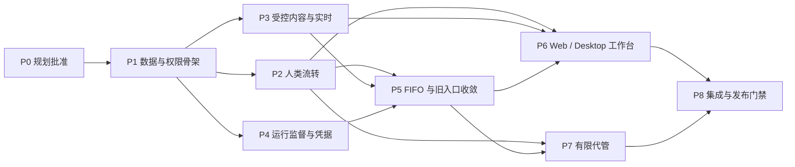

# 跨账号协作实施计划

## 2026-10-20 增量已验证

- [x] 触发预览补全有效输入合批、后续批次和当前小队续作；精确草稿身份与权限/暂停边界保持，旧响应继续兼容。
- [x] R58/AC89 反向唤醒：协作子任务完成/取消后调用普通父任务阶段屏障；重放/回滚不派发，共享父任务隔离。
- [x] 独立复核、相关 Go race/前端/静态检查和生产 Web 验证通过；[验证记录](verification-preview-wakeup-2026-10-20.md)保留范围及失败经过。

以上仅勾选这两项增量，不替代下文其他阶段及全部 97 项验收。

- 日期：2026-10-19；状态：任务保持实施，来源入口、字段/迭代、评论操作与来源实时增量已完成[本轮验证](verification-source-editing-2026-10-19.md)。已有验证各有范围，见 [progress.md](progress.md)；本轮边界见[来源与编辑续作](continuation-source-editing-2026-10-19.md)，后续从[当前未完清单](research/remaining-product-work-2026-10-18.md)继续。
- 依据：[PRD](prd.md)、[技术设计](design.md)、[执行协议](research/execution-contract.md)；源码索引见[研究摘要](research/design-contracts.md)。
- 分支：`codex/cross-workspace-collaboration`。原授权见 discussion §55；本轮产品决定见 §57–§60、§64–§66 与[调整清单](mention-redesign-2026-10-17.md)。最新用户续作指令是修订方案的实施授权，已记录到 task.json。
- 任务保留为规划与集成责任入口；下面按可验证阶段拆分工作，批准后可据此建立子任务，依赖以本文为准，不能从任务树推断。

当前基础调整及验证见[本轮结果](verification-revision-2026-10-17.md)；下方未勾选项继续按完整功能范围验收，不以存储/内部控制切片替代运行端与双端交付。

## 本轮续作：2026-10-19 R51/R52

已按[本轮边界](continuation-r51-r52-2026-10-19.md)完成子任务/旧入口、运行记录/用量/资源来源和结果通知，并通过[验证](verification-r51-r52-2026-10-19.md)。下方历史阶段未勾选项仍按完整验收理解；下一步以[更新后的待办](research/remaining-product-work-2026-10-18.md)为准，不能因本增量归档父任务。

## 历史续作：2026-10-18

已完成[调整与推进计划](review-followup-2026-10-18.md)中的 M09 收尾与独立检查，证据见[本轮验证](verification-summary-followup-2026-10-18.json)。单直接 agent 的文本合批、启动/终结及恢复闭环已在真实 Linux/DB/API/daemon 环境跑通；v3 读取、权限代次、FIFO 和迁移恢复缺口已修复。已按用户本次续作指令完整重读最新执行契约，完成[目标 hold 与分范围恢复](continuation-hold-2026-10-18.md)的控制/资源边界切片及真实双通道验证；随后推进同队长多目标合批与 M11，附件交付和完整双端界面另按原阶段验收。

## P0R. 本轮变更规划与影响收敛

- [x] 记录 @智能体/小队触发、@人通知、同单多目标、触发预览及不自动改派/授权的已接受方向。
- [x] 更新原 R/AC，追加 AC90–AC97；列出旧单 session/单 grant/单未结 run、R53 和旧触发监听的冲突。
- [x] 用户确认 M01：不同目标在资源允许时可并行，同一目标输入保持有序；小队依赖和实际资源竞争列入技术定稿。
- [x] 用户选择 M02 的 A 方案：按智能体/小队或整单停止/恢复，小队包含成员执行；无关目标保持状态，整单暂停不得被目标级恢复绕过。
- [x] 用户选择 M03 的 A 方案：@仅展示本单已授权目标，creator/handler 组织新增，各实际 owner 确认，不开放额外资源发现。
- [x] 修订 D01–D11 及 data/execution-contract：issue 控制器、逐 lane 批次 FIFO、根执行组/成员 run、逐资源授权和两级原子控制；保留 nonce/proof 与旧入口隔离。
- [x] typed target 去重，@A 与 @S（队长 A）同 lane 合并（M06）；按实际资源共享容量。小队按现状派发（M08）：队长评论后结束并释放 slot，成员回帖/结束合并唤醒续作；不以队长 proof 结算全组。
- [x] 重审 P1–P8 受影响清单、97 项 AC 主验证和旧客户端/迁移边界；保留既有数据与验证证据。
- [x] 独立产品与执行契约复审；所有发现已修正，结论见 review-2026-10-17.md，完整规划摘要见 discussion §61。
- [x] 用户要求“根据需求核对一下已经实现的代码是否需要调整，并请继续推进这个任务”，随后再次要求“继续推进”；已据此执行 task.py start，恢复实施。
- [x] 审计后续决定 M04–M10 已记录（discussion §64）；M08 改为保持现有小队派发（§65），M11 人类再 @队长并入本组续作（§66）。
- [x] M10、M06/M07 单目标基础与 M04 单 lane：前向删除旧单会话执行路径，保留当前输入/证明；通道/合批、停止及明确恢复已实现并通过本轮验证。
- [x] M09 门禁：单直接智能体、单 lane 在 Docker 提供的真实 Linux 内核跑通评论→command→promote→claim→permit→supervisor→Stop→sealed proof→Resume→下一批及 never_launched；另验证真实 daemon 注册/槽位/Runner 接线。仅使用测试自建静态程序，macOS/Windows 运行能力不宣称支持。
- [x] M09 之后完整重读当前执行/数据契约与讨论 §66 最后两轮修正，确认单目标恢复原子、整单恢复按 lane/hold 分项结算。
- [x] M04 控制基础与目标 hold/version、资源失效、完整原回执及真实双直接智能体通道部分恢复已验证；见本轮推进与证据。
- [x] 通道 FIFO、held/失效输入筛选、不可变消费历史、安全 never-launched 回队、待配置迁移、持久配置失效和 v4 读取通过本轮验证。
- [x] 逐输入冻结授权、授权就绪的原子 Switch、M08/M11 派发/读取与续作、真实静态 Linux CLI/daemon 容量 1 闭环通过；完整范围和限制见本轮报告。
- [x] 账号工作台新建/私有附件、资源授权/Switch 表单、禁用参与人管理、账号实时及拒绝后的原请求恢复通过本轮服务端和双端验证；默认门禁仍关闭。
- [x] 来源新建/共享详情、外部摘要/筛选、安全操作、初始/日常字段与迭代、评论编辑/回复/解决/回应、来源空 WS 刷新通过本轮验证；原键恢复、旧迭代旁路和真实重复 DOM 问题已修复。
- [ ] R51 普通子任务共享详情、完整运行记录/通知、运行端文件/Git与通用供应商、有限代管及其余验收继续按 P1–P8 完成。

下方 P1–P8 已按本轮模型修订。标记已完成的早期基础项只证明旧结构存在，新 target/group/运行协议仍待实现；未受影响的人类流转与字段规则继续回归。旧单会话“唯一未结 run”不能作为多目标验收。

## P0. 旧基线开工条件与历史记录

- [x] O11 已确认：双禁用时重开并指定已有有效协作者，无候选拒绝；仅增加 R40 的窄例外。
- [x] 发起人退出来源空间后，账号及协作身份有效时保留完成/取消/重开权限（discussion §54，2026-10-13）；只确认产品规则，尚未批准实现。
- [x] 按 grill-me 复核结果重新收敛 PRD、design/implement，检查文档和上下文并呈现新摘要（discussion §53，2026-10-12）。上一轮静态审阅和 O11 复核保留为历史证据，§32 被 §53 取代。
- [x] 用户于 2026-10-13 明确授权复审后实现（discussion §55）；技术复审收口后执行 `task.py start`，无需重复询问开工。
- [x] 记录实现时 git 状态、基础提交及他人改动；需要隔离时建立独立工作区，不 reset、stash 或提交本任务之外的文件。
- [x] 在涉及层加载最新 `.trellis/spec/`。确认当前 root CLAUDE、命名规范、sqlc/迁移规则和真实 AI 测试隔离约束。
- [x] 服务端实施/检查前必读 `.trellis/spec/server/security-boundaries.md` 全文及对应层规范；自动上下文改载任务研究索引，不能把该索引当作规范替代品。
- [ ] 固定 D02/D09 DTO、status_options_version、D06/E01–E08 launch/proof/准入/锁协议和 source/execution scope；新协作字符串版本与旧 Issue.revision 数字字段分开。

最小证明：没有未决产品选择；所有 R/AC 保留；实现/检查 context 无缺失文件或超限截断。真实实现前再分配迁移号，避免并行分支冲突。

## 阶段依赖和写入责任



P1 后 P2/P3/P4 可独立研究和实现，但共享服务、router 和 migration 由单一责任人整合；不能并行各自改 `task.go`。P6 的 schema/无空间外壳可按已固定契约提前开发，完整验收等待 P2/P3/P5。三项代管共享 UI 接入随 P7 完成。涉及核心行为的实施与检查使用 Trellis 原生子代理，主会话整合、处理产品选择并验证结果。

| 阶段 | 写入责任范围 | 高风险交界 |
| --- | --- | --- |
| P1 | `server/migrations/`、`server/pkg/db/queries/`、生成 DB 代码、新协作授权/DTO 服务 | 迁移号、所有权列、旧普通 issue 判别 |
| P2 | issue/comment/状态动作服务与 handler、账号工作台查询 | 与 P5 共用队列副作用接口，不先落半套 lifecycle |
| P3 | file/storage/attachment、realtime/scope authorizer、来源记录 | 公共上传、原生下载、执行空间清理 |
| P4 | protocol、agent supervisor、daemon、purpose middleware、凭据存储 | `daemon.go`/claim finalization 与 P5 共用接口 |
| P5 | task/run 调度与控制、旧 retry/claim/start/status writers、资源撤权 | `task.go`、runtime/account/workspace teardown，由该阶段统一整合 |
| P6 | core 协作模块、views 协作页面、Web/desktop 路由/标签接线 | core API client、desktop tab/coordinator、详情组件提取 |
| P7 | admin handler/service 和共享有限代管表单 | 原管理域锁、组织范围、O11 接手原子性 |
| P8 | 集成测试、内置技能/source maps、开发/发布规范 | 不改无关功能，不用发布开关代替服务端保护 |

## P1. 数据、对象授权及原子新建

- [x] 旧基础已建立协作/参与/交接/session/command/run/grant/outbox/终结与身份门禁；只证明原单目标 schema，不代表以下新增结构已交付。
- [ ] 按新 D02 增加 target、授权资源清单、execution_group、派发/续作关系；根 command 固定目标/输入，run 归组且有独立 proof。替换旧 session 单 active_grant/run 权威及 command/run 一对一约束，逐 lane 至多一个当前根组。按 M10 用前向迁移删除旧执行数据与 legacy_* 列，不映射、不隔离、不改写已提交迁移文件。
- [x] 所有新索引（含主键/唯一键）各用单语句 CONCURRENTLY 迁移；无 FK/级联，检查 invalid index 与安全 down 前置条件。
- [ ] 复用 `issue.assignee_id=user.id`，creator 保留真实用户；输出独立 source/execution scope，禁止虚构成员或代理 issue。
- [ ] 新增事务内单据授权器与最小 AccountSummary，读与普通评论采用来源成员 OR 本单参与关系；角色/操作能力分开。R53：人类身份用白名单；只有绑定当前 target/group/run/资源的协作能力可进入执行白名单，其他 task_token/cloud_pat/plugin/IM/未知机器仍只得最小引用、写入拒绝；需要时由认证中间件显式标记人类来源，不能靠缺失 header 推断。
- [ ] 原子新建 issue、协作记录、参与关系和 paused session；标记从服务端关系派生，不允许旧 PATCH 启用。
- [ ] 创建使用 source/creator/request_id 的独立操作范围及无 issue ID 的回执查询，私有 draft 一次绑定；同 key 并发/丢响应只得到原单，同 draft 换 key 拒绝。
- [ ] 增加精确接收账号查询，区分用户名/邮箱/UUID、归一化/歧义/限流；提交动作仍重验。
- [ ] generic GET 列表最小协作投影、generic writers 拒绝未适配协作操作。R54：列表/详情/时间线/评论对非来源成员的 creator、handler、作者返回最小 AccountSummary（user_id、显示名、头像、外部标记），不含邮箱/用户名，并支持“外部协作者”筛选。创建开关持续关闭，不能先上线半套权限。
- [ ] R50 迭代归属（含创建时）：锁内重验来源成员与有效发起人/handler，复用 `PrepareMembershipChange`/`CommitMembershipChange` 借用事务、原因与版本契约，结转仍由服务端负责；外部 handler 不使迭代统计/预览/历史失败或泄漏账号详情。覆盖转交、离开来源空间、迭代版本变化和幂等重放。
- [ ] R51 普通子任务：普通任务以协作单为 parent 的写入沿用既有校验、锁序与 I1 记录，只把协作单当作引用，不取 session/participant/command 锁或推进协作版本；子任务执行与本单队列/grant 隔离。详情的子任务投影按查看者来源权限裁剪。覆盖跨空间拒绝、外部协作者读取、移出/删除子任务和并发转交。
- [ ] R58：协作单 `position` 允许来源成员经普通排序写入（看板、CLI `issue reorder`），不推进协作版本、不写历史/通知，机器身份按 R53 拒绝；`stage` 按 R49 规则锁内重验并留记录，child-done 阶段唤醒语义不变。
- [ ] R49 项目/父任务（含创建时）：锁内重验来源成员身份及有效发起人/handler，沿用普通任务的引用校验、锁序与 I1 事实记录；非来源成员写入拒绝，读取只得不可打开的最小引用。覆盖转交、离开来源空间、引用失效和幂等重放。
- [ ] 按 R41/R42/R48/D03 编辑字段（R48 开始/截止日期沿用普通任务解析与清空）：锁内重验有效发起人/handler、版本及来源定义/选项，值与历史/事件同事务，复用 D08 幂等；不重写 command 或触发 AI。仅投影本单所需选项，不开放定义管理；其余未确认写入暂拒绝，覆盖旧 API/Plugin/uploader/admin 旁路，不改普通任务规则。
- [ ] schema/DTO 明确 command seq、版本的字符串传输及 typed unavailable；冻结后供 core/daemon 阶段使用。
- [ ] 落实 2026-10-13 数据复审：comment 协作版本/墓碑及 collaboration_event 历史，附件永久交付/多引用，通知稳定 UUID 和收件人幂等；R53 搜索在匹配、排序、计数与 snippet 前裁剪，不能仅删响应正文。来源 membership revoke 保留独立协作身份与 creator/handler，不推进无关账号 epoch。

验证：数据库 fixture 建两个独立空间用户，跨空间只访问本单；第三人拒绝；来源普通成员只能读/普通评论。对新建注入中途失败并发删除，验证无半张单、无普通自动任务。R41 覆盖两类编辑者成功、转交/禁用/退出后旧权限失效、并发编辑冲突、失败原子回滚和事件重放；旧 command 输入保持不变。对 actor spoof、PAT/task token、人类确认、全局 UUID 与 member UUID 混淆建立负例。迁移从空库和当前升级库验证，`make sqlc` 后生成差异可复现。

## P2. 人类交接、状态与持久待办

- [ ] 实现普通转交、邀请/移除/退出；移除当前 handler 与回交 creator、指令/资源副作用接口同事务。
- [ ] R46 邀请/派单直接生效：锁内查 R12 角色和目标有效性，参与/历史/outbox 同事务，派单再变更 handler/待办；仅邀请不改责任。覆盖离线接收、通知故障、无权/失效目标、幂等重放和个人资源不被自动授权，不实现待接受阶段。
- [ ] 实现具体请求 ID 的“补充完成并交回”和“提交验收并转交”，目标失效不自动加回，过期请求不能覆盖后来的责任。
- [ ] 落实 D04 来源映射和 status_options_version 的生成/传输/锁内重算、补充请求链及 superseded；不伪造既有目录 revision，不静默改选。
- [ ] R47 手动改非终态：锁内重验有效发起人/handler、版本和 status_options_version，仅接受来源有效非终态；前后状态/操作者/事件同事务。不改 handler/待办/command，不触发 AI，不建、不消费或作废补充请求，in_review 不产生验收交接；覆盖转交后旧权限、目录变化、终态拒绝和幂等重放。
- [ ] R47 同时验证当前来源类别非终态且 session 未 closed；handler 的 done/cancelled→todo 等 PATCH 必须拒绝，只允许具权者明确重开。AC78 与 AC55 联合覆盖，无生命周期半更新。
- [ ] 完成/取消/重开进入同一领域服务，调用 session close/reopen 原子 primitive；旧 direct status/assignee writers 不绕过角色或 R35。含 GitHub/GitLab/Forgejo PR 合并自动推进 done（`server/internal/handler/github.go:1671`）与 `WriteIssueStatus` 系统写入：对协作单跳过，不能代替 R19 发起人完成。
- [ ] AC27/AC55 验证发起人退出来源空间后仍可完成/取消/重开，账号及协作身份须有效；来源结构字段权限及代管分别由 P1（AC80/AC81/AC89）、P7（AC66）主验证。空间退出清理不得误删本单参与关系或入口，运行资源失效仍按既有撤权规则处理。
- [ ] 账号工作台查询“当前处理/我参与的”，分页与计数同一谓词；不使用 inbox read/archived 或来源空间 membership 替代参与关系。
- [ ] 幂等操作记录保存原成功/拒绝和版本；通知投递意图与责任变更同事务，通知故障不丢待办。
- [ ] 来源空间删除在清理前检查全部协作记录；协作 hard delete/move/merge 拒绝，普通空间/任务行为回归。

验证：P→D→T→D 的阶段交接，D 请求 P 补充及嵌套补充逐层交回；普通评论不交回，AI 结束不整单完成。跨空间同名自定义 status 分别属于不同类别，按来源解释。对并发转交/移除/状态目录变化、重复操作、归档通知后重登验证最终责任及入口；失败事务不留下已移除却无人处理的结果。生命周期的真实队列副作用在 P5 联合验收，P2 不单独开放生产入口。

## P3. 受控附件、来源过程记录与实时

- [ ] 复审补项：R55 comment/body edit 仅新增有效提及者通知，与同一新评论事件按 recipient 去重；投递重试不重算后来名单。R57 与 edit/delete 共用 issue 锁串行两个目标的 resolve/unresolve，API 接线使用 D09 协作 scope。分别以 AC86/AC88 验证新增差集、并发解决、撤权竞争和零额外执行/通知。

- [ ] 协作上传从私有 draft 开始，创建时绑定唯一 issue；正文/评论/command/run 附件归属同一对象级授权。
- [ ] Web cookie/bearer 及原生下载均有可行认证通道：fetch 带认证，Web 无 cookie 的图片/下载/range 与 Desktop 使用重验短能力代理；不 fallback 公共 uploads/旧签名/S3。
- [ ] 来源侧保存 run event、结果、用量、历史 actor 和固定附件版本；执行空间清理不删来源事实或终结屏障。
- [ ] R43 评论编辑/删除使用同单授权和作者校验，内容/版本历史/删除墓碑/事件同事务；保留 ID/回复锚点，删除后拒绝新编辑。屏蔽旧 CancelTasksByTriggerComment/retrigger 和附件清理；命令/执行不受评论修改影响。
- [ ] R57 resolve/unresolve 与评论/任务表情回应：按当前评论权限（人类）授权，沿用每线程单一解决不变式，记录真实操作者；不改评论版本历史或 command，旧回应通知对协作单跳过，不进 R52。
- [ ] R56 评论子任务 preview/create（manual 与 agent）对协作单在任何 capture/复制前拒绝，不写 source-context、不复制附件、不启动 agent；普通任务不变。
- [ ] R44 区分评论展示引用和本单交付归属：移除展示后保留 issue 关联、固定文件和历史引用；旧删除/GC 不清理已交付文件，附件/历史入口仍受当前 ACL 保护。覆盖删评论/移除单附件、其他引用、刷新/跨端及撤权后拒绝。
- [ ] 引入账号连接和明确 issue scope，复用认证但不自动加入来源 workspace room；发送前重验访问依据，撤权丢弃队列中失效 payload。
- [ ] 实现持久 outbox、snapshot/event seq 补偿、按 viewer 的失效通知；不靠当前 workspace 推测事件归属。
- [ ] R52 账号级通知：collaboration_event 同事务为当前有效参与者（除操作者）写通知意图，recipient/issue/event_seq 幂等；被移除者仅收无内容的移除通知；旧 subscriber/inbox 监听对参与者跳过，同为来源成员者不重复收。P2/P5 的流转与 AI 事件接入同一事件清单，投递失败不回滚业务。
- [ ] R24/R55：协作解析器分别解析当前参与者、@all 和已授权 typed AI targets；预览无副作用，发送原子保存 comment/input、逐目标执行/拒绝回执和通知意图，同 key 不重复。无效 AI 目标不吞掉合法目标/人员通知，人员提及不邀请/改派/授权；旧监听整体跳过。普通无 @回复/编辑不产生根执行，编辑只通知新增人员。
- [ ] 目标候选仅本单有效授权清单；creator/handler 组织登记，全部实际 owner consent 齐备后可选。忙碌/暂停/离线保留合法候选，撤权移除候选但保留历史和停止；小队资源授权不自动创建成员 direct-agent 目标。
- [ ] R53 出站隔离：plugin 事件桥与 IM（含企业微信 inbox 推送）对协作单不发或只发最小引用；普通 agent/子任务执行的 prompt 与上下文组装不带入父协作单内容。覆盖 CLI `issue get`/`comment add`、plugin 订阅、IM 推送和未分类身份来源。
- [ ] 两侧检查通用 task list/snapshot/message/usage/WS，执行空间普通成员不能从 engine task 得到来源私有内容。

验证：两条 read basis 的撤权分别覆盖详情、预览、下载、旧能力兑付和订阅；无效附件/comment/run ID 不串单。无 cookie 的真实 Web bearer 会话能预览/下载/range，撤权后重取拒绝。换/删执行资源后来源历史仍可读；断线丢事件由 snapshot 恢复。HTML/原生桥接沿用安全测试；已下载副本无法收回不作承诺。

## P4. 固定启动身份、监督器与窄凭据

- [ ] 新增 collaboration purpose 与 claim/finalize/launch/progress/proof 协议；普通同空间 claim 不放宽。
- [ ] 业务 token 绑定 issue/session/group（含其 command/target/grant 集合）/run/账户与参与 epoch；全局路由默认拒绝，子进程无宽域 mat_/PAT fallback。
- [ ] 每次业务 token 请求调用动态能力谓词，写事务再验，旧 token 不因重新参与/重开/新 grant 复活；不能借 owner 的来源成员权降级。
- [ ] 按 E07 登记中立账号 epoch 更新者；password 使用真实会话版本，legacy 共享 runtime 有 owner 授权及持久 key challenge enrollment。保持原登录模式和 password-only 管理入口，不用空版本/空 binding 兜底。
- [ ] 在可能启动前预发并持久化仅 supervisor 持有的终结 token，绑定原 deployment/install/run/fence/nonce；撤权后仍只收尾。
- [ ] 本地账本使用跨进程锁、fsync、启动前 nonce burn、单调 attempt、最终 run seal；burn/fork/PID 回写窗口保守 unknown。内部尝试先证明前次退出再取新许可。
- [ ] supervisor 覆盖每次 provider launch、内部 fallback 及全部派生进程；共享能力须证明封闭 containment，Windows Job 绑定失败不启动，Unix 单独进程组不足以准入。覆盖 setsid/改变组/双 fork/提前关闭 stdio/PID复用，无法保证则不宣告能力；观测丢失保留 unknown，不能签发完整 proof。
- [ ] daemon owner、供应商账号、实际执行者和根 command 的人类作者分开。固定 typed target/配置与输入快照，各 run 重验实际资源授权；不能在成为队首时把 @A 改用全局当前 B。切资源须显式暂停/owner 授权，旧 epoch 不复活。
- [ ] 小队按现状派发（M08）：本组存活 run 评论 @冻结名册内已授权成员才记派发，comment_id+成员去重；成员回帖/结束及满足 E01“M11 并入”的人类再 @S/@队长合并为一次队长续作，组停止或结算时未被任何 run 读取的并入输入回到 waiting，原人类来源不可改写；briefing 的 todo 子任务指派对协作单明确拒绝并有负例。队长评论后结束即释放真实 slot，成员 bypass 外部 FIFO；容量 1 和同目录竞争必须验证。
- [ ] 文件通过已提交 Git/明确附件准备；新环境重置供应商恢复指针，不搬运未提交目录、私人 session 或其他平台凭据。

验证：fake executable 起子孙进程、延迟/崩溃，逐点注入 burn/fork/PID/reap/seal 故障；另一 daemon 实例、重复 nonce/派发、迟到 fallback 不重复 fork。测 Windows Job 失败、token 路由矩阵、当前 grant/私有 owner 关系和认证×runtime enrollment/challenge 重放。撤用户/runtime 后只可提交旧 proof，不读正文/启动/续租/恢复；provider 无 supervisor 凭据。不用单个 ProcessExited mock 代替原生矩阵。

## P5. 逐 lane 批次、执行组与两级控制

- [ ] 根 command 固定 typed target/输入/作者，按实际根智能体进入 lane（M06），lane seq 和原子 active_group 占位；忙碌/暂停期间的输入 waiting，promote 按 FIFO 取合格输入一次运行（M07），遇第二支合格小队截断、hold/失效者被跳过；未开始时单条取消/作者移除只移出该条，已开始整批停止。根组可包含多个成员/continuation run；不同 lane 可并行，同 lane 下一批等整个组结算。
- [ ] R45 取消单条 waiting：当前有效参与者且为作者/creator/handler；与 promote 同锁，取消状态、操作者/时间及事件同事务。不变更原文/seq、active_group、两个控制层状态/版本，不依赖 grant/gate；in_flight 或终态拒绝，不自动 Stop。测试三类允许主体、他人/撤权/转交、paused/维护及 cancel↔promote 的确定性竞争和幂等重放。
- [ ] 按 E01 显式连接来源正式 admission、installation accepting、当前资源/绑定/账号和全局 gate；旧恢复例外不发新许可；真实资源容量不被目标名绕过，容量受限目标不堵住其他独立可运行目标。
- [ ] E03 无许可占位由服务端原子撤派发并结算；永久 prepare 错误、临时投递故障和可能已有许可区别处理，不等不存在的 daemon 回执。
- [ ] target/issue Stop 明确范围、观察到的组/目标集合版本；先挂起并封闭派生，再停止所有范围内 run。单目标停止带同 lane 目标、不影响其他 lane，整单暂停约束新增目标；proof 只清对应 run 屏障，不能恢复 gate。
- [ ] 移除/退出、撤 grant、owner 离开、生命周期 close/reopen 与相应取消/暂停/停止副作用同事务。
- [ ] 目标 hold（initial/grant_required/config_invalid/switch_hold）：新建、撤权、epoch/配置失效、promote 发现失效与 Switch 同事务置 hold，撤权不暂停 lane；promote 跳过且不挡他人，可按 R45 取消；Resume target/All 验本目标配置且所在 lane 无强制停止缺 proof 的组后释放并逐个回执，重新授权不自动释放。换队长时 waiting 转入新队长 lane 末尾，新 lane 忙碌不阻止释放；新 lane 暂停时证明齐才一起恢复，否则整笔拒绝。单目标恢复全有或全无（AC40）。
- [ ] 禁用作者/owner 的 auth epoch 即刻拒新许可，持久失效 fanout 不因快速恢复丢失；按顺序收敛受影响单据。
- [ ] Resume target 不跨整单暂停；Resume issue 按 M04 结算：整单级条件失败整笔拒绝；否则解除整单暂停，证明齐的 lane 恢复、授权有效的 hold 目标释放，其余保持暂停/hold 并逐个返回原因。原 key 重放原回执，旧 stop 不套到新组；重复恢复不重复启动既有工作。
- [ ] 关闭旧隐式失败重试/merge/reconcile/rerun 及无归属 continuation 旁路；只允许同组持久、已授权的成员/续作。全部 run/派发结算且组封闭才释放该 lane；手动重做新建根 command。
- [ ] E05 分开 business_outcome/forced_disposition/proof；proof 先到缺结果记 outcome_unconfirmed，结果先到无 proof 不解锁，停止优先于 late success。
- [ ] 按 D08 清单覆盖 HTTP/WS、Plugin、CLI、队列 SQL、后台状态/孤儿/GC、整机停止及所有 teardown；同 purpose 进入同一 primitive。
- [ ] 固定逐 writer 锁序和 NOWAIT 交汇点，所有 helper 借同一事务；冲突有限重试、commit 不明查原操作。
- [ ] E06 gate 先关再扫描暂停；Resume/所有 active 写入持 FOR SHARE 到提交并比较 expected_execution_epoch。barrier 测覆盖读 gate→提交窗口及旧请求延迟到重新 enable；扫描完成才解除，不自动 active。关闭创建仍接收尾，未结 run 不因重启/超时/engine 清理消失。

验证：使用数据库事务屏障/同步通道制造 stop↔claim/finalize/start/complete、close↔enqueue、remove↔launch、revoke↔resume、workspace delete↔create、runtime teardown↔proof 竞争，不靠任意 sleep 猜时间。指令 1 运行、2/3 排队时停，4 在 paused 加入，证明前拒恢复，同 key 之后仍拒；新请求恢复后有效 2/3/4 合为一批运行一次，1 不重试。至少两个调度 worker 验证同一 lane 至多一个 active_group、不同 lane 可并行；小队组内非阻塞派发在容量 1 时仍能前进。整单级恢复拒绝必须零状态写入，新增目标不能越过整单暂停，其他 issue 不受影响。

## P6. 共享界面与 Web / Desktop 路由

- [ ] 复审补项：private schema 一律 redact:true，畸形正文/短能力不进入日志；来源成员退出重验 account 视图，保留有效发起人生命周期权并移除来源字段能力，不能误删账号组。覆盖 CL03/CL04 的暖缓存与日志 sentinel 负例。

- [ ] core 增加协作 schema/API/queries/mutations/realtime，显式 deployment/viewer/issue scope；列表 key 含 view/归一化筛选排序，账号请求去 ambient workspace header。新版本字符串无损比较，不改旧 Issue wire。
- [ ] views 组合工作台、受限单据详情、精确查找/交接、参与人、统一评论与 @触发预览、逐目标队列/执行组、两级控制、授权/换环境及生命周期界面；复用可注入数据的现有组件，避免复制完整 IssueDetail。
- [ ] 接入 R41/R42/R48–R50 字段编辑及修改记录（R49/R50 选择器仅对来源成员显示，含新建表单；迭代切换/移出要求填写原因；R51 子任务列表对来源成员可打开，对外部协作者只显示最小引用）；来源普通成员不因此获得编辑权，角色/版本/来源选项冲突保留输入并重取，双端验证保存与历史接线。
- [ ] R55 选择器注入当前参与者、@all 和完整有效授权的 typed AI targets，不显示个人/任意空间资源目录；预览各目标实际状态并可取消本次执行。来源成员无 AI 控制权时不能借 @执行。R56 继续关闭评论/选区建子任务。
- [ ] 多目标 DTO 带显式协议版本及 targets/groups/control 范围；旧客户端不把未知结构解释为空闲或 fallback 普通执行，根作者、组/成员状态和停止待确认分别显示。
- [ ] R57 双端按能力显示解决/取消解决与表情回应，失败回滚本地状态并保留线程位置。
- [ ] R43 双端提供本人普通评论编辑/删除、历史及删除占位；依当前评论权限显示，冲突保留输入，不复活删除记录；其他人的回复继续可定位。
- [ ] R44 评论移除附件后，本单附件/历史仍提供受控访问；清楚区分移除展示与删除文件，不让客户端隐藏整个附件记录。
- [ ] R45 队列仅对有权者显示等待项取消，提交后按服务端结果更新并保留记录；状态已变时说明需使用停止入口，不能自动扩大操作为 Stop 或重排。
- [ ] 工作台及来源任务页有明确“新建协作任务”入口/表单：来源创建权、本人/精确目标、私有 draft 上传、原子提交、同 UUID 导航及未知结果恢复；失败保留输入，无 enable/convert。
- [ ] `/account` 集中构造/校验、登录返回地址、通知/分享/评论锚点；来源旧详情使用同一协作契约。
- [x] Web 账号 guard 独立于 workspace guard；零空间仍可访问获授权单据，创建另选来源空间。
- [x] Desktop App 启动/恢复不让 workspaceListUnavailable 阻塞已认证账号页；workspace list 500 仅在空间选择处重试，不能强制跳首空间/新建浮层；真实认证/强制改密仍阻断。
- [x] Desktop 扩展持久账号 tab/group，route classifier、sanitizer、Coordinator、deep link/pop-out、资源键和 memento 一起适配；保留 workspace tabs/pins/MRU。
- [ ] 账号进入前清 workspace 镜像，旧布局晚卸载不能写回；A空间→account→B空间、StrictMode、重新登录/换 Server 和零空间启动均覆盖。
- [ ] 多实体动作 await 服务器，未知结果重用原 key；转出后详情不消失、通知归档不删参与入口。
- [ ] R54 来源列表/看板/时间线用 AccountSummary 显示外部人员并加“外部协作者”筛选；看板协作卡列内拖动按 R58 正常保存，拖到负责人列不乐观移卡，按能力打开转交入口或提示，状态列拖动仅 R47 非终态，完成/取消列拒绝并提示整单动作；普通任务拖动不变。
- [ ] R47 状态选择器只向有效发起人/当前处理人提供来源非终态选项，显示修改记录；选项变化时保留选择并重取，不静默改选，也不把完成/取消混入该入口。
- [ ] R52 工作台通知列表与未读数，链接到 `/account`；打开时按当前权限重验，已读/归档只改通知状态，失权后旧通知不能打开本单。
- [ ] R46 双端提交成功后显示已加入/已转交；仅邀请在参与列表可见，有派单才新增当前待办，不展示待接受按钮；接收人重登直接恢复服务器结果。
- [ ] 挂载/聚焦、账号 WS 重新认证/重连重验权限快照；撤权推进 epoch、cancelQueries(revert:false)、清 Query/draft/upload/preview/局部 transcript，阻止迟到响应，保留仍合法的来源成员投影。
- [ ] 展示真实队列/运行/proof 三种状态，键盘可操作、焦点返回、窄屏/缩放与共享 i18n；停止确认不依赖文案猜 task.status。
- [x] 更新 root CLAUDE 与 Desktop spec：持久账号目的地和一次性 WindowOverlay 有各自分类，Zustand 仍只存客户端状态。

验证落点：纯 schema/权限/状态/路径在 core；shared component 测组合/提交/焦点；app 测路由/持久迁移。补旧 ordinary+shared 混合列表、新字符串 9/10 与超安全整数版本、current/participating 分离、暖缓存错过撤权再重连、getMe/workbench 成功但 workspace list 500。双端点击新建并带私有附件验证同一 UUID；Electron 隔离 profile/HTTP+WS/fake daemon 透传幂等/版本头，已有 tab 更新 ?issue=，重启保留布局但不泄漏前账号数据。

## P7. 有限管理员代管

- [ ] 使用当前平台管理域完整会话/角色/组织 fence，限制 creator disabled、来源空间在管理范围和非空原因。
- [ ] 实现专用 complete/cancel/reopen，记录真实 admin、原 creator、before/after 和 request ID；ordinary lifecycle 不增加 admin bypass。
- [ ] 实现 R40：仅双禁用的 reopen 必填 successor_user_id，锁内重验已有有效参与关系/账号和 revision；其他动作或非双禁用场景拒绝夹带改派，无候选拒绝。重开/handler/待办、失效补充请求链、前后身份审计及 outbox 同事务。
- [ ] R38 管理域下提供最小候选摘要；共享表单在 Web 管理入口和 Desktop 账号壳接线，R40 明确选人、无候选禁提交、失效后刷新但不自动改选。管理员不因此查看本单全文、获得普通转交权或加入本单。
- [ ] complete/cancel 调用同一 close，reopen 保持 paused/旧屏障，不隐式恢复账号、grant 或命令。

验证：creator 启用/禁用/操作中恢复、admin 缺角色/范围/原因、PAT/observer/空间 owner 均有明确结果；真实审计 actor 与 creator 不混。使用单独 password/admin-enabled 合成环境，默认 legacy-auth E2E 不能作为 AC65–66、AC69–70 证据。覆盖 creator=handler 和不同账号均禁用、有效 handler 保留、无候选/漏选/未参与/已退出/禁用候选、其他动作夹带字段；用事务屏障控制目标禁用/退出、原账号恢复及并发责任变更的先后，失败不留半次重开或成功事件。重复 key 不重复交接，换候选复用旧 key 拒绝；Web/Desktop 验证候选表单和持久待办接线，重开仍 paused 且不复活旧 command/grant。

## P8. 集成、文档与启用门禁

- [ ] 三账号、两个独立空间、Web+Desktop 完成人类派单/补充/阶段交接/验收，以及共享执行、撤权、换环境、完成重开。
- [ ] 同单授权矩阵扩展到直链、HTTP/WS、上传/下载/预览、来源列表及执行空间列表；证明两侧无正文泄漏。
- [ ] 故障注入：丢响应/重复事件、Server/daemon 重启、旧 provider 未结、owner 禁用/解绑/删除、未结凭据与日志不完整。
- [ ] 旧 Web/Desktop/Mobile/CLI/daemon 请求对协作数据无法绕过；普通任务原行为回归。未支持 Server/运行时显示不支持，禁止普通执行或公开下载 fallback。
- [ ] 更新受影响 CLI 行为、`server/internal/service/builtin_skills/` 的 SKILL.md 与 source maps，以及必要用户说明。提交 Lore 决策记录，不纳入他人改动。
- [ ] 验证相对 main 的加法迁移/功能关闭/兼容回退（M10 删除执行后不可回退）：开关关不丢读取与停止收敛；部署无旧 writer 后才能开创建，不能带活数据回退旧二进制或删表。
- [ ] 留存 capability 矩阵、数据库竞争、原生进程树、双端 E2E 和权限负例的证据，独立 review 无未解决严重发现后才建议启用。

## 验收归属

每项 AC 由一处主验证负责；跨端 E2E 验证接线，不重复通过 DOM 枚举底层权限/状态矩阵。尚未执行的测试不能勾成通过。

| 主验证阶段 | AC | 主要证据 |
| --- | --- | --- |
| P1 数据/权限 | 01、05、13、17、45、46、60、68、71、72、73、79、80、81、82、89 | DB-backed handler/service、创建及字段编辑/角色/版本/来源选项；P6 验证双端接线 |
| P2 流转/责任 | 02、03、04、11、14、25、26、27、28、29、30、47、51、52、53、54、55、56、62、63、64、77、78 | 交接/版本竞争、直接加入/离线派单、手动改状态、持久查询与删除门禁 |
| P3 内容/实时 | 18、61、74、75、84、86、87、88、90、97 | 访问/撤权、评论及附件留存、混合提及通知去重；P6 双端接线，@执行由协作入口接入 |
| P4 资源/执行协议 | 15、16、37、38、39、40、41、42、43、44、49、50、96 | grant/token/各执行终结/重放、目标与成员资源权限；覆盖已确认 M03 的每个实际资源与目标清单 |
| P5 队列/终结 | 06、07、08、09、10、12、19、20、21、22、23、24、32、33、34、35、36、48、57、58、76、92、93、94、95 | 目标幂等、@门禁、小队调度与控制、fake daemon、旧 writer 负例；按已确认 M01 验证并行/排队，落实已确认 M02 的两级控制矩阵 |
| P6 双端体验 | 31、59、83、85、91 | Web/原生 Desktop 接续、账号通知、预览与逐目标结果；AC83 待 P2/P3/P5 全部事件接入 |
| P7 代管 | 65、66、69、70 | password/admin 范围、审计与双禁用原子接手；候选/账号恢复竞争及双端表单 |
| P8 原子新建集成 | 67 | P1 原子/幂等创建、P3 首次上传受控、P6 双端实际创建三项证据全部具备后验收 |

另需不依赖现有 AC 编号的工程证据：所有迁移索引并发建；schema 错误不放宽权限；unknown commit 不重复 fork；执行空间删除不抹来源历史；本地账本损坏不清屏障；低版本协议不能领取协作执行；无真实付费 AI 参与默认测试。

## 验证命令与环境

以下是未来实施时的入口，不表示本轮已执行。测试文件名为规划目标，落地后按实际文件筛选。

```bash
# SQL 变更后生成并审阅差异
make sqlc

# 按影响包做有界迭代
pnpm --filter @multica/core test collaboration
pnpm --filter @multica/views test collaboration
pnpm --filter @multica/web test account
pnpm --filter @multica/desktop test

# 实现完成后的统一检查，已包含 lint/typecheck/TS/Go race/Web E2E
make check

# 统一入口未覆盖的静态检查
pnpm knip
pnpm check:ui-exports
node apps/desktop/scripts/verify-renderer-file-access.mjs

# 需要单独复现 Web E2E 时，使用本任务拥有的生产模式环境
make up C=api,web ARGS="--web-mode production"
make status ARGS="--json"
make env-exec ARGS="-- pnpm exec playwright test e2e/account-workbench.spec.ts --workers=1 --retries=0"
```

Go handler/service 测试使用 `server/internal/testutil` fixtures 和调用断言，在本任务隔离数据库运行；必要时通过 `make test` 做阶段回归。锁测试用确定性同步，真实平台进程测试用 fake executable。默认测试不得查找或启动用户已安装的 AI CLI；真实 AI smoke 需独立明确授权且受 `agentintegration` 与环境变量双门禁，不是本计划默认验收项。

`make check` 默认 E2E 环境不覆盖 password/admin；P7 需单独具备该配置的隔离环境。原生 Electron 与 OS/provider supervisor 能力矩阵另存证据，不以 jsdom 或 Web E2E 代替。检查通过后不无理由重复全套。

## 当前规划验证

规划阶段只更新本任务资料，不运行迁移、服务或产品测试。完成文档后执行：

```bash
git diff --check -- .trellis/tasks/10-10-cross-workspace-collaboration
python3 .trellis/scripts/task.py validate .trellis/tasks/10-10-cross-workspace-collaboration
```

并核对 JSON/JSONL、R/AC 完整性、相对链接、验收归属、jsonl 引用文件各 65536 bytes、prd/design/implement 各 65536 bytes 与总自动上下文 262144 bytes 限额（`.trellis/config.yaml` 的 `context_injection.max_total_bytes`）；结果和访谈/审批状态记入 task.json 与 discussion.md，不把 planning 改成已实施。
