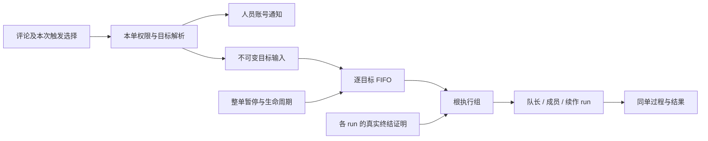

# @提及触发与多执行目标：需求设计调整

日期：2026-10-17。本文件保留 M01–M03 的规划调整。用户随后已授权继续实施，当前基础与验证见[续作结果](verification-revision-2026-10-17.md)；完整 @、运行协议与双端交付仍未完成。复用原任务。

## 已确认的产品行为

- 新评论 @具体智能体或小队，发送后自动提交对应执行，无须再选“发给 AI”；保留触发预览与取消本次目标的能力。
- @人产生账号级站内通知：评论提及定位原评论，正文提及定位正文/修改记录；同事件去重，不自动派单、邀请或授权。人员候选仍限当前参与者。
- 一条评论可同时 @人、多个智能体和小队；执行目标与通知接收人分别处理，保留同一单据及人类处理责任。
- 无 @评论、仅回复 AI、正文/评论编辑仍不自动启动新执行。编辑新增 @人只通知新增的有效接收人；已提交 AI 输入不可被编辑覆盖。
- 纯文本名字或没有解析到具体对象的 `@AI` 不代表授权或执行目标。所有入口仍遵守本单权限、暂停和终态限制。

## 三项已确认选择

| 决策 | 采用方案 | 记录 |
| --- | --- | --- |
| M01 调度 | 不同目标在资源允许时并行，同一目标输入有序；小队成员不能被等待它的队长堵住 | 讨论 §58 |
| M02 控制 | 同时支持目标/小队及整单停止恢复；小队包含派生执行，整单暂停不能由新增目标或单目标恢复绕过 | 讨论 §59，A |
| M03 资源 | @仅展示本单已获完整有效授权的智能体/小队；新增由 creator/handler 组织，各实际资源 owner 在按既有规则参与本单后确认 | 讨论 §60，A |

不采用全单只运行一个目标组、只提供整单停止、或在 @选择器发现其他个人资源并临时申请的方案。目标获授权后，当前及后来合法加入的参与者无需逐人重复确认。

忙碌、暂停或暂时离线不等于撤权：有效目标仍可选，显示等待状态。撤权/配置失效后移出可选清单，保留历史和合法停止能力。小队授权必须覆盖实际队长、成员与运行环境，不自动邀请人类，也不把成员自动开放为独立 @agent 目标。

## 需求与验收调整清单

| 范围 | 主要需求 | 验收与设计调整 |
| --- | --- | --- |
| 触发与混合提及 | R24、R55 | AC35/36/86、AC90–93；@AI 目标提交执行、@人通知，预览/请求重放/旧监听隔离 |
| 多目标协作 | R06、R08、R23 | AC06–12/31–34、AC94；目标身份固定、同目标 FIFO、跨目标按实际容量并行 |
| 停止与生命周期 | R09/10/16/17/35/45 | AC19–24/48/57/58/76、AC95；组内派生闭包、两级暂停、全部终结证明、整单结束覆盖所有工作 |
| 资源与机器身份 | R13/25–28/31/53 | AC15/16/37–44/49/50/84、AC96；逐 owner 授权、重验实际资源与配置、撤权后停止及保留历史 |
| 人员通知 | R52、R55 | AC83/86/90/97；离线可见、同事件去重、按提及来源定位，不改变待办或权限 |
| 人类流转与隔离 | R01–05/07/11/12/14/18–22/29/30/32–34/36–40/46/54 | 原派单、补充、验收、责任、来源隔离规则保留；增加混合提及不改派/不扩权的回归 |
| 编辑、附件和结构 | R41–44/47–51/56–58 | AC71–82/85/87–89；原输入/附件留存、普通子任务隔离、编辑/状态/表情不自动执行 |

保留 R01–R58 与 AC01–AC89 的编号，新增 AC90–AC97，共 58 项需求、97 条验收，每条有单一主验证阶段。旧单目标轨迹仍是同目标回归，不能推导所有目标必须串行；旧测试不能证明新语义已通过。

## 技术模型

一张单保留一个 issue 级控制器及共享历史，每个已授权 typed target 有自己的输入顺序、暂停状态和当前根执行组。一个评论可生成多个根 command；一个小队根 command 可有多个成员/续作 run。

具体协议见 [design.md](design.md)、[数据契约](research/data-contract.md)及[执行契约](research/execution-contract.md)：

1. **固定目标。** command 保存目标、输入及人类发起者；不能轮到执行时用全局当前 grant 把 @A 变成 B。同 typed target 重复提及去重，直接 agent 与 squad 保留不同角色；共享实际资源仍使用同一容量约束。
2. **小队不占槽等待。** 队长持久派发后结束当前 run，可信终结后释放实际资源；成员不进入其他目标的外部 FIFO，其完成幂等生成同组续作。根组仍占自身目标的外部 FIFO 位置；必须验证机器容量 1 和独占目录竞争。
3. **作用范围明确。** target 停止覆盖其当前组/派生，全单停止覆盖所有目标及后来新增目标。停止当前组不恢复其尚未开始的派生，其他等待根输入保留。proof 只收尾，不恢复任何暂停。
4. **整单恢复原子处理。** 全范围停止证明、目标/授权均通过才恢复；任一失败则整个请求不改状态，返回原因，不静默部分恢复或保存稍后自动恢复的意愿。失效资源可能使整单恢复继续等待修复，这是保留原恢复条件的结果。
5. **按实际资源授权。** 组内派发只使用该组批准的成员清单，逐 run 固定实际资源和原人类授权来源；普通机器/插件/IM 仍不得读取本单正文或另起无归属执行。
6. **执行与通知持久关联。** 合法评论写入、逐目标 accepted/blocked 回执、有效 command 和通知意图在同次提交中保存；一个 AI 目标被拒绝不吞掉其他合法目标或人员通知，数据库失败全部回滚。同键重放不重复。
7. **业务子任务保持原规则。** 小队成员 run 是执行关系，不是从评论新建普通 issue；R51/R56 的隔离不变。

## 需要修改的设计与实现位置

| 位置 | 调整 |
| --- | --- |
| D01/D02、data-contract、P1 | session 只管整单；增加 target、授权映射、execution_group 与 run 派生关系；替换单 active_grant/run 和 run.command_id 唯一性 |
| D03/D07、E01/E07、P4 | 各资源 owner consent、target/配置代次、根人类身份与派生身份、窄业务/终结能力 |
| D06/D08、E02–E06、P5 | 逐目标占位与容量、小队非阻塞接续、范围版本、组收尾、两级控制及失效扇出 |
| D09/E08、P3/P5 | 协作专用 @解析/预览/提交、逐目标回执、人员通知去重；旧监听不能再并行触发 |
| D10、core/views/Web/Desktop、P6 | 受控目标列表、多目标协议、目标与组状态、两级控制、账号通知定位与权限缓存 |
| D11/P8 | 后续迁移、新旧客户端/运行端兼容、真实停止/撤权与双端端到端验证；未完成前关闭创建/执行 |

既有人类流转、字段编辑、版本/幂等和账号撤权基础可复用。已落库约束及验证事实仍由 [基础规范](../../spec/server/collaboration-foundation.md) 和原日期报告记录；不改旧迁移，不把文件更新当作新能力已上线。若旧等待输入缺少可确定目标，迁移保持暂停并等待明确处理，不能猜当前资源自动运行。

## 规划交付与验证边界

- 需求、验收、设计、实施计划、自动上下文、讨论及任务状态同步；三项产品选择不再待定。
- 文档验证检查 R/AC 编号、唯一主验证归属、JSON/JSONL、相对链接、diff 空白及 Codex 上下文完整加载。
- 独立复核覆盖授权与通知边界、目标/组生命周期、容量 1 小队、两级恢复、旧实现事实与新设计的区分。
- 默认产品测试使用 fake executable，原生 containment/停止证明和真实双端流程要在实施期单独举证。本轮没有产品代码、产品测试、部署或发布。
- 完整修订稿经文档复审后呈现最终规划摘要；最新整体方案获实施确认后再执行 `task.py start`，旧授权和本轮选项答复不自动代替该确认。
