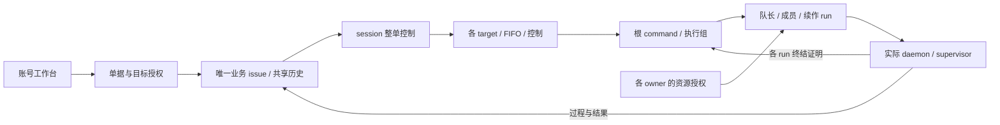

# 实施必须保留的研究结论

> 2026-10-17：M01–M03 及实施已确认，完整目标见[调整清单](../mention-redesign-2026-10-17.md)和主文档。当前多目标基础必须同时读取[代码规范](../../../spec/server/collaboration-targets.md)。下列源码观察保留研究日期，单 session/单执行等旧结论已被替代；真实运行协议与完整 @/双端验收仍未交付。

- 日期：2026-10-13；源码研究与技术复审摘要，产品实现/验收尚未完成。
- 当前权威为 2026-10-17 修订的 [PRD](../prd.md)、[设计](../design.md)、[执行协议](execution-contract.md)、[实施计划](../implement.md)。R39 已确定仅新建；详细研究中的存量转换和早期状态建议不覆盖当前设计。
- O11、G01–G18 的确认以 [PRD](../prd.md) R40–R58、[验收附表](../acceptance.md) AC69–AC89 和设计 D03–D05/D09/D10 为准，决策过程见[讨论记录](../discussion.md) §31、§34–§52，最终摘要见 §53（§41 存有本处原逐条摘要）。早期研究/审阅中的未决或相反表述（如字段/评论禁编）是历史快照，以当前主文档为准；完整 AC 由 implement/check 显式加载。

原 58 项技术复审见[2026-10-13 结论](../review-2026-10-13.md)，其中身份、事务、私有内容和终结证明约束继续保留。讨论 §55 的授权和该报告只覆盖旧模型；本次 M01–M03 及后续多目标技术稿须用新摘要和验证。

## 数据与权限

1. `assignee_type=member` 的 ID 是 `user.id`，不是 `member.id`。证据：`server/internal/handler/issue.go:4162`、`server/pkg/db/queries/member.sql:10`。设计复用该列，避免重复的权威 handler。
2. `loadIssueForUser` 本身没有 membership 校验，现有路由依赖外层中间件。证据：`server/internal/handler/handler.go:1102`、`server/cmd/server/router.go:2018`。账号对象 API 必须显式 ACL。
3. `agent_task_queue` 无 workspace_id，部分读取跟 agent 空间、部分解析跟 issue 空间。证据：`server/pkg/db/queries/agent.sql:796`、`:2567`，`server/internal/service/task.go:7029`。选择独立 collaboration purpose/run 关联；普通 task.issue_id 不跨塞来源任务。
4. engine task 的 quick-create fallback、通用 list/snapshot/messages/WS 都需 purpose 分支。来源正文不得放公开调度 context；来源历史不能仅引用 task ID。`server/pkg/db/queries/workspace_delete.sql:197` 会清 task 消息/用量。
5. 人类 creator、当前 handler、command author、资源 owner、供应商账号和平台凭据是不同身份。`originator=accountable=command author`，不用 owner 冒充提交者。普通 mat_ 仍能继承 owner 的空间能力，绑定 workspace 不等于绑定单据（`server/internal/handler/daemon.go:1906`、`server/internal/middleware/workspace.go:228`）。
6. 所有新迁移无 FK/级联；新表及 PK/unique 的索引也必须 CONCURRENTLY、每个单语句文件，不能参考旧初始化迁移照抄 inline primary key。

## 队列、可信结束与撤权

1. 旧 comment 输入会合并并改 originator/accountable；完成回放也会合并（`server/internal/handler/comment.go:2060`、`:2132`；`server/internal/handler/daemon.go:4060`）。它们不能改写协作输入身份；旧 trigger/reconcile 对协作单隔离，新入口按 typed target 保存独立 FIFO/根组，组内派发不借旧监听另起根。
2. `CancelTaskInTx` 将 DB task 立即 cancelled 并唤醒 waiters（`server/internal/service/task_cancellation.go:65`、`:137`），没有进程结束证明。整单/target 控制状态与各 group/run 的未结证明必须独立；task 终态、TTL、无心跳都不能解锁。
3. 旧 start 只认 task ID/state，不能防已派发任务重复 fork（`server/internal/handler/daemon.go:3766`、`server/pkg/db/queries/agent.sql:1118`）。新协议有固定 run/fence/nonce、每次许可重验和 daemon 私有持久 launch 账本。
4. 撤权后普通 HTTP/middleware、managed runtime 和本地 transport 都可能拒旧 cancel-ack。预发 supervisor 独占的 termination-purpose 能力，只读本 run 停止意图/交最小 proof，不读内容/claim/start/续租/resume，不给 provider 宽 token。
5. ProcessExited 支持不统一：Codex 检查进程组，Claude 目前只检查直接子进程，其他 wrappers 多未设置；Windows Job 绑定失败目前继续启动。证据：`server/pkg/agent/codex.go:1369`、`claude.go:277`、`proc_windows.go:110`。共享执行需统一监督与实际 OS/provider 能力测试，不能降级后声称支持。
6. 当前 orphan/retry/rerun/GC/NotifyTaskFinished 都可能重新派发。协作 purpose 先隔离再接专用服务，v1 不保留服务端隐式失败重试。proof 到达不恢复 paused，也不执行之前拒绝的 Resume。
7. 普通 issue cancelled 不停止执行是现有明确行为（`server/internal/handler/issue.go:4104`）。R35 必须仅在协作分支原子收尾。
8. API ACL 不等于宿主 OS 沙箱，进程结束证明也不能对恶意主机作保证。默认验证只用测试创建的 fake executable，不调用用户真实 AI/付费账号。

## 附件、状态和客户端

1. `/uploads/*` 公开读本地对象（`server/cmd/server/router.go:1381`、`server/internal/handler/file.go:940`）；旧 signed-download 不重验当前权限（`attachment_capability.go:198`）。新协作附件从第一次上传就走私有 namespace/受控代理；旧签名 TTL 不是即时撤权。
2. 来源状态支持七个 category，自定义 key 继承行为（`server/internal/issuestatus/issuestatus.go:3`）。终态判断按来源类别，不用未知 key→todo 的显示兜底。非来源成员只能取本单动作状态投影。
3. `/account` 已保留且未用为 Web 页面；`workbench` 未保留，直接抢它可能覆盖既有空间。工作台用账号路由，不能给外部协作者伪造 WorkspaceProvider。
4. Desktop tab 当前只属于 workspace，resource key 只看 pathname，持久版本 v4（`apps/desktop/src/renderer/src/stores/tab-store.ts:77`、`:131`、`:982`）。需真实账号 TabGroup、同 tab 更新 ?issue=、按 issue/view 的 memento 及保留旧 tabs/pins/MRU 的迁移。
5. 进入账号页清 workspace 镜像；旧布局晚卸载不能改回。默认 WS 需要 wsSlug，Query staleTime 为 Infinity（`packages/core/realtime/provider.tsx:79`、`packages/core/query-client.ts:3`）；需账号订阅、快照重验及迟到响应权限代次控制。
6. API 请求不得继承当前空间头；query/draft 键含 Server、viewer 和 issue。Query 管服务器数据，Zustand/StorageAdapter 只管客户端草稿、布局和未知操作 key。
7. 默认 `make check` E2E 使用 legacy auth，不证明 R38；需另测 password/admin 管理域。原生 Electron 及 OS 进程监督证据不能由 Web/jsdom 替代。

## 按需资料与层级规范

- [授权与跨空间数据研究](cross-space-authority-design.md)：完整入口/表/锁/管理域清单。
- [共享队列与执行研究](shared-queue-runtime-design.md)：竞争结果、启动/退出证据及旧 writer。
- [工作台双端研究](account-workbench-client-design.md)：实际路由/tab/组件路径、schema/草稿边界及验证命令。
- [身份与用量](runtime-identity-and-usage.md)、[状态与访问](status-and-access-contracts.md)、[历史审计](../audit-2026-10-10.md)：保留早期来源和决策背景。
- Server 实施与检查前必须先读取 `.trellis/spec/server/security-boundaries.md` 全文，不以本索引代替规范；再按阶段读取 `managed-installations.md`、`triage.md`、`iterations.md`、`platform-observability.md`，借用事务/生命周期不自行拼出反向阻塞锁序。
- Core/Views/Web/Desktop 实施读取各自 `.trellis/spec/<package>/frontend/index.md` 及相关 state/type/quality 规范；账号撤权参考 core 的 `api-client-auth-epoch.md` 与 `iteration-operations.md`，原生附件参考 desktop 的 `renderer-file-access.md`。

自动加载本索引、[数据契约](data-contract.md)、执行协议和验收附表；安全规范按上文全文必读，完整报告按需读取。跨层实施还需 `.trellis/spec/guides/cross-layer-thinking-guide.md`。源码行号是研究时锚点，拟新增名称不表示已有能力。

## 当前协作结构图（拟实施）

一个 session 仍可作为整单控制器，但不再是单个 AI 执行位置；根组完整结算才释放对应 target 的 FIFO。产品选择确认和数据关系设计均不代表当前代码已经交付。
