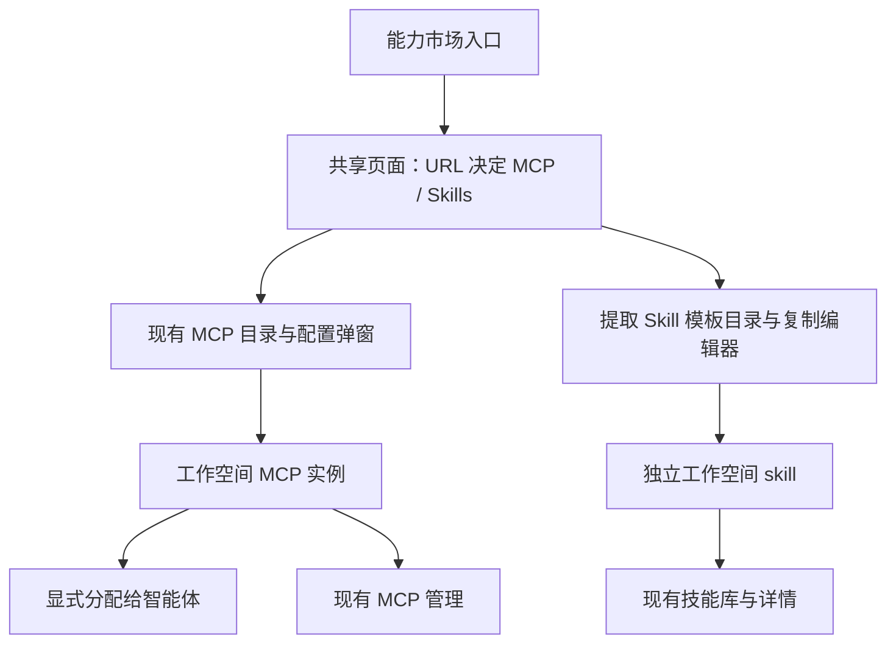

# 能力市场设计方案

状态：用户已批准按本方案实施，仅整合市场，保留管理入口。

## 方案比较

| 方案 | 体验与代价 | 结论 |
| --- | --- | --- |
| 独立市场入口，页内 MCP / Skills 切换 | 发现路径统一，管理位置稳定，可复用组件/API | 推荐 |
| 能力中心同时容纳市场和已安装管理 | 菜单更少，但管理导航、详情返回和筛选全部需调整 | 用户已选择不采用 |
| 仅将原菜单放进可折叠分组 | 改动少，但页面仍混合市场和管理，没有完成提取 | 不采用 |

## 页面组织

```text
资源与连接
  能力市场 → MCP / Skills 两个页内标签
  技能库   → 已有 skill 的管理
  MCP      → 已有服务器配置及分配管理
  运行时
```

市场只显示一个标题、两个类型标签及当前类型的来源/分类/搜索/卡片，不增加“全部能力”聚合列表或二级侧边栏。每种能力沿用自身操作：skill “从模板创建”，MCP “配置并添加”。不将模板存在误报为已安装或已连接。

## 路由与多端导航

| 目的地 | 建议路径 |
| --- | --- |
| 能力市场 | /{slug}/marketplace |
| MCP 市场 | /{slug}/marketplace?type=mcp |
| Skill 市场 | /{slug}/marketplace?type=skills |
| 技能库及详情 | 保留 /{slug}/skills、/{slug}/skills/{id} |
| MCP 管理 | 保留 /{slug}/mcp |
| Settings MCP 挂载入口 | 保留现有 /{slug}/settings?tab=mcp 的可达行为 |

- 无 type 时默认 MCP；未知值回退 MCP。类型选择由 URL 决定，点击通过 NavigationAdapter.push 更新，支持刷新、前进后退及桌面会话恢复。
- core/paths 集中生成路径。marketplace() 保持无参数供注册表使用；类型入口用独立的必传类型参数方法。
- 市场保持工作空间作用域和 Dashboard 权限边界，不新增前置全局市场或安装目标选择器。
- 补齐 WORKSPACE_PAGES、图标映射、locale、命令搜索关键词、编辑器无前缀链接识别和路径测试。
- Desktop 使用工作空间会话路由，不使用 WindowOverlay；桌面标签标题为“能力市场”。
- 旧市场使用页内状态，没有独立市场 URL；无需新增通用重定向。资源管理和详情链接保持有效。

## 组件与数据边界

新增 packages/views/marketplace/，通过 @multica/views/marketplace 导出共享页面。Web 增加薄页面，Desktop 注册同一页面。



- 页面壳只负责标题、类型导航、工作空间和面板生命周期。
- Skill：提取 SkillLibraryCatalog 的模板查询、筛选和卡片；复用 SkillTemplateCard、发现 helper、CreateSkillDialog。不要挂载完整 SkillsPage。
- MCP：复用 McpTemplateCatalog 和 McpSetupDialog，配接必要权限和旧版内置模板自定义编辑回调；不复制整个 McpTab 管理控制器。
- 仅在创建表单需要时加载相应数据，目录不初始化无关管理列表/虚拟器。
- 沿用 React Query 和 core 的现有偏好 store；不新增依赖、通用能力实体或全局市场 store。

## 原管理页面与上下文入口

技能库保留列表、新建、导入、编辑、删除和详情，移除原双 Tab。“从模板创建”和空态入口打开 Skill 市场。普通新建对话框内部现有模板选择步骤保留，避免重写创建流程。

MCP 管理保留自定义添加、改名、替换配置、删除、分配，移除嵌入式市场 Tab，增加“浏览能力市场”。Settings 中复用 McpTab 的入口同步处理。

Agent MCP 发现弹窗继续原地复用目录，携带目标智能体、运行时支持和命名冲突信息。Agent 的 skill 挂载继续选择技能库已有资源。

## 创建、关闭与返回

| 动作 | 结果 |
| --- | --- |
| 市场预览 skill | 使用现有指定模板预览及复制编辑器 |
| 新副本保存成功 | 留在 Skill 市场，更新关联状态，toast 可打开副本 |
| 普通新建或明确打开恢复结果 | 延续原详情导航 |
| MCP 保存成功 | 保留已保存 ID 与弹窗，进入可跳过的分配阶段 |
| MCP 部分分配失败 | 保留成功项，只重试失败项 |
| 关闭弹窗 | 恢复原卡片焦点，失效时到稳定页内操作 |
| 管理页进入市场 | 进入对应 type，通过平台返回可回原页 |

保留 dirty / pending / unknown-result 保护；市场类型切换保留已访问面板及未完成会话，并隐藏其 portal。实际代码确认 Desktop 仅挂载当前标签，跨工作空间/页面/桌面标签沿用既有临时弹窗关闭与隔离行为，本期不新增全局导航守卫或跨页草稿恢复。MCP 凭据不持久化，不进入 URL。

## 状态与权限

- 复用各自目录、实例和创建/分配 API，不合并查询 key 或领域模型。
- Skill 继续按模板来源关联副本，MCP 按 source + key 关联实例；多个副本/实例独立。
- 不将 Skill 创建限制为管理员。MCP 写入沿用 human owner/admin，Agent 所有者复用已有实例的权限保留。
- 运行时不支持可阻止分配，但不阻止浏览。
- Skill libraryView 读写及空库自动选择退役；持久化 rehydration 丢弃废弃字段，保留工作空间来源/分类偏好。
- 保留两类当前搜索与筛选语义，不开发跨类型统一搜索。
- 只有可见市场参与前台轮询；同时检查 Web 隐藏页和市场内非活跃类型。Desktop 切换标签会卸载旧页面，自然移除查询观察者。预览共享现有 query key，不建第二份目录缓存。
- 首载失败、缓存刷新失败、模板变更/撤下、工作空间资源未知分别展示；不将错误显示为空列表或未添加。
- 两类模板恢复语义保持不同：MCP 修改需重新审阅，撤下禁止从旧模板保存；Skill 尚未采用的预览撤下时禁止采用，已采用的独立草稿继续可编辑，刷新不覆盖草稿。

## 风险、规范与回退

主要风险：Skill 会话/焦点/虚拟器/旧偏好，MCP 保存后继续分配/后台轮询/凭据清理。具体证据见 research.md。

改动集中于共享前端、两端接线、locale、测试和文档；如发现必须改 API 或权限范围，先重新评审。更新 skill-market-discovery.md、mcp-market.md 的入口与生命周期说明，同步实际使用路径；归档历史保持原样。

无需数据库迁移。回退以还原页面组合与导航改动为主，既有及本次新创建的副本/实例继续被原接口管理，不删除用户资源。废弃的 libraryView 偏好丢失时，旧版本按默认视图回落即可。

中文“能力市场”、MCP / Skills 标签及原“技能库”菜单遵守现有术语规范；中英文一起更新。
