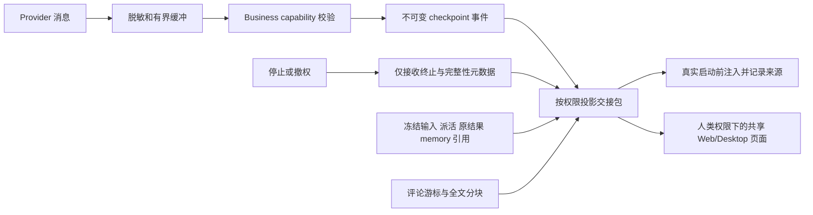

# 技术设计：可靠上下文交接与召回

状态：方案已批准，实施与集成验收进行中。源码依据和行号见 `research/*.md`；需求以 `prd.md` 为准；存在实现不代表验收完成。

## 1. 边界与数据流

复用 source-owned `collaboration_run_event`、现有 memory version、冻结 prompt、业务权限锁及人类记录页面。新增字段在协议边界统一解码，不让不同消费者各自解释原始 JSON。不新增通用文档/知识表、总结模型或依赖。

权限检查发生在存储与读取边界；prompt 中的 provenance 只描述来源，不能授权。失去读取权的人不能因为之前有 content_ref 或 snapshot_id 继续读取。

## 2. Checkpoint 与记录封口

### 写入与边界

新增窄 `POST /api/collaboration/runtime/runs/{runId}/checkpoints`。共享协议包含 version、完整 identity、attempt_seq/nonce、recording stream、checkpoint_seq、消息起止 offset、typed messages 和 partial 原因。使用稳定 producer key；同 key/同 payload 幂等 ACK，不同 payload 冲突。

新内容在与 Stop/撤权相同的事务锁次序下重新校验 issued business capability、当前完整 admission、reservation 和 attempt。已提交相同内容的重试可以沿用 outcome 的 content-free ACK 分支；不可读取旧正文或绕过当前权限新增内容。

工程初值保持现有 run 级存储上限：256 messages / 512 KiB decoded bodies，覆盖所有 fallback launch。单 chunk 至多 16 messages / 64 KiB，至多 256 chunks；每 5 秒、有满块或正常结束时 flush。单条 64 KiB 消息独占块。请求 JSON 转义膨胀有独立 HTTP 读取上限；业务预算以解码后正文计。服务端复用 redactor 和 typed message 校验，不接受客户端自报“已脱敏”。

daemon 使用一个有界 sender 队列、至多一个在途写入；不在 provider channel 消费循环同步等待 HTTP。丢失 ACK 的原 key/payload 进入现有 ledger 的恢复记录；不得凭发出请求就推进 acknowledged watermark。取消不等待无限 flush，不妨碍生命周期 Stop。

首次不可恢复的丢块（队列溢出或保留预算耗尽）即封住该 recording stream 的消息追加，标为 partial；不再跳过缺口发送更大的 ordinal。已在队列中的连续前缀仍可按原 key 交付。服务端 retained_through 从实际已提交 checkpoint 推导，daemon 的 acknowledged watermark 只表示本机收到的确认；ACK 丢失或较旧 seal 不能使服务端已有前缀消失。最终 outcome 也不得通过更高 offset 冒充补齐缺口；其独立 final result 可在当前授权有效时照常写入。网络不确定但原 payload 仍在 ledger 中不算丢块，先按同一身份重试。

### 封口与缺失

原终止通道增加版本化、严格字段的 recording seal：仅 run/attempt/launch 身份、最后 observed/ACKed offset 和枚举原因。拒绝任意正文、文件、路径、错误长文本或新 outcome。旧 token 的原身份校验及 proof/capacity 规则不变。seal 可在 settlement 后补齐但只能单调增加已知缺失信息，不把未知运行改成已证明终止。

服务端交接投影包含 `retained_through`、`observed_through`（可 unknown）、`completeness` 和原因。没有 seal 时，已保存前缀是事实，后面是否还有内容是未知。

### 与最终结果拼接

v1 outcome-only 写入/读取保持原样。新 writer 的 recording stream 为每条记录提供稳定 ordinal；checkpoint 前缀和最终 outcome 的完整/剩余部分必须在同一 stream 中一致。按 offset 校验并去重，不用正文相等来猜重复。出现不一致拒收冲突，不覆盖历史。

公开 record item kind 继续使用既有 message/tool_call/tool_result；使用稳定 stream/ordinal 标识，不能让最终结果到达后替换已分页展示的 ID。records 的 through_seq 固定页链水位；下一次刷新才纳入后来 checkpoint/outcome。

内部 `handoff_snapshot`、`wakeup_pending/assigned` 等元数据不得直接进入旧 record parser。SQL 改为明确选择可展示事件，checkpoint 通过受控投影转换为旧 item kind。测试新内部事件穿插任意位置仍可遍历整条页链。

## 3. 交接包与实际启动快照

在 `server/pkg/protocol` 定义统一版本化 DTO，不重复定义 CLI/service 类型。现有 `/context` 字段保留；新增 handoff 是带水位的实时投影。新增窄的 handoff base/read 操作取得一次逻辑 prompt 的冻结来源集合，复用 memory base 的“首次冻结、相同身份重取”模式；实际 launch 另行绑定，不能在来源冻结时预先宣称进程已经接收。

| 包字段 | 权威来源和缺失语义 |
| --- | --- |
| `snapshot` | version、mode、snapshot_id、run/逻辑 prompt 身份、issue event watermark；独立 launch binding 提供实际 attempt/nonce |
| `authority` | 当前锁定的 issue 状态/处理人；handoff 顺序来自 collaboration event sequence，不用时间戳猜顺序 |
| `intent` | 冻结 inputs、原作者、原始请求、当前 handoff 和 information request；resource owner 不是原作者 |
| `assignment` | 本 run 的 role/step/parent；正文取 parent 不可变 comment event 并核对 delegation hash，不能用可编辑评论 |
| `memory` | 既有 memory version、作者及内容引用；区分 launch base 与 live latest |
| `inputs` | 引用已有 claim 冻结输入，不重复正文；当前状态和 canonical `collaborationInputReaders` 返回的 reader IDs 有界分页 |
| `results` | run/role/step/leader_turn、typed result/event ref、outcome、reason、完整性；无结果明确 absent/unavailable |
| `wakeup_causes` | 所有实际分配给该续作的 source IDs、种类、顺序；旧记录不完整显式标记 |
| `sources` | 决定/理由/发现/被否决方案/下一步的原文引用和可用验证引用；不生成伪造的结构化结论 |
| `limits` | 各集合 total/returned/truncated、游标、缺失/清除/权限过滤原因 |

新增 handoff 材料预算为 256 KiB：计入 JSON 框架与全部元数据，source Content 按解码后的 UTF-8 正文计数；编码后的完整 JSON 另设 2 MiB 传输上限（含 snapshot 封装和结尾换行），服务端、daemon 与 core schema 使用一致口径。两种预算独立校验。原先单一 256 KiB JSON 上限与合法 64 KiB 派活正文矛盾：控制字符经必要 JSON 转义后可接近 384 KiB，关闭 HTML 转义也不能解决。此次分离保留材料限额和既有输入，不静默裁掉派活，也不新增强制正文补取流程。

runs/results 首页最多 32 条。普通评论的独立 recall 接口默认每页 50 条；v1 启动快照不自动装入普通评论。既有 claim inputs 保留 `collaboration_batches.go:19-20` 的 1024 条 / `(2 MiB - 32 KiB)` 预算，在 prompt 中只注入一次，不能以新上限拒绝原本合法的 batch。reader 明细等新增集合也有界分页。身份和本步骤 assignment 是新增包必需部分；其余内容按确定顺序取页并给出同授权域读取引用。测试接近旧 batch 上限、HTML/控制字符、多字节最大合法派活仍可启动；超材料或超实际传输字节均明确拒绝。整个 prompt 的上限由旧 inputs、既有 memory/brief/附件清单预算和新增 handoff 材料预算相加得出，不引入隐形收紧。

必须为被截断的 run results、来源证据和 wakeup causes 提供 runtime 可用的分页读操作；仅给人类 RunRecords URL 不算模型可召回。所有引用严格绑定 issue/run 和当前授权范围。

冻结事件保存当时的服务端非正文投影（状态/处理人/输入状态、准确的来源成员集合和 reader 集合），以及正文来源 ID/version/hash 和实际输入整体 hash。只存引用不足以还原后来变化的这些标量。memory 等可清除正文不重复存储；重放时从受权来源还原。来源已清除则保留原 expected hash 并单独返回 availability=missing/purged，不把删去正文后的响应冒充原 hash 匹配，也不偷偷换成新版文本。

实际启动采用两步，适配现有不可变 prompt 参数的 Backend.Execute：

1. preparation 和 memory base 完成后，为逻辑 prompt 获取冻结材料，构造实际输入并在 supervisor 保存 snapshot_id/hash；此时只是准备，不是已消费事实。
2. 每次 `hostSupervisor.BeforeLaunch` 先调用现有 authorize。对 provider launch，在新 permit 生效后、nonce burn/process start 前，服务端用当前 business capability 将同一 run 的 snapshot/hash 与实际 attempt/nonce 绑定，并复查全部来源的当前可读性、冻结 revision/hash 和清除状态。复查只针对实际进入快照的来源；已受理派活使用不可变事件，不能用后来编辑的评论改写。普通评论的版本变化由独立 recall/content 操作校验，不宣称未注入的讨论已经冻结或会阻止该启动。hash 覆盖组装后的实际 prompt（含 memory 和固定说明）。失败阻止启动；不通过在 observer 内临时替换已构造的 prompt 来修正。
3. Git preparation launch 不绑定模型输入。provider 内部 retry 与外层 fresh-session fallback 均保持同一 run 绑定的来源快照和 memory 基线；重取来源必须匹配原身份、版本与 hash，不能因 fallback 重新锚定到更新材料。每个实际 Provider 进程在 authorize 后独立绑定其准确输入 hash 与 attempt/nonce。Codex adapter 的恢复/重试说明必须包含在已校验的实际应用输入中，不能在绑定后改变文本。绑定成功后进程未启动仍保留“准备交付/未启动”，Started/termination 事实独立投影。

绑定、实际输入 hash 和 fake-provider stdin 的组合证明交付路径；仅记录 HTTP read 或 launch 绑定不宣称模型读懂。

历史 `outcome.body` 标为 `provider_result`；activity reason 保持活动原因。新 producer 区分 `result.Output` 和 `result.Error`，只有 backend 合同明确提供最终答复时才标为 final_answer；否则仍是 provider_result/unknown。不取最后一条 assistant 消息拼出答案。

## 4. 合并唤醒与并发

复用 group 锁和最多一个 prepared continuation 规则。每个 comment、joined input、member proof 都以稳定 source key 留下原因。立即入队时记录归属；延迟 proof wake 先记录 pending，再在 drain 时原子分配给待续作。

原因可保存在现有 run events，通过明确的 pending/assigned 查询连接。claim 冻结本轮原因集合；之后到达的原因归下一轮，不修改旧 snapshot。leader 顺序用已有 `leader_turn`，读者用已有 helper。proof 引发的原因只包含服务端已知元数据，在业务授权失效时仍不接收新文字。

## 5. 评论页与全文读取

集成决策：PRD R4/AC6 要求有界、带版本和权限的完整召回，并未要求把普通讨论预载到每次启动。v1 启动包固定在受理输入、memory 基线、交接说明及历史结果/派活来源；普通评论通过独立 runtime recall/content 接口读取，始终 data_only，并在每次读取时校验当前权限/版本。原设计把 recall 默认页大小与普通评论快照重放混在一起，此处纠正为实际交付合同。不得把这一边界描述成已实现普通评论的冻结、重放或编辑阻断；将来增加预载需另行完整实现其来源版本与绑定校验。

复用 `(created_at,id)` 的不透明游标。新增 runtime comments GET；人类与 runtime 使用各自授权入口，共用纯分页/预算逻辑，不能用人类 principal helper 冒充 runtime 作者。旧 `/context` 请求仍保留最新 200 条 comments 的原有语义；有界首屏用于显式新协议的 handoff/recall 读取，不悄悄把旧数组缩成 50 条。新启动流程不重复装入旧 context 的大数组。

新模式参数：limit 1–100（默认 50）、max_bytes 4 KiB–1 MiB（默认 64 KiB）、cursor。`bytes` 是最终 UTF-8 JSON 响应大小，包含 envelope；组装时计算元数据本身和 JSON 转义膨胀。预算太小连占位都放不下时明确 `budget_too_small`，不能返回重复游标空页。

响应保留 `items,next_cursor`，增加 total、returned、bytes、max_bytes、truncated 和原因。runtime total 使用其未删除可见集合；人类列表继续保留 tombstone。评论有完整性标记和服务端计算的作者角色/当前 SubmitCommand 能力；所有普通评论都是 data_only，即便作者当前有提交权。

首条完整评论超预算时返回有 ID/revision/作者/时间/content_ref 的显式占位，页游标越过它。新增窄的 runtime comment content GET 支持按 revision 绑定的内容游标分块，按 UTF-8 边界切分且满足 JSON 预算；编辑后返回 stale，删除/撤权立即拒绝，客户端不拼接不同版本。尚未选入页面的其他评论不可跳过。

人类旧请求不传 max_bytes 时保留完整条目；新 UI 显式请求预算，使用现有单评论详情恢复占位，展示加载状态，恢复前禁用编辑。旧 CLI 默认数组格式保持；新显式分页模式返回 envelope。为协作命令只开放新增分页 flags，并增加明确的内容读取操作，不放行普通任务的其他 filters/凭据覆盖。command 注册、CLI allowlist 和内置 skill/source map 同步更新。

## 6. 共享 UI 与 API 兼容

`core/collaboration` 定义 schema、API 方法和 query；凡预算改变投影，query key 包含预算。`views/collaboration/collaboration-detail.tsx` 展示加载范围，`comment-list.tsx` 处理来源和占位，`run-records.tsx` 展示 checkpoint 缺失与交接引用。不新增平台重复页面，文案同步 en/zh-Hans。

新字段用 zod/parseWithFallback 和严格 Go decoder。不存在的新字段表示 unsupported/unknown，不能伪造成完整空包。未知版本或错身份阻止新能力启动；旧客户端仍可读旧契约。新增支持版本不进入资源配置 digest，避免无意义撤销现有 consent。

分阶段启用：先部署支持新旧读取的 server，再更新 daemon/CLI，最后启用写入与默认注入。能力协商不得把“新字段存在”当授权。旧 server 不支持时维持明确的旧能力路径，UI/日志不得宣称可靠交接已启用。畸形已声明支持响应不能静默降级后继续新流程。

## 7. 回退与保留

先停新写入/新启动能力，保留新读者；已经持久化的事件不能删除来使旧二进制通过。回退到完全不理解 checkpoint 的 server 会破坏 records，需要将只读兼容投影保留在回退版本中。无须创建表时不增加迁移；确需索引时先确认空闲 migration 前缀，每个 concurrently index 单独文件，无外键或 cascade。

这份方案只保证可验证的服务端事实与输入交付。模型理解、真实 provider 稳定性和原生平台行为另有实验/验收记录；不解除现有默认关闭的产品开关。
