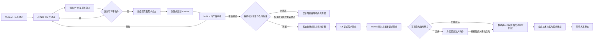

# Git 工程物料与 Multica 协作：设计草案

日期：2026-11-12。状态：planning，未批准实施。D1–D10 已记录：D7 为产品批准后系统受控自动合并需求 PR/MR；D8 为项目级自动启动开关，默认开启，关闭则方案任务进入待办；D9 是未来使用时将产品/测试物料仓关联到普通项目，由该项目兼任系统需求与协调入口；D10 确认稳定目录、分层状态与 Multica 归档管理。目标平台为 GitLab（含自建）或 GitHub，审核界面在 Multica，产品人员仅需 Multica 账号；首期边界未决，真实业务接入配置不作为当前开发前置条件。

已澄清目标组织方式：模块项目对应分布式系统中的模块，使用多个代码 Git 地址；产品/测试物料仓关联的普通项目作为系统级归属。该模型不假定当前开发环境已配置这些真实仓库或业务项目。跨项目编排仍待实现，不引入特殊“系统”项目类型。

## 1. 目标与候选首期

产品人员在 Multica 提出目标，AI 探索已授权工程并澄清需求，形成可评审 PRD 后自动推送需求分支并创建/更新 PR/MR。产品在 Multica 阅读、评论、批准或退回；业务审核通过后，由系统核对当前版本、预先配置的仓库授权与原生门禁，自动合并并核对实际结果，形成正式需求基线。正常路径无需另一位负责人逐份操作；阻塞时展示具体原因。

建议首期以这一条完整流程验证机制；沿用需求、设计、任务、缺陷的统一归属原则，但不因此承诺一次实现所有编辑器和全自动开发。该交付范围尚待用户确认。

## 2. 数据归属与对象边界

| 内容 | 权威来源 | Multica 的职责 |
| --- | --- | --- |
| 需求、设计、任务与缺陷定义，获批后的内容版本 | Git 文件与修订 | 展示对应版本、保留关联、提出候选变更 |
| 尚未送审的工作草稿 | Multica 中的候选修订 | 支持讨论与编辑；标明未入库/未获批，不能覆盖正式基线 |
| 讨论、指派、业务进度、运行与重试 | Multica | 持久化、协作与恢复，不逐次回写为 Git 内容 |
| Multica 内的需求讨论与业务审核决定 | Multica 中带身份、版本的记录 | 保存原始意图、审核依据、决定及撤回/过期关系，关联远端记录 |
| Git 平台原生 PR/MR 评论、review、门禁及合并事实 | 选定 Git 托管平台 | 核查、展示、缓存来源事实；写回保留真实执行身份，不伪装用户原生批准 |
| 工程探索依据 | 实际读取的工程版本/快照 | 记录仓库身份、修订、路径与引用，不使用可移动分支名代替版本 |

区分物料、业务事项与执行：一个物料有多个修订，可关联业务事项；一个事项可有多个运行。多个运行不是多份需求。需求定义修改不覆盖事项的运行状态，事项进度修改也不改需求正文。

建议区分共享物料身份与本地事项映射：物料由托管实例/仓库稳定 ID、稳定系统根标识和物料 ID 定位；工作空间、模块项目与事项仅建立各自有权限的关联，不能因跨空间或跨模块接手再复制一份物料。文件路径用于定位，改标题或目录迁移不产生新物料。是否复用既有 Issue 为主关联、跨空间映射及阶段派发归属如何表达，需在具体数据设计中确认。版本至少保留物料提交、文件内容摘要和所需代码仓各自的实际版本清单。

Git 中可保存验收条件与证据引用，但“内容已合并”本身不能证明审批人有权、审批覆盖当前内容或功能已实现。正式基线核对具体合并内容与批准对象；绕过审核的外部合并不能直接显示为获批。Squash/rebase 时合并 SHA 与评审 head 可不同，应检查实际物料内容对应关系。

### 物料仓目录与维护（D10 稳定目录与状态归属已确认）

完整目录、元数据示例和管理流程见 [物料仓布局方案](research/material-repository-layout.md)，依据见 [DeepSeek Harness 一手资料](research/deepseek-harness-primary-sources.md)。按当前模块型项目组织，建议一个业务系统一个逻辑物料根：`requirements/<id>/` 保存唯一 PRD、总体方案、跨模块计划与系统测试计划，必要时在其 `modules/<module-id>/` 细化模块任务；`issues/<id>/` 独立保存测试问题，`modules/<id>/` 保存长期模块目录与逻辑仓库引用，`contracts/` 保存跨模块契约或既有权威源的固定引用。`specs/`、`decisions/`、`knowledge/` 保持各自职责。文档按阶段产生，不生成占位文件；根入口保持简短，模板/schema 单独维护。

采用稳定 ID 和 Markdown frontmatter 建立关联，Multica 生成可重建索引；不要求所有更新争抢一个中央物料清单，也不按待办/进行中/已关闭搬目录。状态、分派、运行与 D8 项目开关保留在 Multica；文件中填写批准或执行字段不构成真实授权。规则文件、模板与 Agent 指南需要独立维护权限，普通需求自动合并仅覆盖其允许的物料路径。

D10 已确认完成、关闭、重新打开与归档均保持 Git 路径和物料 ID 不变，纯状态操作不生成物料提交。物料审核、需求交付和问题处理分别表达，归档是独立的展示/管理维度；归档后仍可搜索和追溯，不替代需求验收或缺陷复测。需求须整体验收通过才完成，问题修复后先待复测，通过后关闭，失败可重新打开；原始报告和修复证据保留版本关联。业务阶段表见目录研究，具体状态映射、转换权限和自动归档规则尚待设计，不直接扩展现有枚举或改写所有项目的完成语义。

D9 已确定物料项目兼任协调入口，具体目录兼容与 QA 入库流程仍待定案。模块使用独立代码仓；一个模块可绑定多个 Git 地址，共享库可以被多个模块引用。功能使用时显式配置资源与访问权限：空物料仓可按模板初始化，已有内容可兼容读取，不按示例目录强制迁移文件；这些均为待实现接入行为，不要求当前已有真实仓库供检查。保密范围不同需使用授权引用，目录本身不提供 Git 读取权限隔离。测试问题可以关联零到多条需求、多个受影响模块及被测版本组合；未知归属先分流，不强制测试人员猜根因，也不为每个模块复制缺陷。问题确认与修复启动另定，不直接继承 D7/D8 的产品需求策略。

跨模块需求由 D9 的物料项目统一承接总体方案与整体验收，再关联各模块项目任务。功能投入使用时配置一个普通项目及其物料仓资源；协调能力落在这一项目中，不额外建立协调容器。Git 仓是内容资源，Multica 项目是业务与执行容器，将两者关联不等于所有跨项目自动化已经可用。产品与测试从这个统一入口操作，模块任务引用同一获批需求，分别记录模块方案/任务版本、代码结果和依赖；不能让每个仓库事件消费者各生成一份总体方案。需求合并后的总体方案阶段遵循该入口项目的 D8 配置，总体与模块阶段的具体配合尚待评审；协调任务不能据此绕过关闭的模块开关或未经批准开始编码。

跨代码仓没有原子合并或统一提交号。执行和测试冻结物料仓及每个相关代码仓的版本，关联实际构建/镜像与环境；追踪部分合并、契约兼容和部署顺序。模块任务完成或单仓测试通过均不等于系统需求完成，整体结果需要全部必要模块与该版本组合的联调验收证据。

### 与后续自动开发衔接（D8 启动策略已确认，技术合同待评审）

正式需求基线作为后续方案阶段的输入。D8 已确认在项目配置自动启动开关：默认开启，核对基线后启动技术方案生成与任务拆解；关闭则先建立待办，等待手动启动。首期交付边界仍待定案，本节不代表现有产品已经完成对接。

后续链路：正式需求基线 → 按项目开关自动启动或进入待办后手动启动 → 技术方案与任务计划 → 方案审核 → Agent 编码与测试 → 代码评审/合并 → 验收。D8 只控制方案阶段的启动，编码仍须等待当前方案审核通过；审核角色和再后续阶段的自动化范围另行定案。

首期建议固定以下交接信息，具体字段与接口仍待设计收敛：

| 交接内容 | 后续流程的用途 |
| --- | --- |
| 工作空间、项目、稳定需求 ID 及关联业务事项 | 技术方案、任务和运行沿用同一需求来源，无须重新录入需求或复制出另一份业务身份 |
| 需求仓身份、实际合并修订、受控文件路径与内容摘要 | 读取被批准且已合并的完整 PRD，不以可移动分支名或聊天摘要代替执行依据 |
| 范围、约束、带稳定标识的验收条件与样例引用 | 任务拆解对应具体需求，后续测试和验收能逐项回查 |
| 工程来源仓、实际读取修订或快照、证据引用 | 开发启动时检查工程现状与需求形成时的依据是否一致；相关变化需要补充分析 |
| Multica 审核决定引用、适用修订、原生门禁核对及实际合并记录 | 证明输入的业务有效性，保留真实审核人与合并人；这些记录不自行授予代码开发权限 |

交接信息引用 Git 中的物料定义及各系统的审核事实，不另建一份可独立改写的正式 PRD。后续产生的设计、任务定义继续按 D3 保存于 Git；指派、进度和运行保留于 Multica。每个后续对象记录所采用的需求版本及验收条件，开发目标仓与写入权限从可信项目配置取得，需求仓的写权限不能代替代码仓授权。

#### Agent 收到的 PRD 内容（建议）

建议同时提供固定版本正文和来源引用。阶段交接记录保存稳定需求 ID、需求仓身份、完整提交 SHA、文件路径和内容摘要；宿主或受控执行准备阶段按该引用读取、核对正文，再向 Agent 提供可读取的内容与来源信息。传递的原文是最终审核并合并的 PRD；若审核期间修改过，以核对后的合并内容为准。

| 传递项 | 建议形式 |
| --- | --- |
| 常规长度的 PRD | 将完整 Markdown 正文载入任务上下文，保留范围、约束和验收条件 |
| 超出上下文容量的 PRD | 提供可读取的完整只读文件或固定版本文档读取入口；提示中包含版本清单、目录、当前任务相关章节和验收条件，Agent 可继续读取全文 |
| 来源与追溯 | 附 GitLab/GitHub 的提交版本文件链接、仓库身份、完整提交 SHA、路径、内容摘要及审核/合并记录引用；PR/MR 链接用于审计，不独自充当正文来源 |

长文档的摘要和节选只帮助定位，不能静默截断全文或取代原始验收条件。链接指向具体提交，执行中不因默认分支移动而改读新版本。必要的文档附件也应保留固定版本引用并在授权范围内可读取。

私有仓读取由已授权的连接器或执行准备服务完成，并检查当前工作空间、项目及执行身份的访问权限；凭据不写入 Agent 提示或正文。正文获取失败、内容摘要不符或访问权限不足时，输入保持未就绪，不能用只有网页链接的输入冒充文档已加载，也不能静默切换到其他版本。已核对正文的运行快照是 Git 版本的只读副本；修改建议进入新的候选修订，不直接改变正式需求。

需求就绪与阶段启动分别处理。按 D8，配置归属工作空间内的项目，默认开启，持久保存显式关闭值；不引入单条需求覆盖。基线核对通过后，以项目、稳定需求 ID、获批基线和阶段定位同一后续任务：开关开启且输入、执行身份与环境可用时持久化一次启动意图，再派发方案生成与任务拆解；关闭时任务进入待办并记录等待手动启动，不创建可执行派发。手动启动在同一任务上重新核对输入、权限与已存在的运行，不能重复创建阶段。

“待办”采用本项目已有 `todo` 语义，不能改称或暗中映射为 `backlog`。现有创建路径会为已指派且不在 `backlog` 的事项启动 Agent/小队，见 [IssueService 创建流程](../../../server/internal/service/issue.go#L219) 与 [派发判断](../../../server/internal/service/issue.go#L905)。因此关闭路径必须在服务端明确保持“等待手动启动”，并检查创建、指派、恢复和任务领取等相关入口；仅将状态写成 `todo` 或只在前端隐藏启动动作无法满足 D8。应优先复用现有任务与执行控制，实际持久化字段和统一判定位置在接口设计中定案。

新建后续任务及启动采用可恢复的意图记录：合并通知丢失由对账发现，重复通知定位原任务；已创建但未派发可继续，派发回执丢失先核对已有运行。源 PRD 不可读、版本改变或权限撤销时显示阻塞，不把开启开关当作忽略条件的授权。开关值的变化不等于恢复事件；重新开启是否补启动既有待办尚待用户确认，建议已有待办继续手动启动，运行中的任务使用独立暂停/取消操作。

需求变更后，产生新的候选版本并重新审核合并。后续通过需求版本与依赖关系识别受影响的方案、任务和测试，暂停受影响的后续推进并重新核对；保留已有运行及产物，不能把旧版本的测试通过当成新版本已完成。未受影响的材料无需仅因仓库出现其他提交就全部重做。

交接验证先使用不派发真实 Agent 的消费样例，核对完整 PRD、验收条件、工程来源与固定 Git 内容一致，大文档全文可读取。再按 PAC12–PAC14 验证项目默认开启、关闭持久化、待办不执行、手动启动、跨项目隔离及故障恢复；模拟调度通过不能替代真实方案产出和审核阶段验收。相关身份与版本依据见 [贯通示例](research/requirements-depth.md) 和 [现有能力边界](research/multica-existing-capabilities.md)。

## 3. 复用与增量

复用现有 Project/Issue/Agent run、多仓库 checkout、讨论、项目资源、PR 关联与权限检查；依据见 [源码核查](research/multica-existing-capabilities.md) 和 [产品流程核查](research/product-authoring-workflow.md)。

保持插件交付目标：插件可呈现文档、证据与入库状态，连接外部工具。受控写入、持久化操作记录、后台对账与阶段规则需要宿主明确支持，不能仅依赖当前可能丢弃的插件事件。针对 GitLab/GitHub 核查可复用的扩展点与所需窄接口，不预先建设通用工作流引擎。

### GitLab / GitHub 适配

用户已明确两者均可作为需求仓。每个项目的需求输出配置选择一个托管实例与仓库，统一物料身份、修订和发布意图；MR/PR 的名称、身份授权、状态读取与远端写入在平台适配处处理。此处不引入跨两平台镜像写入需求。

现有代码的两条读取路径可复用：GitLab 位于 `server/internal/integrations/vcs/`，GitHub 使用独立 handler。现有 VCS Provider 接口只定义事件解析、验签和令牌检查，没有创建 MR 或批准合并的方法；不为本需求先重构这两套已用路径。发布能力增加窄操作合同，并对两个目标平台分别验证。

现有 GitLab 集成文档面向自托管 Multica，通过部署开关启用；工程 checkout 与 Agent Git 操作是另一条执行路径。接入内网 GitLab 时必须验证 API、执行器到仓库的可达性、TLS 信任及 Webhook/对账路径，不能假设云端 Multica 可直连内网。具体部署与支持版本未定，不通过关闭 TLS 校验规避环境配置。

GitHub 当前代码使用 github.com 的 App/API 地址；用户尚未要求 GitHub Enterprise Server，不据此声称覆盖它。现有只读 GitHub App 和 GitLab `read_api` 令牌不自动获得提交能力；需求发布采用单独明确授权的写入能力，发布身份与人工审核身份分别记录。各平台的审批、权限和版本限制需以官方资料和目标实例共同核验。

源码依据：[VCS Provider 只读协议](../../../server/internal/integrations/vcs/vcs.go#L115)、[GitLab 实例 API](../../../server/internal/integrations/vcs/gitlab.go#L205)、[现有 GitLab 集成部署边界](../../../apps/docs/content/docs/vcs-integration.mdx#L9)、[GitHub API 地址](../../../server/internal/handler/github.go#L36)。

官方资料核查见 [GitLab/GitHub 能力差异](research/gitlab-github-compatibility.md)。需要保持的差异：

- GitLab `read_api`、`write_repository` 与 `api` 不是同一权限：Git 推送可用不代表 MR 写 API 可用。GitHub 的 Contents 与 Pull requests 权限也需按实际动作区分。具体凭据类型与作用域待接入实例定案，不从现有只读连接静默升级。
- GitLab 可选审批与强制审批规则不是同一能力，后者依赖版本/套餐与配置；不得只凭某个 `approved` 布尔值或 `merged` 状态断言“当前版本已获负责人审核”。不因缺少高级功能直接假定 Free 不能使用，也不静默降级审核要求；先确认实际审核方式和可验证证据。
- 两平台的合并操作均有按 head SHA 核对的能力；GitLab approve 的 SHA 校验与 GitHub review 的 commit 关联语义不同。以平台实际合同分别实现版本验证，不能用一个统一布尔值掩盖差异。
- 发布身份不代表产品人员审批。按 D6，产品以 Multica 人类身份审核，系统另行同步可追溯记录；按修订后的 D7，已授权集成可在当前业务批准与仓库门禁满足后执行合并，但不能以机器人自批补足原生人工审批，也不能冒充审核人的 Git 身份。

建议增加三项明确能力：

1. **项目物料配置**：声明输入工程仓、需求输出仓、允许文档路径、目标分支及授权策略。用途配置与真正的访问控制分别实现。
2. **文档修订与送审判断**：保存候选内容、依据和阻塞项，判断可评审性；服务端校验来源、版本、授权与提交意图。
3. **受控需求提交与合并**：确定性写文档、commit、push、创建/更新关联 PR/MR；当前版本获得产品批准且满足仓库条件后执行合并。提交与合并分别持久化意图和实际回执，支持恢复与对账。

产品分析师保留 Observer 的读取与分析职责。它提交结构化分析结果后，由已获用户授权的产品流程决定并执行提交；不能把借用人类凭据或唤起可写 Agent 当作 Observer 的逃逸路径。若需要新的结果提交能力，应同时更新窄能力检查、角色说明与任务注入，不单改提示词。已有技术文档角色只描述已实现行为，不直接复用其完整角色合同写未来 PRD。

分析结果不构成发布授权，也不能携带可执行提交命令或覆盖目标仓/允许路径。发布器从可信项目配置和被冻结的文档修订构造动作；文档中的指令性文字按内容处理，不作为权限或执行指令。

## 4. 自动送审与审核

可评审条件草案：目标、范围与可观察验收明确，无阻塞性业务问题；现状与预期行为分开，工程依据可查；保留非阻塞未知项。AI 的语义判断给出依据，系统做结构/版本/权限核查；这些检查只能证明可送审，不能代替产品审核。

展示四个独立维度：文档修订、提交操作阶段、评审结果、业务进度。不要把它们揉成一个“已完成”。远端已推送但 PR 创建失败，应显示对应阶段并恢复创建，不重新生成不同内容。

普通讨论不自动提交；可评审修订以一个意图提交。未结束评审中的新修订更新同一 PR/MR，保留差异并重新核验审批适用范围。合并后的新需求修改进入新评审周期，保留旧基线；关闭且未合并的评审不得被后台无条件重开，继续意图由明确规则处理。

### Multica 内审核合同草案

以下细化 D5–D7，审核入口、账号要求与合并责任已确认；具体记录结构和同步方式仍为待评审方案：

1. 审核人打开的是明确的候选修订，可以阅读完整文档、与上次版本的差异、工程依据和未决项；“正式版本”和“本次待审版本”同时可辨认。
2. 评论与退回要求绑定对应文档修订。退回保留理由，由需求修订流程处理；AI 不得把“已回应意见”转换成人类批准。
3. 批准请求使用当前登录的人类身份，检查项目审核权限。记录物料 ID、修订/摘要、远端 MR/PR/head、决定、理由和时间。记录针对哪个对象作出判断，而不是一个永久 `approved=true`。
4. 已记录的决定不可被后台覆盖；撤回、修订导致失效或新的批准采用后续记录关联。远端出现新提交时重新核对适用性；不能将对旧 SHA 的批准套用到新内容。
5. 本地决定、远端写回与最终合并分别跟踪。同步超时保留真实本地决定并显示待核对；恢复查询已产生的远端记录，不重复发表评论或发起审批。
6. 按修订后的 D7，有效的产品批准创建一次受控合并意图；执行前再次核对审核权限、批准有效性、仓库/目标分支/允许路径、完整 PR/MR 变更和当前 HEAD，并核对集成身份的合并权限及仓库原生门禁。系统只合并获批的需求变更，不把同一 PR 中夹带的其他文件纳入授权。原生审批、检查或合并队列仍待处理时显示等待原因，条件满足后恢复原意图；批准已撤回、内容变化或出现冲突时停止自动推进并重新处理。
7. 通过目标平台支持的版本条件执行合并，绑定获批 HEAD，拒绝版本不匹配；不能在失败后悄悄改用新 HEAD 重试。Multica 保留 Git 返回的实际合并身份、时间与结果提交，并核对合并内容与批准对象；异步接受、入队或响应超时都不表示已合并。合并身份可以是系统集成，真实产品审核人单独保存。未经当前版本业务审核的外部合并仍展示真实事实，但不能据此标为正式获批基线。

**已确认的身份模式（D6）：产品人员仅需 Multica 账号。**

- 产品人员无需拥有或绑定 GitLab/GitHub 账号，也无需完成个人 Git 授权。服务端依据当前 Multica 登录身份和项目审核权限接受决定；拥有账号本身不授予所有项目的审核权。
- Multica 保存真实审核人及其权限范围、审核决定、所审修订、理由和时间。连接器使用已明确授权的仓库集成身份，在 MR/PR 同步审核摘要与原始记录链接；摘要标明 Multica 审核人、所审版本和决定，同时明确该记录由系统同步。实际执行身份与业务审核人分别保留，不以系统账号的原生 review 代替产品批准。
- 项目的 Git 连接仍需配置与实际动作匹配的仓库授权；这项接入要求与每位产品人员的账号要求分开。同步失败不抹除 Multica 已保存的人工决定，按前述独立阶段显示与恢复。
- 项目接入时由有权限的管理者预先配置系统的物料仓合并权限与适用规则。若仓库仍强制额外原生人工审批，该条件必须由合格审核人满足，系统只能等待；“产品批准后无需另一人操作”的完整路径要求目标仓规则与该业务流程相容。可在部署方案中配置物料仓的专用规则或适用的业务审批检查，但不能在运行时自动关闭保护、使用绕过权限或以机器人自批替代人工审批。具体支持方式待目标实例核验，本轮不修改任何仓库设置。

客户端不得自报审核人，Agent 不得使用人类会话，服务账号操作不得冒充个人操作。Git 中的文件仍为定义与获批版本的依据，Multica 审核决定与 Git 平台回执属于各自系统的审计事实。

## 5. 一致性、恢复与访问边界

- 每次送审先冻结物料修订、目标配置及工程来源，持久化提交意图，再产生远端副作用。提交前检查当前授权与配置，目标变化或内容过期时暂停原意图并重新判断。
- 对同一意图重试先查询已产生的分支、提交及 PR。网络超时记为待核对，不凭一次失败响应判断“远端没有成功”，也不盲目重做。
- 合并意图绑定物料修订、业务批准和远端 PR/MR；重复批准与通知复用同一意图。重试先读取实际合并事实：已合并则核对内容并回填，未合并则重新核对当前授权、批准和版本。文档变化、退回或批准撤回后，不继续执行旧意图；已发生的合并保留事实，新变更另走评审，不自动回滚正式分支。
- Webhook 和插件通知用于加速核对；持久化工作记录与对账负责恢复。按来源事件去重，并按业务意图区分“已收到”和“已完成”。不承诺跨 Git 与数据库的原子事务。
- 人工在 PR 分支编辑后，发布器比较预期版本；冲突需要保留双方变化，禁止用 force-push 覆盖。恢复索引不隐含启动新 Agent。
- 工程访问与需求写入分离，发布器只对配置目标与文档路径写入；拒绝路径越界或通过链接逃逸。普通 worktree 隔离与角色提示词不是文件系统沙箱。
- 需求合并核对后更新物料基线，再由 D8 的阶段规则决定启动方案任务或保留待办；合并事实本身不能证明 Agent 已启动。避免沿用带 closing intent 的普通 PR 关联而误关闭开发父事项；需要专门的物料评审关联或明确识别其用途。

## 6. 客户端与兼容性

在现有项目与事项中设计“草稿 / 待审候选 / 已获批版本”，显示与工程依据对应的修订、差异及入库状态。Multica 内审核包含阅读、评论、批准与退回；产品人员仅需 Multica 账号。批准操作明确提示将由系统自动合并当前需求版本，无需另加“提交合并”按钮。业务批准后按实际阶段显示“审核通过，正在合并”“等待仓库检查/审批”“合并受阻”或“已合并，正式需求生效”；版本变化时要求重新审核，入队或超时仍保留待核对状态。原生 Git 链接用于追溯，实际系统合并身份与产品审核人分别可查。以上 UI 仍是待实现设计。

插件界面通过 SDK/窄 API 与宿主交互，不直接依赖宿主内部包。若宿主增加共享 UI，逻辑放 `packages/core/`，业务组件放 `packages/views/`，web/desktop 做平台接入。宿主使用 React Query 管服务器状态，Zustand 只保留本地编辑草稿与视图状态；响应通过现有 schema 解析。需保证未配置物料流程的旧项目仍遵循现有行为，不全局改写 `done`。

项目设置提供“需求合并后自动启动方案生成”开关，默认开启；说明关闭后仍生成待办，稍后可手动启动。该项目的设置是服务器状态，显式关闭必须持久化，其他项目不受影响；不增加逐需求覆盖。待办保留获批需求、版本、拟执行阶段和“手动启动”入口；另行显示排队、运行、失败与等待方案审核，不能因创建待办就展示为 Agent 已运行。具体管理角色与重新开启的积压处理待最终方案定案。

数据库关系按项目约定由应用层维护，不加外键；并发索引使用独立单语句 migration。API、数据库字段与事件名待平台和角色决策收敛后定案，本文不提前承诺新端点。

## 7. 验证与推出

开发与业务接入分开：用可控 Git provider、隔离测试项目/数据及必要的临时本地 Git 仓验证读写、版本和编排，不依赖用户预建项目或提供真实业务 Git 地址。真实托管平台、私网连通性与权限规则在后续授权的集成环境中验证；模拟通过不冒充真实接入通过。运行时地址与授权需在实际 Git 操作前配置，不是写代码前必须取得的输入。

针对 PAC1–PAC15 验证：真实两仓来源、自动触发、未达条件不提交、重复/乱序/丢失事件、远端成功但响应丢失、人工并发修改、授权撤销、旧审批、文档合并不关闭开发事项；未绑定 Git 账号的有权产品人员完成审核、无项目审核权限时拒绝操作、同步记录的系统署名与原始决定回链、原生门禁独立核对，以及审核中的版本变化、伪造审核人、机器身份审批、重复批准和退回重提应有专门用例。D7 验证当前产品批准在授权与门禁满足时自动触发合并，无需额外人工操作；覆盖合并权限不足、额外原生审批、冲突、HEAD 改变、PR 夹带越权文件、批准撤回、队列等待及合并成功但响应丢失。只有核对实际合并内容才形成基线，旧批准或未经审核的外部合并不成为正式获批基线。D8 验证项目级默认开启、关闭后待办不执行、手动启动、跨项目隔离、重复与恢复不重复派发，以及当前方案未审核通过前不编码。GitLab 和 GitHub 分别保留能力与验证矩阵。使用确定性 provider 测试与隔离数据库，不让普通测试调用真实 Agent 或用户 Git。

真实试点再使用明确授权的测试仓和审核者，保存 PR、实际文件内容、版本、运行回执和工时。停止新提交须保留已产生远端变更与操作记录，继续只读核对；不通过删除共享分支或历史回滚来掩盖失败。

本轮没有实施、上线或运行这些验证。平台选项、审核入口、仅需 Multica 账号的审核身份模式及产品批准后系统受控自动合并方向已记录，交付顺序、实际仓库规则与首期范围仍未决，下一步不能进入 `task.py start`。
