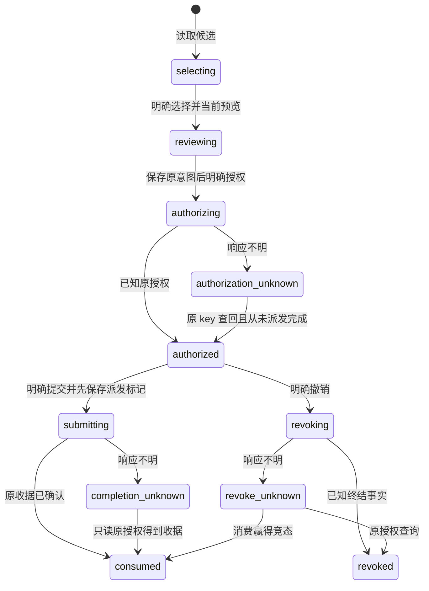

# M1-S1 技术与交互设计

> 当前F2状态：最小首包已按本线程明确授权实现并通过确定性验收，见 [F2验收](research/f2-acceptance-20261113.md)。以下设计/待授权文字保留为历史；task仍in_progress，M1其他入口及F3/F4/F5、真实运行禁区不变。

2026-11-12 M1-S1 规划提案，后按 task.json 所记范围获批并实现。第 1–7 节是 M1-S1 设计；第 8 节是 2026-11-13 的 F2 planning-only 技术提案与验收边界，尚有待决项，没有实现授权。

## 1. 选择与复用边界

采用“两个窄只读接口补齐发现/预览 + 原授权 API + 原普通 writer + 原最小收据查询”。Web/Desktop 共享 core 协调逻辑与 views 对话框，CLI 使用相同 wire 合同。原 v1 gate、observer、issuer/consumer 权限、撤销/消费串行化和事务收据均保留。

| 方案 | 取舍 |
| --- | --- |
| 选定方案：任务候选列表 + 所选证据预览 | 增加两个只读边界，能在服务端原权限与锁内取得完整绑定、期限；不复制观察器，不产生新持久评价 |
| 客户端拼接一般 approvals、project、artifact-package | 接口少，但 approvals 无 issue 分页，制品权限更窄、credential horizon 不可得；多次读取易混版本，不能满足当前证据需求 |
| 新建完整审批工作流/代理签发服务 | 增加第二套事实和授权语义，重复 v1 并扩大迁移风险；首包不采用 |

证据研究：[后端](research/m1-backend-current-contract.md)、[客户端](research/m1-clients-current-contract.md)。当前 PR head 仅来自数据库观察，不能写成实时远端 Git 核验、质量通过、已部署或已发布。

## 2. 只读证据准备（新增提案）

### 2.1 候选接口

`GET /api/issues/{id}/delivery-evidence/candidates?limit=20&cursor=...`

- 仅当前有权 human；通过普通 issue loader 规范化 UUID/人类编号，拒绝独立 collaboration。沿用 workspace selector 冲突拒绝规则、状态 catalog 与生命周期锁顺序。
- scope 固定为实际任务及当前项目；不能借父任务证据。只返回真实受控制品执行记录，不从评论“通过”、普通附件或模型自述制造候选。
- 逐候选应用原 artifact authority：一般 approvals 可读不代表可读制品。原发起/审批/生产者及运行时等条件继续复核；不能泄露无权候选 ID、摘要、数量或 digest。列表过滤与分页不得用数据库失败伪装空列表。
- 建议默认 20、最大 50，稳定排序 `(created_at DESC, approval_id DESC)`。首屏固定扫描时间上界，cursor 绑定 issue/revision/上界/最后已返回的有权候选；每页重新鉴权，版本变化返回冲突并重新开始。分页、has_more 只基于完整 artifact authority 校验通过的集合：可先 SQL 收窄，再逐项复核到 limit+1 个可见项或扫描结束。若有界扫描不足以确定这一页，返回通用 unavailable，不吐出由隐藏行造成的空页、隐藏计数或扫描位置。cursor 仅含已公开候选 ID，不包含不可见记录的 ID（base64/签名也不能遮蔽其内容）。cursor 不是授权，不接受它传入的身份/权限。
- 返回 `protocol_version:1`、`issue_id`、`issue_revision`、`project_id`、`checked_at`、`items`、`next_cursor`、`has_more`。候选包含 approval/execution ID、source revision、spec/artifact/receipt digest、创建/期限及可公开的结果摘要；缺失字段明确 nullable/不可选，不拼假 digest。无权字段不通过“错误详情”绕出。
- 不宣称跨页状态是冻结报告；选择后仍须当前预览。此接口不读取完整 tar、不生成制品、不触发外部 Git/Provider/审批执行。

### 2.2 所选证据预览接口

`POST /api/issues/{id}/delivery-evidence/completion-preview`

严格 body：`{expected_issue_revision, target_status, approval_id}`。unknown/重复/大小写别名/缺字段拒绝；不接受 evaluation_key、consumer、项目版本或客户端自报观察结论。

在一个无业务写的受控事务中解析当前活跃状态类别、issue/project/policy，验证所选制品的原 authority，复用 `deliveryPolicyTx`、`EvaluateDeliveryEvidenceInTx` 及已有必要锁/源事实读取。这里的“只读接口”允许原 FOR UPDATE/SHARE 锁，不设置与这些锁冲突的 PostgreSQL READ ONLY。不得先用 pool 读取一部分、再把它当同一快照拼进观察；遵守原 NOWAIT/超时顺序。候选列表不逐项执行完整观察，选中一个后才做。

成功响应的必需字段：

- `protocol_version:1`、规范 issue/当前及目标 status/category、project/policy mode/revision、`checked_at`。
- `observation`：从现有观察投影的 verdict/reason、observed_at、valid_until、source revision、observed head/provenance、approval/execution、spec/artifact/receipt digest。原 pass/hold/unknown 语义不变。
- `authorization_binding`：仅 enforce + 新完成 + 当前 pass 时为下节请求中 `contract_version/source_workspace_id/target/project/evidence/consumer` 的规范对象，否则为 null；这只是拟签请求的数据，不是 ticket。
- `max_expires_at`：可签分支为 `min(DB checked_at + 24h, evidence.valid_until, 有限 issuer credential expiry)`，UTC 微秒；未知或无剩余期限不得给可签绑定。只给合成上限，不披露凭据类型、ID、bearer 或内部 issuer 元数据。
- `enforced:false`、`usable_for_completion:false`、`skip_supported:false`。前两项描述预览动作，不能用作完成可用性。

non-done、done-to-done、无项目、off/observe 返回明确不适用分支，不签发；原提示流程继续负责其交互。不存在/失权拒绝沿用原最小错误，不能变成 attention。hold/unknown 可展示原失败或缺口，但不能启用签发。无持久评价/授权/状态/评论/队列写入；`Cache-Control:no-store`。创建授权时仍做新观察，预览不是可转让私有 evaluation。

## 3. 保留现有写入和查询合同

### 3.1 创建授权

`POST /api/delivery-completion-authorizations`，header `Idempotency-Key: <canonical nonzero UUID>`。不是 body 的 request_id。首次点击前生成并可靠保存原 key 和独立 operation UUID。

```json
{
  "contract_version": "delivery-completion-enforcement-v1",
  "source_workspace_id": "<source workspace UUID>",
  "operation_id": "<original operation UUID>",
  "target": {
    "kind": "ordinary", "issue_id": "<issue UUID>",
    "expected_issue_revision": 7, "expected_status": "in_review",
    "target_status": "done", "target_position": null
  },
  "project": {"id": "<project UUID>", "expected_revision": 3, "expected_policy_revision": 2},
  "evidence": {
    "issue_id": "<same issue UUID>", "expected_issue_revision": 7,
    "approval_id": "<selected approval UUID>",
    "expected_source_revision": "<40/64 lowercase hex>",
    "expected_spec_digest": "<64 lowercase hex>",
    "expected_artifact_digest": "<64 lowercase hex>"
  },
  "consumer": {"kind": "human", "user_id": "<current signer UUID>"},
  "expires_at": "<UTC Z timestamp at microsecond precision>",
  "reason": "<explicit acceptance reason>"
}
```

上面的角括号仅为格式说明，不能直接提交。版本/digest/consumer 使用预览规范值，不让 UI 随意修改；理由与有效期是明确的用户输入。建议默认有效期 `min(checked_at + 15min, max_expires_at)`，明确展示到期时刻，允许缩短或在上限内设置；过期后重新预览，不默默延长。同 key 不可换 payload；issuer/consumer 当前检查分别由原服务负责。首包不提供代他人、task、GitHub/VCS 或 R38 授权控件。

### 3.2 提交完成

复用 `PUT /api/issues/{id}`：

```json
{"status":"<exact selected done key>","completion":{"authorization_id":"<UUID>","operation_id":"<original UUID>","expected_issue_revision":7}}
```

字段名为 `completion`。首包不传 `target_position`、`position`、内容或 `suppress_run`。CLI 常规 `--no-start` 合同仍在原路径；新 submit 不接受此标志，不能在确认时悄悄丢掉用户请求。服务端最终验权、消费及状态/iteration/收据在原事务原子提交；不新增完成 endpoint 或第二次状态写入。

### 3.3 原操作读取与撤销

- 创建未知：`GET /api/delivery-completion-authorizations/by-request-key/{requestKey}?workspace_id=<source workspace UUID>`，原 human/current authority，header workspace 必须一致。查询参数是 `workspace_id`，与创建 body 的 `source_workspace_id` 不同。
- 已知 ID：`GET /api/delivery-completion-authorizations/{authorizationId}`；完成恢复走这里，不重发 PUT。
- DTO 原字段：`authorization_id/operation_id/issue_id/issue_revision/target_status/contract_version/created_at/expires_at/state/applicability/replayed`，可有 `completion_receipt`。
- 公共 receipt 只有 `authorization_id/operation_id/issue_id/completed_revision/target_status/completed_at/replayed`；actor/before 等更完整事实保存在后端，不能假设已有公共字段。精确比对 ID/operation/目标及 `completed_revision > 原预期版本`。
- 再读实际任务供当前状态展示。receipt 是历史事实；当前 issue 可以有更高 revision、已重开，甚至已不可读，不用 receipt 覆盖当前 cache。
- 撤销复用 `POST .../{authorizationId}/revocations` + 原撤销 `Idempotency-Key` + `{reason}`。创建、完成、撤销分别保留原 key/operation 语义。GET `revoked` 只证明授权被撤销，不一定能证明本次撤销请求是终结者；不虚构 revoker/请求收据字段。

## 4. 共享 UI 与恢复状态

从现有普通 status-only gate 分流 enforce；保留原非授权 hint DTO 和 null key。核心协调器负责带类型的实际提交，不能仅在 modal 新增按钮后调用捕获旧 updates 的无参 closure。用 typed result 让既有 `onDone`、run-confirm 等 continuation 只在原完成已证实且当前状态合适时执行；恢复读取本身不重放历史导航/通知或启动任务。



authorization_unknown 查回精确原授权且 state=issued、未过期，并且本地从未派发完成时，可以确认签发并进入 authorized；applicability=not_checked 仍不表示当前可消费，提交时原 writer 复核。若读到 consumed/revoked 则展示真实终结事实。completion_unknown/revoke_unknown 遇 issued/not_checked 则保留未知；所有未知态遇404、查询冲突或继续失败也不推出原写失败。结构化写请求的已知拒绝进入 refused；新意图须由用户重新查看当前证据后明确授权。单纯“刷新证据”只读取，不改变既有意图或恢复 key。

- 查看：任务标题/版本、原/目标状态、候选证据摘要、PR/source、digest、观察与失效时间；技术 ID 收在可复制详情中。主要按钮依序为“授权此版本完成”“提交完成”。授权后显示尚未提交。
- 签发前取消关闭即可；签发后可“关闭”或“撤销授权”，两个动作的后果明确。发出完成后只有查询结果/关闭，AbortController 不被视为服务端取消。关闭和卸载不能触发后续写。
- 当前失败显示已知原因；失权后移除受保护投影；目标/证据/项目改变时要求新的预览。不要自动挑另一个 artifact、改目标或套用最新 revision。
- 窄窗/长 hash 可换行或横向滚动；焦点圈定、关闭后返回来源按钮，键盘可选择与取消；加载、空、拒绝、未知和终结均有可读状态。只复用现有 Dialog、按钮、语义 tokens 和 i18n，不加依赖或独立 app 页面。

### 4.1 原意图与缓存归属

- server state（候选、观察、授权读、当前任务）放 React Query，key 包含 Server/用户/source workspace/issue/选择/目标；敏感响应不持久化。请求显式携带原 workspace，不依赖可能变化的全局 mirror。
- core 负责纯状态转换和同进程 scope/issue 单飞。用户已经确认的原写请求是 durable operation draft，按现有 admin/collaboration 模式通过 StorageAdapter 保存、读回比对后才发送；不把授权可用状态、私有评价或观察结果存成长期事实。
- draft 保存 scope、schema version、原创建 key/operation、不可变请求、已派发阶段、授权 ID（获得后）、独立撤销意图。每个 operation 独立 key，枚举待处理项，禁止用一个覆盖式 index 丢掉其他窗口的原请求。存储不支持安全枚举/验证则阻止写并解释恢复材料无法保留。
- 页面刷新只恢复查询入口；未派发完成且成功创建/找回的授权可由用户再次点提交。持久标记只表明可能已派发，不因没有响应清零。跨进程/多标签页不假设浏览器锁是安全边界，最终靠同任务版本/授权的实际事务。
- 注册到现有 session cleanup/draft cleanup；登出、身份更换清除 draft 与 Query。不能为跨登录自动恢复留下上一人的数据。UI 可复制不含证据正文/秘密的最小恢复定位信息；原用户重新登录后自行输入原 key 查询仍受当前 authority。不能仅为丢失 key 新签。
- bound completion 不乐观标 done，不把控制字段写入缓存；按原 cache coordinator reconcile/invalidate detail/list/children/count/iteration，查询未知也应刷新当前数据。普通不带 binding 的更新继续原语义。旧收据不降低较新 issue revision。

## 5. CLI 合同（新增提案，尚不存在）

使用 `issue completion` 子命令，保留现有 `issue status` 与 status-only `issue update` 的 hint/plain PUT 行为及 enforce 拒绝；在可识别缺授权错误时给出 prepare 路径，不自动签。所有新命令支持 `--output table|json`，默认 json；人类进度去 stderr。

| 命令 | 参数与结果 |
| --- | --- |
| `prepare <id> --status <key>` | 无 approval 时读取候选，支持 `--limit/--cursor` 并暴露 has_more；不预选。加 `--approval <UUID> --operation-file <path>` 时取得所选预览，写本地准备文件；无服务端写。无合格证据返回原因，不生成可签材料。 |
| `authorize --operation-file <path> --accept --reason <text> --expires-at <UTC>` | `--accept` 为专用明确授权标志，通用 `--yes` 无效；要求 selected preview/source scope/current human 一致。生成原 UUID/key，固定请求并落盘验证后单次 POST。重复调用已有派发文件只查询原 key，不重签。 |
| `submit --operation-file <path>` | 必须已有成功创建/查询的原授权，发送上节精确 status + completion；先写派发标记。已派发或不明文件只查询，不重 PUT。拒绝 mixed/position/no-start 参数。 |
| `show --operation-file <path>` | 纯查询原 key 或 ID；不自动转 submit。输出历史原操作与当前 issue 两栏。支持不用文件的 `show --authorization-id <UUID>` 或 `show --request-key <UUID> --source-workspace <UUID>`，两者互斥。 |
| `revoke --operation-file <path> --reason <text>` | 明确撤销，单独生成并保存撤销 key；本次撤销已派发的文件只查询授权终结状态，不自动再撤销或完成。创建已派发本身不阻止首次明确撤销。 |

operation 文件为版本化本地意图，不含 bearer、evaluation key 或 issuer credential 元数据。新文件排他创建，0600、拒绝符号链接；更新使用同目录临时文件/原子替换及锁或等效排他约束，读回后才能联网写。记录真实 Server/user/source workspace 与原请求 hash，拒绝与当前 profile 不符或被改动的已派发请求；本地 hash 只防意外修改，不替代服务端验权。复用既有安全路径/文件读取习惯，不引入新依赖。文件准备成功不等于验收通过。

JSON 使用独立 `protocol_version:1` envelope：`outcome`、`operation`（原定位信息）、`authorization`/`completion_receipt`（原最小 DTO）、`current_issue`（可空）、`current_issue_read`、`reason`，不把新 envelope 当成旧 PUT issue DTO。outcome 为 `candidates|prepared|authorized|consumed|revoked|refused|unknown|not_applicable`。

退出码沿用 CLI 成功/非成功基线，不引入 shell 专用多码：0 表示命令期望的确定结果（包括成功列候选、prepared、authorized，或完整查询到的历史 consumed/revoked）；1 为参数/权限/拒绝/未知/查询失败。`submit` 只有原 consumed 且当前查询成功才返回0；当前已重开仍可返回0但明确历史 consumed 与当前 reopened，不声称当前 done。`show` 查到 issued 且本地可能已提交则 outcome unknown/exit1；没有本地派发信息时仅报告 authorization.state，不能断言从未完成。已知 consumed 但当前任务不可读保持历史事实，同时 current_issue_read=denied/unknown、exit1。原现有命令输出不改变。

## 6. 错误、兼容与禁止降级

| 情况 | 客户端动作 |
| --- | --- |
| 400 参数/严格 JSON 错误 | refused，修正输入；不得重签、重 PUT |
| 401/403/受保护 404 | 清受保护缓存，显示失权/不可用；保持未确认定位供合法原身份查询，不扩大读权限 |
| 409 stale/冲突/过期/撤销/锁竞争 | 保留原事实和拒绝原因；只读刷新或查询；重新授权是明确新意图 |
| 428 缺 completion binding | 常规入口提供明确授权入口，不把 hint confirmation 变成授权 |
| 503、网络超时、写后 abort、malformed 2xx | 对已派发写视为 unknown；查询原操作，绝不自动重复写 |
| GET state=issued/applicability=not_checked | 仅表明本次读取未看到终结；不是当前可用 grant 或安全重试许可 |
| 旧 backend 无候选/preview/授权接口 | 首包不可用；enforce 不降级。原非结构化 404/405 hint 兼容只用于原 hint 语义 |

新响应在 core API 边界用 zod + parseWithFallback；安全关键字段缺失/未知时 fallback 是明确不可用，不提供默认 pass/authorized。ID/目标/版本与原意图精确比对。现 wire int64 若超 JS safe integer 必须拒绝，不 round/truncate；CLI 保留 Go int64。读取新增无关字段可按兼容策略剥离，未知合同/状态不能默默成功。新 human endpoints 经过现 TaskCapabilityGuard，Reporter/Reviewer/task 不增加签发能力。

## 7. 文件边界、上线与回退

- server：新增候选/preview handler、窄查询和复用 service helper；原授权/writer 不重写。若复用需要提取私有函数，只作必要边界提取并守住已有测试。预计无需 migration；若发现必须改 schema，返回规划说明具体需要，不能顺手扩建账本。
- core：API schema/查询、completion 状态机/原意图、bound mutation settle 与 session cleanup；views：既有 gate 的类型化分流及一个共享授权对话框。app 只验证既有挂载，不复制业务代码。
- CLI：独立 command 文件及测试，接入既有 issue command；同步 working-on-issues、creating-agents 内置 SKILL.md 和 source maps。
- 完成证据、提示 spec 只在实际实现并验证后同步；本轮不把提案写成已交付 spec。
- 部署此包不在本轮授权内。将来先发布支持新只读接口的服务端，再启用客户端流程，保留旧客户端被 enforce 合法拒绝的边界。不修改项目 policy 默认值。
- 回退 UI/CLI 新入口即可停止新增签发；保留原授权/终结记录与查询，不回滚 v1、不删除审计数据。不能通过自动切 off/observe 解决兼容或测试失败。真实运行条件另见独立任务 PRD。

本设计的剩余风险是多窗口竞争、权限受限后的不可恢复读和当前证据的时效；分别由服务端事务、明确 unknown/denied 和提交时重检约束。task.json 记录了对当前 M1-S1 规划版本的明确批准及授权哈希；此批准仅覆盖该首包。实施中若发现需要改变 wire、权限或数据边界，先回到规划审阅。真实 Provider、知识注入、发布、Hosted CI 和部署不在本设计授权内。

## 8. F2 确定性报告快照：设计与审阅边界（design only）

状态：可审阅提案，D1–D6 尚未解决，不是实现就绪。F2 不属于 2026-11-12 的 M1-S1 批准。本节不授权 schema/migration、路由、Reporter capability、采集执行或 Provider 调用。当前任务保持 in_progress，只表示 roadmap 在推进。

完整源码锚点、逐指标权威/公式、coverage 示例、A01–A16 验收及待决项见 [F2 research](research/f2-deterministic-report-snapshot-planning-20261113.md)。requirements.md 的 F2-01–12 是结果需求；本节是技术合同提案，implement.md §9 记录尚未完成的规划/未来验证门。

### 8.1 选择、复用与边界

采用“授权 cut 中采集最小事实 → 确定性 reducer → 一次封存 → 按 ID 当前验权重读”的方向；模型只解释已冻结事实，模型正文与结果账本分离。不是保存查询参数后每次重新执行，也不是复制现有进度更新写入路径。

- 复用 projecthealth 的正式项目范围、状态分类、风险/时区规则、CanonicalJSON 经验；保留旧 project-health / progress-update 行为作只读 baseline。其正常 complete 只检查 unknown_status，不能沿用作 F2 来源完整性证明；其 snapshot_version 也不等于持久报告身份。
- 拒绝仅保存 ID/digest：没有实际最小输入内容，旧来源被删/变更后不能重算。拒绝把 public Timeline 当完整 feed：2,000 activity cap，cursor 并非提交水位。
- iteration snapshots/事件、交付收据是已有局部事实/模式，不证明项目全部历史；不因存在它们而重建整个事件平台。本轮登记来源缺口，是否补采集能力待 D2/D5。
- 新 GET 权限不扩到生成、发表、刷新、评论、业务状态、策略、附件、审批或凭据交换。既有 Reporter 当前报告 inert comment POST 是另一份已存在的合同，本轮既不新增也不撤销。

### 8.2 不可变结果 envelope 与可重放事实

| 合同部分 | 必需冻结内容 |
| --- | --- |
| 身份/版本 | snapshot_id、report_issue_id、report_revision_at_capture、protocol_version（wire）、schema_version（持久输入）、semantics_version（统计口径）、collector/adapter_version、coverage_version；producer/task/claim 只作 provenance，不是读权限 |
| 范围 | canonical workspace_id/project_id（可 null）、scope_mode、cut 时正式准入规则、按 ID 去重的 cohort manifest、报告排除规则版本/依据；项目与报告版本分别保存 |
| 时间 | IANA timezone、配置来源/版本、reference_date、period_mode、可信 anchor/source、解析后的 UTC 微秒 start/end、半开 [start,end)、as_of、read-cut provenance；保留时区数据/解析规则版本和已解析边界 |
| 来源 | source kind/identity/native revision 或声明的 content revision、source schema、投影 payload+digest、time semantics、ordering/cursor、producer watermark（不可证明则 null）、retention boundary、page receipt、source gaps |
| 结果 | 按 metric 的 value/quality、verified source refs、coverage/gaps、count/ratio 使用 exact 整数分子/分母，project 指标按 bool/enum/timestamp/scalar 类型保存；stock_as_of 与 window_event_results 分开；缺 end 状态不拿当前值代替 |
| 封存/完整性 | materialization status（sealed_complete/sealed_partial，未 sealed 不可读）、facts_digest、result_digest、整体 snapshot_digest、原周期身份、可选 correction_of；仅保存 references/hash 不满足物化要求 |

时间与范围：start < end <= as_of；没有可靠时区/anchor 不猜测。滚动24小时/7天与自然日/周要显式选择；自然日按当地边界解析，DST 不固定为24小时。as_of 是采集 RR cut 的可读 DB 时间标签，与 cut 内可见性一起记录；它不是全局 commit watermark，不能用时间过滤重建。旧 cut 的 MVCC 标识仅供内部审计，事务结束后不得当持久读取凭据。

当前推荐 `cohort-as-of-v1`：正式 issue 按 cut 的 exact project 形成集合，排除已证实报告；窗口指标只描述该 cohort 的有证据记录，事件发生时项目归属不明则 unknown。移出项目的 issue 不由当前列表追溯回来；因此不能称作整个项目所有历史吞吐。D1 需审阅这个取舍；若改为 event-time membership，先补完整成员历史与最小权限方案。无 project 只保留当前报告自身 scope，project metrics=not_applicable。

规范编码保存有序唯一 ID 集合、UTC 微秒时间、确定的 null/enum/数值表达，固定 object key 编码/字符串规则；整型不经过浮点舍入，比例保存有理数，展示 rounding 不进入事实。facts_digest 覆盖实际规范输入；result_digest 覆盖 scope/time/语义/结果/coverage/gaps；snapshot_digest 再覆盖持久 envelope/provenance。随机 snapshot ID、采集分页大小和本次 GET checked_at 不影响相同输入的 facts/result 比较；同一 snapshot ID 的 sealed envelope 和整体 digest 永不修改。模型文字、当前权限、当前实时状态放在独立响应/叙述层，不能写回冻结 digest。

旧 schema/semantics reader 必须明确支持；不支持、内容损坏/丢失、保留期终止返回 unavailable/unsupported，不能按新代码重新解释或自动换 latest。完整性 hash 只证明所存内容未变，不证明来源没有漏报。

### 8.3 两个读 cut、封存和分页

采集 cut C：在一个已授权 RR 事务里读取实际 report/project、来源、最小依赖和各页；所有 SQL 使用同一 q/tx，不借 pool 拼页。DB 内来源可在同 cut 采集；跨系统若无可验证版本或水位，仅能记录已有输入与缺口，本轮不调用外部系统。

- 先定义必需 source/metric，再采集并生成不可变 manifest。producer 水位不可证实时为 null，不能把 `(created_at,id)`、row count 或最后一页当提交水位。缺失、截断、无序因果或不可读影响相应 metric 的 unknown。
- 每 source 定义 total order（例如 row ID；activity 的 time+ID 仅用于稳定遍历）与去重/冲突规则；检查最后边界/EOF 与已读清单。即使遍历 complete，生命周期 source 的 producer completeness 可以仍 unknown。
- 连接丢失或事务失败不能继续使用旧页；整体重启使用新 cut。可恢复单源 gap 的处理必须证明没有中止 RR；savepoint/限额/取消等采集机制待 D5，不能用一次 catch 忽略事务错误。
- 只有事实、结果、manifest 和 seal 完整一致后才可让 current 指向它。seal+current 发布的原子性、原周期幂等/correction/未知提交恢复需 D5 单独设计；GET 不执行这些操作。
- 迟到记录进入后继 cut。旧快照不追加“后来发现”的 gap/来源或数字；correction 新 ID，保留旧 identity/digest。原周期重试不自动发起 correction。

重读 cut R：每次 GET 建立新的 RR scope 校验当前 reader/token/task/runtime/principals 与 report/project，并在同 tx 读取原 snapshot 的持久正文。R 与原 C/as_of 不同；绝不恢复 C 时的权限，也不重查当前业务 rows 来重新计算。采集时 source 不可读是 gap；R 前 reader 撤权是 deny，无正文。

首包推荐两个 GET 返回有大小上限的最小完整结果/manifest，不接收 query。若 D3 要求外部 facts 分页，必须在 D4 另审精确只读形状，cursor 绑定 snapshot_id/scope/manifest_digest/schema/order/last_key，每页新建 R 验权，只遍历已物化事实；不得传入 actor/project 权威或将 current alias 翻页到另一个快照。cursor 采用不披露隐藏 source 的 opaque 格式；缺页/伪造/跨快照拒绝，不回查 live feed 补齐。未定大小/分页上限前不宣称 API 合同已冻结。

### 8.4 Coverage 与指标权威

采用 research §4 的逐 metric `coverage-v1`：完整可枚举时 E=I+X+U、coverage=I/(E−X)，I/X/U 互斥；来源缺失不能当排除。U 数量未知用 null+extent_unknown+gap，不造0或1；分母未知或0时 ratio=null。issue 计数指标用去重 issue 单位；project bool/enum/timestamp/scalar 指标按版本化的 required_dependency 清单计算覆盖，不能套 issue 分母；source 使用 row/event 单位，三类不相加。每指标声明 value_kind 与 coverage_unit；exact/partial/unknown/not_applicable 与值分开。计数 partial 只给已核实下界；布尔/健康/时间戳的依赖未齐则 value=null+unknown，不猜 false/clear 或空时间。

指标权威表与公式在 research §2：存量来自 cut 的正式 issue/状态类别及相关项目/主体/更新事实；窗口新增来自 created_at 和项目依据，完成/取消/关闭/重开来自有顺序/类别/归属证据的状态转换，closed 按非terminal→terminal 的不同 issue 去重；net=created−closed，不是 open 存量变化。报告 provenance 决定自排除，标题不是依据；分类未决影响 U。评论仅为叙述证据，执行成功、旧报告正文不能替代状态/部署/结果事实。

现有 project-health 是当前健康视图的权威，F2 sealed snapshot 是该 scope/语义/cut 历史报告的权威，人工 progress update 是人工发布内容/判断的权威。先按 research §2 用相同 cut/输入做只读双向 ID/数值对照，解释差异；不替换现有 API、不发布 update、不双写 issue/project。无当时输入的历史 update 标 not_replayable。

### 8.5 Reporter exact GET 与拒绝矩阵

待审阅路由提案（当前 closed TaskCapabilityGuard 均未允许）：

- GET `/api/issues/{canonical_report_uuid}/report-snapshots/current`
- GET `/api/issues/{canonical_report_uuid}/report-snapshots/{canonical_snapshot_uuid}`

路径 report UUID 必须等于 verified Reporter capability.IssueID。项目结果内嵌于该报告快照，不新增 workspace/project 快照列表；frozen project 不是 caller 的可选 query。current 只读已封存指针，没有快照返回最小 not-found，不触发生成；明确 snapshot ID 才是不可变重读身份。首包无 query（含空 key/重复 key 拒绝），HEAD/非GET 不从 GET 自动放行。

身份入口显式要求 server-provenance progress-reporter v2+ 与有效 frozen capability；不靠名字/提示词，不沿用 legacy NULL capability 的旧路由 passthrough。读取同一次 R 内的 live token、task/claim generation、runtime、agent、originator/owner/member/invoke 权限，以及实际 report/project/current pointer/snapshot envelope/payload。必须满足：

`snapshot.workspace_id == token.workspace_id == report.workspace_id`；`snapshot.report_issue_id == capability.IssueID == path.report_id`；`snapshot.project_id == capability.ProjectID == report.current_project_id`。比较前将内部 capability.ProjectID 的空字符串（现有 auth.TaskCapability 的无项目表示）和 DB nullable UUID 规范化为统一 OptionalUUID；公共 snapshot.project_id 用 null 表示无项目。非空值必须是规范 UUID，禁止把非法值也折成无项目；规范化后三方的 absent/present 及实际 ID 必须一致。不能在 guard 先检一个 scope，handler 再用 pool 读另一版本。

推荐允许 fresh claim 在自身完整当前授权且同 report/project 下读旧 snapshot，旧 producer claim 仅作 provenance；旧 terminal/revoked token 不恢复。获准采集的最小 frozen facts 在来源后来移出/删除后仍按当前 report/project 权限读；不得追加新的跨项目 live 内容。此保留/删除选择由 D3 审阅，并非绕过任何当前 reader 检查。

| 请求/变化 | 预期行为（提案） |
| --- | --- |
| 当前有效 Reporter + exact report/project/snapshot | 经同 R 验权返回已保存结果，no-store；无采集副作用 |
| 无 frozen project | 仅当前报告自身快照；project metrics 不适用，不列 workspace |
| 同项目另一个报告、snapshot/report 错配、跨项目/workspace、报告已移项目 | deny，无正文、source IDs、digest、隐藏计数或存在性提示 |
| Reviewer/custom/legacy token、仅名为 Reporter | 无 F2 新能力；handler 显式拒绝 |
| task terminal、claim/runtime 变更、originator invoke 撤销、主体非成员/禁用 | R 建立前可见则403，无正文；不能改成 gap/空快照 |
| token 缺失/过期/撤销 | 初始 Auth 发现为401；Auth 后、R 前发现为403；均无正文 |
| 路由/UUID 非规范、额外段、重复斜杠、编码歧义、未知/重复 query、非GET/HEAD | 拒绝且不通过 redirect/alias 绕过；不产生资源存在性差异 |
| 原始 actor/workspace header 伪造、重复或冲突 | 绝不改变 scope；若采用严格拒绝，需 Auth 覆写前专门检测。当前源码仅覆写，最终拒绝点/码仍为 D4，不能声称已实现 |
| 缺快照/错配快照 | 推荐统一最小404，避免枚举；授权失败先处理。403/404 最终分层待 D4 |
| DB/runtime 查询不可用、RR commit 失败 | 503/unavailable，无快照正文；缓冲响应只在事务成功后释放 |
| 创建/刷新/删除快照、附件、策略、completion authorization、凭据交换 | 无新增权限，拒绝；现有当前报告 inert comment 的合同不受影响 |

每页/每次重读重新验权，no-store，身份变化清除受保护客户端结果。拒绝响应不含历史 payload/hash/hidden count，成功也只含授权最小投影；内部 source manifest 不因“审计用途”泄漏不可读 ID。

RR 的授权线性化点是本次 R 建立：此前提交的撤权必须 deny；其后发生的撤权不保证收回该请求在途/已交付的字节，下个请求必须拒绝。在同一 RR 中于 commit 前再读一次不等于最新权限。若产品要求发送瞬间 fencing，须另审机制，不能声称 RR 自带此保证。当前参考测试为 `task_capability_test.go:350`、`task_capability_runtime_lookup_test.go:43`，只是现有合同证据，不是新 F2 测试。

### 8.6 验收、兼容与后续准入

A01–A16 在 research §5 给出明确 expected：分页/cut/迟到/重开/取消/移动/报告排除/unknown/损坏/重读/权限/幂等/零副作用。后续测试必须落在 reducer、source adapter、持久化及真实 Auth/router 的各自主层，不能用模型回答或文档检查替代。

未来持久模型若需要迁移，须单独设计应用层关联清理、保留与索引（不新增 FK/cascade，concurrent index 单语句文件）；本轮无迁移设计批准。新协议与已安装客户端按 additive/schema parsing 约束，未知版本 fail closed，无 latest/live 回退。关闭未来新入口可停止新增采集，但不得删历史或调共享 policy 求通过；发布/部署另有授权。

D1 范围/时间、D2 历史与报告身份、D3 保留/大小、D4 exact GET/错误/分页、D5 采集主体/幂等/原子发布、D6 coverage 与只读 parity 证据均待收敛。规划审阅通过不自动批准实现；M1-S2–S6、F3/F4/F5 仍保留后续状态。

## 9. F2 已授权执行合同

用户随后明确“F2 授权 ，请推进”。本批准独立于 M1-S1，覆盖 F2 实现与任务自有验证。前述 design-only/未授权文字属于上一轮历史状态；当前按 [F2 execution contract](research/f2-execution-contract-20261113.md) 收敛 D1–D6 并执行。来源不能证明的历史继续 unknown，不扩充真实 Provider、POLA-1、共享策略或其他 roadmap 包。task 保持 in_progress，不新建或归档。

## 10. 本次 F2 设计复核补充（仅设计与验收）

第9节是已有并行记录，本次不按其启动实施。第8节中“当前closed allowlist未允许”等源码描述仅适用于HEAD c79dfe304/前次观察；工作副本已有并行接线，未经本轮验收。完整补充合同、源码差异和反例在 [F2 research §8](research/f2-deterministic-report-snapshot-planning-20261113.md)，本节固定本次需要审阅的设计结论。

1. **冻结计算输入与结果。** 除scope/timezone/[start,end)/as_of/版本外，必须保留计算使用的当地reference/update/anchor日期或其原offset，防止tzdb变化改写health/age。规则版本需定位实际语义产物；source ID/hash不能代替最小物化内容，GET不回查live数据重算。内部采集页收据与独立于page size的facts/result摘要分开。
2. **区分三种完整性。** 每source分别说明可见行遍历、producer无损历史、retention/baseline完整性；watermark不可证明为null。采集C绑定所有页及实际q/tx，失去cut不得续拼；可恢复来源失败为安全gap，根权限失败或事务中止为整体拒绝/unavailable。read-cut/time标签不是持久全局提交水位。
3. **区分统计scope和coverage。** formal_stock包含普通正式报告/未分类任务，business stock/window只消费分类/历史证据；project health若用formal输入需明确标注。E/I/X/U有单位、谓词和互斥清单，I允许贡献0、X不收读失败、未知数量为null；gap只传播到依赖指标。complete由版本化必需source/metric集合决定，不能只检unknown_status或平均coverage。
4. **权威与只读parity。** 先解释旧project-health与ordinary formal的双向集合差，再在共同输入比较固定旧规则，最后应用报告排除；保留旧open含unknown、done_count含cancelled、无update时age=null以及health/reasons的精确含义。人工update、当前health和历史seal各自权威；不发布update取样、不双写业务数据、不调用模型。
5. **安全重放投影。** 物化输入不自动获得公开许可；逐字段界定envelope、provenance、源ID、request key、read cut和内部目录事实。推荐公共最小布尔/日期/类别足以复算公开指标，更丰富证据留内部；两种投影的摘要各自命名，不能泄漏隐藏内容hash。源后来删除/移出不自动改变旧facts；当前reader失权始终deny无正文。
6. **两个exact GET、一次当前R。** R建立于本次RR首次取得数据快照的查询，非BEGIN。Auth前保留raw headers，Auth后按verified身份在R中比较；token/task/runtime/principals、report/project、snapshot/current及正文共用tx。普通report revision改变不阻断历史读取，fresh claim无需等于producer；report移项目则拒绝。是否须继续ordinary/formal准入，见D3/D4待决项，不能仅因UUID相同隐式放行。
7. **拒绝不泄漏。** exact path/report/snapshot/project、无项目、角色/legacy、HEAD/query/header/编码歧义、撤权/commit失败按research拒绝矩阵验收；no-store覆盖Auth/guard早退。无snapshot正文/源ID/digest/隐藏计数/附件URL/wildcard cookie泄漏。R后撤权不承诺回收在途字节，但下一GET/页重验并拒绝。

未来采集主体、保留/删除、限额、公有分页、cycle/correction及seal发布均需单独落定；当前并行代码/执行合同仅作候选与差异证据。本轮不写schema/迁移/route/产品代码，不改变共享策略；实现准入、F2产品验证和其他roadmap范围均不因文档补充而完成。

## 11. 最小首包收敛设计

当前以 [最小首包合同](research/f2-minimum-contract-20261113.md) 为本次设计收敛入口。用户已选择正式存量先行/业务历史unknown、源变化后保留最小事实、人工显式采集；第8–10节中相应产品问题不再待答，其他技术证据仍保留。

核心变化是把内部manifest与Reporter公共投影分开封存：公共投影不泄漏creator/request key/read cut、来源origin链或目录身份，以逐issue的assignment validity、environment状态和逐project的lead validity等安全事实支撑纯计算；公共摘要只覆盖公开内容。内部保留实际源身份/版本与必要证明，不以hash代内容。该投影相对并行完整Snapshot响应是待落实设计差异，本轮不改源码。

人工采集需在同C验证实际报告编辑准入、ordinary/formal范围与当前project，原请求/cycle/correction/原子seal/current彼此区分。明确撤回与普通source删除不同：前者阻止原正文读取，后者按已确认规则保留；撤回状态应独立于sealed结果，需内部引用定位、读fence与清除/tombstone的技术方案。当前scope变化及report资格的精确读取建议、源writer证据和未来测试缺口均在最小合同，不能把它们当已实现。

## 12. F2 当前落地合同

后续明确授权与report-wide选择已落地：[server code-spec](../../spec/server/report-snapshots.md)。实现为同次保存internal/public/private audit的v2封存包，行级seal_digest绑定三者；公共project_reasons也从safe facts重放。capture/correction/withdraw共享实际更新的report control；撤回为本报告全部内容终止，不做跨报告来源治理或物理备份销毁。来源采集按独立依赖处理，未证历史保持unknown。当前验收与原失败保留见 [F2验收](research/f2-acceptance-20261113.md)，旧设计/并行草稿仅作历史依据。

## 13. F3 单一父任务预算根（design only，未授权实施）

完整合同在 [F3 最小合同](research/f3-minimum-budget-contract-20261113.md)，其 §11 是 2026-11-14 对照源码后的修订，冲突处以 §11 为准。本节只留设计骨架与接点；逐行 expected 在 [验收矩阵](research/f3-acceptance-matrix-20261113.md)。

### 13.1 选择与边界

- 根绑定普通父任务 `(workspace_id, root_issue_id)`，终身一个（D1，用户已确认）。准入状态 `open / closed / tombstoned` 与结算状态分两条轴；业务状态变化不动预算。
- 首包只观察：记录影子预留、已知实际、估算、未知与“若强制将拒绝”，不改变任何执行结果。强制准入是另一个需单独授权的包。
- `autopilot_quota` 是工作空间次数配额，`task_usage` 是可覆盖的当前值，hourly 是展示投影；三者都不是预算账本，首包不读它们来算金额，也不改它们。

### 13.2 数据职责（候选，未写迁移）

root/control、member binding、attempt/invocation、不可变 entries、operations/receipts 五类。全部无 FK，保存 ID 副本，因此现有 issue 删除的 FK 级联不会带走预算行。每个索引单独一条 CONCURRENTLY 迁移。

### 13.3 接点

| 接点 | 位置 | 做什么 |
| --- | --- | --- |
| 成员绑定 | issue 创建/改父/删除路径，已持有 `iteration:<ws>` fence 处 | 同事务写成员行；启用根时递归遍历并查环 |
| 影子预留 | `FinalizeTaskClaim` 事务内，身份 CAS 之后、发 token 之前 | 写 attempt、预留、收据，签发 `budget_attempt_id` 并随 launch payload 下发 |
| 用量事件 | 新的版本化上报入口（现有 `ReportTaskUsage` 保持不变） | 整批原子、原 key 幂等、逐事件收据 |
| 管理与读取 | exact root 的人工 API 与 `issue budget` CLI | 允许名单的人工来源 + 当前 owner/admin + 根任务编辑权 |

锁序：根行锁在所有路径中排最后；持根锁时不阻塞等待 task 或 issue 行。finalize 经已保存的成员行找根，不锁祖先。

### 13.4 与源码不符而已修订的假设

没有“按原 claim 查询”，重领即新 attempt；`claim_generation` 不上行，不能当执行身份；普通 agent 在 finalize 没有 invoke 复核；`RequireHumanActor` 对未知来源放行；quick-create 执行无 `issue_id`。详见合同 §11 R1–R10。

### 13.5 兼容与回退

响应为新增字段与新增端点，客户端经 schema 解析；旧 daemon 照常执行并记为覆盖缺口。回退是停止新观察、保留账目与只读，不做破坏性 down，不把金额降为 0。F2 报告快照与 M1-S1 完成授权不新增写路径。
