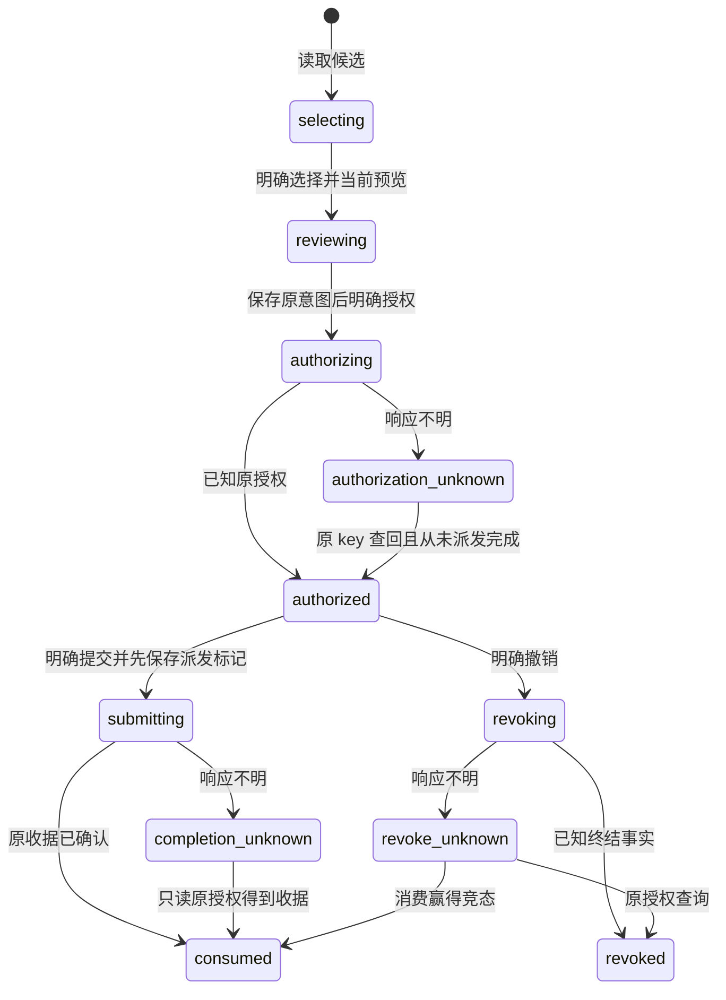

# M1-S1 技术与交互设计

2026-11-12 M1-S1 规划提案，后按 task.json 所记范围获批并实现。第 1–7 节是 M1-S1 设计；第 8 节是 2026-11-13 新增的 F2 planning-only 结果/验收边界，不是实现设计或实现授权。

## 1. 选择与复用边界

采用“两个窄只读接口补齐发现/预览 + 原授权 API + 原普通 writer + 原最小收据查询”。Web/Desktop 共享 core 协调逻辑与 views 对话框，CLI 使用相同 wire 合同。原 v1 gate、observer、issuer/consumer 权限、撤销/消费串行化和事务收据均保留。

| 方案 | 取舍 |
| --- | --- |
| 选定方案：任务候选列表 + 所选证据预览 | 增加两个只读边界，能在服务端原权限与锁内取得完整绑定、期限；不复制观察器，不产生新持久评价 |
| 客户端拼接一般 approvals、project、artifact-package | 接口少，但 approvals 无 issue 分页，制品权限更窄、credential horizon 不可得；多次读取易混版本，不能满足当前证据需求 |
| 新建完整审批工作流/代理签发服务 | 增加第二套事实和授权语义，重复 v1 并扩大迁移风险；首包不采用 |

证据研究：[后端](research/m1-backend-current-contract.md)、[客户端](research/m1-clients-current-contract.md)。当前 PR head 仅来自数据库观察，不能写成实时远端 Git 核验、质量通过、已部署或已发布。

## 2. 只读证据准备（新增提案）

### 2.1 候选接口

`GET /api/issues/{id}/delivery-evidence/candidates?limit=20&cursor=...`

- 仅当前有权 human；通过普通 issue loader 规范化 UUID/人类编号，拒绝独立 collaboration。沿用 workspace selector 冲突拒绝规则、状态 catalog 与生命周期锁顺序。
- scope 固定为实际任务及当前项目；不能借父任务证据。只返回真实受控制品执行记录，不从评论“通过”、普通附件或模型自述制造候选。
- 逐候选应用原 artifact authority：一般 approvals 可读不代表可读制品。原发起/审批/生产者及运行时等条件继续复核；不能泄露无权候选 ID、摘要、数量或 digest。列表过滤与分页不得用数据库失败伪装空列表。
- 建议默认 20、最大 50，稳定排序 `(created_at DESC, approval_id DESC)`。首屏固定扫描时间上界，cursor 绑定 issue/revision/上界/最后已返回的有权候选；每页重新鉴权，版本变化返回冲突并重新开始。分页、has_more 只基于完整 artifact authority 校验通过的集合：可先 SQL 收窄，再逐项复核到 limit+1 个可见项或扫描结束。若有界扫描不足以确定这一页，返回通用 unavailable，不吐出由隐藏行造成的空页、隐藏计数或扫描位置。cursor 仅含已公开候选 ID，不包含不可见记录的 ID（base64/签名也不能遮蔽其内容）。cursor 不是授权，不接受它传入的身份/权限。
- 返回 `protocol_version:1`、`issue_id`、`issue_revision`、`project_id`、`checked_at`、`items`、`next_cursor`、`has_more`。候选包含 approval/execution ID、source revision、spec/artifact/receipt digest、创建/期限及可公开的结果摘要；缺失字段明确 nullable/不可选，不拼假 digest。无权字段不通过“错误详情”绕出。
- 不宣称跨页状态是冻结报告；选择后仍须当前预览。此接口不读取完整 tar、不生成制品、不触发外部 Git/Provider/审批执行。

### 2.2 所选证据预览接口

`POST /api/issues/{id}/delivery-evidence/completion-preview`

严格 body：`{expected_issue_revision, target_status, approval_id}`。unknown/重复/大小写别名/缺字段拒绝；不接受 evaluation_key、consumer、项目版本或客户端自报观察结论。

在一个无业务写的受控事务中解析当前活跃状态类别、issue/project/policy，验证所选制品的原 authority，复用 `deliveryPolicyTx`、`EvaluateDeliveryEvidenceInTx` 及已有必要锁/源事实读取。这里的“只读接口”允许原 FOR UPDATE/SHARE 锁，不设置与这些锁冲突的 PostgreSQL READ ONLY。不得先用 pool 读取一部分、再把它当同一快照拼进观察；遵守原 NOWAIT/超时顺序。候选列表不逐项执行完整观察，选中一个后才做。

成功响应的必需字段：

- `protocol_version:1`、规范 issue/当前及目标 status/category、project/policy mode/revision、`checked_at`。
- `observation`：从现有观察投影的 verdict/reason、observed_at、valid_until、source revision、observed head/provenance、approval/execution、spec/artifact/receipt digest。原 pass/hold/unknown 语义不变。
- `authorization_binding`：仅 enforce + 新完成 + 当前 pass 时为下节请求中 `contract_version/source_workspace_id/target/project/evidence/consumer` 的规范对象，否则为 null；这只是拟签请求的数据，不是 ticket。
- `max_expires_at`：可签分支为 `min(DB checked_at + 24h, evidence.valid_until, 有限 issuer credential expiry)`，UTC 微秒；未知或无剩余期限不得给可签绑定。只给合成上限，不披露凭据类型、ID、bearer 或内部 issuer 元数据。
- `enforced:false`、`usable_for_completion:false`、`skip_supported:false`。前两项描述预览动作，不能用作完成可用性。

non-done、done-to-done、无项目、off/observe 返回明确不适用分支，不签发；原提示流程继续负责其交互。不存在/失权拒绝沿用原最小错误，不能变成 attention。hold/unknown 可展示原失败或缺口，但不能启用签发。无持久评价/授权/状态/评论/队列写入；`Cache-Control:no-store`。创建授权时仍做新观察，预览不是可转让私有 evaluation。

## 3. 保留现有写入和查询合同

### 3.1 创建授权

`POST /api/delivery-completion-authorizations`，header `Idempotency-Key: <canonical nonzero UUID>`。不是 body 的 request_id。首次点击前生成并可靠保存原 key 和独立 operation UUID。

```json
{
  "contract_version": "delivery-completion-enforcement-v1",
  "source_workspace_id": "<source workspace UUID>",
  "operation_id": "<original operation UUID>",
  "target": {
    "kind": "ordinary", "issue_id": "<issue UUID>",
    "expected_issue_revision": 7, "expected_status": "in_review",
    "target_status": "done", "target_position": null
  },
  "project": {"id": "<project UUID>", "expected_revision": 3, "expected_policy_revision": 2},
  "evidence": {
    "issue_id": "<same issue UUID>", "expected_issue_revision": 7,
    "approval_id": "<selected approval UUID>",
    "expected_source_revision": "<40/64 lowercase hex>",
    "expected_spec_digest": "<64 lowercase hex>",
    "expected_artifact_digest": "<64 lowercase hex>"
  },
  "consumer": {"kind": "human", "user_id": "<current signer UUID>"},
  "expires_at": "<UTC Z timestamp at microsecond precision>",
  "reason": "<explicit acceptance reason>"
}
```

上面的角括号仅为格式说明，不能直接提交。版本/digest/consumer 使用预览规范值，不让 UI 随意修改；理由与有效期是明确的用户输入。建议默认有效期 `min(checked_at + 15min, max_expires_at)`，明确展示到期时刻，允许缩短或在上限内设置；过期后重新预览，不默默延长。同 key 不可换 payload；issuer/consumer 当前检查分别由原服务负责。首包不提供代他人、task、GitHub/VCS 或 R38 授权控件。

### 3.2 提交完成

复用 `PUT /api/issues/{id}`：

```json
{"status":"<exact selected done key>","completion":{"authorization_id":"<UUID>","operation_id":"<original UUID>","expected_issue_revision":7}}
```

字段名为 `completion`。首包不传 `target_position`、`position`、内容或 `suppress_run`。CLI 常规 `--no-start` 合同仍在原路径；新 submit 不接受此标志，不能在确认时悄悄丢掉用户请求。服务端最终验权、消费及状态/iteration/收据在原事务原子提交；不新增完成 endpoint 或第二次状态写入。

### 3.3 原操作读取与撤销

- 创建未知：`GET /api/delivery-completion-authorizations/by-request-key/{requestKey}?workspace_id=<source workspace UUID>`，原 human/current authority，header workspace 必须一致。查询参数是 `workspace_id`，与创建 body 的 `source_workspace_id` 不同。
- 已知 ID：`GET /api/delivery-completion-authorizations/{authorizationId}`；完成恢复走这里，不重发 PUT。
- DTO 原字段：`authorization_id/operation_id/issue_id/issue_revision/target_status/contract_version/created_at/expires_at/state/applicability/replayed`，可有 `completion_receipt`。
- 公共 receipt 只有 `authorization_id/operation_id/issue_id/completed_revision/target_status/completed_at/replayed`；actor/before 等更完整事实保存在后端，不能假设已有公共字段。精确比对 ID/operation/目标及 `completed_revision > 原预期版本`。
- 再读实际任务供当前状态展示。receipt 是历史事实；当前 issue 可以有更高 revision、已重开，甚至已不可读，不用 receipt 覆盖当前 cache。
- 撤销复用 `POST .../{authorizationId}/revocations` + 原撤销 `Idempotency-Key` + `{reason}`。创建、完成、撤销分别保留原 key/operation 语义。GET `revoked` 只证明授权被撤销，不一定能证明本次撤销请求是终结者；不虚构 revoker/请求收据字段。

## 4. 共享 UI 与恢复状态

从现有普通 status-only gate 分流 enforce；保留原非授权 hint DTO 和 null key。核心协调器负责带类型的实际提交，不能仅在 modal 新增按钮后调用捕获旧 updates 的无参 closure。用 typed result 让既有 `onDone`、run-confirm 等 continuation 只在原完成已证实且当前状态合适时执行；恢复读取本身不重放历史导航/通知或启动任务。



authorization_unknown 查回精确原授权且 state=issued、未过期，并且本地从未派发完成时，可以确认签发并进入 authorized；applicability=not_checked 仍不表示当前可消费，提交时原 writer 复核。若读到 consumed/revoked 则展示真实终结事实。completion_unknown/revoke_unknown 遇 issued/not_checked 则保留未知；所有未知态遇404、查询冲突或继续失败也不推出原写失败。结构化写请求的已知拒绝进入 refused；新意图须由用户重新查看当前证据后明确授权。单纯“刷新证据”只读取，不改变既有意图或恢复 key。

- 查看：任务标题/版本、原/目标状态、候选证据摘要、PR/source、digest、观察与失效时间；技术 ID 收在可复制详情中。主要按钮依序为“授权此版本完成”“提交完成”。授权后显示尚未提交。
- 签发前取消关闭即可；签发后可“关闭”或“撤销授权”，两个动作的后果明确。发出完成后只有查询结果/关闭，AbortController 不被视为服务端取消。关闭和卸载不能触发后续写。
- 当前失败显示已知原因；失权后移除受保护投影；目标/证据/项目改变时要求新的预览。不要自动挑另一个 artifact、改目标或套用最新 revision。
- 窄窗/长 hash 可换行或横向滚动；焦点圈定、关闭后返回来源按钮，键盘可选择与取消；加载、空、拒绝、未知和终结均有可读状态。只复用现有 Dialog、按钮、语义 tokens 和 i18n，不加依赖或独立 app 页面。

### 4.1 原意图与缓存归属

- server state（候选、观察、授权读、当前任务）放 React Query，key 包含 Server/用户/source workspace/issue/选择/目标；敏感响应不持久化。请求显式携带原 workspace，不依赖可能变化的全局 mirror。
- core 负责纯状态转换和同进程 scope/issue 单飞。用户已经确认的原写请求是 durable operation draft，按现有 admin/collaboration 模式通过 StorageAdapter 保存、读回比对后才发送；不把授权可用状态、私有评价或观察结果存成长期事实。
- draft 保存 scope、schema version、原创建 key/operation、不可变请求、已派发阶段、授权 ID（获得后）、独立撤销意图。每个 operation 独立 key，枚举待处理项，禁止用一个覆盖式 index 丢掉其他窗口的原请求。存储不支持安全枚举/验证则阻止写并解释恢复材料无法保留。
- 页面刷新只恢复查询入口；未派发完成且成功创建/找回的授权可由用户再次点提交。持久标记只表明可能已派发，不因没有响应清零。跨进程/多标签页不假设浏览器锁是安全边界，最终靠同任务版本/授权的实际事务。
- 注册到现有 session cleanup/draft cleanup；登出、身份更换清除 draft 与 Query。不能为跨登录自动恢复留下上一人的数据。UI 可复制不含证据正文/秘密的最小恢复定位信息；原用户重新登录后自行输入原 key 查询仍受当前 authority。不能仅为丢失 key 新签。
- bound completion 不乐观标 done，不把控制字段写入缓存；按原 cache coordinator reconcile/invalidate detail/list/children/count/iteration，查询未知也应刷新当前数据。普通不带 binding 的更新继续原语义。旧收据不降低较新 issue revision。

## 5. CLI 合同（新增提案，尚不存在）

使用 `issue completion` 子命令，保留现有 `issue status` 与 status-only `issue update` 的 hint/plain PUT 行为及 enforce 拒绝；在可识别缺授权错误时给出 prepare 路径，不自动签。所有新命令支持 `--output table|json`，默认 json；人类进度去 stderr。

| 命令 | 参数与结果 |
| --- | --- |
| `prepare <id> --status <key>` | 无 approval 时读取候选，支持 `--limit/--cursor` 并暴露 has_more；不预选。加 `--approval <UUID> --operation-file <path>` 时取得所选预览，写本地准备文件；无服务端写。无合格证据返回原因，不生成可签材料。 |
| `authorize --operation-file <path> --accept --reason <text> --expires-at <UTC>` | `--accept` 为专用明确授权标志，通用 `--yes` 无效；要求 selected preview/source scope/current human 一致。生成原 UUID/key，固定请求并落盘验证后单次 POST。重复调用已有派发文件只查询原 key，不重签。 |
| `submit --operation-file <path>` | 必须已有成功创建/查询的原授权，发送上节精确 status + completion；先写派发标记。已派发或不明文件只查询，不重 PUT。拒绝 mixed/position/no-start 参数。 |
| `show --operation-file <path>` | 纯查询原 key 或 ID；不自动转 submit。输出历史原操作与当前 issue 两栏。支持不用文件的 `show --authorization-id <UUID>` 或 `show --request-key <UUID> --source-workspace <UUID>`，两者互斥。 |
| `revoke --operation-file <path> --reason <text>` | 明确撤销，单独生成并保存撤销 key；本次撤销已派发的文件只查询授权终结状态，不自动再撤销或完成。创建已派发本身不阻止首次明确撤销。 |

operation 文件为版本化本地意图，不含 bearer、evaluation key 或 issuer credential 元数据。新文件排他创建，0600、拒绝符号链接；更新使用同目录临时文件/原子替换及锁或等效排他约束，读回后才能联网写。记录真实 Server/user/source workspace 与原请求 hash，拒绝与当前 profile 不符或被改动的已派发请求；本地 hash 只防意外修改，不替代服务端验权。复用既有安全路径/文件读取习惯，不引入新依赖。文件准备成功不等于验收通过。

JSON 使用独立 `protocol_version:1` envelope：`outcome`、`operation`（原定位信息）、`authorization`/`completion_receipt`（原最小 DTO）、`current_issue`（可空）、`current_issue_read`、`reason`，不把新 envelope 当成旧 PUT issue DTO。outcome 为 `candidates|prepared|authorized|consumed|revoked|refused|unknown|not_applicable`。

退出码沿用 CLI 成功/非成功基线，不引入 shell 专用多码：0 表示命令期望的确定结果（包括成功列候选、prepared、authorized，或完整查询到的历史 consumed/revoked）；1 为参数/权限/拒绝/未知/查询失败。`submit` 只有原 consumed 且当前查询成功才返回0；当前已重开仍可返回0但明确历史 consumed 与当前 reopened，不声称当前 done。`show` 查到 issued 且本地可能已提交则 outcome unknown/exit1；没有本地派发信息时仅报告 authorization.state，不能断言从未完成。已知 consumed 但当前任务不可读保持历史事实，同时 current_issue_read=denied/unknown、exit1。原现有命令输出不改变。

## 6. 错误、兼容与禁止降级

| 情况 | 客户端动作 |
| --- | --- |
| 400 参数/严格 JSON 错误 | refused，修正输入；不得重签、重 PUT |
| 401/403/受保护 404 | 清受保护缓存，显示失权/不可用；保持未确认定位供合法原身份查询，不扩大读权限 |
| 409 stale/冲突/过期/撤销/锁竞争 | 保留原事实和拒绝原因；只读刷新或查询；重新授权是明确新意图 |
| 428 缺 completion binding | 常规入口提供明确授权入口，不把 hint confirmation 变成授权 |
| 503、网络超时、写后 abort、malformed 2xx | 对已派发写视为 unknown；查询原操作，绝不自动重复写 |
| GET state=issued/applicability=not_checked | 仅表明本次读取未看到终结；不是当前可用 grant 或安全重试许可 |
| 旧 backend 无候选/preview/授权接口 | 首包不可用；enforce 不降级。原非结构化 404/405 hint 兼容只用于原 hint 语义 |

新响应在 core API 边界用 zod + parseWithFallback；安全关键字段缺失/未知时 fallback 是明确不可用，不提供默认 pass/authorized。ID/目标/版本与原意图精确比对。现 wire int64 若超 JS safe integer 必须拒绝，不 round/truncate；CLI 保留 Go int64。读取新增无关字段可按兼容策略剥离，未知合同/状态不能默默成功。新 human endpoints 经过现 TaskCapabilityGuard，Reporter/Reviewer/task 不增加签发能力。

## 7. 文件边界、上线与回退

- server：新增候选/preview handler、窄查询和复用 service helper；原授权/writer 不重写。若复用需要提取私有函数，只作必要边界提取并守住已有测试。预计无需 migration；若发现必须改 schema，返回规划说明具体需要，不能顺手扩建账本。
- core：API schema/查询、completion 状态机/原意图、bound mutation settle 与 session cleanup；views：既有 gate 的类型化分流及一个共享授权对话框。app 只验证既有挂载，不复制业务代码。
- CLI：独立 command 文件及测试，接入既有 issue command；同步 working-on-issues、creating-agents 内置 SKILL.md 和 source maps。
- 完成证据、提示 spec 只在实际实现并验证后同步；本轮不把提案写成已交付 spec。
- 部署此包不在本轮授权内。将来先发布支持新只读接口的服务端，再启用客户端流程，保留旧客户端被 enforce 合法拒绝的边界。不修改项目 policy 默认值。
- 回退 UI/CLI 新入口即可停止新增签发；保留原授权/终结记录与查询，不回滚 v1、不删除审计数据。不能通过自动切 off/observe 解决兼容或测试失败。真实运行条件另见独立任务 PRD。

本设计的剩余风险是多窗口竞争、权限受限后的不可恢复读和当前证据的时效；分别由服务端事务、明确 unknown/denied 和提交时重检约束。task.json 记录了对当前 M1-S1 规划版本的明确批准及授权哈希；此批准仅覆盖该首包。实施中若发现需要改变 wire、权限或数据边界，先回到规划审阅。真实 Provider、知识注入、发布、Hosted CI 和部署不在本设计授权内。

## 8. F2 确定性报告快照：规划边界（design only）

本节只在现有 M2 roadmap 上冻结结果/数据源/覆盖率/权限的规划条件。F2 不在 2026-11-12 M1-S1 批准范围内；本节不授权 endpoint、schema/migration、Reporter token capability、model call、rollout 或业务实现。细节与验收清单见 [F2 planning research](research/f2-deterministic-report-snapshot-planning-20261113.md)。

### 已知代码边界与缺口

- `projecthealth.StatisticsSnapshot` 已含 `calculated_at`、timezone/reference date、project revision、aggregate counts、`snapshot_version` 与 incomplete reasons；目前 `complete` 只检查 `unknown_status`。它不是来源清单完整性证明。
- `project_update_revision.statistics_snapshot` 是版本化进度更新的内嵌统计结果，可作 read-only parity baseline；它不是单独可查询/重放的完整 report snapshot。
- `activity_log` 可提供生命周期 activity 的 `(created_at,id)` 稳定顺序。公共 issue Timeline 有 2,000 activity row cap 并带 `X-Timeline-Truncated`，不能当无损报表来源。该 tuple 也不是全局提交序列；必须把 source cut 与一个 repeatable-read 事务绑定，并将不能证明完整的来源标 `unknown/gap`。
- 当前 `issue` 与 `project` 行只表示当前值，不能重建整个窗口的历史 status/project membership。缺少所需历史事件时，不根据 `updated_at` 推断。

### 候选快照合同

不可变快照至少保存：`snapshot_id`、`protocol_version`、`semantics_version`、精确 `workspace/project` scope、timezone、半开 `[start,end)`、DB read cut 对应的 `as_of`、当前报告 issue 自排除规则、source identity/revision、每源 watermark/cursor 及排序定义、materialized source IDs/digests、结果事实、coverage/gap manifest 和 canonical result digest。重读用 snapshot identity 取回保存的结果；不能重新运行当前查询来重构历史结果。

覆盖率显式分解 `eligible/included/excluded/unknown`，并保存每个 exclusion/gap 的 reason 与 source boundary。快照采集时读不到 source、cursor/row count 不一致、出现截断、来源读权不足或 source 不支持所需历史时，结果必须 incomplete/unknown；unknown 不是 0。读取者的 Reporter capability/当前 issue/project 权限若在 replay 前撤销，则 deny 且不返回快照正文；不得把读者失权当作 snapshot data gap。迟到数据不改变旧快照，属于更晚的 `as_of` 或 source watermark。

### Reporter 最小权限门

候选能力仅是 verified `progress-reporter` task 对当前报告 issue 及其 frozen project 的只读投影。Reporter 不能枚举 workspace，也不能通过改变 path/query 读取其他 project；无 frozen project 时只允许当前报告自身读。新增 current/historical snapshot read 必须与 `TaskCapabilityGuard` 的 closed exact-GET allowlist 一起设计，使用同一 repeatable-read scope 读取，不接受 caller-supplied actor/project authority。附件、评论创建、状态写入、policy 管理、completion authorization 签发/消费和 credential exchange 均不在该权限内。当前 guard 还不放行任何新 report route，未来实现必须新增专门且精确的 route predicate 与负向测试。

### F2 规划验收门

- 用同一 scope/window/as-of 只读双向比较候选结果与现有 project-health/progress-report 结果，逐 metric 确认差异与权威来源；不得 dual-write issue/project 状态。
- 在 Reporter 仍有当前读取权限时，重读快照于分页、晚到事件、issue reopen/cancel、project move、report self-exclusion 后仍复现原 digest、source revisions、水位、coverage 和 gap manifest。Reporter capability/issue/project 访问权撤销时必须 deny 且不返回快照正文；快照采集阶段 source 失权/不可用则记录 gap 与 nonzero unknown coverage。二者不得混成同一种 `unknown` 响应。
- 针对 Reporter 能力测试 exact current issue/frozen project、无项目、跨项目 UUID、伪造 workspace/project header、重复 query、编码路由、未知 path、所有写方法及 credential exchange；只读权限不扩到发布或完成授权。
- 在 route contract、retention/source completeness、watermark generation、coverage formula 和回放测试均经审阅前，F2 保持 planning；这些条件通过本身也不构成实现授权。
