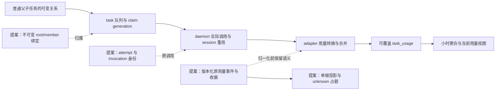

# F3 来源权威与复用边界

2026-11-13，本轮只读源码研究，未运行产品测试。入口 HEAD `feb87aee75fa6b9dd051a4e35bf7df8b101edb75`，分支 `codex/cross-workspace-collaboration`；`463b201fa`、`c79dfe304`、`fafb27b1d` 均为其祖先。HEAD 是观察值，不是回退目标；实际源码身份以本轮文件摘要为准。

本任务入口目录干净，另有 392 项并行状态记录，暂存区为空；当前会话指针原为空，已恢复到原 task，状态保持 `in_progress`。预算相关产品代码均未由本轮修改。详细分源研究：[usage](f3-usage-source-map-20261113.md)、[执行/claim](f3-execution-source-map-20261113.md)。技术方案和产品建议在 [最小合同](f3-minimum-budget-contract-20261113.md)，不能把建议当已有能力。

## 1. 各项来源的权威

| 来源 ID | 源与定位 | 它能证明什么 | 不能证明什么 / F3 处理 |
| --- | --- | --- | --- |
| H1 | archived `11-05-agent-squad-rnd-improvements/design.md:18,25,46` | M2 的设计方向：同根、整数、实报/估算/未知、先 observe 后 enforce | 未交付 F3；不继承原 M1/F2 的实施授权 |
| H2 | 当前 `requirements.md`、用户 2026-11-13“长期绑定父事项” | 单一父任务预算根、重试不重置的产品意图 | 关闭/物理留存、读写角色和硬封顶承诺仍须审阅 |
| Q1 | `service/autopilot_quota.go:79` `quotaPolicy` | GateAutopilotRuns、Cloud 时间区间、limit、policy/subscription revision | 工作空间次数配额，不是父任务金额；nil/off/malformed 会 fail-open 且不访问 quota 表，F3 不能照搬 |
| Q2 | 同文件 `:109` `createAutopilotRunWithQuota`；`queries/autopilot_quota.sql:1` | 先取得 policy，再在 tx 内确保/更新 period 行；按同 workspace/period/key 查已存 run；reserve+run 同事务 | policy 本身在 tx 外取得，不能当 F3 的当前 policy/权限 fence；原 key 未绑定完整 caller/意图 digest |
| Q3 | 同 Go `:171`、SQL `:29,50,80` | used+reserved 按单个 period 行串行，reservation reserved→consumed/released CAS；消费后次数不递减 | +1 次与任意金额/价格/unknown 不同；无可靠成本上界，也无资金账务更正 |
| Q4 | `service/autopilot.go:838–855` | create_issue 的业务创建、run 关联、次数消费同事务，消费点是创建完成 | 后面的真实执行失败或花了多少钱不是这个消费点的依据 |
| Q5 | 同文件 `:1230,1281`；`queries/autopilot.sql:467` | issue done/in_review、run_only task completed 驱动 run 终结；failed/cancelled 可释放仍 reserved 次数；一条 SQL 串联 run 与 quota | 任务状态不能作为 F3 零费用/最终结清证明；已启动失败也可能付费 |
| Q6 | `autopilot_quota.go:341`；`autopilot_quota.sql:109`；`autopilot.sql:353` | 对旧 terminal/orphan 和限定 manual/api partial 的次数恢复，CAS 防重复；保留失败 run | 不等于证明 provider 从未启动。F3 不按 orphan、TTL、failed 自动释放未知；schedule/webhook 的恢复 owner 也不同 |
| Q7 | `migrations/352_autopilot_quota_execution.up.sql`、`355_autopilot_quota_reservation_key_index.up.sql` | 无 FK 的次数表；按 workspace/period/key 建条件唯一索引，released 行不占唯一槽 | F3 的原操作 key 与 lifetime 根唯一身份应长期占槽；不能释放后复用 key 创建“同一请求”的第二个计费行为 |
| U1 | `queries/task_usage.sql`、`handler/daemon.go` 的 `ReportTaskUsage` | 最近一次 task/provider/model 累积观测与 daemon 上报入口 | 可覆盖、无原事件版本与归属证明；不能直接 SUM 成父任务账本，详见 usage 分源表 |
| U2 | `service/task.go:878` `CaptureTaskUsage` | 向 analytics/metrics 转发用量 | 不是 DB writer，更不是 claim 或账本事务接点 |
| U3 | `pkg/agent/*usage*`、各 provider parser、`daemon/daemon.go` | 当前 adapter 到统一 usage 的实际变换 | parser 注释或统一 authoritative 标签不证明原金额实报、互不重叠或完整，需逐提供方/版本分类 |
| U4 | `scheduler/jobs_task_usage.go` 和相关 aggregate SQL | 后台面向报表的小时聚合 | 不可替代事件/版本/原请求；不由 scheduler 拼装财务权威 |
| X1 | `service/task.go` 的 claim/finalize 与 `queries/tasks.sql` | 当前领取/generation/运行时/主体权限与事务接点 | 最终领取不是执行费用终结；generation 不是实际调用唯一身份，详见执行 source map |
| X2 | ordinary issue 创建/改父/删除及 queue retry writer | 当前 mutable 树与 task 生命周期 | 当前 parent_id 无法追溯移出/删除前的预算归属；需要独立持久成员绑定与全 writer fence |
| P1 | `.trellis/spec/server/task-api-capabilities.md`、`security-boundaries.md`；`handler/actor_guards.go` | 当前凭据/主体、originator/invoke/runtime owner 与 frozen capability 的边界 | 机器凭据携带 human ID 不获得预算管理员权限；Reporter 不借 F3 扩读 |
| P2 | `.trellis/spec/server/delivery-policy-evaluations.md` | 原操作键/规范意图、当前 authority、revision CAS、历史结果与当前 applicability 分离的既有模式 | 这是交付证据，不能把其授权或 policy 改为预算授权；只复用结构性经验 |
| F2 | `.trellis/spec/server/report-snapshots.md`；`research/f2-acceptance-20261113.md` | 已交付的显式人工 capture、unknown、公有重放、当前 exact Reporter 读、报告全部快照终止撤回 | 不把报告快照当用量事件，不自动采集预算报告，不改变其源删除保留和 owning-root 清理合同 |

路径表中 `service/`、`handler/`、`scheduler/`、`daemon/` 均指 `server/internal/` 下目录；`queries/` 指 `server/pkg/db/queries/`。行号属于本轮读取，可用符号和摘要复定位。单元测试文件是**静态断言出处**，不是本轮通过证据。

## 2. 次数配额中可复用与明确不复用的内容

可复用：借调用方 tx/q、一致锁序、同一控制行串行准入、原子联结记录、单次状态迁移、保留原事实、限定批量扫描以及有界 reason 标签。F3 仍需自己的 USD/未知/归属模型与当前权限合同。

不复用：

- 按月/Cloud period 重置根；父任务是 lifetime scope。
- 固定消费一次，或把 `used_count` 改字段名当金额。
- malformed policy 自动关闭；旧 policy 取到后无事务复核即准入。
- released key 可复用，或原 run 消失后自动新建“同请求”执行。
- task completed/failed、取消、orphan 或过期自动证明费用终结。
- observe 的 bounded metric 当成可审计的每次预算决策；F3 必须保留原版本与原因。

源码静态测试参考：`TestAutopilotQuotaEnforcesBoundaryAndFinalizesIdempotently`、`ConcurrentAdmissionNeverExceedsLimit`、`ObserveToEnforceAndOffFinalization`、`ConsumedCreateIssueCannotBeRefunded`、`SettlementStaysInOriginalPeriod`、`ReconcilerSettlesTerminalOnlyOnce`、`ReconcilerReleasesOnlyAbandonedManualOrAPIRuns`、`IdempotencyRecoversOrphanedReservation`。它们证明的目标是次数语义，F3 需另写并运行自己的 named cases。

## 3. 从现有链路到 F3 的缺口

虚线框架为方案，不是当前源码已存在的旁路。模型文本/parent rollup、DB latest row 和价格表均不能越级成为原调用的实付凭据。

首包的最低补证顺序：根/成员来源 → claim/调用身份 → 原始 usage basis/范围 → 持久事件与原 key ACK → 原子投影/状态恢复 → 当前权限读取。未来 enforce 还须完整启动入口和成本上界，不能仅在图中的小时聚合阶段判断额度。

## 4. 证据等级与剩余清单

1. **用户确认**：D1 长期绑定；M1/F2 的有效批准仅限原首包。本轮无 F3 实施批准。
2. **代码事实**：上述具体 Go/SQL/adapter 行为，以工作副本摘要固定；并行变化需重新核对。
3. **静态测试断言**：现有测试的预期和覆盖面，不冒充本轮运行。
4. **设计提案**：最小合同的 root/成员/事件/状态/权限/价格版本，是未来拟新增内容。
5. **缺证/不支持**：外部提供方真实费用与账单、全部 adapter 的最终完整性、跨根 session 分摊、旧行历史、完整 writer fence、S2 硬上界与物理留存政策。

最终摘要、分源 SHA-256 与文档验证结果统一写入 `f3-planning-validation-20261113.json`。不会为了消除缺口而调用真实 Provider、修改共享策略、执行迁移或恢复账单对账。
