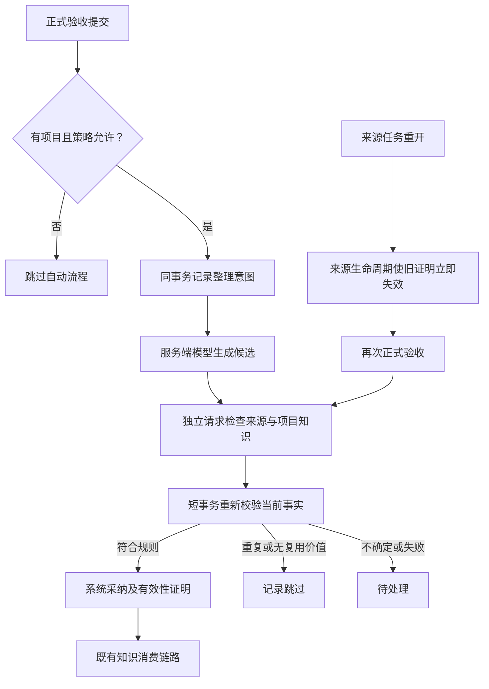

# 项目知识自动沉淀与默认启用：最终设计待审

> 实施状态更新（2026-11-14）：用户已批准 `2026-11-14-v1` 并授权实施，原任务已启动。下文“待审/规划轮不实施”保留原规划时点；当前授权见 `research/implementation-approval.md`。真实账户模型、PR/推送及部署边界不变。

> 2026-11-14。产品选择 D1–D10 已收敛，本文和 PRD/实施计划一同审阅；任务仍为 `planning`，未批准实施。字段/路由为拟新增契约，不代表当前产品已有能力。

## 1. 边界与复用

复用现有知识候选、精确来源、独立项目贡献、人工决定、失效 outbox 和运行时 prepare/authorize。新增有项目协作任务的自动生产/采纳与重开复查；不改写项目 description/workspace context，不建立向量库或通用工作流引擎。

源事实和现有代码约束见：

- `research/default-enable-and-scope.md`：默认值、部署与测试入口、旧任务边界。
- `research/extraction-resources.md`：统一模型、项目资源与业务队列关闭。
- `research/automatic-adoption.md`：人工身份、来源、容量及目标 revision。
- `research/extraction-contract.md`：模型接口、用量、输入输出与内容检查。
- `research/reopen-and-compatibility.md`：立即暂停、有效性证明及严格版本迁移。

一个合并任务内分阶段实施，各阶段共享验收，不另外创建子任务。源代码中已有其他会话改动，实施者只拥有分配给本任务的改动。

## 2. 配置与授权

### 2.1 已采纳知识的使用

`MULTICA_KNOWLEDGE_CONTEXT_ENABLED`：未设置或空字符串默认开启；字面值 `true` 开启、`false` 关闭；其他非空值保持不启用。router、Compose 的 `:-` 默认、环境示例和文档保持一致。保留已有部署和测试环境的显式 `false`。

使用开关不决定候选采纳，不授予来源读取或模型调用权。内置本地 Claude/Codex 的支持范围、来源/受众、有效期、精确会话与逐次启动授权保留。

### 2.2 项目自动沉淀策略

- 默认生效的是内置版本化策略，项目不需要逐个初始化。默认策略主体是 system，不能伪填某个负责人 UUID。
- 当前人类项目负责人或目标工作空间 owner/admin 可读写项目覆盖设置；修改时做当前角色检查、revision CAS 和原请求恢复。
- 首期可调整 `is_enabled` 与 `max_candidates`（1–3，默认3）；必需的来源/权限/正式验收/冲突检查不可关闭。规则算法由内置版本升级，不新增脚本或任意 DSL。
- 关闭项目自动沉淀阻止新整理及在途自动采纳，保留手工流程及历史有效知识；全局知识使用另行控制。已有显式关闭不被默认策略升级覆盖，规则升级不回填历史任务。
- 纯人工任务、无项目任务跳过自动工作。已有业务队列处于完成关闭状态不妨碍独立整理，但整理不能恢复该队列或重放业务输入。

### 2.3 系统整理的资料权限

复用部署 `MULTICA_LLM_*` 配置及 `server/pkg/llm`，费用由该配置承担。此路径不使用个人 CLI/daemon 账号。无 API key/base URL 时零请求，等待配置且不阻塞业务。

新增内部系统用途限定为确切 issue、source workspace、当前项目、已接受交付和有效项目策略。真实触发验收者作为来源读取依据保存并重新检查账号/当前 source Read；不将其伪装为本次人工提议/批准人。项目策略授权系统在该目标内采纳，但不能扩大来源 ACL。管理员配置模型不代表其个人账号获得任务访问权。

对照其他知识前，也以本次来源读取依据逐条检查其来源访问。应参与对照的条目不可读时，记录 `comparison_unavailable` 并转待处理，不能发送受限正文或静默忽略后批准。候选、工作结果和通知均使用当前来源授权投影。

## 3. 正式验收、工作身份与来源

第一期从正式验收后异步生成；提交时预生成是可后续加入的提速优化，不建立另一套必须执行的生产路径。覆盖他人交付与发起人正式自验收，不监听普通 run success 或 ordinary done 来替代 accepted。

验收事务只追加轻量持久工作意图，不调用模型、不等待目标知识锁或外部服务。业务事务若本身失败不能报告验收成功；模型错误发生在提交后，不回滚业务。

工作唯一身份绑定 `(issue_id, accepted_event_seq)`，固定 submission、关闭后的 lifecycle、source project 和策略快照。重放验收、worker 接管或规则升级恢复原工作，不另建一份历史工作。正式再次验收产生新的 accepted event，可执行复查。accepted 内旧 lifecycle 与关闭后的新值通过领域事件链关联，不能直接假定相等。

正式交付新增 `kind: delivery` 来源，包含 issue、SubmissionID、交付/accepted 事件序号和正文 SHA256。通过已有交付领域读取验证不可变 result/basis 和决定。hash 对服务端规范化的完整 result/basis 结构计算；精确引文另外指定 result 或 basis 字段，在解码原文中匹配。附件保留引用，不抓取文件内容或外链。其余 memory/comment/run_record 来源继续支持。

模型只看到临时 `s1/k1` 引用；服务器掌握 UUID、版本、hash 和权限映射。不能让模型指定真实项目、用户、状态或批准身份，也不能把交付正文伪装为评论来源。

## 4. 持久化与后台执行

最小新增领域记录，沿用仓库单数 snake_case 命名：

| 记录 | 关键事实与约束 |
| --- | --- |
| `project_knowledge_policy` | project、revision、is_enabled、max_candidates、builtin rule version、变更人/时间；无覆盖行时解析内置默认，保留系统来源 |
| `collaboration_knowledge_job` | issue/accepted event 唯一、submission、关闭epoch、项目/策略绑定、phase、lease、attempt、结果/原因、配置/模型/用量；固定批次清单区分新生成与全部待复查candidate，保存批次身份/阶段结果，不复制整份来源日志 |
| `collaboration_knowledge_evaluation` | append-only：candidate、job、规则版本、来源/目标快照hash、判定、真实usage、原决策/复查身份；缺失结果不能解释成通过 |
| `collaboration_knowledge_validity` | 每自动采纳candidate一条当前有效性头：revision、通过的evaluation、exact accepted event、validated_close_epoch；旧evaluation保留 |

扩展现有 candidate 的提议/决定来源为 human/automation，自动记录关联 job/policy。原 human 字段仅对 human 分支必填，自动分支不伪填账号。保留原 approved 状态历史、lineage、原批准事实和不可删除约束。人工入口保持原授权；后台只能用服务内部验证过的工作身份调用领域采纳原语，公开请求不能传 system 绕过权限。

新增字段、eval/job正文与引用必须沿用当前 source availability 过滤；来源清除后不通过工作详情、日志或模型结果恢复已隐藏材料。公共工作状态/待处理理由只返回固定的内容无关 `reason_code`。模型自由文本理由、对照引用及evaluation详情必须按该次模型请求全部实际输入来源的闭包（含全部对照）检查当前Read和可用性；不能信任模型自报的related_refs来缩小授权，不能仅凭主issue权限显示可能转述其他任务的理由。通用日志只记录内容无关错误码。

worker 借用现有 PostgreSQL 持久租约/受限扫描模式，不用易失 goroutine 实现可靠完成。每工作有固定、持久的批次：先处理待复查集合，再处理最多一个新增批次；每批为 queued → generating → checking → settling → completed/review_pending。waiting_configuration、skipped、cancelled 是明确结果/等待状态。抢占和DB失败最多3次短退避，模型阶段复用既有SDK传输重试，不做无限重新生成。

每阶段请求开始前持久记录 attempt；成功输出落库后可在绑定未变时恢复下一阶段。崩溃/超时使模型完成与费用不确定时记录 uncertainty，不自动假设未调用再重放；当前有目标确认权限且可读来源的人可显式重试，沿原 job 新建 attempt。成功采纳与幂等回执同事务，不因回执丢失重调模型。

## 5. 模型与规则契约

### 5.1 固定预算

| 内容 | 首期预算 |
| --- | --- |
| 每次验收新增知识 | 0–3条，项目可调低；正文≤2KiB、摘要≤256B、每条≤4个精确引用；恢复/替代已有逻辑条目不占新增额度 |
| 重新验收复查 | 完整枚举本来源/当前项目全部仍由系统批准且暂停的候选，受原目标16条上限约束；稳定排序分为每批≤3条，最多6批，未处理的继续暂停 |
| 来源 | 最终交付及明确关联的完整材料，最多8份、128KiB；不扫描整段历史后静默截断 |
| 项目对照 | 全部当前有效贡献，沿用最多16条/完整材料128KiB |
| 每阶段模型输入 | 解码后≤288KiB，完整wire JSON≤2MiB，包含固定说明、来源、候选和必要对照 |
| 模型输出 | 生成最多6000 completion tokens/24KiB；检查3000 tokens/16KiB |
| 并发与时限 | 每API实例最多2个活动批次；每阶段60秒、每批120秒，租约至少180秒；一次验收最多6个复查批次加1个新增批次，逐批保存结果 |

任一预算不足转待处理，不截断/删旧/降低检查范围。每批最多一次生成加一次检查；复查批次在生成阶段对每个固定前驱输出保留原文或有来源的新表述，检查阶段验证该选择，不通过“检查失败后再生成再检查”超出预算。一个普通首次验收只有一个新增批次，重新验收的用量可能更高但有上述固定上限。副本数影响总并发，以上不宣称全局账单上限。SDK的配置重试和最多两次参数兼容协商共享deadline；两阶段不是严格两次HTTP请求。

`GenerateJSON` 当前只返回 string。在 `pkg/llm` 内增加薄的自有 typed result（文本、实际模型、usage及presence），复用同一请求/参数协商实现，旧消费者行为不变，不新增SDK依赖或在领域服务直接引入SDK。真实零、缺失、partial、timeout unknown分别保存，不从 token 推算账单或把未知记为0。

### 5.2 两次有界模型请求

第一次只生成0–3条建议。每个statement包含 text、source_ref、quote；服务端拒绝重复键、额外字段、未知ref、无效UTF-8和超预算。引用必须是冻结版本指定字段的非空精确连续子串，并校验完整正文hash。候选正文由可追溯statement组成，摘要不能承载未有依据的新结论。

第二次是独立请求，使用完整允许来源、候选和当前目标对照，不提供第一次的推理过程。输出每候选恰好一个结果：

- support: supported / unsupported / uncertain
- reuse: reusable / transient / uncertain
- relation: novel / duplicate / conflict / uncertain
- related_refs和简短理由，仅可引用输入ref

同一配置模型可以完成两次请求；不称为统计独立、多模型证明或事实验证。精确引文证明文本出处，不证明事实正确；模型意见是规则输入，不是服务器可核验事实。所有意图都要求 supported + reusable 和下面的确定性条件，relation依据意图区分；模型扩展范围、新推断、无授权前驱的改写、缺失/冲突/不确定进入待处理。

### 5.3 新增、恢复与修订意图

服务端固定新生成/重验批次及其前驱、目标，模型只能建议有引用的内容。重验输出严格对应批内每个前驱；服务器在结构校验后按正文/适用范围是否相同确定 `revalidate` 或 `revise`，再传给检查阶段。模型不能指定其他前驱或更改工作范围。任何遗漏前驱保持暂停/待处理，不算已完整复查。

| 意图 | 处理关系 |
| --- | --- |
| create | 没有前驱；要求novel，重复跳过，冲突待处理 |
| revalidate | 指向本来源/当前项目的精确暂停自动候选，要求正文/适用范围不变且新验收仍支持；自身相同版本不作为duplicate障碍，与其他条目仍检查冲突，成功只更新有效性证明 |
| revise | 仅允许本次重验工作指向同一lineage的精确暂停自动前驱；新验收明确支持变更才允许按规则替代，该前驱差异不单独视为冲突；与其他条目冲突仍待处理 |

比较集保留精确前驱并标注其身份，不能通过省略前驱来规避检查。恢复/修订不能针对人工批准/撤回/已替代的条目。其他待复查候选及前序批次结果也纳入有界完整对照，避免相互矛盾的条目分批恢复。每批开始重新取得完整对照revision；自己前序批次的提交自然进入后续输入，外部并发变化使本批检查失效。

### 5.4 最终确定性门

采纳短事务重新检查：确切正式验收与关闭epoch、当前项目、AI策略、有效项目规则及revision、来源读取与材料hash、完整对照revision、候选schema/引用、有效期、容量和未被人工决定取代。不能只凭模型判断通过写approved。

- 精确重复：同目标、适用范围和规范化正文（只统一换行，不删空格/否定词/大小写/数字），含批内去重，跳过create新增；revalidate/revise仅对自身精确前驱适用上一节的例外。
- 语义duplicate：保存关联依据并跳过；conflict/uncertain/unsupported：待处理；transient：无复用价值跳过。
- 目标中任何应对照来源不可读或集合无法完整取得：整批待处理，不能拿可读子集证明novel。
- 目标/策略/来源在模型调用后变化：原判定作废，转待处理供显式重查，不能无限CAS重试并重复消耗模型。
- 在一次目标事务中按稳定顺序确定可容纳集合，原子保存该集合的候选/证明/目标revision/hint及每条结果，容量不足者标记待处理。本事务失败时全部回滚，不能声称某条已独立成功；原回执恢复不重做此前其他成功批次。不超过原16条/128KiB。
- 现有verified是提议者声明。首期不把它升级为机器证明；可核对测试事实必须关联真实记录与版本，缺少则只显示声明。

## 6. 重开立即暂停与重验恢复

### 6.1 即时生效点

对 decision_origin=automation 的贡献，消费要求当前有效性头匹配来源的当前关闭epoch和已接受事件链。所有准备/复查/启动授权在原来源锁内检查；重开更新已有来源生命周期，与这些读锁形成事务先后关系。

每次有效性证明保存实际支持该结论的精确来源依赖，包括新验收材料的身份/版本/hash；这些依赖必须进入prepare/replay/authorize的来源锁提示及当前可用性检查，不能只检查原candidate.sources。对照知识是私有检查输入，不自动变成正文的支持来源；自由文本理由的读取始终按该次请求全部输入来源闭包授权，不依赖模型是否标注引用。

重开事务不逐条改candidate、不获取目标知识锁。它推进来源epoch并追加既有失效扫描原因；提交后旧有效性头立即不匹配，消费返回暂停/拒绝旧manifest，不依赖后台hint。新GET显示 `usage_status: paused_review`，原candidate仍是approved。UI通过原outbox和显示租约刷新。

这不撤回已合法交给正在运行模型的字节，不声称瞬间杀停所有旧消费者。已曝光会话的后续续跑仍按累计manifest检查，不能降级到普通会话绕过暂停。

### 6.2 重新验收

新的正式accepted event建立复查工作，完整枚举并固定相关暂停自动候选，不受0–3新增额度截断；按每批最多3条逐候选检查新验收材料、旧来源、规则/权限、内容和项目对照：

- 正文与适用范围相同且仍被支持：追加evaluation，CAS有效性头到新的关闭epoch/accepted event，revision增加后恢复；不修改原提议/批准历史。
- 内容改变：沿原lineage提出修订版本；只有新版本按同一规则通过后原子替代旧版本，旧暂停贡献不提前恢复。
- 冲突、缺失依据、失权、过期或失败：继续暂停/待处理。
- 人工withdrawn/rejected、人工修订已替代或当前决定已改变：旧自动工作不能恢复/覆盖。人工采纳版本不受此自动重开策略无条件暂停。

只影响相关来源自动贡献。暂停不自动释放原approved条目的容量，防止恢复时挤掉其他知识；恢复/替代仍重新检查预算。人工决定竞态、再次重开及迟到租约均在提交时重新检查。

恢复后的有效性revision是新证明；旧会话manifest不能被悄悄改写为新证明继续运行。依照既有会话保护返回明确不可续跑结果，新合法执行重新准备。

## 7. API、客户端与持久协议兼容

v2明确表示新系统身份、delivery来源和usage_status。人工知识端点沿用路由，以 `X-Multica-Knowledge-Version: 2` 协商；写体也声明2，两者冲突拒绝。缺省为v1。新增header纳入CORS/客户端测试，不假定安装版Desktop与服务同步。

- v1仅提供完全可表达的旧人工形态；请求范围需要新系统/来源/暂停语义时返回明确 `knowledge_protocol_unsupported`，不删条伪造空集合、不伪装人工或available。原v1操作回执恢复继续保持原格式。
- 新客户端先协商v2，旧服务不支持时显式说明；纯人工旧功能只有在明确v1可表示时才使用原契约，不把未知响应宽松解码。
- 普通TaskKnowledge、协作RunKnowledge、含有效性revision的新manifest升为v2。普通数据库 `knowledge_context_version` 允许1/2，各自严格解码；不改写旧保留记录或将1常量全局替换2。
- 协作固定存储slot `knowledge:claim:v1` / `knowledge:prepare:v1` 保持可发现，slot内payload显式版本分支；不得用全新键让旧读者看不到原知识历史。
- v1 runtime仅处理全程可表示的legacy知识/历史；遇必须理解的新候选或已有v2曝光时明确拒绝，不悄悄省略知识或丢私有历史走base路径。
- 自动有效性证明在v2manifest绑定candidate/version/content hash/validity revision/accepted身份；重新授权按完全相同元组检查，不替换为最新集合。

新增项目策略 GET/PUT `/api/projects/{id}/knowledge-policy`，写入带request UUID和expected revision。新增工作读取/有权重试端点位于现有 collaboration issue 下；不新增全局页面路由。所有读写复用workspace/issue loaders与当前权限，自动采纳内部命令不暴露为可冒充system的公共API。

数据库关系无FK/cascade。所有新索引用CONCURRENTLY且独立单语句迁移；同步sqlc、删除清单和保留历史。先交付支持严格双版本读取的服务/客户端/daemon，再允许写新形态；禁止混用不理解新保留记录的旧API实例。关闭自动化不删除新记录或允许回滚到不识别它们的旧程序。

## 8. UI、恢复与交付

- 共享Core负责协议/Query/缓存恢复；Views负责交付状态、项目策略、候选/贡献和异常处理；Web/Desktop只做平台接线。
- 完成页显示整理中、已保存N条、无复用结论、待处理、未配置/暂不可用；无项目不显示虚假的整理中，验收无新增必填项。
- 详情展示来源、模型整理/系统规则采纳、规则版本、真实证据、暂停/复查状态；完整源码身份/hash可折叠，不让普通成员填写它们。
- 异常入口交给有目标确认权且可读取来源的人；没有合格审核人时保留待处理，不能扩大权限。通知复用当前来源过滤和内容最小化约束。
- 撤回/修订/人工确认保留；来源清除/失权立即影响当前投影及新的消费。后台错误和模型原文不能流入通用日志或未经授权的通知。
- 文档同步用户帮助、升级说明、模型出站消费者与相关builtin skill/source-map；不改判旧任务真实模型/平台证据。

## 9. 验收与退出条件

按PRD AC1–AC12及 `implement.md` 的具名场景验证。规划阶段只校验文档、路径与契约，不执行产品测试或真实模型。最终规划经用户后续明确批准才开始实施。

关闭项目自动沉淀可停止新整理/采纳，关闭知识使用可停止新使用；两者保留原结果、失效/回执、历史会话与清理。已保存新协议数据后优先前向修复，不能删除历史强制降级。
