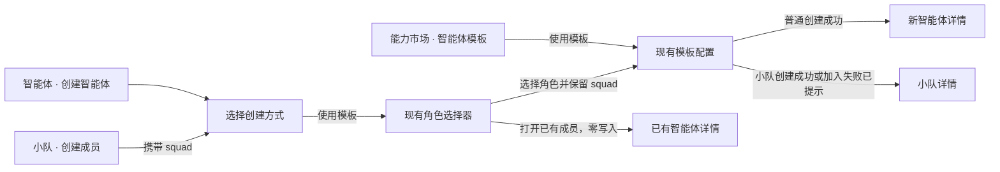

# 智能体模板进入能力市场 — 设计提案

Status: approved by the user on 2026-11-21 after the final planning summary.

## 设计目的与权威

面向为团队寻找可用角色的工作空间成员，页面模式为 Operate：先理解角色用途，再选择和配置。市场承担发现，创建流程承担配置，智能体目录承担已保存成员管理。

保留现有能力市场的集合页头、横向类型标签、语义颜色、字体尺度和卡片布局。用户截图与现有实现是视觉依据，不建立新的视觉风格或市场框架。

## 方案比较

| 方案 | 用户路径与代价 | 判断 |
| --- | --- | --- |
| A：共享模板内容，市场与创建器双入口 | 市场新增纯模板目录；原创建器继续快捷选角色并保留实例链接；抽取共用卡片，配置复用原路由。 | 推荐。统一内容，同时保留已验证的小队/返回/防重复创建语义。 |
| B：所有模板选择都重定向到市场 | 只有一个目录页面，但原创建流程离开创建器；还需市场理解小队来源、招募上下文、返回和旧地址迁移。 | 本轮不选。为入口归属增加了不必要的流程迁移。 |
| C：复制当前页面到市场 | 最快可显示，但市场会出现第二个创建页头、实例依赖和重复的卡片/错误逻辑。 | 不选。内容与行为将分叉。 |

## 页面结构与文案

| 层级 | 提案 |
| --- | --- |
| 页面头 | 保留「能力市场」，描述更新为涵盖 MCP、Skill、AI小队模板和智能体模板。 |
| 类型导航 | 现有 MCP → Skills → AI小队模板顺序不动，追加「智能体模板 / Agent templates」。缺省 MCP 不变。 |
| 分类说明 | 「智能体模板」；「选择角色模板，创建适合团队工作的智能体。」英文使用对应自然短句。 |
| 卡片 | 现有头像、角色名称、描述、已识别的权限范围。主动作「使用模板 / Use template」。卡片容器本身不可点击，主动作是真实链接。 |
| 市场不展示的内容 | 现有成员、已创建计数、「尚未从此模板创建智能体」以及整个「创建智能体 / 选择角色」页头。 |
| 原创建器 | 保留「创建智能体 / 选择角色」、已有实例链接、「创建智能体 / 再创建一个」与配置阶段。 |

保留三列/两列/单列的现有响应式网格。390/320 像素下标签区域可横向滚动但文档不溢出，长角色名换行，权限标签不挤掉主动作。沿用 Tabs 的箭头移动焦点、Enter/Space 选择；触摸主动作至少保持现有 44px 高度。

## 用户路径

### 配置返回

- 市场卡片生成 `/{slug}/agents/new/template?template=<key>&source=marketplace`。`source` 只接受精确的 `marketplace` 值；不接受 `returnTo` 或任意路径。
- 市场来源配置的返回使用现有 `useBackOrReplace(paths.marketplaceTab("agent-templates"))`：安全历史存在时回真实来源，保留原 query/hash；冷启动或平台不能证明历史安全时替换到确定的分类。
- 原创建来源保持当前 `replace` 回模板选择器，并保留 `squad`。市场本身不读取 URL 中的 `squad` 或制造小队上下文；若配置地址同时包含 `squad` 与来源标记，以显式小队创建语义优先。
- 无效来源值按原创建流程处理；模板未找到仍沿用现有选择器回退，不展示虚构配置或写入。市场来源的页头返回仍可回市场。
- 普通创建成功进入新智能体；小队创建的成功/部分成功去向沿用现有提交 hook。来源标记不改变成功目的地。
- 浏览器 Back/Forward 使用平台历史；不增加自定义导航栈，不清洗任意历史记录。

## 组件边界

### 1. 共享领域卡片

从 `template-create-agent-page.tsx` 抽取智能体角色模板卡片/网格及其 `AutonomyBadge` 到 agents 领域的小组件文件。只抽取两处真实复用的展示，不建立通用资源目录模型。

共享卡片接收模板、创建链接及必要的导航回调；原创建器可以提供已有实例区域，市场不提供。卡片不自己调用创建接口、不查询智能体实例、不持有路由或滚动控制器。

原 `RoleTemplatePicker` 保留实例 Query、加载/错误提示、精确 `template_key` 匹配、已改名成员链接及已有 scroll memento。抽取前先补齐/保留其回归测试。

### 2. 市场领域面板

新增轻量 `AgentTemplatesMarketPanel({ workspaceId, active })`。使用 `useRoleTemplates({ enabled: active })` 和共用卡片，独立处理模板 pending/error/retry/empty，不渲染完整 `TemplateCreateAgentPage` 或 `AgentsPage`。

模板缓存继续由语言而非 workspace 标识；实例和权限写入仍是原配置页职责。市场面板不新增 agent-list Query，不改变缓存键，也不取消其它消费者的请求。

新分类首次访问时挂载；之后保持 DOM，非活动时由市场 shell 设置 hidden/inert 并传 active=false。新面板没有 portal。切 workspace 重建控制器；模板公共缓存可继续复用。

### 3. 滚动与导航

新分类只设置一个内容滚动容器，和市场页头/标签分开；使用独立的 `data-tab-scroll-root` 标识。市场外壳与面板不得同时产生嵌套内容滚动条。

分类往返依靠保留的 DOM 恢复滚动；跨路由/桌面标签切换使用现有恢复适配器。模板数据尚未加载时不把被夹到零的位置写回。原创建器同路径两阶段的自定义 memento 保持原样。Web 无适配器时维持现有平台行为，不引入 storage 或新的持久化承诺。

## 数据与状态

| 状态 | 市场行为 | 创建器兼容性 |
| --- | --- | --- |
| 模板 pending | 骨架与加载语义，不先显示空态。 | 原配置/选择加载保持。 |
| 模板 error | 可见错误与重试；其它市场类型可进入。 | 原重试和输入规则保持。 |
| 成功空数组 | 显示现有「服务端未内置角色模板」语义。 | 不伪造模板。 |
| 未识别权限 | 角色可选，隐藏无法解释的权限徽标。 | 不顺带重写配置页的现有权限展示。 |
| 实例 API 故障 | 面板不依赖实例 API，模板仍可浏览。 | 原实例错误/重试独立存在，不误报零成员。 |
| 配置 API 拒绝/运行时缺失 | 交给原配置/提交行为显示或阻止提交。 | 不改变角色权限和服务端校验。 |
| 隐藏分类 | hidden/inert，当前观察者 enabled=false，保留已访问 DOM。 | 原独立创建页不受影响。 |
| 工作空间变化 | 控制器重建，链接使用当前 workspace；不携带旧 squad。 | 公共语言模板缓存可复用。 |

## 技术范围与兼容性

- Core：扩展 `marketplaceTab()` 联合类型与路径测试；不新增根路由、workspace 保留字、store 或 API schema。
- Views：新市场 panel、领域卡片提取、配置返回分支、必要的创建链接来源构造；使用 `NavigationAdapter`、`AppLink`，不导入平台 router。
- 文案：`layout.json` 添加类别与更新 tagline；`agents.json` 增加市场专用说明/动作，保留原 picker 文案。两种 UI locale 同步。
- 现有 Web 和 Desktop route wiring 复用，不需要新增 route；实施前复查有无并行变更。
- 规格：更新 capability-market 的第四类契约，修订 agent-discovery 的“仅创建流程”归属描述，保留模板与成员分离规则。

## 风险、验证与回滚

主要风险为卡片抽取破坏旧 picker 的实例/滚动、来源返回落错分类，以及市场分类新增时破坏隐藏面板草稿。由原 picker 定向回归、新返回分支矩阵和市场生命周期测试分别覆盖，避免重复测试 API 矩阵。

无服务端或数据迁移。回滚移除第四类和市场入口来源分支、恢复原页内卡片即可；原模板配置 URL 和所有既有成员一直保留，不需要数据清理。完整执行与验证步骤见 `implement.md`。
