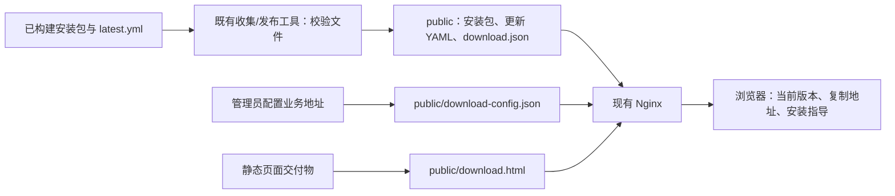

# 桌面端自助下载页技术方案

状态：完整方案已获用户批准，进入实现。用户已确认以既有下载页为基础，保留深色首屏和浅色平台列表。需求以 [prd.md](./prd.md) 为准；来源与行为证据见 [research/context.md](./research/context.md) 和 [research/existing-download.md](./research/existing-download.md)。

## 1. 架构与边界

采用一份独立静态 HTML，使用少量原生 JavaScript 读取同源 JSON，复用现有 Nginx 和桌面发布工具。网页不是 Web/Desktop 业务路由，不需要 Next.js、Electron、数据库或新的后台服务。



- 浏览器访问 `/desktop/`；`/desktop` 规范化到带斜杠地址，避免相对 URL 解析错误。
- Nginx 为目录入口返回 `download.html`；原具体文件下载路径保持现状，`/health` 不变。
- 页面请求使用相对路径，下载信息、地址配置和安装包始终同源。
- 保持现有 `public/` 只读挂载、UID/GID 101、私有 staging/backups/lock，不新增 Nginx 运行时依赖。
- 单一交付任务即可：静态页、发布投影与部署文档共同构成一个可验收流程，不拆成独立发布的子产品。

## 2. 静态数据契约

### 下载信息

`public/download.json` 是已验证 Windows x64 发布的静态投影，不是另一个手工维护的版本源：

```json
{
  "schemaVersion": 1,
  "platform": "windows",
  "arch": "x64",
  "version": "0.6.5",
  "file": "multica-desktop-0.6.5-windows-x64.exe",
  "size": 123456789
}
```

以上为结构示例，不代表已发布的实际版本或大小。

- 仅从 `latest.yml` 及其已验证引用生成。要求一个确定的 Windows x64 EXE，版本与文件名一致。
- 复用现有 YAML 解析器、`updateReferences`、大小及 SHA-512 校验；不新增 YAML 依赖。
- 不消费上传目录里自行编写的 `download.json`，发布时重新生成。
- 发布其他平台时不覆盖当前 Windows 投影，也不自动开放 macOS/Linux 按钮。
- 现有稳定版/显式预发布测试规则保持一致；页面使用“当前版本”，不将测试构建描述为正式稳定版。
- 浏览器验证 schemaVersion、平台、架构、版本、正整数大小和单一安全文件名，拒绝外部地址、目录跳转及与版本不符的 EXE。验证失败不猜文件名。
- 对 JSON 请求设置有界超时和体积限制；通过 HEAD 确认安装包可访问、响应长度符合投影后再开放下载。页面加载不下载整个安装包。
- 确认请求期间文件不可用时禁用入口并提供重试；真正的下载使用正常同源链接。

### 业务地址配置

`public/download-config.json` 由部署管理员维护：

```json
{
  "schemaVersion": 1,
  "serverUrl": "http://intranet.example:8080"
}
```

示例域名不是默认业务地址。交付模板的 serverUrl 留空，管理员填写实际值。

- 只放可公开给内网用户的业务 URL，不放凭据。
- 页面校验 HTTP(S)、非空主机、无用户名密码；按客户端接受的地址形态保留必要路径和端口。
- 不从下载域名、18080 端口或客户端更新 URL 推断业务地址。
- 启动、发包和页面升级均保留管理员配置；缺失时才初始化模板。
- 地址配置无效只影响连接信息提示，不阻断阅读教程或独立加载下载信息。
- 两份 JSON 均按现有 no-cache 策略提供，页面读取使用 no-store；不增加定时轮询或后台版本列表。

## 3. 发布一致性与恢复

在现有收集/发布函数中增加小范围投影生成，不重写整套发布器。

1. 按现有规则读取、验证并暂存完整产物。
2. 若包含 Windows x64 通道，在任何公开切换之前生成、验证并暂存投影。
3. 检查版本文件不可变性，并备份将要替换的通道 YAML 和已有投影。
4. 先暴露完整安装包/附属文件，再原子替换通道 YAML，最后同文件系统原子替换 download.json。
5. 所有必要写入完成后才报告发布成功；返回文件清单包含实际生成的投影。

YAML 和 JSON 是分别原子替换的文件，不宣称跨文件事务。若最后一步失败，旧投影仍指向保留的完整安装包；命令报错，使用同一发布源重试可修复。测试和操作手册必须明确这个边界。

`collect` 同样生成投影，便于只有 Nginx 的服务器接收完整离线交付目录。手工部署时先复制安装包、再替换 YAML、最后替换投影，不能用普通目录同步顺序代替发布顺序。

首次给已有文件服务加页面时，必须通过新版 collect/publish 为当前完整 Windows 发布补齐投影。仅复制 HTML 不会自动生成投影。没有 Windows 发布时页面如实显示暂不可下载。

撤回坏版本时从同一备份点恢复 YAML 和投影；已安装客户端不会因此自动降级。页面移除也不删除旧安装包或修改业务数据。

## 4. 页面内容与交互

既有 Web 下载页已定位：`apps/web/app/(landing)/download/page.tsx` 及 `apps/web/features/landing/components/download/`。用户已确认沿用其深色首屏、浅色平台列表，以现有布局、品牌与系统图标为基础提取成独立静态交付物。不能直接复制依赖 React、Next 和 locale context 的组件到 Nginx，也不能沿用 GitHub 数据源和“全平台产物齐全才优先展示”的版本选择逻辑。

页面采用轻量单页结构：

1. 深色首屏：Multica 标识、居中标题、Windows x64 当前版本与主下载按钮；导航使用页面内的下载、安装指导和常见问题入口。
2. 浅色行式平台列表：Windows x64 当前可下载状态，以及 macOS 两种架构、Linux x86/ARM64 的“待开放”状态。
3. 单一业务服务器地址与复制按钮。
4. 中文编号步骤：下载、安装并启动、测试并保存业务地址、注册/登录、加入或创建工作空间、完成上手引导并进入工作台。
5. 常见问题，使用原生 details/summary 等轻量交互。

文案使用“工作空间”等项目统一术语。新用户注册表单包含姓名和确认密码；成功后已建立会话，不要求重复登录。运行时/AI 工具连接可使用现有稍后处理入口，本页不展开工具安装。

FAQ 包含网络/下载失败、安装被本机策略阻止、服务器连接失败、没有注册入口、账号输入错误、没有可用工作空间。无法解决时提示联系内网管理员，不编造联系方式，不指导关闭安全软件。

页面视觉以用户确认的既有下载页为基线，保留深色首屏与浅色列表的层次；语义变量和必要字号仍遵循项目规则。静态交付物只携带必要样式并注明来源。衬线标题复用可交付的本地字体资源或本地字体栈；不增加 React、Tailwind 浏览器运行时、外部图标或公网字体请求。

- 下载信息：加载中、可下载、不可用三种状态；失败保留教程，允许重试。
- 待开放条目不能作为可点击下载链接；不做系统自动识别后偷偷开放平台。
- 业务地址可换行且可选中；按钮具有键盘焦点和明确名称。
- 安全上下文可使用 Clipboard API；HTTP 内网或浏览器拒绝时使用可用的兼容复制能力，最终保留选中地址后手动复制的路径。必须按真实结果反馈，不能无条件提示成功。
- 移动/窄视口仍可阅读步骤，但不改变首期仅支持 Windows x64 的下载事实。
- HTML 中的静态文字在数据请求失败时仍可阅读；页面不访问业务 API 来猜测认证策略。

## 5. 部署文件和兼容性

计划修改/增加的主要位置：

| 路径 | 责任 |
| --- | --- |
| `deploy/desktop-updates/download.html`（新增） | 自包含页面、中文指导、数据读取与复制交互 |
| `deploy/desktop-updates/download-config.example.json`（新增） | 业务地址配置模板 |
| `deploy/desktop-updates/nginx.conf` | 目录首页与规范化入口，保留文件下载约束 |
| `scripts/desktop-updates.sh` | 启动前原子安装页面，配置仅缺失时初始化 |
| `apps/desktop/scripts/update-artifacts.mjs` | 复用校验流程生成、发布、备份静态投影 |
| 两个现有桌面下载操作文档 | 更新最小部署清单、首次补齐投影、正常发布与恢复 |
| 现有发布/脚本测试及一个页面行为测试文件 | 验证合同与用户可观察行为 |

生命周期脚本以明确的自有文件名操作页面；拒绝用符号链接写出存储目录，不扫描或删除其他文件。写入临时文件后改为公开可读权限，再同目录替换。

最小离线部署归档增加页面和配置模板。Node 仍只用于发布/收集/校验环境，Nginx 服务端无需安装 Node。

Nginx 配置在既有容器中变化时，需要先检查配置再 reload；不能误以为修改 bind-mounted 文件或普通 Compose up 必然使进程重载。操作手册给出首次页面上线步骤，日常版本发布不重启服务。

## 6. 技术取舍与验证限制

- 采用发布时生成 JSON：复用已验证数据，浏览器不承担 YAML 解析或文件目录扫描。
- 不采用浏览器猜安装包命名、读取目录列表或依赖 GitHub：都无法满足现有发布合同或纯内网约束。
- 使用原生静态单页：无需新增项目/运行服务；交付文件和维护成本较小。
- 合成产物可证明发布与下载逻辑，不能证明 Windows 安装器签名、实际安装权限或完整首次使用体验。真实安装验收单独记录。
- 初期 Linux x86 标签按用户原文保留，未来开放时再澄清位宽与包格式。
