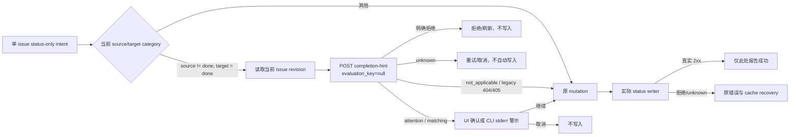

# M1 UI/CLI 自动完成提示技术设计

本设计只消费已有 completion-hint API。完成授权、事务校验器、skip 语义、批量 partial 协议和 collaboration/R38 writer 保持在 v1 现有实现中，不在本包重新设计。

## 数据流



## Core API 边界

计划修改或新增：

- `packages/core/types/api.ts`：`DeliveryCompletionHintRequest`、`DeliveryCompletionHintResponse` 及最小 `DeliveryCompletionHintEvaluation` 只读类型。响应中的 `hint`、`reason`、`policy_mode`、`target_category` 使用可扩展字符串；`enforced`、`usable_for_completion` 必须是布尔值。
- `packages/core/api/schemas.ts`：严格解析 required identity/revision/status/category/policy/hint/reason/checked_at/boolean 字段，evaluation 只作为可选私有响应解析； malformed 2xx 走 schema error，不能返回空对象。
- `packages/core/api/client.ts`：增加 `getDeliveryCompletionHint(issueId, input, options)`，请求体严格包含三个字段，使用 `parseWithFallback` 和 `AbortSignal`。不在 API client 中自动重试、缓存或消费授权。调用方可将 404/405 分类为 legacy unsupported，其他错误保留 `ApiError` 原状态/body。
- `packages/core/issues/`：增加纯函数/类型化结果分类，判断 `source category !== done`、`target category === done`、status-only intent 和 legacy/unknown/refusal；不得在 core 内访问 React、toast、router 或 `process.env`。该函数必须对缺失 revision/category fail-safe，并把“skip hint”与“completion authorization”分开。

核心请求固定为：

```json
{
  "expected_issue_revision": 4,
  "target_status": "done",
  "evaluation_key": null
}
```

`expected_issue_revision` 来自发起动作时的 issue snapshot；hint 409 后必须重新读取 issue，不能沿用旧 revision。status key 使用用户实际选择的 custom key，不把 custom done 归一化成 literal `done`。

## Shared Web/Desktop 协调

建议将交互协调保持在 `packages/views`，让所有 status-only 单 issue writer 共享一条入口：

- `packages/views/issues/actions/use-issue-actions.ts`：右键菜单、详情字段和顶部标记完成走这里；在现有 run-confirm/collaboration 判断之后调用 completion-hint gate。提示确认后才调用原 `surfaceActions.updateIssue` 或 `useUpdateIssue`。
- `packages/views/issues/surface/use-issue-surface-actions.ts`：list/board/table/swimlane 状态编辑经过同一 gate；从 Query cache 取完整 issue（含 revision/status_category），找不到 revision 时走兼容 bypass，不能伪造 `0`。`moveIssue` 单独保留为本轮 out-of-scope，不能误接此 gate。
- `packages/views/issues/components/issue-detail.tsx`：`SubIssueRow` 当前直接调用 `useUpdateIssue`，需改到共享单 issue gate；顶部 `onDone` 改为实际 PUT 成功后调用，取消/提示拒绝/写入失败均不导航或关闭详情。
- `packages/views/issues/actions/issue-actions-menu-items.tsx`、`status-picker.tsx`、`table-view.tsx`、`board-card.tsx`、`batch-action-toolbar.tsx`：入口本身不复制 hint 逻辑。status picker 只把目标 status 交给共享协调器；batch toolbar 保持无 hint 并在测试/文档中明确 out-of-scope。
- 交互组件建议新增 `IssueCompletionHintModal` 和短暂 continuation token；不得把 evaluator key、服务器 evaluation 或不可序列化的长期业务状态写入持久 store。若复用 `useModalStore`，只保存 issue id、revision、target、hint state 和 transient token。
- Modal 的确认按钮不能直接把 hint response 当 `completion` binding；继续操作重新调用原 mutation，实际 server response 才触发 cache reconcile、toast 和 `onDone`。

UI 文案使用 `packages/views/locales/en/issues.json` 与 `zh-Hans/issues.json`，至少覆盖：检查中、需要关注、当前观察仍匹配但不授权、继续完成、取消、提示不可用请重试、revision 已变化请刷新、旧服务器未提供提示。文案不能写成“已通过”“已授权”或“已完成”。

## CLI 协调

计划只改 `server/cmd/multica/cmd_issue.go` 及必要的 CLI helper/test：

1. `runIssueStatus` 与 status-only `runIssueUpdate` 在 PUT 前获取完整 issue JSON，读取 `revision`；若目标是 custom key，先让 hint 返回真实 `target_category`，不在 CLI 本地猜 custom category。
2. 发送 `POST /api/issues/{id}/delivery-evidence/completion-hint`，`evaluation_key` 固定为 null。建议新增小型 typed response struct 和 `requestIssueCompletionHint` helper，限制 body 读取大小，保留 HTTP method/path/status/body。
3. 只有无结构化资源/权限/交付 code 的 404/405 才归为旧路由 `unsupported`，直接回到原 PUT；结构化 404/403/409 必须保留为拒绝/刷新。缺 revision 的旧响应同样只走兼容分支并在必要时写一条 stderr warning。
4. `attention`/`matching` 写 stderr 后继续；`refusal` 和 `unknown` 在 PUT 前返回非零。未知结果不得打印 `status changed`，不得自动重试 hint 或 PUT；Ctrl-C 只取消当前 hint 请求，不会发送 PUT。
5. 实际 PUT 保持原 body（仅 status 与现有 `suppress_run`），不添加 completion binding。`issue update` 混合字段 status 写入不在本轮 gate 范围，保留原路径并在 CLI help/skill source-map 中说明。

CLI 改动涉及命令行为时，同步更新 `server/internal/service/builtin_skills/multica-working-on-issues/SKILL.md` 及 `references/working-on-issues-source-map.md`；completion-hint 的 API 非授权边界仍要在 `multica-creating-agents/references/creating-agents-source-map.md` 保持准确。不要把提示消费者写成完成门禁或自动授权。

## 错误与取消合同

| 层 | 结果 | 客户端动作 |
|---|---|---|
| API 404/405 | legacy unsupported | 原 mutation；不报告 hint 成功 |
| API 2xx `not_applicable` | 当前读取不需要提示 | 原 mutation |
| API 2xx `attention` | 需要用户注意 | UI 确认；CLI stderr 警示后继续 |
| API 2xx `matching` | 当前观察仍匹配 | UI 确认；CLI stderr 警示后继续；绝不授权 |
| API 4xx 明确拒绝 | stale/permission/policy/lock 等 | 不 mutation；显示 code/retry/refresh |
| API 5xx、transport、schema、commit unknown | 无法确认提示 | UI Retry/Cancel；CLI 非零；不自动写入 |
| 实际 mutation 2xx | 真实写入成功 | 仅此处更新缓存/成功 toast/`onDone` |
| 实际 mutation 428/409/5xx/transport | 真实写入拒绝或未知 | 现有错误/cache recovery；不把 hint 当成功 |

Hint 请求只能因组件卸载、用户取消或显式 retry 结束；禁止后台自动重试。实际 mutation 仍使用现有 `useUpdateIssue` optimistic/cache 合同，但必须在 hint gate 确认前不触发 optimistic patch。

## 兼容边界与风险

- 老 Desktop 对新 server：已有完成请求继续工作；本轮不要求旧客户端发送 hint。
- 新 Desktop/Web/CLI 对老 server：hint 404/405 bypass，旧写请求形状不变。
- enforce 项目：hint attention 后即使用户继续，服务端可能以 `delivery_completion_authorization_required` 拒绝；客户端必须把该实际拒绝显示给用户，不能自行创建 authorization 或把 hint 升级为许可。
- 状态目录加载失败、custom key 未解析、issue revision 缺失：不本地猜测，不把未确认类别显示成通过；按兼容路径执行原请求或要求刷新，具体由实现测试冻结。
- 本设计不触碰 `delivery-completion-enforcement.md` 的 writer、事务锁、schema、migration 或 skip 合同。
