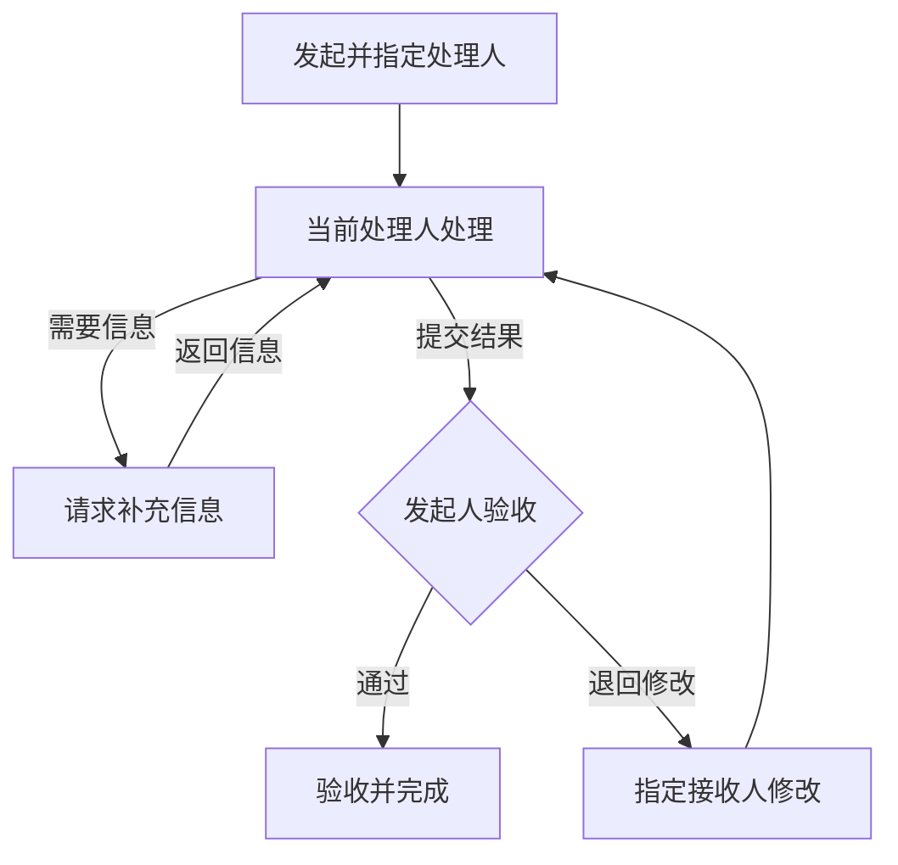
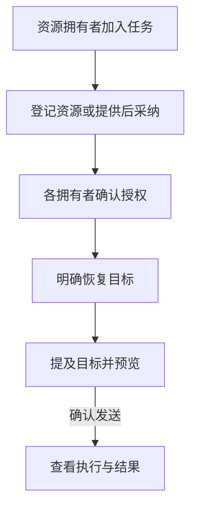

import { Callout } from "fumadocs-ui/components/callout";

**协作空间**集中展示当前账号参与的共享任务。它适合把一项工作交给其他团队的人，或让不同账号提供智能体一起处理。同一条任务保留统一的讨论、文件、交付结果和执行历史。

协作任务仍归属于创建时选择的**来源工作空间**，不会复制到接收人的工作空间。参与者获得的是这条任务的访问权限，不会因此加入来源工作空间，也不会获得资源拥有者其他工作空间的访问权限。

## 打开与查找

在全局导航中选择**协作空间**。这里有两个列表：

- **当前处理**：查看当前需要你处理的协作任务。
- **我参与的**：查看你参与的协作任务，包括已经转交给别人的工作。

通过**通知**查看协作动态，可以标为已读或归档；它与工作空间里的[收件箱](/inbox)分别展示。列表搜索只覆盖已经加载的任务，未找到时点击**加载更多**，再检查搜索结果。

没有加入任何工作空间的账号仍可访问已经共享给自己的任务；要发起新的协作任务，需要有可创建任务的来源工作空间。

## 创建协作任务

1. 点击**新建协作任务**，选择来源工作空间。
2. 填写标题和描述，说明目标、需要对方处理的内容和验收条件。
3. 选择接收人，也可以选择**分配给自己**。确认账号后再提交。
4. 按需要设置项目、优先级、日期等初始字段，附上本次需要共享的文件。
5. 选择 **AI 参与方式**，然后点击**创建协作任务**。

| 参与方式 | 行为 |
| --- | --- |
| **手动处理** | 通过评论、文件和交付结果协作，不接受新的 AI 输入或执行。 |
| **AI 辅助** | 可使用这条任务中已登记、已授权且允许执行的 AI 资源。 |

接收人来自**当前连接的服务器**。这不是跨服务器邀请。管理员限制账号目录后，列表可能只显示相关账号；仍可按完整用户名、邮箱或账号 ID 精确查找。

如果服务器尚未开放协作创建，创建会被拒绝。所选父任务仍在[分拣台](/triage)待审时，也不能在其下创建协作子任务；需要先接纳父任务，再重新创建。

## 处理、转交与补充信息

这张图按处理责任串起一次交付：信息不足时返回补充，有结果后交给发起人验收。

发起人同时也是处理人时，可以直接**记录结果并完成**。AI 执行成功不会代替验收；等待验收时，先处理当前结果，再进行受限的转交或状态操作。

打开任务后，先看当前处理人、所处阶段、描述和已有讨论。需要开始工作时选择**开始处理**。

- **添加参与者**：把需要共同讨论或提供资源的账号加入任务。
- **转交**：把处理责任交给另一位账号，并说明接下来需要做什么。
- **请求补充信息**：指定需要补充信息的人；对方处理后使用**返回信息**，继续原来的协作流程。
- **评论**：记录讨论、进展和判断依据。可以回复、回应或解决讨论。

**任务资料**区域的按钮会打开右侧面板：任务详情、文件、协作上下文、知识候选、子任务和活动都从这里查看。过程细节写在评论中；需要供下一位处理者接续的当前结论，整理到[协作上下文](/collaboration-knowledge)。

子任务的访问权限和 AI 执行各自独立，看到子任务引用不等于可以打开其详情。从来源工作空间打开协作任务时，同样要通过协作流程转交或完成，不能用普通任务的批量操作替代。

## 提交与验收结果

当前处理人完成工作后，选择**提交结果**，填写结果和判断依据；需要时选择已经共享的文件作为依据。发起人查看**交付结果**，可以：

- **验收并完成**：确认结果满足要求，结束任务。
- **退回修改**：说明原因并指定修改接收人，继续处理。

发起人同时也是处理人时，使用**记录结果并完成**。结果区保留历史提交、验收或退回决定及对应依据。等待验收期间，部分状态修改和转交操作受限，应先处理本次验收。

一次 AI 执行成功，只说明该次执行结束；任务是否完成仍以结果交付和验收为准。

## 共享文件

创建任务、发表评论或提交相关操作时，可以选择要共享的文件。单个文件最大 **100 MiB**，一次最多选择 **32 个文件**。

上传中的草稿文件尚未共享；随操作提交成功后，任务中有权限的人才能访问。删除评论或移除引用不会删除已经交付的文件。共享前检查所选文件，避免把无关材料或凭据附在任务中。

## 配置共享 AI 资源

AI 辅助任务使用自己的资源登记与授权。普通工作空间里的智能体可见范围，不能代替这条协作任务的授权。

从共享资源到实际执行，需要分别完成授权、恢复和发送确认。

采纳资源不等于授权，授权也不会自动恢复执行。重新授权或切换配置后，仍需明确恢复；普通评论不会自动变成 AI 指令。

1. 在任务的 **AI 执行**中打开**管理 AI 资源**。
2. 先邀请资源拥有者加入任务。发起人或当前处理人可选择资源工作空间，**添加 AI 目标**并登记智能体或 AI小队。
3. 资源拥有者也可以**提供资源**，由发起人或当前处理人**采纳资源**。
4. 每位资源拥有者分别核对并确认自己的资源授权。登记或采纳成功后，仍需这一步。
5. 授权齐全后，明确选择**恢复目标**或**恢复全部**，才会继续处理有效指令。

授权允许这条任务当前及以后加入的有权参与者使用相应资源的当前配置。AI小队包含多项资源时，分别检查各拥有者的授权状态。

<Callout type="warning">
**普通本机执行**使用所选运行环境的 AI 账号和工具权限，与普通任务相同。任务有独立会话和工作目录，但工作目录不是操作系统沙箱；智能体仍能访问普通配置允许的本机文件、账号和工具。资源拥有者应先核对授权面板中的执行方式与权限范围。
</Callout>

### 发送 AI 指令

在评论编辑器中使用**提及**选择已经登记的 AI 目标，输入要求，再通过**预览发送**检查这条消息会触发哪些目标，确认后发送。普通评论不会因为保存成功就代表 AI 已启动。

在 **AI 执行**中查看等待中的指令、执行组、具体运行和结果。等待指令可由指令作者、发起人或当前处理人取消；取消等待指令与停止已经开始的执行是两种操作。

### 停止、恢复与更换配置

**停止目标**和**恢复目标**会影响同一执行队列中的所有目标，操作前先核对队列范围。**停止全部**作用于这条任务的全部 AI 执行。停止会阻止所选范围继续派发，并请求结束已启动的受管理执行。

“停止请求已受理”仍需要执行端确认。运行时离线或连接中断时，本机执行可能仍在继续；查看最终状态，不能把断线当成已经停止。进程清理按普通任务机制进行，不保证清除已经脱离管理范围的后台程序。

资源拥有者可撤回自己的授权，阻止新执行并请求停止在途工作。等待指令和历史记录会保留。重新授权、从手动处理切回 AI 辅助或切换配置，都不会自动恢复执行。

修改智能体或运行时配置后，按页面提示由拥有者重新确认，或由发起人/当前处理人**提出配置切换**。需要切换时，先暂停目标，取得相关拥有者同意，并等待旧执行结束，再应用配置。新配置仍保持暂停，确认就绪后再恢复。

## 谁可以做什么

以下是通常的权限范围；具体按钮还取决于任务当前状态、授权和执行是否已结束。

| 身份 | 可以进行的主要操作 |
| --- | --- |
| 来源工作空间成员或有效任务参与者 | 查看共享任务、评论、回应和解决讨论。 |
| 有效任务参与者 | 控制共享 AI；在任务未结束且允许 AI 辅助时提交 AI 指令。 |
| 发起人或当前处理人，且仍为有效参与者 | 添加参与者、转交、编辑任务、请求补充信息；修改来源项目等结构还需来源工作空间成员权限。 |
| 当前补充信息接收人 | 返回请求的信息。 |
| 当前处理人，且不是发起人 | 提交结果供发起人验收。 |
| 发起人 | 移除参与者、改变 AI 参与方式、验收完成、取消或重新打开任务。 |
| 既不是发起人也不是当前处理人的参与者 | 离开这条任务。 |
| 资源拥有者 | 亲自授权或撤回自己的 AI 资源。 |

只属于来源工作空间、未加入任务参与者名单的人，可以查看和讨论，但不能控制共享 AI。复制任务链接不会自动授予权限。移除参与者会撤销其任务和资源权限、取消其等待指令，并请求停止相关在途执行。

## 操作结果尚未确认

断网或超时可能使客户端暂时不知道服务器是否已经处理请求。出现“待确认请求”时，使用页面提供的**查询原结果**或**重试原请求**；创建时对应**查询创建结果**和**重试原始创建**。

这些入口会保留原请求身份。先确认原结果，避免重复创建任务、重复转交或重复发送 AI 指令。显示明确拒绝原因后，再按提示修改草稿并重新提交。

## 接下来

- [协作上下文与知识](/collaboration-knowledge) — 交接当前状态，把可复用结论提交确认。
- [工作空间](/workspaces) — 理解来源归属与成员权限。
- [守护进程与运行时](/daemon-runtimes) — 检查执行机器的连接与能力。
