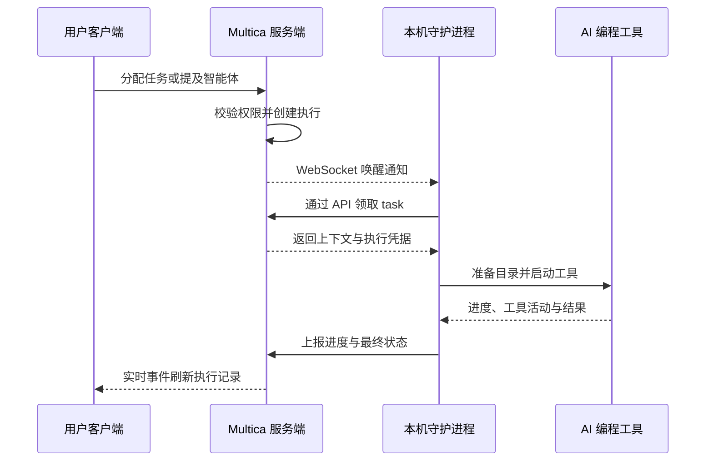

import { Callout } from "fumadocs-ui/components/callout";

把一个任务分配给智能体后，Multica 会创建一条执行任务，由连接电脑上的运行时领取。运行时调用本地 AI 编程工具，并把进度和结果写回原来的任务。

## 一次执行的完整链路

从一次新执行入队开始，服务端负责协调与记录，连接电脑上的守护进程负责准备和运行工具：

WebSocket 通知帮助运行时及时领取任务；断线重连后仍会查询和校准状态。工具返回结果不等于业务任务已验收完成。

1. **任务提供上下文。** 任务保存工作说明、讨论和负责人。分配给智能体后，系统会使用该智能体的指令、模型、skill 和运行时配置。
2. **Multica 创建执行任务。** 执行任务进入队列；没有在线运行时时，它会在队列中等待。
3. **运行时领取任务。** 连接电脑上的在线运行时领取任务，并调用智能体配置的 AI 编程工具。
4. **AI 编程工具在本地执行。** 工具读取工作目录、运行命令并生成结果。
5. **结果写回任务。** 进度、评论和结果显示在任务的时间线与执行日志中。

任务、智能体、执行任务和运行时的完整清单与关系，见[核心概念](/concepts)。

## 数据与执行的边界

| Multica | 连接的电脑 |
|---|---|
| 工作空间、任务、评论和状态 | AI 编程工具及其凭据 |
| 智能体配置与 skill | 代码目录和本地文件 |
| 执行任务的状态、执行记录和结果 | 实际的文件修改与命令执行 |

这条边界在 Multica Cloud 和自托管中相同。

<Callout type="warning">
保存到智能体 `custom_env` 或托管 MCP 配置中的内容会存放在 Multica 服务器端，执行时传给运行时。不希望离开你电脑的凭据，不要写进 `custom_env` 或托管 MCP 配置。具体规则见[环境变量与凭据](/agents-create#环境变量与凭据)和 [MCP 与能力市场](/mcp#权限与凭据)。
</Callout>

## 智能体的触发方式

智能体不会自己开始工作，每次执行都由一个明确的动作触发：分配任务、在评论中 @智能体、直接对话，或自动化。四种方式的选择和通用规则见[让智能体开始工作](/triggering-agents)。

## 执行结束与 issue 完成

执行日志显示"已完成"，只表示这一次执行已经结束。任务仍然可以继续讨论、补充要求或再次触发智能体。任务是否完成，以实际工作进展和它的状态为准。

## 接下来

- [守护进程与运行时](/daemon-runtimes) — 了解电脑如何连接 Multica，以及运行时上线、离线时会发生什么。
- [执行任务](/tasks) — 查看执行任务的状态、重试和取消规则。
- [分配任务给智能体](/assigning-issues) — 了解最常用的协作方式。
