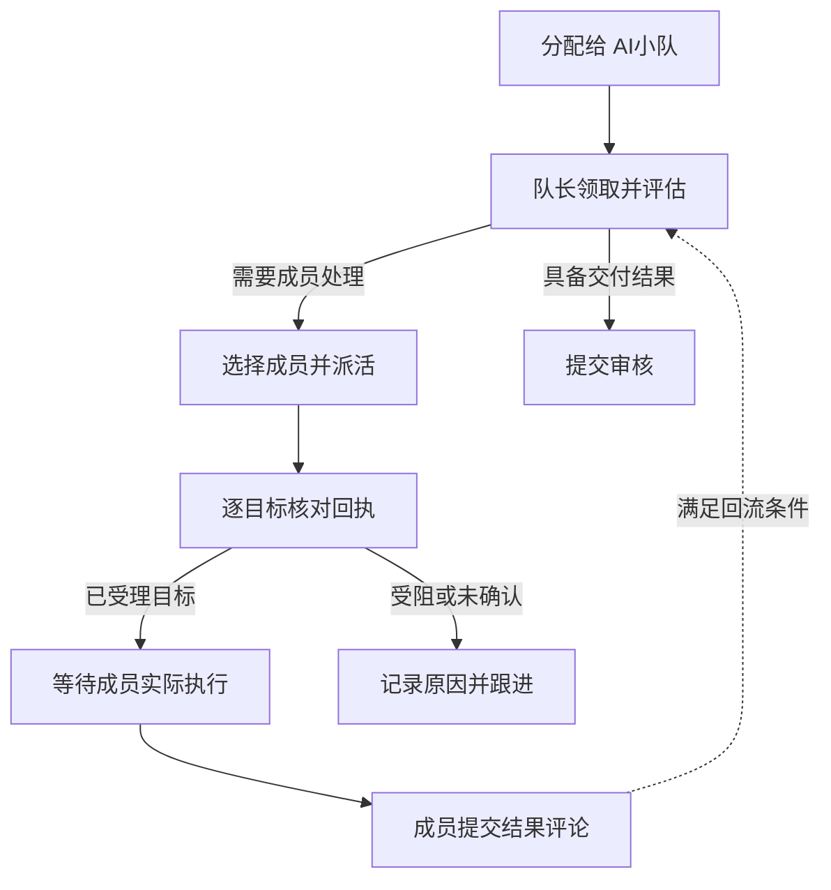

import { Callout } from "fumadocs-ui/components/callout";

小队由一名 leader 智能体和若干成员组成。把 issue 分配给小队后，不会同时运行所有智能体。Multica 会先唤醒 leader，由它阅读上下文并决定下一步交给谁。

小队解决的是把工作交给谁的问题。它不会把多个智能体合并成一个新的智能体，也不会自动提高并发。

## 从模板创建

打开 **AI小队 → 模板**，选择**应用到项目**，即可把工作流程用于新项目或已有项目。可以选择执行运行时，也可以稍后连接。内置九个模板：

| 模板 | 成员构成 | 路由依据 |
|---|---|---|
| **特性交付小队** | Lead、产品分析师、架构师、实现工程师、测试工程师、代码审查员 | issue 当前缺什么：验收标准、方案、改动、验证结果、审查 |
| **缺陷修复小队** | Lead、产品分析师、测试工程师、诊断工程师、实现工程师 | 定性、复现；原因未知时先诊断，再带回归测试修复、验证 |
| **合并门禁小队** | Lead、代码审查员、安全审查员、测试工程师、智能体评测工程师、体验验证工程师、迁移审查员 | 按变更范围核对代码、安全、测试、智能体行为、体验和迁移证据；必须修复的问题回到原作者 |
| **需求预研小队** | Lead、产品分析师、架构师 | 问题是「要不要做」还是「怎么做」；只产出结论，不写代码 |
| **文档小队** | Lead、技术文档工程师、代码审查员 | 已合并的变更要求哪一种文档：变更日志、API 文档、运维手册 |
| **例行维护小队** | Lead、安全审查员、诊断工程师、实现工程师、测试工程师 | 不稳定测试或升级失败原因未知时先诊断，再一次处理一项并验证 |
| **安全漏洞修复小队** | 队长、产品分析师、安全审查员、诊断工程师、实现工程师、测试工程师、迁移审查员、代码审查员 | 分诊依赖、代码和其他安全风险；代码漏洞先复现再修复；复现和修复之前、收口之前各由安全负责人放行一次；在非生产环境修复、独立验证，或交人工处理 |
| **发布小队** | Lead、发布工程师、测试工程师、技术文档工程师 | 发布前缺什么：回滚方案、验证、变更说明 |
| **事故响应小队** | Lead、产品分析师、实现工程师、发布工程师、测试工程师、诊断工程师 | 先止血；恢复后把独立根因后续任务交给诊断工程师 |

从模板创建会一次性建好花名册所需的[角色模板智能体](/agents-create#角色模板)、小队本身和成员关系。小队的运行方式不变：仍然由 leader 接收工作，并通过 @提及派活。诊断工程师只在确有未知失败时使用；成功的交付、审查和发布不需要额外经过诊断。

点击之前有三点需要知道：

- **已存在的角色会按原样复用。** 如果先创建了特性交付小队，再创建缺陷修复小队，两支小队用的是同一个实现工程师，包括你修改过的指令。创建第二支小队永远不会覆盖已有智能体。九个模板共用同一批角色，重叠的座位复用，不会重复创建。
- **新建智能体的 Access 默认是「仅自己」**，不会隐式放开。需要全队都能派活时，请选择工作空间范围。
- **发布小队和事故响应小队含发布工程师**，也就是 [Operator](/agents#自治等级与审批边界) 级角色。因此只有能授予 Operator 的调用者才能创建这两支小队：由智能体代为创建时，该智能体自身必须是 Operator（Coordinator 级的 leader 会被拒绝）。人来创建不受此限制。

如果工作空间里已有一个智能体占用了某个角色的默认名称，但它不是从该模板创建的，创建会中止并说明原因，而不是把一个来历不明指令的智能体纳入小队。请重命名，或手动创建小队。

Leader 的路由规则会复制到小队指令中，可以自行修改。Multica 的版本升级不会覆盖它。

## 安全漏洞修复

**安全漏洞修复小队**（`security-remediation`，版本 2）负责安全分诊，以及开发或测试环境中的修复。专用队长协调七个现有工作角色，最高自治等级为 Coordinator，不含 Operator。复用的角色保留已保存的指令、skill、运行时和 Access。

版本 2 在原有的分诊和路由上增加了三项约束：代码漏洞先复现再修复；复现和修复之前、收口之前各有一个由安全负责人放行的闸门；收口时逐项核对每个结论的来源和所针对的提交。

### 开始之前

处理第一条任务之前先确认下面几件事，缺一件流程都会停住。

**指定安全负责人。** 在小队详情页点**添加成员**，选一名工作空间成员，**角色**填"安全负责人"（也可以写 `security owner`）。可以添加多位，其中任何一位都能放行。小队里没有这样的成员时，由任务的创建者承担。自动化或智能体创建的任务没有人类创建者，这时队长会回复"小队缺少安全负责人"并停下。添加之后要在任务里评论并 `@` 这支小队，小队才会继续。能添加成员、改**角色**的只有工作空间的所有者、管理员和创建这支小队的人，安全负责人也就由他们指定。队长不会自己添加成员或改角色，需要调整时会请人来做。队长按**角色**是否包含这几个字认人，不会按完整词匹配；请直接填写"安全负责人"或 `security owner`，不要把"非安全负责人"、"安全负责人助理"等含有这些字的说明写给其他成员。

**确认安全负责人可以运行小队的智能体。** 模板新建的智能体，[Access](/agents#权限与-access) 默认是"仅自己"：只有所有者（建小队的人）可以运行，管理员也不行。安全负责人不是所有者时，放行不会生效：

- 评论里 `@小队`：评论照常发布，但提示小队未触发，原因是"找不到该目标，或你没有它的使用权限"。
- 不带 `@` 的评论：没有任何提示，也不会启动智能体。

要让其他人也能放行，有两种做法：

- **建小队时放开。** 在 AI小队页面点**新建AI小队**，再选**从模板创建**（工作空间里还没有小队时，页面上直接有**从模板创建**），把"谁可以把工作分配给这个AI小队"选为"工作空间全体成员"。在模板目录里点**应用到项目**建出的小队没有这个选项，智能体一律是"仅自己"。
- **建好之后放开。** 由所有者逐个打开小队里每个智能体的详情页，在**设置** > **访问权限**的"谁可以运行该智能体"里选"整个工作空间"，或选"指定成员"并勾选安全负责人，然后点**保存**；不保存不会生效。也可以在智能体列表里勾选这些智能体，点**设置访问范围**一次改完。队长和每名成员都要改，因为放行之后队长的每一次派活都按放行人的权限判断。被复用的已有智能体保留原来的设置，也要逐个检查。

向整个工作空间开放后，其他成员也能在所有者的运行时上运行这些智能体。只需要一两位负责人放行时，选"指定成员"。

**确认队长和成员已绑定可用的非生产运行时。** 队长未绑定运行时时，`@` 列表里即使显示这支小队，也不能选中；有权限不等于可以执行。先在智能体详情页配置运行时，并确认它在线。

**队长使用 Codex 运行时，先调大指令长度上限。** 不调大时队长读不到花名册和小队指令；指令要求它这时每一轮都停下，不派活。做法见[限制](#限制)。

### 流程

三类风险的步骤不同，代码漏洞的步骤最全：

| 步骤 | 内容 | 由谁推动下一步 |
|---|---|---|
| 受理 | 队长写分诊记录。当前生产可利用、凭据或客户数据暴露时不往下走，直接交人工 | 队长 |
| G1 | 队长用一条评论派出安全审查员，列出待决事项和自己的提议。改动影响 schema、API、已安装客户端或存储数据时，同时派出迁移审查员 | 安全负责人放行 |
| 复现 | 复现者写一个在基线提交上失败的测试 | 复现者交回结果 |
| 修复 | 实现工程师提交最小补丁，不修改复现测试 | 实现工程师交回结果 |
| 验证 | 小队里有漏洞验证成员时，先由它在修复提交上重跑复现测试；再由测试工程师验证原始风险并做回归 | 各自交回结果 |
| G2 | 队长用一条评论派出代码审查员和安全审查员，涉及迁移时加迁移审查员 | 安全负责人放行 |
| 收口 | 队长逐项对账，写证据总结，把任务交到审核中（`in_review`） | 人工验收后标为已完成（`done`） |

顺利时需要人做三件事：放行 G1，放行 G2，最后验收。出现下面的情况会多出人工步骤：G1 选了人工复现；两个闸门之外又要派审查员，例如修复到一半才发现涉及迁移；任何成员停止；安全负责人的结论与审查员的结果不一致。

闸门要由人放行，是因为三个审查员角色的评论不会启动任何智能体，也不会唤醒队长（见[角色模板](/agents-create#角色模板)和[队长的再次触发时机](#队长的再次触发时机)；被复用的旧版审查员除外，见[已有的小队](#已有的小队)）。审查结果出来后流程停在原地，等安全负责人读完再决定。产品分析师、诊断工程师、实现工程师和测试工程师交回结果后，队长会自己继续。

以上说的是任务分配给这支小队的情况。小队是被 `@` 进别人的任务时，成员的结果评论不会唤醒队长，队长也不会替安全负责人订阅任务或改任务状态：每一步交回结果之后，都要有人在任务里 `@` 小队，流程才会继续。要走完整流程，请把任务直接分配给小队。

另外两类风险与上表的差别：

| 风险类型 | 差别 |
|---|---|
| **依赖或组件漏洞** | 不写复现测试。安全审查员在 G1 给出可达性证据：实际解析到的版本、锁文件里的依赖路径、是否调用到受影响的函数。一次只修一个公告或依赖，保留锁文件和来源证据。没有安全且兼容的版本时暂停，交安全负责人。 |
| **其他安全风险** | 配置、供应链、构建产物、智能体、skill 与 MCP、运行边界。安全审查员在 G1 写明来源、信任边界和证据缺口，是否需要复现测试由安全负责人决定。缺证据时保持 `unknown`，写明补证负责人和下一步检查；不能读取真实密钥来补证。 |

原因或触发条件不清的代码漏洞，在 G1 之后、修复之前先交诊断工程师，诊断和实现由不同成员完成。范围或验收条件不清时，队长先请产品分析师澄清。

每个角色仍遵守自己的停止条件和审批边界。例如，诊断工程师发现安全缺陷或凭据暴露时会报告并交人工处理；队长必须尊重这一停止条件，不能直接继续派发实现。队长使用实际花名册中的精确成员提及链接，每轮只派一个下一步，闸门前的一批审查员算一个下一步。派活之后的回执核对和记录方式见[怎样判断派活是否成功](#怎样判断派活是否成功)。队长用其他角色的标题代写报告，不算独立审查。

### 放行

队长的闸门评论会写明：派出了哪些审查员，有哪些待决事项和队长的提议，每项可以选什么结论，由谁放行，怎样放行。

| 闸门 | 待决事项 | 可选结论 |
|---|---|---|
| G1：复现和修复之前 | 定级、处置、路由、期限、复现由谁承担、知情范围 | 处置：修复、不受影响（附理由和证据）、不修复、风险接受。复现：漏洞验证成员、人工独立复现、补丁作者自证、不适用 |
| G2：收口之前 | 复审结论、变体清单、回移范围 | 接受、退回（写明缺口）、风险接受 |

安全负责人先读审查员的结果，再用下面任意一种方式写结论：

1. 在这条任务里评论，输入 `@` 后从弹出的列表里选中这支小队。顶层评论和回复都可以。没有从列表里选中的名称和粘贴进来的"@小队名称"只是普通文字，不算提及；队长闸门评论里的小队名称也是普通文字，复制它没有用。
2. 发一条不带任何 `@` 的顶层评论。

例如，G1 用第一种方式：

> @安全漏洞修复小队 G1：定级 high；处置：修复；路由按提议；期限 12 月 18 日；复现由补丁作者自证；知情范围 normal。

G2 用第二种方式：

> G2：接受复审结论。变体清单确认，共两处。不需要回移。

最常见的错误是在队长评论所在的讨论线程里直接回复，又没有 `@` 小队。这种回复不一定到得了小队：讨论线程由智能体的评论开头时，它只交给那个智能体本身，队长这一轮拿不到花名册和小队指令，按版本 2 的指令只回一条评论说明正确的做法，流程不前进。只有讨论线程由人的评论开头、那条评论当初又交给了这支小队时，回复才会带着小队上下文到达队长。放行请用上面两种方式，不要依赖回复。

放行时还要注意：

- 第二种方式只在任务分配给这支小队时有效。小队是被 `@` 进别人的任务时，用第一种。
- 队长确认三件事之后才继续：结论出自安全负责人本人；这个闸门的每位审查员都交了晚于最近一次派出该审查员的评论的结果；每个待决事项都有结论，逐项写或写明"接受提议"都可以。G1 的旧结果、G2 退回前的结果、失败通知和进度评论都不能充当本次结果。不修复、风险接受和搁置还要写理由和复查日期。缺任何一项，队长会回评论说明缺什么。
- 放行评论要晚于每位审查员的结果，发出后直到队长明确确认本次放行通过校验之前，所有人都应保持它不变：编辑、添加或撤销表情回应、标记解决或设为结论、增删附件，都会增加评论的 `revision`，别人这样做也一样。校验时 `revision` 大于 1 的评论一律不算放行，即使正文和作者没有变。早于结果或改动过的评论，需要安全负责人读完结果后另发一条新评论，不能靠编辑原评论补正；普通回复、等待提示或被拒说明都不表示放行通过。队长可以在下一条派活、收口或移交评论里引用本次放行并确认校验结果，不需要另发一条确认评论。
- 放行之后迟迟没有回应，先按[开始之前](#开始之前)检查权限。
- 审查员一直没有交结果，或者讨论线程里出现一条以它的名义发出的失败通知时，照常 `@` 小队说明。队长会查执行记录：还在运行就说明在等谁；执行已结束却没有结果，或根本没有执行记录时，重派一次。每位审查员在每个闸门各有一次重派额度，临时审查点也各算一次；G2 退回后再审不会重置额度。再次失败就交安全负责人排除原因，不再自动重派。负责人不能跳过必需审查直接放行。审查员失败不会自动通知队长，失败通知也不算审查结果。
- 两个固定闸门之外的临时审查点，同样要满足上述三项校验并等本次审查结果。其他交给安全负责人决定的事（例如无法安全复现时是否依据静态证据继续），也只认负责人本人、未经改动的评论。

队长在发出第一条闸门评论之前，会替花名册里的安全负责人订阅这条任务，审查员交结果时安全负责人会收到通知。关闭了通知的人收不到，需要自己回来查看。

### 复现

修复代码漏洞之前先要有"最小安全复现"：仓库测试层的一个自动化测试，在记录的基线提交上因为安全属性被破坏而失败。它有四条边界：

- 只用本地测试夹具和合成数据，不出站，不接触真实凭据、生产或第三方系统。
- 证明可达且可触发就停，不做载荷串联、数据提取或持久化。内存破坏和远程执行类漏洞停在触发证据。
- 不产出可以脱离测试框架单独使用的攻击脚本。
- 补丁作者不得修改复现测试。

它是一个会失败的测试，不是漏洞利用。小队仍然不编写漏洞利用、攻击载荷或数据提取步骤。

由谁复现，安全负责人在 G1 决定：

| 承担者 | 条件 | 记录 |
|---|---|---|
| 漏洞验证成员 | 小队里有角色含"漏洞验证"的智能体，且它不是同一漏洞的补丁作者或复审者 | 独立复现 |
| 人工独立复现 | 小队里没有漏洞验证成员；安全负责人自己或指定的人完成，结果由安全负责人按[放行](#放行)的两种方式之一发评论交回 | 独立复现 |
| 补丁作者自证 | 小队里没有漏洞验证成员，安全负责人接受自证；实现工程师先提交失败的测试，再提交补丁，两个提交分开 | 标为"非独立复现" |
| 依据静态证据推进 | 无法安全复现，安全负责人决定继续 | 证据总结写明这一限制 |

只有独立复现才能把可利用性记为已证实。诊断工程师和测试工程师不承担修复前的复现：他们的角色规则要求遇到安全缺陷时停止并报告。测试工程师在修复后验证中发现安全缺陷仍未闭合时也要停止，队长不能改派另一人绕过这条规则。

### 漏洞验证座位

漏洞验证座位是试点。模板不包含它，花名册仍是七个工作角色。没有这个座位时，G1 在人工独立复现和补丁作者自证之间选。

需要独立复现，又不想每次都由人来做，可以自己加这个座位：

1. [创建一个智能体](/agents-create)，指令用下面的范本。手动创建的智能体没有自治等级，产品里目前也没有设置它的入口，所以范本里的边界只是写给它的要求，平台不会强制。
2. 在小队详情页点**添加成员**，选中这个智能体，**角色**填"漏洞验证"（也可以写 `vulnerability verification`）。
3. 确认安全负责人可以运行它，做法见[开始之前](#开始之前)。

```text
# 漏洞验证

你为安全漏洞修复小队写最小安全复现，并在修复提交上重跑它。你证明安全属性被破坏，不利用漏洞；不写补丁，也不评审补丁。

## 职责

- 写一个最小安全复现：仓库测试层的一个自动化测试，在委派评论给出的基线提交上因安全属性被破坏而失败。
- 列出同类写法清单：用了什么检索方式，命中了哪些位置，每处是否同样可达。
- 被要求时，在修复提交上重跑同一份测试并报告真实结果，不修改测试。

## 不负责的事项

- 写补丁或修改被测代码。发现补丁有问题时写进结果，由实现工程师处理。
- 评审补丁。你复现过的漏洞由别人复审。
- 越过止步点。证明可达且可触发即停；不做载荷串联、数据提取或持久化；内存破坏和远程执行类停在触发证据；不产出可脱离测试框架复用的攻击脚本。
- 接触真实环境。只用本地测试夹具和合成数据，不出站，不读取真实凭据、生产数据或第三方系统。
- 任何生产操作。只在开发和测试环境的隔离分支上提交。

## 输入

先读委派评论里的分诊记录、基线提交和停止边界，再读受影响的代码路径和附近的现有测试。委派评论要求只引用 `finding_id` 时，分支名、提交信息和测试名都不写能定位漏洞的细节。

## 交付格式

发布一条评论，不 @ 任何成员或智能体，依次写明：

- 复现：测试文件路径和测试名，基线提交，真实命令、退出码和失败输出。
- 同类写法清单：检索用的模式和目录，每处命中位置及是否同样可达。
- 修复后重跑（被要求时）：修复提交，真实命令和退出码。
- 未做的事：未运行、未读取或未验证的范围及原因。

## 完成标准

复现测试在基线提交上失败，失败原因是被报告的安全属性被破坏；结果里的命令、退出码和输出来自你实际执行的运行；清单写明了检索方式；重跑针对的是委派评论给出的修复提交。

## 需要人工介入的情况

- 复现需要真实凭据、生产数据、生产环境或第三方系统。
- 只有越过止步点才能证明问题。
- 无法安全复现。写明原因和已尝试的内容后停止。
- 发现当前生产可利用、凭据泄露或客户数据暴露的迹象。报告后停止。
```

这份范本只存在于文档里，不是内置角色，升级时不会自动更新。是否把它做成内置角色，要等真实使用的证据。

### 分诊记录和期限

队长在任务评论里维护一份分诊记录。每次更新都另发新评论，保留旧记录，不编辑以前的派活评论，避免取消或重新触发其中的执行。版本 1 的字段不变：风险类型、来源、受影响范围和版本、可达性、受影响资产、严重程度、可利用性、证据状态、生产影响、路由、禁止的动作和下一步负责人。版本 2 增加十二个字段：

| 字段 | 记录什么 |
|---|---|
| `finding_id` | 发现的编号：任务编号加 `-F` 和序号。与已有发现重复时注明原编号 |
| `cwe` | CWE 编号 |
| `severity_basis` | 定级依据：评分向量、可达性、受影响资产 |
| `exploit_maturity` | 外界是否已有利用：`none-known`、`poc-public`、`exploited-in-wild`、`unknown` |
| `disposition` | 处置：`under_investigation`、`affected`、`not_affected`、`fixed`、`risk_accepted`、`wont_fix` |
| `not_affected_reason` | 不受影响的理由，从五个固定值里选，例如 `vulnerable_code_not_in_execute_path` |
| `reproduction` | 复现方式：`independent`、`author-only`、`static-only`、`not-reproducible`、`pending`、`not-applicable` |
| `reproduction_ref` | 复现测试的路径和基线提交 |
| `fix_ref` | 修复提交 |
| `backport_range` | 需要带上修复的版本或分支 |
| `due` | 期限：日期、`next-regular-release` 或 `unset` |
| `disclosure` | 知情范围：`need-to-know` 或 `normal` |

这些字段只是评论里的证据记录，不新增任务状态、审批类型或权限。填写时有四条规则：

- `unknown` 不会被改写成不受影响。`not_affected` 只能来自安全负责人在 G1 的结论，并附理由和证据。
- `fixed` 只在 G2 接受之后填，并写明修复提交。
- `risk_accepted` 和 `wont_fix` 要有安全负责人写明的理由和复查日期。
- `exploitability` 记本项目里是否已证实可利用，`exploit_maturity` 记外界是否已有利用。两者分开填，互不推导。

默认期限从 G1 确认定级起算：

| 严重程度 | 默认期限 |
|---|---|
| critical | 7 天 |
| high | 30 天 |
| medium | 90 天 |
| low | 随常规版本 |

队长按表提出期限，安全负责人在 G1 确认或改写。严重程度未知时没有默认期限，由安全负责人给。当前生产已可利用的情形不走这张表，直接交人工和事故响应。期限只是分诊记录里的一行，不会写入任务的截止日期。

这些数值取自常见做法，不出自某一项标准，也不构成合规建议。需要不同的期限时，在小队详情页的**指引**标签页修改小队指令里的这张表。队长自己的指令里也有一份，两份不一致时以小队指令为准。

### 证据、变体和保密

- **结论绑定提交。** 每项结论都写明所针对的提交。修复提交在验证或复审之后变了，旧结论作废，要在新提交上重做对应步骤。
- **收口对账。** 队长的收口总结逐项列出每个结论的来源评论、作者和所针对的提交：复现、修复、修复后验证、回归、每位审查员的结论，以及安全负责人在 G1 和 G2 的结论。对应不到确定提交的结论，或作废后没有重做的结论，不出具通过。成员的陈述与原始命令输出不一致时，队长标出差异，以原始输出为准。
- **变体。** 复现者列出同类写法的清单，G2 的审查员核对它是否完整。安全负责人在 G2 确认后，队长为每个变体建一个不指派的任务，状态为待规划（`backlog`），标题只写发现编号加序号。变体不并入当前补丁。小队是被 `@` 进别人的任务时只列清单，不建任务。
- **保密。** 知情范围为 `need-to-know` 时，修复发布之前，小队写出的分支名、提交信息、PR 标题与描述、派生任务的标题和描述只引用 `finding_id`，不写能定位漏洞的细节。任务评论里的证据一律脱敏。对外披露（公告、编号申请、通知上游或客户）只出草稿，由人发布。

交付需保留受影响性结论、来源与文件/版本证据、最小变更、无修复时失败的回归测试、实际命令与结果、兼容性证据、回滚限制和残余风险。父任务交到审核中（`in_review`），已完成（`done`）留给人工确认或既有集成。确实没有下一步需要派发时，最终评估才记为 `no_action`。

当前部署已可利用、生产已受影响、凭据或客户数据暴露，或没有安全兼容的修复方案时，停止本地修复，把证据交给人工及事故响应或发布流程。生产发布、线上迁移、凭据读取或轮换、外部通知和不可逆删除仍需逐项审批。小队不编写漏洞利用载荷，也不执行这些操作。

可恢复的阻塞排除后，由安全负责人另发未经改动的新评论，写明原阻塞如何解除、证据和允许的非生产下一步，并按[放行](#放行)的方式唤醒小队。队长重新核对安全边界和所需闸门，停止条件仍在就不恢复；这条评论不能覆盖成员自己的停止规则，也不能把已交事故响应、需要真实凭据或第三方系统的操作重新交回本地执行。

### 限制

- **放行依赖人。** 审查结果出来之后，没有安全负责人的评论，流程不会前进。安全负责人不在时任务停在闸门，状态保持进行中（`in_progress`）。
- **没有任务级可见性控制。** 能读这条任务的人都能读到评论。保密要求只约束小队自己写出的内容；需要更严格的知情范围时，由安全负责人决定是否把细节放到任务之外。
- **保密要求不管推送。** `need-to-know` 只约束名称和文字。复现测试和补丁是仓库分支上的提交，推送之后谁能读由仓库权限决定。仓库对知情范围以外的人可读时，`need-to-know` 挡不住复现测试在修复发布之前被读到，请先准备只有知情者可读的仓库或分叉。
- **隔离来自部署。** "不出站"和"不接触真实凭据"是写给智能体的要求，不是网络或文件系统限制。模板不会增加[文件系统沙箱](/security-model)，请把小队的智能体放在受限的非生产运行时上。
- **通知可能没开。** 替安全负责人订阅任务这一步失败时不阻塞闸门，关闭了通知的人也收不到提醒。
- **安全负责人的指定靠指令约束。** 平台允许队长管理小队成员、修改小队指令；指令要求队长不这样做，但这不是平台限制。小队详情页的成员列表显示当前谁是安全负责人。

<Callout type="warning">
队长使用 Codex 运行时，要先调大 Codex 的指令长度上限，否则队长读不到花名册和小队指令。
</Callout>

按默认花名册和最小任务上下文测得，版本 2 队长与版本 2 小队生成的指令文件为 79,766 字节（约 80 KB），依次是队长自己的指令、小队工作规范、花名册和小队指令，后面还有平台的通用说明。实际任务和工作空间配置可能让它更长。Codex 默认只读取前 32 KiB，花名册和小队指令落在被丢弃的部分。请在守护进程所在机器的 Codex 配置文件里加一行。配置文件默认是 `~/.codex/config.toml`；守护进程的环境里设置了 `CODEX_HOME` 时，是那个目录下的 `config.toml`。这一行要写在文件里所有 `[...]` 表之前：

```toml
project_doc_max_bytes = 131072
```

- 这是临时配置方式，对之后启动的任务生效，不需要重启守护进程；守护进程目前不会按实际注入长度自动调大这个值。已有同名根级配置时修改原值，不要重复添加；大于示例的配置无需调小。
- `131072` 是 128 KiB 的示例预算，不是所有小队都够用的固定值。按实际生成的 `AGENTS.md` 的 UTF-8 字节数留足余量；仓库或父目录还有额外指令时，也要计入总读取预算。
- 开始工作前，核对新任务的 `CODEX_HOME/config.toml` 已保留根级 `project_doc_max_bytes`，并检查所用 Codex 版本是否报告指令截断。不要为排查配置而复制或公开凭据。
- 没有调大时，版本 2 的指令要求队长回复"本轮指令不完整"并停下，不带着残缺的指令派活。这只是模型需要遵守的停止规则，不能保证运行时一定拒绝残缺指令。
- 这条检查靠小队指令的最后一节"最终证据"判断指令是否完整。修改小队指令时请保留这一节，并让它留在最后。
- 依据是 Codex 的公开源码，以及对组合后指令长度的一次手工测量；Multica 的自动化测试只覆盖配置文件的复制和指令里这条停止规则的存在。没有用真实的 Codex 运行验证过，其他运行时的指令长度上限也没有核对。

### 已有的小队

升级 Multica 不会改动已经建好的小队和智能体，它们的指令是创建时复制的副本。

| 工作空间里的情况 | 结果 |
|---|---|
| 升级前建的安全漏洞修复小队 | 继续按版本 1 运行 |
| 没有这位队长，升级后新建小队 | 队长指令和小队指令都是版本 2 |
| 已有版本 1 的队长，升级后再新建一支小队 | 新小队复用这位队长：小队指令是版本 2，队长指令仍是版本 1 |

第三种情况下，闸门和复现规则随小队指令生效，但旧队长指令只写"每轮只派一个下一步"，没有把闸门前的一批审查员算作一步，审查员可能被逐个派出，放行次数随之变多。旧队长指令也没有"直接回复不算放行"这条规则：在以队长评论开头的讨论线程里直接回复、又没有 `@` 小队时，队长拿不到小队指令，只按版本 1 的指令行事，闸门规则对这一轮不起作用。这种组合用 Codex 运行时又没有调大上限时，小队指令会从"人工闸门"一节的中段被截断，放行条件和复现边界都读不到；小队指令开头的检查要求队长回复"本轮指令不完整"并停下。请先按[限制](#限制)调大上限。

被复用的旧版审查员（代码审查员 v1、安全审查员 v1、迁移审查员 v1 或 v2）不受[受限角色模板](/agents-create#角色模板)的限制，它们的评论仍会唤醒队长。队长按指令不把智能体的评论当作放行，闸门照样等安全负责人。

要让已有的小队完整用上版本 2，需要手工替换两份指令：

- **小队指令。** 在 AI小队页面点**新建AI小队**，选**从模板创建**，新建一支安全漏洞修复小队，从它的**指引**标签页复制全文，粘贴到原小队的**指引**标签页并保存。也可以直接改用新建的这支小队：它和原小队共用同一位队长，下面的队长指令一步仍然要做。新建时给它起一个不同的名称，免得放行时 `@` 错小队。
- **队长指令。** 产品里目前没有查看队长模板正文的入口。在一个还没有这位队长、并且有你能使用的在线运行时的工作空间里从模板建一支小队，打开新队长的详情页，在**能力**标签页的**指令**里复制"系统指令"的全文，粘贴到原队长的同一处并保存。

改过的指令不会自动合并。替换前先保存自己的改动，再逐条并入新版本。

普通升级仍可交例行维护小队，普通缺陷交缺陷修复小队，已完成的改动交合并门禁审查；安全漏洞修复小队围绕安全发现串起这些修复和审查步骤。版本 2 的流程已通过指令契约检查和脚本化场景：场景由测试代码扮演每个角色，验证的是平台在每一步把控制权交给指令预期的人。真实模型是否按指令行事仍未验证，这套流程也不构成合规结论。请使用受限的非生产运行时，并由人核对证据。

## 适用场景

当工作需要多种能力，而且不能在创建 issue 时就确定具体负责人，可以使用小队。例如，一个产品交付小队可以包含前端、后端和测试智能体，由 leader 根据每条 issue 的内容进行分配。

工作范围明确时，直接分配给对应的[智能体](/agents)即可。

## 小队的组成

| 配置 | 作用 |
|---|---|
| **leader** | 必须是一名智能体。接收分配给小队的工作，并决定如何处理。 |
| **成员** | 可以是智能体，也可以是人类成员。同一成员可以加入多个小队。 |
| **角色说明** | 告诉 leader 每个成员适合处理什么工作。它只是上下文，不会授予权限或自动触发成员。 |
| **小队指令** | 保存路由规则、协作方式和需要贯穿全队的背景，只会提供给 leader。 |

创建小队时需要填写名称并选择 leader。小队 leader 会自动成为成员；之后可以继续添加成员、填写角色说明和小队指令。

## 分配后的执行流程

非 backlog 状态的 issue 分配给小队后，Multica 会立刻给**队长智能体**入队一个 task（不是给每个成员都入一个）。先看队长与成员如何分轮协作：



已受理表示入队、合并或延后，不代表成员已经开始或完成。结果回流仍受权限、评论路由和角色限制；受限审查员的评论不会自动唤醒队长。具体步骤如下：

1. **队长的运行时领走 task**，和普通智能体的分配流程一样。
2. **队长拿到 briefing。** 领走的瞬间，Multica 会在队长的指令后面追加三段内容，见下文[队长每次执行看到的内容](#队长每次执行看到的内容)。
3. **队长发一条派活评论并检查回执。** 评论里用花名册中的 mention markdown `@` 选中成员，随后逐一核对派发是否被受理。评论保存成功本身不代表成员已经开始工作。
4. **队长记录 evaluation**：`multica squad activity <issue-id> <outcome> --reason "..."`。这一行会写进任务的动态时间线，记录本次判断及派发结果。部分成员未被受理时，要写清成功的部分和仍需处理的目标。
5. **派活轮让父 issue 处于 `in_progress`。** 和直接分配给智能体同一套状态约定：协调小队就是在推进父 issue 本身的工作，所以父 issue 从 `todo` 进入 `in_progress`；派活不等于交付，小队干活期间保持不变。
6. **队长停下。** 派完活，队长不亲自动手。被派成员在同一任务中的结果评论可按下文的[再次触发规则](#队长的再次触发时机)唤醒队长，决定下一步：继续派活、上抛给人类、在整体目标达成后把父任务推到 `in_review`，或保持沉默。`done` 留给人工确认或既有集成（例如带 close intent 的 PR merge）。

拆成子任务的工作通过阶段屏障交接。子任务进入 `in_review` 表示已交付、等待验收，还不会关闭阶段。最早未完成阶段的全部子任务都进入 `done` 或 `cancelled` 类别后，符合现有路由条件的父任务智能体或小队队长才可能被唤醒。父任务仍在待办池、已经关闭或分配给人时，不会唤醒智能体。未设置阶段时，全部子任务视为一组。智能体的一次执行结束，不会自动改变这些任务状态。

如果 issue 仍在 `backlog`，分配本身不会触发队长。移出 `backlog` 后才会开始执行。

### 怎样判断派活是否成功

队长通过 CLI 派活时，会请求 JSON 输出并检查 `trigger_outcomes`，按类型和准确 ID 匹配每一个目标；提及 AI小队时匹配的是小队 ID。

- `queued`、`coalesced`、`deferred` 表示触发已入队、合并或延后处理，只能证明派发已受理，不能证明执行已开始或已经交付。
- 被阻止、缺失或无法识别的回执表示该目标尚未确认。只做派活的轮次，所有目标都被受理才记为 `action`；否则记为 `failed`，在原因中注明部分成功和未确认的目标。
- 响应丢失时，先检查评论是否保存，不要重复发送同一条派活评论。重新读取已保存评论不能找回原始派发回执，应保留不确定性，由有权限的人继续核查执行记录。

检查小队进展时，应同时看队长的评估、成员的执行记录和交付内容，不能仅凭一条派活评论判断工作已经完成。

### 队长每次执行看到的内容

每次队长被触发，三段内容会附加到它的指令上：

- **Squad Operating Protocol（小队工作规范）**——一段硬编码的规则集：读 issue → 用 `@` 派活 → 保持简洁（不复述 issue 内容，被派的成员自己能读）→ 每次记 evaluation → 派完就停（派活轮结束时父 issue 处于 `in_progress`）→ 整体目标达成后才推 `in_review`。这段由系统管理，不可编辑。

  其中状态相关的规则只对"确实分配给本小队"的 issue 生效。队长被别人 issue 里的 `@小队` 唤醒时，同样拿到花名册和派活规则，但会被明确告知不要改动那条 issue 的状态——状态仍归它自己的负责人。
- **Squad Roster（小队花名册）**——队长一行 + 每个未归档成员一行，每行带可直接复制的 mention markdown（`[@Name](mention://agent/<uuid>)`）。纯文本 `@name` 不会触发任何人。
- **Squad Instructions（小队指令）**——你为这个小队写的自定义内容：路由规则（"数据库相关派给 Alice，前端派给 Bob"）、上报策略，或 issue 本身不会有的背景。

## 队长的再次触发时机

以 `/note` 开头的评论只留记录，不启动智能体。其他评论先按明确目标和线程上下文路由，再考虑负责人兜底。以下以任务仍分配给该小队为前提，触发仍须满足权限与运行条件：

| 评论内容或位置 | 执行者 |
|---|---|
| 显式 `@智能体` 或 `@小队`，包括同时带有 `@all` | 只按点名目标处理，不额外唤醒未被点名的原队长。 |
| 没有点名智能体或小队，但含有 `@成员` 或 `@all` | 不启动智能体，也不走队长兜底。 |
| 人类成员发表不带上述路由提及的顶层评论 | 队长可作为负责人接手。 |
| 工作智能体发表不带上述路由提及的结果评论 | 可唤醒队长，继续协调下一步。 |
| 队长以队长身份发表、不带上述路由提及的评论 | 不会自触发。 |
| 人类成员回复已有评论，且不带上述路由提及 | 优先交给被回复的智能体或线程中承接对话的智能体，不保证唤醒队长；没有智能体承接的成员间回复不会仅因小队负责就启动执行。 |

任务互链不算路由提及。对同一智能体的重复目标会去重，连续评论也可能合并到同一次执行。线程路由、触发预览和合并规则见[在评论中提及智能体](/mentioning-agents)。

部分[受限角色模板](/agents-create#角色模板)有额外边界：代码审查员 v2、安全审查员 v2、迁移审查员 v3 和进展报告员 v2 的评论不会自动触发智能体，也不会唤醒队长。这些角色提交结果后，由人工或既有有权主体决定后续推进，不适用表中的一般结果回流规则。

<Callout type="info">
显式提及优先的规则同样适用于智能体的结果评论：如果结果里 `@` 了另一名智能体，工作直接交给它，原队长不会额外被唤醒。需要原队长参与时，明确 `@` 原队长或当前小队。
</Callout>

## 分配小队和 @小队

| 操作 | 是否改变负责人 | 结果 |
|---|---|---|
| **把 issue 分配给小队** | 是 | 小队成为负责人，并触发 leader。 |
| **在评论中 @小队** | 否 | 只让 leader 处理这条评论，原负责人不变。 |

直接 @某名成员时，工作会交给该成员处理。Multica 也会合并重复触发并阻止 leader 的评论再次触发自己，避免形成执行循环。

## 小队与 Access

把智能体加入小队不会绕过它的 [Access](/agents#权限与-access)。普通成员创建或管理小队时，只能选择自己有权运行的智能体。

成员能否分配或 @某个小队，也取决于其是否有权运行小队的 leader。若 leader 已归档，或当前成员无权运行它，这个小队就无法被分配或 @提及。

## 创建与管理权限

任何工作空间成员都可以创建小队。创建者可以修改和归档自己创建的小队；工作空间 `owner` 和 `admin` 可以管理所有小队。

小队名称不要求在工作空间中唯一。更换 leader 时，新 leader 会自动加入小队；当前 leader 不能直接移除，需要先指定另一名 leader。

## 归档小队

归档后，小队会从列表、负责人选择器和 @菜单中消失，也不能恢复。

为避免现有工作失去负责人，当前分配给小队的 issue 和自动化会转给原 leader 智能体。历史评论和活动记录仍然保留。如果之后还需要相同的路由，需要重新创建小队。

<Callout type="warning">
归档操作无法撤销。
</Callout>

## 使用 CLI

```bash
multica squad create --name "Product Delivery" --leader delivery-lead
multica squad member add <squad-id> \
  --member-id <agent-or-member-id> \
  --type agent \
  --role "负责前端实现"
```

完整命令见 [使用 CLI](/cli)。

## 接下来

- [分配 issue 给智能体](/assigning-issues) — 比较成员、智能体和小队负责人。
- [在评论中提及智能体](/mentioning-agents) — 了解 @提及的触发与路由规则。
- [执行任务](/tasks) — 查看每一次智能体执行如何排队和记录。
